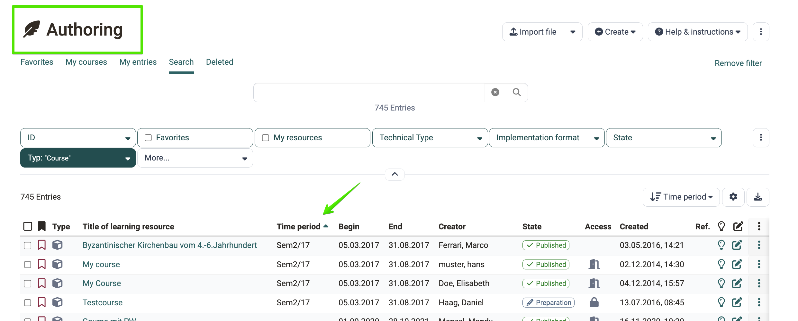

# Module Time periods {: #zeitabschnitte}

## Time periods help with filtering and sorting [:octicons-tag-16:{ title="from Release 20.3 (OO-9218)" }](https://track.frentix.com/issue/OO-9218){:target="_blank"}

If you plan courses in semesters, school years or quarters, set up these periods once, centrally, as time periods. Authors then choose a time period as the execution period of their course instead of entering the begin and end one by one, and the course lists can be sorted by the time period.

Administrators switch on the "Time periods" module and set up the time periods there. You find it in the system administration under: 
`Administration > Modules > Time periods`

{ class="shadow lightbox" title="Time periods page in the Modules menu" }

The "#Uses" column shows how many learning resources use the time period. Use the tabs "All", "Relevant", "Default" and "Past" to restrict the list.

The time periods appear in the course lists as the column "Time period" and can be sorted there, for example in the [Authoring area](../../manual_user/area_modules/Authoring.md):

{ class="shadow lightbox" title="Search tab in the Authoring area" }

## Switching the module on and off {: #module_switch}

The switch Module "Time periods" decides whether courses can choose a time period as their execution period. If your organisation works without semesters or quarters, switch the module off and still see the begin and end of the courses in all lists.

If the module is switched on:

- This page shows the list of time periods and the button "Add time period".
- For the execution period of a course, the option "Time period" is available, in the [course settings in the "Execution" tab](../../manual_user/learningresources/Course_Settings_Execution.md#execution_period) and when creating a course.
- The course lists offer the columns "Time period" and "Time period desc." under "Customize columns", for example in the ["Courses"](../../manual_user/area_modules/Courses.md) menu, in the Authoring area, in the [catalog](../../manual_user/area_modules/catalog2.0_sort_offers.md#sorting_microsites_button) in the table view and in the Course Planner in the "Content" tab of an implementation.
- In lists that filter by a period, the time periods are available as a period to choose.

If the module is switched off, none of this appears. The columns "Begin" and "End" remain available under "Customize columns" in all course lists, because they show the execution period of the course and do not depend on the module. [:octicons-tag-16:{ title="from Release 20.3.9 / 21.0.3 (OO-9295)" }](https://track.frentix.com/issue/OO-9295){:target="_blank"}

Persons who are currently logged in only see a change of the switch after their next login.

As long as a learning resource uses a time period, the module cannot be switched off. The switch stays on "On", and OpenOlat reports: "The module cannot be switched off as there are resources that use the time periods." The "#Uses" column shows which time periods are in use.

## Create and edit a time period

Click "Add time period" to create a time period. Use the pencil symbol in the row to edit an existing time period.

{ class="shadow lightbox" title="Dialog Add time period" }

The dialog contains the following fields:

Field | Meaning
---------|----------
Time period | Short label, for example "HS26". Mandatory entry, maximum 64 characters.
Description | Full name, for example "Autumn semester 2026". Optional, maximum 250 characters.
Begin | Start date of the time period.
End | End date of the time period.
Set as default for courses | The time period is preselected when a learning resource is created. There is only ever one default: setting it removes the mark from the previous default.

!!! info "Important"
    The short label in the "Time period" field is the mandatory entry. You may leave the "Description" field empty. Lists that sort by the description place entries without a description at the end.

!!! note "Time period in the course"
    How authors select a time period as the execution period of a course. 
    [Execution period in the course >](../../manual_user/learningresources/Course_Settings_Execution.md)

---

## Further information {: #further_information}

**Mentioned on this page** 
[Authoring - Overview >](../../manual_user/area_modules/Authoring.md) 
[Course Settings - Tab Execution >](../../manual_user/learningresources/Course_Settings_Execution.md) 
[Finding courses >](../../manual_user/area_modules/Courses.md) 
[Catalog 2.0 - Sorting/order >](../../manual_user/area_modules/catalog2.0_sort_offers.md)

**Further reading** 
[Module Taxonomy >](Modules_Taxonomy.md) 
[Module Catalog >](Modules_Catalog_2.0.md)

[To the top of the page ^](#zeitabschnitte)
