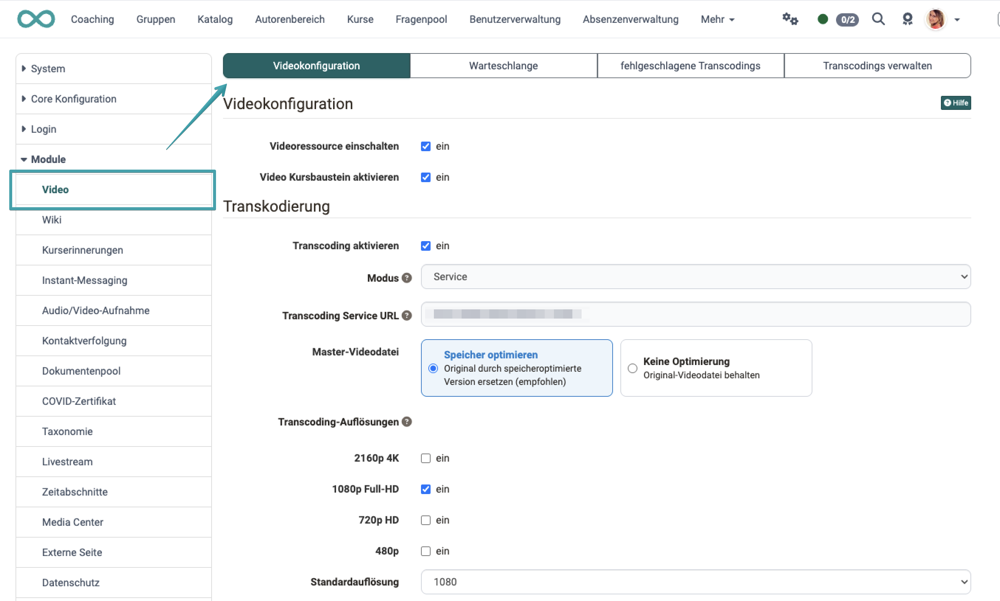
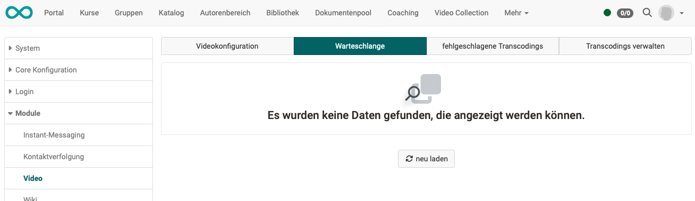
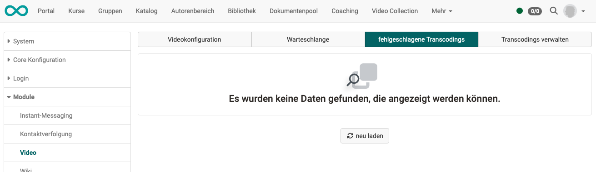
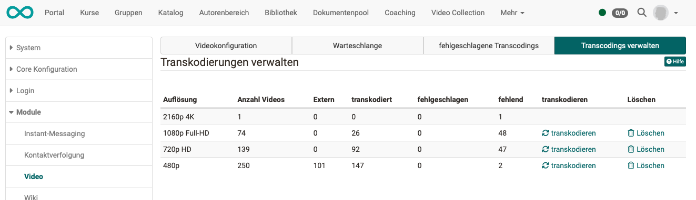

# Modul Video {: #module_video}

Mit dem Modul Video legen Sie als Systemadministrator:in fest, ob Autor:innen Videos als Lernressource anlegen und im Kurs einsetzen können und in welchen Auflösungen OpenOlat hochgeladene Videos bereitstellt. Sie konfigurieren das Modul in der System-Administration unter: 
`Administration > Module > Video`

Im Tab "Videokonfiguration" legen Sie fest,

- ob Videoressourcen in der OpenOlat-Instanz zugelassen sind. Das betrifft Videos, die im Autorenbereich als Lernressource gelistet sind. Direkt verlinkte Videos, etwa in einer HTML-Seite, sind davon nicht betroffen.
- ob Autor:innen den Kursbaustein "Video" verwenden dürfen.
- ob OpenOlat hochgeladene Videos transkodiert, in welchen Auflösungen, und ob die Master-Videodatei durch eine speicheroptimierte Version ersetzt wird, um Speicherplatz zu sparen.

Der frentix Cloud-Transcodingservice kann beim Transkodieren zusätzlich automatisch Untertitel (Transkripte) für Videos erzeugen [:octicons-tag-16:{ title="ab Release 20.2.6 (OO-9347)" }](https://track.frentix.com/issue/OO-9347){:target="_blank"}. Die Funktion ist Teil des frentix Cloud-Service. Details dazu finden Sie im Benutzerhandbuch auf der Seite [Lernressource: Video](../../manual_user/learningresources/Learning_resource_Video.de.md#video_subtitles_auto).

!!! info "frentix-Kund:innen"

    Bei frentix-Kund:innen übernimmt die zuständige Kundenberatung bei frentix die Aktivierung.

!!! info "Wichtig"

    Wird der frentix Cloud-Transcodingservice genutzt, wird die lokale Audio- und Video-Konvertierung deaktiviert.  Sind weder der frentix Cloud-Transcodingservice noch die lokale Audio- und Video-Konvertierung aktiv, liegt es in der Regel daran, dass HandBrake oder ffmpeg nicht gefunden oder gestartet werden konnten.

## Tab Videokonfiguration {: #video_config}

Im Tab "Videokonfiguration" schalten Sie Videoressource und Kursbaustein ein und richten die Transkodierung ein. Die Felder zur Transkodierung erscheinen, sobald "Transcoding aktivieren" eingeschaltet ist.

Unter "Master-Videodatei" wählen Sie, ob OpenOlat die hochgeladene Originaldatei behält ("Keine Optimierung") oder durch eine speicheroptimierte Version ersetzt ("Speicher optimieren"). Gibt es bereits Videos, deren Master-Videodatei sich optimieren lässt, nennt OpenOlat beim Umstellen deren Zahl und ersetzt sie erst nach Ihrer Bestätigung. Wer die Originaldatei eines Videos behalten möchte, speichert sie vor dem Hochladen lokal.

{ class="shadow lightbox" title="Tab Videokonfiguration im Modul Video" }

### Transcoding-Modus {: #transcoding_mode}

Bei eingeschalteter Transkodierung legen Sie im Feld "Modus" fest, wo OpenOlat die Videodateien umwandelt [:octicons-tag-16:{ title="ab Release 20.2.2 (OO-9141)" }](https://track.frentix.com/issue/OO-9141){:target="_blank"}.

| Modus | Bedeutung |
|-------|-----------|
| **Lokal** | Die Umwandlung läuft auf dem OpenOlat-Server. Das Feld "HandBrakeCLI" zeigt den Pfad zum verwendeten Programm. |
| **Service** | Die Umwandlung übernimmt ein externer Transcodingservice. Seine Adresse tragen Sie im Feld "Transcoding Service URL" ein, die Angabe ist zwingend. |

Legt die Serverkonfiguration fest, dass ein externer Prozess die Videos umwandelt, etwa weil das Transcoding-Verzeichnis ausserhalb des OpenOlat-Datenbereichs liegt, gilt der Modus "Remote". Er erscheint als reine Textanzeige und lässt sich nicht umstellen.

Die automatische Untertitelgenerierung steht im Modus "Service" in Verbindung mit dem frentix Cloud-Transcodingservice zur Verfügung.

### Transcoding-Auflösungen {: #transcoding_resolutions}

Für neu hochgeladene Videodateien erzeugt OpenOlat transkodierte Dateien in den ausgewählten Auflösungen. Standardmässig ist "1080p Full-HD" die einzige ausgewählte Auflösung und zugleich als "Standardauflösung" gesetzt [:octicons-tag-16:{ title="ab Release 20.3.0 (OO-9187)" }](https://track.frentix.com/issue/OO-9187){:target="_blank"}. Jede zusätzlich eingeschaltete Auflösung erzeugt eine weitere Videodatei pro Video. Fehlende Auflösungen bereits vorhandener Videos erstellen Sie im Tab ["Transcodings verwalten"](#manage_transcodings).

### Gesperrte Transcoding-Einstellungen {: #transcoding_readonly}

!!! info "frentix-Kund:innen"

    Bei frentix-Kund:innen übernimmt die zuständige Kundenberatung bei frentix die Änderung.

Die Serverkonfiguration kann die Felder "Modus", "Transcoding Service URL" und "HandBrakeCLI" gegen Änderungen sperren [:octicons-tag-16:{ title="ab Release 20.2.4 (OO-9242)" }](https://track.frentix.com/issue/OO-9242){:target="_blank"}. Gesperrte Felder lassen sich nicht bearbeiten und tragen den Hinweis "Diese Einstellung wird durch die Datei olat.local.properties gesteuert.". Die Sperre ist Teil der Serverkonfiguration und gilt nach einer Änderung erst ab dem nächsten Neustart.

## Tab Warteschlange [:octicons-tag-16:{ title="ab Release 11.1 (OO-2361)" }](https://track.frentix.com/issue/OO-2361){:target="_blank"} {: #pending_transcodings}

Im Tab "Warteschlange" sehen Sie, welche Videos noch auf ihre Transkodierung warten, mit ID, Name, Ersteller, Erstellungsdatum, Dimension, Grösse und Format. Mit "Löschen" in der Spalte "Aktion" entfernen Sie eine Transkodierung aus der Warteschlange, mit "neu laden" aktualisieren Sie die Liste.

{ class="shadow lightbox" title="Tab Warteschlange im Modul Video" }

## Tab Fehlgeschlagene Transcodings [:octicons-tag-16:{ title="ab Release 11.3 (OO-2483)" }](https://track.frentix.com/issue/OO-2483){:target="_blank"} {: #failed_transcodings}

Im Tab "Fehlgeschlagene Transcodings" finden Sie die Transkodierungen, die nicht gelungen sind. Die Spalte "Ursache des Fehlers" nennt den Grund: "Stammdatei beschädigt", "Schlechte Qualität" oder "Zeitüberschreitung". Mit "erneut transcodieren" starten Sie die Transkodierung noch einmal, mit "Löschen" entfernen Sie sie.

{ class="shadow lightbox" title="Tab Fehlgeschlagene Transcodings im Modul Video" }

## Tab Transcodings verwalten {: #manage_transcodings}

Im Tab "Transcodings verwalten" sehen Sie je Auflösung, wie viele Videos es gibt und wie viele davon "Extern", "Transkodiert", "Fehlgeschlagen", "Optimiert" oder "Fehlend" sind. Gezählt werden je Auflösung die Videos, deren Originalhöhe mindestens dieser Auflösung entspricht. Als "Extern" zählen Videos, die über eine URL eingebunden sind. Mit "Transkodieren" erstellt OpenOlat die fehlenden Videodateien einer Auflösung, mit "Löschen" entfernen Sie alle transkodierten Videodateien dieser Auflösung.

{ class="shadow lightbox" title="Tab Transcodings verwalten im Modul Video" }

## Weiterführende Informationen {: #further_information}

**Auf dieser Seite erwähnt** 
[Lernressource: Video >](../../manual_user/learningresources/Learning_resource_Video.de.md)

**Weiterführend** 
[Modul Audio-/Video-Recording >](Modules_Audio_Video_Recording.de.md) 
[Kursbaustein "Video" >](../../manual_user/learningresources/Course_Element_Video.de.md)

[Zum Seitenanfang ^](#module_video)