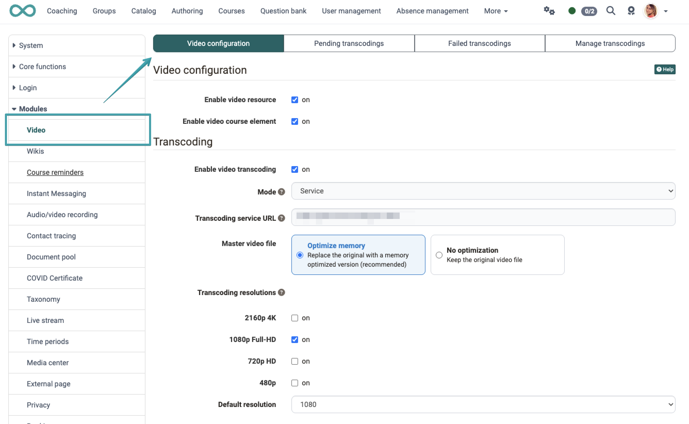
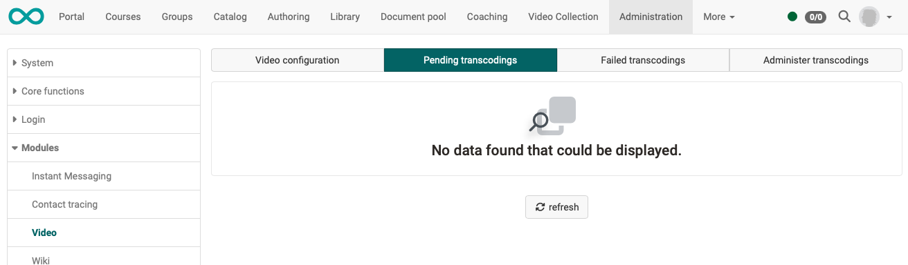
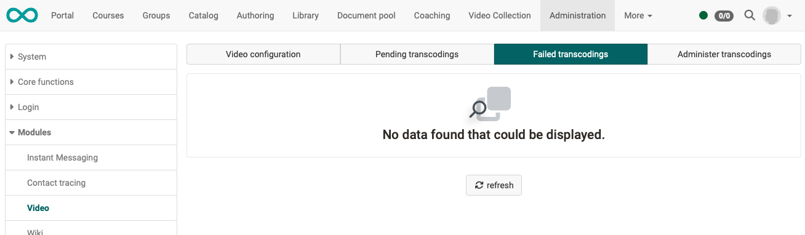
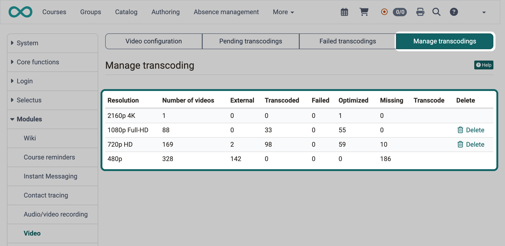

# Module Video {: #module_video}

With the Video module, as a system administrator you decide whether authors can create videos as learning resources and use them in courses, and in which resolutions OpenOlat provides uploaded videos. You configure the module in the system administration under: 
`Administration > Modules > Video`

In the "Video configuration" tab you decide

- whether video resources are permitted in the OpenOlat instance. This concerns videos that are listed in the authoring area as learning resources. Directly linked videos, for example in an HTML page, are not affected.
- whether authors may use the course element "Video".
- whether OpenOlat transcodes uploaded videos, in which resolutions, and whether the master video file is replaced with a memory optimized version to save storage space.

The frentix cloud transcoding service can also automatically generate subtitles (transcripts) for videos during transcoding [:octicons-tag-16:{ title="from Release 20.2.6 (OO-9347)" }](https://track.frentix.com/issue/OO-9347){:target="_blank"}. The function is part of the frentix cloud service. For details, see the page [Learning resource: Video](../../manual_user/learningresources/Learning_resource_Video.md#video_subtitles_auto) in the user manual.

!!! info "frentix customers"

    For frentix customers, their customer advisor at frentix takes care of the activation.

!!! info "Important"

    If the frentix cloud transcoding service is used, local audio and video conversion is deactivated.  If neither the frentix cloud transcoding service nor the local audio and video conversion are active, it is usually because HandBrake or ffmpeg could not be found or started.

## Tab Video configuration {: #video_config}

In the "Video configuration" tab you enable the video resource and the course element and set up transcoding. The transcoding fields appear as soon as "Enable video transcoding" is switched on.

Under "Master video file" you choose whether OpenOlat keeps the uploaded original file ("No optimization") or replaces it with a memory optimized version ("Optimize memory"). If there are already videos whose master video file can be optimized, OpenOlat states their number when you switch and only replaces them after your confirmation. If you want to keep the original file of a video, store it locally before uploading.

{ class="shadow lightbox" title="Video configuration tab in the Video module" }

### Transcoding mode {: #transcoding_mode}

When transcoding is switched on, the "Mode" field determines where OpenOlat converts the video files [:octicons-tag-16:{ title="from Release 20.2.2 (OO-9141)" }](https://track.frentix.com/issue/OO-9141){:target="_blank"}.

| Mode | Meaning |
|------|---------|
| **Local** | The conversion runs on the OpenOlat server. The "HandBrakeCLI" field shows the path to the program used. |
| **Service** | An external transcoding service handles the conversion. Enter its address in the "Transcoding service URL" field, this entry is mandatory. |

If the server configuration specifies that an external process converts the videos, for example because the transcoding directory is located outside the OpenOlat data area, the "Remote" mode applies. It appears as plain text only and cannot be changed.

Automatic subtitle generation is available in "Service" mode in combination with the frentix cloud transcoding service.

### Transcoding resolutions {: #transcoding_resolutions}

For newly uploaded video files, OpenOlat generates transcoded files in the selected resolutions. By default, "1080p Full-HD" is the only selected resolution and is also set as "Default resolution" [:octicons-tag-16:{ title="from Release 20.3.0 (OO-9187)" }](https://track.frentix.com/issue/OO-9187){:target="_blank"}. Each additional resolution switched on generates a further video file per video. You create missing resolutions of existing videos in the ["Manage transcodings"](#manage_transcodings) tab.

### Locked transcoding settings {: #transcoding_readonly}

!!! info "frentix customers"

    For frentix customers, their customer advisor at frentix takes care of the change.

The server configuration can lock the fields "Mode", "Transcoding service URL" and "HandBrakeCLI" against changes [:octicons-tag-16:{ title="from Release 20.2.4 (OO-9242)" }](https://track.frentix.com/issue/OO-9242){:target="_blank"}. Locked fields cannot be edited and carry the note "This setting is controlled by the olat.local.properties file.". The lock is part of the server configuration and only takes effect after the next restart once it has been changed.

## Tab Pending transcodings [:octicons-tag-16:{ title="from Release 11.1 (OO-2361)" }](https://track.frentix.com/issue/OO-2361){:target="_blank"} {: #pending_transcodings}

In the "Pending transcodings" tab you see which videos are still waiting for their transcoding, with ID, name, creator, creation date, dimension, size and format. With "Delete" in the "Action" column you remove a transcoding from the queue, with "refresh" you update the list.

{ class="shadow lightbox" title="Pending transcodings tab in the Video module" }

## Tab Failed transcodings [:octicons-tag-16:{ title="from Release 11.3 (OO-2483)" }](https://track.frentix.com/issue/OO-2483){:target="_blank"} {: #failed_transcodings}

In the "Failed transcodings" tab you find the transcodings that did not succeed. The "Reason of failure" column states the reason: "Master file damaged", "Poor quality" or "Timeout". With "Re-transcode" you start the transcoding again, with "Delete" you remove it.

{ class="shadow lightbox" title="Failed transcodings tab in the Video module" }

## Tab Manage transcodings {: #manage_transcodings}

In the "Manage transcodings" tab you see per resolution how many videos there are and how many of them are "External", "Transcoded", "Failed", "Optimized" or "Missing". Per resolution, the table counts the videos whose original height is at least this resolution. Videos included via a URL count as "External". With "Transcode", OpenOlat creates the missing video files of a resolution, with "Delete" you remove all transcoded video files of this resolution.

{ class="shadow lightbox" title="Manage transcodings tab in the Video module · 2026.11.27" }

## Further information {: #further_information}

**Mentioned on this page** 
[Learning resource: Video >](../../manual_user/learningresources/Learning_resource_Video.md)

**Further reading** 
[Module Audio/Video Recording >](Modules_Audio_Video_Recording.md) 
[Course Element "Video" >](../../manual_user/learningresources/Course_Element_Video.md)

[To the top of the page ^](#module_video)