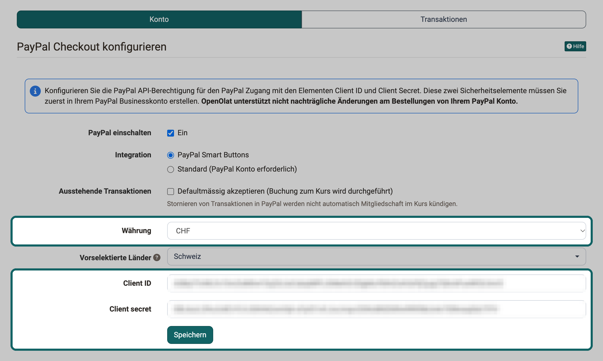

# PayPal Konfiguration {: #PayPal}

Mit dem Bezahlungsmodul PayPal bieten Autor:innen Kurse und Gruppen kostenpflichtig an. Ihre Kund:innen bezahlen dabei mit Kreditkarte oder direkt über PayPal. Ein eigenes PayPal-Konto ist für Ihre Kund:innen nicht zwingend nötig. Die Kontoangaben von PayPal, die OpenOlat für alle Bezahlungen verwendet, hinterlegen Systemadministrator:innen in der PayPal-Konfiguration der System-Administration.

Für die Bezahlung über PayPal brauchen Sie ein PayPal-Geschäftskonto. Ein solches Konto erstellen Sie bei PayPal ohne weitere Kosten. In Ihrem PayPal-Konto erstellen Sie anschliessend eine API-Berechtigung. Sie besteht aus der "Client ID" und dem "Client secret" (Schlüssel). Beide Werte hinterlegen Sie in der PayPal-Konfiguration von OpenOlat, damit OpenOlat die Bezahlungen Ihrer Kund:innen auf Ihr Konto abwickelt. Weiter unten finden Sie die Schritte dazu.

## Verwendung in Kursen und Gruppen

Sollen Teilnehmende einen Kurs oder eine Gruppe erst nach der Bezahlung nutzen, richten Sie dort ein Angebot mit der Angebotsart "PayPal Checkout" ein. Diese Angebotsart steht zur Wahl, sobald das PayPal-Modul konfiguriert ist. Bei einem Kurs finden Sie die Angebote unter: 
`Kurs > Administration > Einstellungen > Tab "Freigabe"` 
Bei einer Gruppe finden Sie sie unter: 
`Gruppe > Administration > Tab "Freigabe"` 
Weitere Informationen finden Sie unter [Zugangskonfiguration / Freigabe](../../manual_user/learningresources/Access_configuration.de.md).

!!! info "Wichtig"
    Je nach Währung, Land und Betrag verlangt PayPal eine Transaktionsgebühr. Sie beträgt ca. 5 % des Betrags und wird vom Betrag abgezogen.

[Zum Seitenanfang ^](#PayPal)

---

## PayPal API Berechtigung erstellen

Damit OpenOlat Bezahlungen auf Ihr Konto abwickelt, legen Sie zuerst in Ihrem PayPal-Geschäftskonto die Verbindung an und tragen danach die zwei Werte daraus in OpenOlat ein.

!!! note "Hinweis"
    Bitte berücksichtigen Sie, dass wir keine Anleitung für Drittanbieter pflegen. Die folgenden Schritte dienen zur Orientierung. Eine Schritt-für-Schritt-Anleitung bietet Ihnen möglicherweise die Hilfe von PayPal.

- [x] Melden Sie sich in Ihrem PayPal-Geschäftskonto an.
- [x] Richten Sie eine Onlinezahlung in Ihrem Geschäftskonto ein.
- [x] Lassen Sie sich eine API-Berechtigung ausstellen.
- [x] Speichern Sie die Client ID und das Client secret.
- [x] Stellen Sie sicher, dass die richtige Währung eingestellt ist.
- [x] Tipp: 
a) "Zahlungseingänge in einer anderen Währung zulassen und umrechnen in Schweizer Franken". 
b) "Doppelte Zahlungen sollten sie vermeiden".
- [x] Melden Sie sich nun mit einem Konto mit der Rolle Systemadministrator:in in OpenOlat an. 
a) Klicken Sie in der Hauptnavigation auf "Administration". 
b) Klicken Sie links in der Navigation auf "Bezahlungsmodule" und dann auf "PayPal". Der Tab "Konto" mit dem Formular "PayPal Checkout konfigurieren" ist geöffnet. 
c) Setzen Sie bei "PayPal einschalten" das Häkchen "Ein". Erst danach zeigt das Formular die übrigen Felder. 
d) Wählen Sie bei "Integration" die Option "PayPal Smart Buttons". Nur mit dieser Option bezahlen Käufer:innen mit Kreditkarte, ohne ein PayPal-Konto zu eröffnen. 
e) Wählen Sie die "Währung" und geben Sie anschliessend die "Client ID" sowie das "Client secret" (=Schlüssel) ein, die Sie zuvor zwischengespeichert haben. Klicken Sie danach auf "Speichern".

{ class="shadow lightbox" title="Formular PayPal Checkout konfigurieren im Tab Konto · 2026.11.02" }

### Weitere Einstellungen im Formular {: #further_settings}

Zwei weitere Felder im Formular "PayPal Checkout konfigurieren" sind optional. Mit ihnen legen Sie fest, wann Käufer:innen den Zugang erhalten und für welches Land PayPal die Bezahlung anzeigt:

* **Ausstehende Transaktionen**: Manche Zahlungen meldet PayPal zuerst als ausstehend, zum Beispiel weil PayPal sie noch prüft. Mit dem Häkchen "Defaultmässig akzeptieren (Buchung zum Kurs wird durchgeführt)" erhalten Käufer:innen den Zugang zum Kurs oder zur Gruppe bereits in diesem Zustand. Ohne Häkchen erhalten sie den Zugang erst, wenn PayPal die Zahlung abschliesst. Wird eine Zahlung später in PayPal storniert, beendet OpenOlat die Mitgliedschaft nicht von selbst.
* **Vorselektierte Länder**: Mit "PayPal Smart Buttons" zeigt PayPal die Bezahlung für eine Sprache und ein Land an. Enthält die Spracheinstellung von Käufer:innen kein Land, wählt OpenOlat das erste Land aus dieser Liste, das zur Sprache passt. Ist kein Land gewählt, leitet OpenOlat das Land aus der Spracheinstellung ab. [:octicons-tag-16:{ title="ab Release 15.3.8 (OO-5200)" }](https://track.frentix.com/issue/OO-5200)

[Zum Seitenanfang ^](#PayPal)

---

## Weiterführende Informationen {: #further_information}

**Auf dieser Seite erwähnt** 
[Zugangskonfiguration / Freigabe >](../../manual_user/learningresources/Access_configuration.de.md)

**Weiterführend** 
[Bezahlungsmodule: Übersicht >](Payment_modules.de.md) 
[Angebotsarten >](../../manual_user/learningresources/Offer_Types.de.md) 
[Angebotskonzepte >](../../manual_user/basic_concepts/Offer_Concepts.de.md)

[Zum Seitenanfang ^](#PayPal)