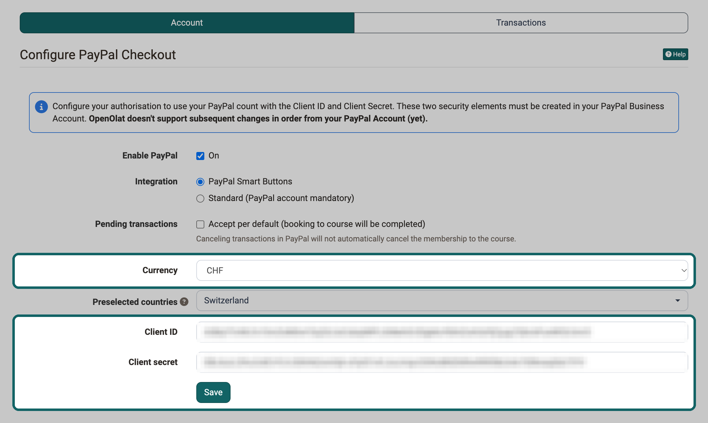

# PayPal Configuration {: #PayPal}

With the PayPal payment module, authors offer courses and groups for a fee. Your clients pay by credit card or directly via PayPal. Your clients do not necessarily need a PayPal account of their own. System administrators store the PayPal account details that OpenOlat uses for all payments in the PayPal configuration of the system administration.

To accept payments via PayPal, you need a PayPal business account. You can create such an account at PayPal at no cost. In your PayPal account you then create API credentials. They consist of the "Client ID" and the "Client secret" (key). You enter both values in the PayPal configuration of OpenOlat so that OpenOlat processes your clients' payments to your account. The steps are described below.

## Usage in courses and groups

If participants should only use a course or a group after payment, set up an offer with the offer type "PayPal Checkout" there. This offer type is available as soon as the PayPal module is configured. For a course, you find the offers under: 
`Course > Administration > Settings > Tab "Share"` 
For a group, you find them under: 
`Group > Administration > Tab "Share"` 
You will find more information under [Access configuration](../../manual_user/learningresources/Access_configuration.md).

!!! info "Important"
    Depending on the currency, the country and the amount, PayPal charges a transaction fee. It is about 5 % of the amount and is deducted from the amount.

[To the top of the page ^](#PayPal)

## Create the API Credentials

For OpenOlat to process payments to your account, you first set up the connection in your PayPal business account and then enter the two values from it in OpenOlat.

!!! note "Note"
    Please note that we do not maintain instructions for third-party providers. The following steps are meant for orientation. A step-by-step guide may be available in the PayPal help.

- [x] Log in to your PayPal business account.
- [x] Set up online payments in your business account.
- [x] Obtain API credentials.
- [x] Save the Client ID and the Client secret.
- [x] Make sure the correct currency is set.
- [x] Tip: 
  a) "Allow incoming payments in another currency and convert to Swiss francs." 
  b) "Avoid duplicate payments."
- [x] Now log in to OpenOlat with an account that has the system administrator role. 
  a) Click "Administration" in the main navigation. 
  b) Click on "Payment modules" in the navigation on the left, then on "PayPal". The "Account" tab with the "Configure PayPal Checkout" form is open. 
  c) Tick "On" next to "Enable PayPal". Only then does the form show the other fields. 
  d) Select the option "PayPal Smart Buttons" for "Integration". Only with this option can buyers pay by credit card without opening a PayPal account. 
  e) Select the "Currency" and then enter the "Client ID" and the "Client secret" (=key) that you stored earlier. Then click "Save".

{ class="shadow lightbox" title="Configure PayPal Checkout form in the Account tab · 2026.11.02" }

[To the top of the page ^](#PayPal)

---

## Further information {: #further_information}

**Mentioned on this page** 
[Access configuration >](../../manual_user/learningresources/Access_configuration.md)

**Further reading** 
[Payment modules: Overview >](Payment_modules.md) 
[Offer types >](../../manual_user/learningresources/Offer_Types.md) 
[Offer concepts >](../../manual_user/basic_concepts/Offer_Concepts.md)

[To the top of the page ^](#PayPal)