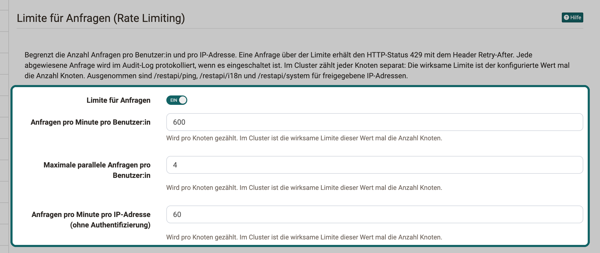

# REST API {: #REST-API}

!!! info "frentix-Kund:innen"
    Bei frentix-Kund:innen übernimmt die zuständige Kundenberatung bei frentix diese Konfiguration.

Andere Systeme wie eine Schülerverwaltung, eine externe Kursverwaltung oder eine externe Verwaltung von Lerngruppen tauschen ihre Daten über die REST API mit OpenOlat aus. Die REST API ist eine Programmierschnittstelle nach dem Architekturstil Representational State Transfer. Über sie verwalten diese Systeme Benutzer:innen und Lerngruppen, importieren Kurse, stellen Kataloge zusammen oder legen viele Objekte auf einmal an, ohne dass jemand diese Schritte in der Benutzeroberfläche ausführt.

Die REST API schalten Sie in der System-Administration mit dem Schalter "REST API Zugang" ein und aus, unter: 
`Administration > Core-Konfiguration > REST API`

Die Seite REST API steht Systemadministrator:innen zur Verfügung. Sie hat zwei Tabs:

* **"Konfiguration"**: die REST API ein- und ausschalten, den Zugriff festlegen und die Links zur Dokumentation öffnen, dazu die Abschnitte "Limite für Anfragen (Rate Limiting)", "Audit-Log" und "Managed Objekte".
* **"Audit-Log"**: die protokollierten Aufrufe der REST API auswerten, siehe [Audit-Log](#audit-log).

{ class="shadow lightbox" title="Tab Konfiguration der Seite REST API · 2026.10.20" }

[Zum Seitenanfang ^](#REST-API)

---

## Konzept {: #concept}

REST ist ein Architekturstil, der meist mit dem HTTP-Protokoll arbeitet, aber nicht darauf beschränkt ist. Mit HTTP nutzt REST dessen Mittel: URIs beschreiben die Ressourcen, die HTTP-Methoden wirken als "Verben" auf sie (GET ruft eine Ressource ab, PUT erstellt eine neue, POST ändert eine bestehende, DELETE löscht sie), HTTP-Header und Medientypen legen das Format des Inhalts fest.

Die REST API von OpenOlat folgt dem Standard Jakarta RESTful Web Services (JAX-RS). Als Implementierung setzt OpenOlat [Apache CXF](https://cxf.apache.org/) ein.

### API-Schlüssel für REST-Zugriff [:octicons-tag-16:{ title="ab Release 18.1.0 (OO-7290)" }](https://track.frentix.com/issue/OO-7290)

Für den Zugriff auf die REST API steht ein dedizierter API-Schlüssel zur Verfügung. Er ist ein automatisch erzeugtes, langes und damit starkes Passwort und kann deshalb auch dann verwendet werden, wenn für die Anmeldung in der Benutzeroberfläche Passkey oder eine Zwei-Faktor-Authentifizierung (2FA) vorausgesetzt wird.

Der API-Schlüssel wird wie das OpenOlat-Passwort verschlüsselt gespeichert. Er wird nur einmal bei der Erzeugung angezeigt und kann danach nicht erneut abgerufen werden. Geht der Schlüssel verloren, muss er gelöscht und ein neuer erzeugt werden.

Der API-Schlüssel kann nicht zur Anmeldung in der OpenOlat-Webanwendung verwendet werden; er ist ausschliesslich für den Zugriff auf die REST API gültig. Unabhängig davon bleibt der Zugriff über eine gültige Sitzung (Session) möglich, etwa um per JavaScript auf die Kursdatenbank zuzugreifen.

API-Schlüssel werden in der Benutzerverwaltung erzeugt, mit der Schaltfläche "API-Key hinzufügen" im Tab "Authentifizierungen" eines Kontos, siehe [Kontoeinstellungen verwalten](../usermanagement/Configure_User.de.md): 
`Benutzerverwaltung > Konto öffnen > Tab "Authentifizierungen"`

Soll es auch Benutzer:innen erlaubt sein, selbst einen Schlüssel zu erzeugen, aktivieren Sie die Option "Erzeugen von API Key durch Benutzer:in" (standardmässig deaktiviert): 
`Administration > Core-Konfiguration > REST API > Tab "Konfiguration"`

!!! info "Wichtig"

    Solange die Passkey-Funktion nicht aktiviert ist, kann für den REST-Zugriff weiterhin das OpenOlat-Passwort verwendet werden.

### Zugriff auf Benutzer:innen mit API-Schlüssel beschränken [:octicons-tag-16:{ title="ab Release 20.1.0 (OO-8745)" }](https://track.frentix.com/issue/OO-8745)

Ist die REST API aktiviert, kann sie grundsätzlich von allen Benutzer:innen mit einer authentifizierten Sitzung verwendet werden. Häufig soll der Zugriff jedoch auf bestimmte Personen beschränkt bleiben.

Wer die REST API nutzen darf, legen Sie mit der Auswahl "API Zugriff" fest, unter: 
`Administration > Core-Konfiguration > REST API > Tab "Konfiguration"`

* **für alle Benutzer:innen**: der Zugriff steht allen authentifizierten Personen offen.
* **nur für Benutzer:in mit API Key**: der Zugriff ist auf Personen mit einem API-Schlüssel beschränkt.

In Kombination mit der Erzeugung der Schlüssel ausschliesslich durch die Benutzerverwaltung lässt sich der Zugriff auf die REST API so gezielt einzelnen Personen gewähren.

[Zum Seitenanfang ^](#REST-API)

---

### Benutzung {: #usage}

Die REST API von OpenOlat ist für externe Verwaltungsanwendungen gebaut. Sie enthält nicht alle Funktionen der Benutzeroberfläche, und viele Anfragen sind administrativen Benutzer:innen vorbehalten, etwa Administrator:innen, Benutzerverwalter:innen, Gruppenverwalter:innen und Autor:innen.

Zu den Hauptfunktionen der REST API gehört beispielsweise das Erstellen und Organisieren von Benutzer:innen, Kursen, Gruppen, Organisationen, Produkten (curriculum) oder Kalenderereignissen (Events).

Anwesenheitskontrollen (Roll Call) liest die REST API, durchführen kann sie sie nicht: Anwesend oder abwesend lässt sich für eine Person darüber nicht setzen. Änderbar sind das Benachrichtigungsdatum an die Aufsicht, der Kommentar und der Grund.

Technisch liesse sich auf der REST API eine eigene Benutzeroberfläche aufbauen. Dafür ist sie aber nicht gedacht.

Ist die Limite für Anfragen eingeschaltet, weist die REST API zu viele Aufrufe mit dem Status 429 ab. Ein Fremdsystem, das viele Aufrufe in Serie sendet, muss dann warten und den Aufruf erneut senden, siehe [Limite für Anfragen](#rate-limit).

[Zum Seitenanfang ^](#REST-API)

---

## Sicherheit {: #security}

Die REST API prüft jede Anfrage in zwei Stufen:

  1. Die erste Stufe ist ein Servletfilter, der alle Anfragen an die REST API entgegennimmt. Er entscheidet, ob eine URI für alle offen ist (`/api`, `/ping`, `/auth`…) oder eine Authentifizierung braucht. Die Authentifizierung selbst übergibt der Filter einem Web Service.
  2. Die zweite Stufe greift bei jedem Aufruf der REST API. Jede Methode prüft, ob die Benutzer:in (sofern eine Authentifizierung nötig ist) genügend Rechte für die betreffende Ressource hat.

Damit eine Authentifizierung über mehrere Anfragen gültig bleibt, unterstützt der Filter zwei Methoden:

  1. Verwenden Sie das Session Cookie bei jeder Anfrage wieder. Der Vorteil dieser Methode ist, dass OpenOlat nicht mit jeder Anfrage eine neue Sitzung erstellen muss.
  2. Wenn Sie kein Session Cookie benutzen, dann fügt der Filter immer einen HTTP Header (`X-OLAT-TOKEN`) der Antwort hinzu. Senden Sie dieses Token mit der nächsten Anfrage, um Ihre Rechte zu behalten.

### Bewährte Vorgehensweise

Setzt die REST API spezifische Funktionen in der Benutzeroberfläche von OpenOlat um, etwa die Kursdatenbank, verwendet sie das Websession-Cookie von OpenOlat wieder (Methode 1). Die Benutzer:in ist im Browser bereits authentifiziert.

Nutzt eine externe, serverbasierte Applikation die REST API, empfiehlt sich "Basic Authentication", dazu eingeschaltete Session Cookies im HTTP-Client der externen Applikation.

Sind diese beiden Wege nicht möglich, benutzen Sie Methode 2 mit dem `X-OLAT-TOKEN`. Eine Benutzer:in hat zu jedem Zeitpunkt nur ein `X-OLAT-TOKEN`. Stellt Ihre externe Applikation mehrere Anfragen gleichzeitig, benutzen Sie deshalb "Basic Authentication".

Bauen Sie ein externes Portal mit einem eigenen Single-Sign-on-Prozess, kann Ihr Server mit Methode 2 für jede Benutzer:in ein `X-OLAT-TOKEN` anfordern. Das Token hängen Sie an jeden Link im Portal an (`?X-OLAT-TOKEN=xyz`). Klickt die Benutzer:in auf den Link, erkennt OpenOlat sie am Token und erstellt eine gültige Sitzung. Sicherheitstechnisch gibt es bessere Wege zum selben Ergebnis: Wir empfehlen OAuth, das OpenOlat ebenfalls unterstützt.

[Zum Seitenanfang ^](#REST-API)

---

## Limite für Anfragen [:octicons-tag-16:{ title="ab Release 21.1.0 (OO-9779)" }](https://track.frentix.com/issue/OO-9779){:target="_blank"} {: #rate-limit}

Ein einzelnes Fremdsystem kann tausende Aufrufe pro Minute oder viele Aufrufe gleichzeitig an die REST API senden, etwa wenn eine Synchronisation aus dem Ruder läuft. Diese Last erreicht die Datenbank und verlangsamt die Benutzeroberfläche für alle, die in OpenOlat arbeiten. Die Limite für Anfragen begrenzt die Aufrufe und schützt so die Benutzeroberfläche vor der Last eines Fremdsystems. Fremdsysteme mit einem eigenen Konto arbeiten unterdessen weiter.

Die Einstellungen finden Sie im Abschnitt "Limite für Anfragen (Rate Limiting)", unter: 
`Administration > Core-Konfiguration > REST API > Tab "Konfiguration"`

Der Abschnitt erscheint, sobald der Schalter "REST API Zugang" auf "Ein" steht. Er steht Systemadministrator:innen zur Verfügung.

{ class="shadow lightbox" title="Abschnitt Limite für Anfragen im Tab Konfiguration · 2026.10.21" }

### Was die Limite begrenzt {: #rate_limit_scope}

OpenOlat zählt die Aufrufe jeder angemeldeten Person. Für sie gelten zwei Werte: wie viele Aufrufe sie pro Minute senden darf und wie viele Aufrufe gleichzeitig laufen dürfen. Aufrufe ohne Anmeldung zählt OpenOlat je IP-Adresse, mit einem eigenen Wert pro Minute; dazu gehört auch die Anmeldung über `/restapi/auth`. Der Wert "Maximale parallele Anfragen pro Benutzer:in" gilt dort ebenfalls, je IP-Adresse.

Eine Minute ist die volle Uhrminute: Zu Beginn jeder Minute beginnt die Zählung wieder bei 0. Aufrufe, die OpenOlat schon bei der Anmeldung mit dem Status 401 oder 403 abweist, zählen nicht.

### Was bei einer Überschreitung geschieht {: #rate_limit_exceeded}

Liegt ein Aufruf über der Limite, führt OpenOlat ihn nicht aus und antwortet mit dem HTTP-Status 429 (Too Many Requests). Der Aufruf wartet nicht in einer Warteschlange, und OpenOlat holt ihn auch später nicht nach.

Der Header `Retry-After` der Antwort nennt die Wartezeit in Sekunden bis zu einem neuen Versuch: bei zu vielen Aufrufen pro Minute die Zeit bis zur nächsten vollen Minute, bei zu vielen gleichzeitigen Aufrufen 1 Sekunde. Der Inhalt der Antwort ist im JSON-Format, zum Beispiel:

    {"code":429,"message":"Too many requests, retry after 23 seconds"}

### Was ein Fremdsystem tun muss {: #rate_limit_client}

Dieser Abschnitt richtet sich an Entwickler:innen von Fremdsystemen. Erhält ein Fremdsystem den Status 429, wartet es die Sekunden aus `Retry-After` ab und sendet den Aufruf dann erneut. So läuft es nicht in einen Zeitüberlauf und verliert keinen Aufruf. Senden Sie gleichzeitig höchstens so viele Aufrufe, wie das Feld "Maximale parallele Anfragen pro Benutzer:in" erlaubt.

Mit drei weiteren Headern kann ein Fremdsystem sein Tempo anpassen, bevor es abgewiesen wird. Sie stehen in der Antwort auf jeden gezählten Aufruf, auch auf einen erfolgreichen:

* `X-RateLimit-Limit`: eingestellte Anzahl Aufrufe pro Minute
* `X-RateLimit-Remaining`: verbleibende Aufrufe in der laufenden Minute
* `X-RateLimit-Reset`: Beginn der nächsten Minute als Unix-Zeitstempel in Sekunden

Eine Abweisung wegen zu vieler gleichzeitiger Aufrufe trägt nur den Header `Retry-After`.

### Einstellungen {: #rate_limit_settings}

Wählen Sie die Werte so, dass Ihre Fremdsysteme im normalen Betrieb ohne Abweisung arbeiten. Erlaubt sind in allen drei Feldern ganze Zahlen ab 1. Ihre Änderungen übernehmen Sie mit "Speichern" am Ende der Seite; sie gelten sofort, ohne Neustart. Die Vorgaben dieser Einstellungen lassen sich auch in der Serverkonfiguration festlegen.

#### Limite für Anfragen {: #rate_limit_switch}

Steht der Schalter auf "Ein", prüft OpenOlat jeden Aufruf gegen die drei Werte darunter, und die drei Felder erscheinen. Steht er auf "Aus", begrenzt OpenOlat die Aufrufe nicht.

#### Anfragen pro Minute pro Benutzer:in {: #rate_limit_per_minute}

Anzahl Aufrufe, die eine angemeldete Person in einer Minute senden darf. Im Auslieferungszustand 600.

#### Maximale parallele Anfragen pro Benutzer:in {: #rate_limit_parallel}

Anzahl Aufrufe einer angemeldeten Person, die gleichzeitig laufen dürfen. Für Aufrufe ohne Anmeldung gilt der Wert je IP-Adresse. Ein weiterer Aufruf erhält sofort den Status 429. Im Auslieferungszustand 4.

#### Anfragen pro Minute pro IP-Adresse (ohne Authentifizierung) {: #rate_limit_anonymous}

Anzahl Aufrufe ohne Anmeldung, die von einer IP-Adresse in einer Minute kommen dürfen. Im Auslieferungszustand 60.

### Einschränkungen {: #rate_limit_restrictions}

* **Gleiche Werte für alle**: Die Werte gelten für alle Fremdsysteme und alle Personen, auch für Administrator:innen. Eine Ausnahme oder einen eigenen Wert für ein einzelnes Fremdsystem gibt es nicht. Braucht ein Fremdsystem mehr Aufrufe, heben Sie den Wert für alle an.
* **Je Person gezählt**: Alle API-Schlüssel und Sitzungen einer Person teilen sich einen Zähler. Ein Fremdsystem mit einem eigenen Konto ist von der Abweisung eines anderen nicht betroffen. Zwei Fremdsysteme mit demselben Konto teilen sich die Limite.
* **Je Knoten gezählt**: In einem Cluster zählt jeder Knoten für sich. Die wirksame Limite ist der eingestellte Wert mal die Anzahl Knoten.
* **Ausgenommene Pfade**: Nicht begrenzt sind `/restapi/ping`, `/restapi/i18n`, `/restapi/openmeetings`, `/restapi/drawio`, `/restapi/onlyoffice` und `/restapi/office365` mit allen Unterpfaden. `/restapi/system` ist nicht begrenzt für IP-Adressen, die in der Serverkonfiguration für den Systemzugang freigegeben sind. Eine Überwachung über `/restapi/ping` läuft also weiter, auch wenn ein Fremdsystem gerade abgewiesen wird.

### Auslieferungszustand und Update {: #rate_limit_default}

Im Auslieferungszustand ist die Limite für Anfragen ausgeschaltet. Nach dem Update auf Release 21.1.0 bleibt sie ausgeschaltet, auch wenn die REST API eingeschaltet ist. Schalten Sie sie bei Bedarf selbst ein.

Schalten Sie die REST API mit dem Schalter "REST API Zugang" ein, stellt OpenOlat den Schalter "Limite für Anfragen" ebenfalls auf "Ein" und zeigt die drei Felder mit ihren Werten. Wirksam wird die Limite mit "Speichern". Schalten Sie die REST API aus und speichern, schaltet OpenOlat auch die Limite aus.

### Abweisungen im Audit-Log {: #rate_limit_audit_log}

Abgewiesene Aufrufe erscheinen im Audit-Log mit dem Status 429; der Filter "Status" fasst sie unter "Limite für Anfragen (429)" zusammen. OpenOlat schreibt höchstens einen Eintrag je Person oder IP-Adresse, je Knoten, je Minute und je Grund. Gründe sind zu viele Aufrufe pro Minute und zu viele gleichzeitige Aufrufe. Einträge entstehen nur, wenn der Schalter "Audit-Log" auf "Ein" steht. Mehr dazu: [Audit-Log](#audit-log)

[Zum Seitenanfang ^](#REST-API)

---

## Audit-Log [:octicons-tag-16:{ title="ab Release 21.1.0 (OO-9778)" }](https://track.frentix.com/issue/OO-9778){:target="_blank"} {: #audit-log}

Ein Konto ist plötzlich geändert, eine Mitgliedschaft fehlt, oder ein Fremdsystem scheitert bei der Anmeldung. Das Audit-Log zeigt Ihnen, welche Aufrufe die REST API erhalten hat: wer wann von welcher IP-Adresse welchen Pfad aufgerufen hat und wie OpenOlat geantwortet hat. Diese Auskunft erhalten Sie ohne Zugriff auf die Datenbank.

Die Einträge werten Sie im Tab "Audit-Log" der Seite REST API aus, die Einstellungen stehen im Tab "Konfiguration" im Abschnitt "Audit-Log". Beides steht Systemadministrator:innen zur Verfügung.

### Welche Aufrufe im Audit-Log stehen {: #audit_log_calls}

Ob ein Aufruf einen Eintrag erzeugt, hängt von seiner Methode und von der Antwort ab:

* **Schreibende Aufrufe**: Jeder Aufruf mit PUT, POST, DELETE oder PATCH erzeugt einen Eintrag, auch wenn er scheitert.
* **Abgelehnte Aufrufe**: Jeder Aufruf mit dem Status 401, 403 oder 5xx erzeugt einen Eintrag, auch ein lesender. Aufrufe mit dem Status 429 erzeugen einen Eintrag nach der Regel unten.
* **Lesende Aufrufe**: Ein erfolgreicher Aufruf mit GET oder HEAD erzeugt nur dann einen Eintrag, wenn die Option "Lesende Aufrufe (GET) protokollieren" eingeschaltet ist. Im Auslieferungszustand ist sie ausgeschaltet.

Fehlt ein Aufruf im Audit-Log, war er meist ein erfolgreicher lesender Aufruf. Keine Einträge entstehen ausserdem, solange der Schalter "Audit-Log" auf "Aus" steht oder die REST API ausgeschaltet ist.

Weist die [Limite für Anfragen](#rate-limit) ein Fremdsystem mit dem Status 429 ab, erscheint höchstens ein Eintrag je Person, Knoten, Minute und Grund im Audit-Log. Gründe sind zu viele Aufrufe pro Minute und zu viele gleichzeitige Aufrufe. OpenOlat zählt dabei je angemeldete Person, ohne Anmeldung je IP-Adresse. Ein Fremdsystem, das die Abweisung übergeht und weiter sendet, füllt das Audit-Log so nicht.

### Einträge auswerten {: #audit_log_evaluation}

Die Tabelle des Audit-Logs finden Sie in der System-Administration unter: 
`Administration > Core-Konfiguration > REST API > Tab "Audit-Log"`

Die neusten Einträge stehen zuoberst. Zur Auswertung stehen zur Verfügung:

* **Zeitraum**: "Heute", "Letzte 7 Tage" (Vorauswahl), "Dieser Monat", "Letzter Monat" sowie "Individuell" für eine eigene Zeitspanne.
* **Filter**: "Benutzer:in", "Methode", "Ressource" und "Status". Der Filter "Status" fasst die Antworten in Gruppen zusammen: "Erfolgreich (2xx, 3xx)", "Abgelehnt (401, 403)", "Limite für Anfragen (429)", "Client-Fehler (4xx)" und "Server-Fehler (5xx)". Den Filter "Kanal" fügen Sie über "Mehr..." hinzu.
* **Spalten**: Die Tabelle zeigt "Datum", "Benutzer:in", "Authentifizierung", "IP-Adresse", "Methode", "Pfad", "Ressource", "Status" und "Dauer (ms)". Weitere Spalten wie "Request-Body" oder "Login-Versuch" blenden Sie ein unter: `Tabelleneinstellungen > Spalten auswählen`
* **Details**: Der Link "Details" in jeder Zeile öffnet den Dialog "Audit-Log Eintrag" mit allen Angaben des Aufrufs.
* **Herunterladen**: Das Symbol "Herunterladen" über der Tabelle lädt die gefilterte Tabelle als Excel-Datei herunter.

{ class="shadow lightbox" title="Tab Audit-Log der Seite REST API · 2026.10.20" }

### Angaben eines Eintrags {: #audit_log_entry}

Ein Eintrag sagt, wer einen Aufruf geschickt hat, was der Aufruf verlangt hat und wie OpenOlat geantwortet hat. Der Dialog "Audit-Log Eintrag" zeigt alle Angaben:

{ class="shadow lightbox" title="Dialog Audit-Log Eintrag · 2026.10.20" }

| Angabe | Inhalt |
|---|---|
| Datum | Zeitpunkt des Aufrufs |
| Kanal | Weg, auf dem der Aufruf kam, für die REST API "REST" |
| Benutzer:in | angemeldete Person; leer, wenn der Aufruf ohne gültige Anmeldung kam |
| Login-Versuch | Benutzername einer gescheiterten Anmeldung |
| Authentifizierung | Art der Anmeldung des Aufrufs |
| IP-Adresse | Adresse, von der der Aufruf kam |
| User-Agent | Kennung des aufrufenden Programms |
| Knoten | Server im Cluster, der den Aufruf bearbeitet hat |
| Methode | HTTP-Methode, etwa PUT |
| Pfad | aufgerufener Pfad, etwa `/olat/restapi/users`; er beginnt mit dem Kontextpfad der Instanz |
| Query | Parameter nach dem Fragezeichen in der Adresse |
| Ressource | Webservice, der den Aufruf bearbeitet hat, etwa "UserWebService"; leer, wenn der Aufruf keinen Webservice erreicht hat |
| Ressourcen-Methode | Methode des Webservice, etwa "create" |
| Status | HTTP-Status der Antwort |
| Dauer (ms) | Bearbeitungszeit in Millisekunden |
| Referenz | interne Kennung der Anfrage |
| Pfad-Parameter | Werte aus dem Pfad, etwa `{"groupKey":"2290515968"}` bei einem Aufruf auf `/restapi/groups/{groupKey}` |
| Request-Body | Inhalt eines schreibenden Aufrufs im JSON-Format |

Passwörter und andere geheime Werte stehen nicht im Klartext im Audit-Log. Im Request-Body und in der Query ersetzt OpenOlat die Werte der Felder password, credential, secret, clientSecret, token und sharedSecret durch `***`, unabhängig von Gross- und Kleinschreibung. Die Pfad-Parameter maskiert OpenOlat nicht. Gespeichert werden nur Inhalte im JSON-Format; bei einem Datei-Upload stehen im Request-Body nur der Inhaltstyp und die Grösse. Ist ein Inhalt grösser als die "Maximale Body-Grösse (Bytes)", kürzt OpenOlat ihn.

### Einstellungen {: #audit_log_settings}

Was das Audit-Log festhält und wie lange, legen Sie in der System-Administration fest, unter: 
`Administration > Core-Konfiguration > REST API > Tab "Konfiguration"`

Der Abschnitt "Audit-Log" erscheint, sobald der Schalter "REST API Zugang" auf "Ein" steht. Ihre Änderungen übernehmen Sie mit "Speichern" am Ende der Seite. Die Vorgaben dieser Einstellungen lassen sich auch in der Serverkonfiguration festlegen.

{ class="shadow lightbox" title="Abschnitt Audit-Log im Tab Konfiguration · 2026.10.20" }

#### Audit-Log {: #audit_log_switch}

Steht der Schalter auf "Ein", erzeugen Aufrufe Einträge nach den Regeln oben, und die übrigen Felder des Abschnitts erscheinen. Steht er auf "Aus", entstehen keine neuen Einträge; vorhandene Einträge bleiben bis zum Ende ihrer Aufbewahrung lesbar. Im Auslieferungszustand steht der Schalter auf "Ein". Schalten Sie die REST API ein, stellt OpenOlat den Schalter "Audit-Log" ebenfalls auf "Ein". Schalten Sie die REST API aus und speichern, schaltet OpenOlat auch das Audit-Log aus.

#### Lesende Aufrufe (GET) protokollieren {: #audit_log_reads}

Eingeschaltet erzeugt auch jeder erfolgreiche lesende Aufruf einen Eintrag, und das Audit-Log wächst entsprechend schnell. Schalten Sie die Option deshalb nur vorübergehend ein, etwa um ein Fremdsystem mit vielen lesenden Aufrufen zu untersuchen, und danach wieder aus. Im Auslieferungszustand ist die Option ausgeschaltet.

#### Request-Body speichern {: #audit_log_body}

Eingeschaltet speichert OpenOlat bei schreibenden Aufrufen den Inhalt der Anfrage im JSON-Format, mit maskierten Passwörtern. So sehen Sie später, welche Werte ein Fremdsystem geschickt hat. Ausgeschaltet bleibt die Angabe "Request-Body" leer. Im Auslieferungszustand ist die Option eingeschaltet.

#### Maximale Body-Grösse (Bytes) {: #audit_log_body_size}

Längere Inhalte kürzt OpenOlat auf diese Grösse. Erlaubt sind Werte von 1024 bis 1048576 Bytes, im Auslieferungszustand 16384. Das Feld erscheint nur, wenn "Request-Body speichern" eingeschaltet ist.

#### Aufbewahrung (Tage, 0 = unbegrenzt) {: #audit_log_retention_days}

Anzahl Tage, die ein Eintrag erhalten bleibt, im Auslieferungszustand 365. Mit 0 löscht OpenOlat keine Einträge. Wie die Löschung abläuft, beschreibt der Abschnitt [Aufbewahrung und Löschung](#audit_log_retention).

### Aufbewahrung und Löschung {: #audit_log_retention}

Das Audit-Log reicht nur so weit zurück, wie die Aufbewahrung es zulässt. Jede Nacht um 01:41 Uhr Serverzeit löscht OpenOlat die Einträge, die älter sind als die eingestellte Anzahl Tage. Gelöschte Einträge lassen sich nicht wiederherstellen. Brauchen Sie Einträge länger, laden Sie sie vorher als Excel-Datei herunter.

Ein Eintrag kann Personendaten enthalten, etwa Name und E-Mail-Adresse im Request-Body eines Aufrufs, der ein Konto anlegt. Beim Löschen eines Kontos bleiben solche Einträge erhalten, bis die Aufbewahrung sie löscht. Mehr zum Löschen von Konten: [Datenschutz](../usermanagement/Data_protection.de.md#deletion_overview)

[Zum Seitenanfang ^](#REST-API)

---

## Konfiguration der Schnittstelle im Code {: #configuration}

Ein Spring Bean konfiguriert Ressourcen, Singletons und Provider: entweder statisch mit der XML-Konfiguration des Beans (`/org/olat/restapi/_spring/restApiContext.xml`) oder programmatisch, indem Klassen und Singletons zum Bean hinzugefügt oder daraus entfernt werden. Die Bean-ID ist dieselbe wie im Interface: `org.olat.restapi.support.RestRegistrationService`.

Die REST API liefert ihre Antworten im XML- oder JSON-Format. Für JSON setzt OpenOlat den Provider von [Jackson](http://jackson.codehaus.org/) ein.

!!! info "Wichtig"

    Alle Konfigurationen müssen vor dem Start des Servlets der REST API eingestellt sein.

### Beispiel

Das Beispiel erstellt eine Benutzer:in und fügt sie einer Lerngruppe als Teilnehmer:in hinzu:

    PUT https://your.openolat.domain/olat/restapi/users
    HTTP Header: Content-Type application/json
    Response: 200
    GET https://your.openolat.domain/olat/restapi/groups
    HTTP Header: Accept application/json
    Response: 200
    Choose a group
    PUT https://your.openolat.domain/olat/restapi/groups/{groupKey}/participants/{identityKey}
    Response: 200

[Zum Seitenanfang ^](#REST-API)

---

## Dokumentation {: #documentation}

Wer ein Fremdsystem an OpenOlat anbindet, findet alle Endpunkte der REST API in ihrer Dokumentation. Die Dokumentation basiert auf der OpenAPI-Spezifikation (früher Swagger-Spezifikation), einem Beschreibungsformat für REST-Schnittstellen. Sie beschreibt die verfügbaren Endpunkte, die Operationen je Endpunkt mit Parametern, Input und Output sowie die Objekte, die die REST API benutzt.

Die Links zur Dokumentation stehen unter "Dokumentation OpenAPI 3.0", sobald die REST API eingeschaltet ist, in der System-Administration unter: 
`Administration > Core-Konfiguration > REST API > Tab "Konfiguration"`

Zwei Links stehen dort zur Wahl:

* **"Pretty Doku mit SwaggerUI"**: die lesbare Dokumentation unter der Adresse `/restapi/api-docs/` Ihrer Instanz.
* **"Raw JSON"**: die ganze Beschreibung in einem Dokument, der Datei openapi.json unter der Adresse `/restapi/openapi.json` Ihrer Instanz.

In der SwaggerUI wählen Sie ein Server-Prefix und führen die gelisteten Anfragen mit dem Button "try it out" aus. Diese Anfragen sind verbindlich: Sie ändern die Daten des adressierten Systems direkt.

[Zum Seitenanfang ^](#REST-API)

---

## Extern verwaltete (managed) Kurse und Gruppen {: #managed}

Kurse und Gruppen lassen sich über die REST API erstellen. Solche extern erstellten Kurse und Gruppen heissen "managed", weil ein externes System das datenführende System ist. Die Verwendung dieser Funktion schalten Sie je Objektart im Abschnitt "Managed Objekte" ein und aus, unter: 
`Administration > Core-Konfiguration > REST API > Tab "Konfiguration"`

Über die REST API lässt sich für Kurse und Gruppen die ID aus dem externen System hinterlegen. Bei Kursen kann zudem eine externe Referenz den Kurs für Benutzer:innen erkennbar machen.

Wer die externen IDs für Kurse oder Gruppen verwendet, legt zusätzlich fest, welche Elemente einer extern erstellten Ressource in OpenOlat nicht bearbeitet werden dürfen. Das geschieht mit den sogenannten "managed Flags". Entweder sind alle Elemente extern verwaltet oder nur einzelne, etwa die Metadaten und die Benutzerverwaltung. Die Konfiguration der "managed Flags" beschreibt die technische Dokumentation der REST API.

Ist die externe Verwaltung eingeschaltet, zeigt die Benutzeroberfläche von OpenOlat die mit "managed Flags" markierten Elemente als nicht editierbar an. Zudem erscheinen die externen IDs in Suchfeldern, Anzeigen und Tabellen. Andere, nicht extern erstellte Ressourcen lassen sich daneben wie gewohnt verwenden und verwalten.

??? abstract "Managed Organisationen"

	* Vollständige externe Verwaltung (all)
	    * Bezeichnung (identifier)
	    * Anzeigename (displayName)
	    * Beschreibung (description)
	    * Externe Id (externalId)
	    * Typ der Organisation (type)
	    * Organisation bewegen (move)
	    * Organisation löschen (delete)
	    * Mitgliederverwaltung (members)

??? abstract "Managed Organisationstypen"

	* Vollständige externe Verwaltung (all)
	    * Bezeichnung (identifier)
	    * Anzeigename (displayName)
	    * Beschreibung (description)
	    * css Klasse (cssClass)
	    * Externe Id (externalId)
	    * Untertypen Verwaltung (subTypes)
	    * Typ löschen (delete)

??? abstract "Managed Produkte"

	* Vollständige externe Verwaltung (all)
	    * Bezeichnung (identifier)
	    * Anzeigename (displayName)
	    * Beschreibung (description)
	    * Externe Id (externalId)
	    * Produkt löschen (delete)
	    * Mitgliederverwaltung (members)

??? abstract "Managed Elemente"

	* Vollständige externe Verwaltung (all)
	    * Bezeichnung (identifier)
	    * Anzeigename (displayName)
	    * Beschreibung (description)
	    * Externe Id (externalId)
	    * Status (status)
	    * Angaben zum Datum (dates)
	    * Typ (type)
	    * Kalender (calendars)
	    * Einheiten (units)
	    * Mitgliederverwaltung (members)
	    * Ressourcen (resources)
	    * Element verschieben (move)
	    * Unterelemente hinzufügen (addChildren)
	    * Element löschen (delete)

??? abstract "Managed Elementtypen"

	* Vollständige externe Verwaltung (all)
	    * Bezeichnung (identifier)
	    * Anzeigename (displayName)
	    * css Klasse (cssClass)
	    * Beschreibung (description)
	    * Externe Id (externalId)
	    * Kalender (calendars)
	    * Einheiten (units)
	    * Untertypen (subTypes)
	    * Kopieren (copy)
	    * Den Typen löschen (delete)

??? abstract "Managed Gruppen"

	* Vollständige externe Verwaltung (all)
	    * Titel, Beschreibung und Einstellungen Plätze/Warteliste (details)
	        * Gruppentitel (title)
	        * Beschreibung (description) 
	        * Einstellungen Plätze/Warteliste (settings)
	    * Werkzeuge konfigurieren (tools)
	    * Mitgliederverwaltung und Sichtbarkeit Mitglieder (members)
	        * Sichtbarkeit Mitglieder (display)
	        * Mitgliederverwaltung (membersmanagement)
	    * Kurse einbinden (resources)
	    * Buchungsregeln (bookings)
	    * Gruppe Löschen (delete)

??? abstract "Managed Lernressourcen (Kurse)"

	* Vollständige externe Verwaltung (all)
	    * Kurseditor (editcontent)
	    * Details (details) 
	        * Titel (title)
	        * Beschreibung (description)
	        * Ziele (objectives)
	        * Anforderungen (requirements)
	        * Credits (credits)
	        * Angaben zum Ort (location)
	        * Organisationen (organisations)
	    * Einstellungen (settings)
	        * Einstellung für Zugriff (access)
	        * Einstellung für Suche (search)
	        * Einstellung für Chat (chat)
	        * Einstellung für Layout (layout)
	        * Einstellung für Ressourcenordner (resourcefolder)
	        * Einstellung für Leistungsnachweis (efficencystatement)
	        * Einstellung für Kalender (calendar)
	        * Einstellung für Glossar (glossary)
	    * Einheit (unit)
	        * Einstellungen der Einheit (unitconfig)
	        * Verwaltung der Einheit (unitmanagement)
	    * Buchungsregeln (bookings)
	    * Mitgliederverwaltung (membersmanagement)
	    * Gruppenverwaltung (groups)
	    * Kurs schliessen (close)
	    * Kurs löschen (delete)
	    * Kurs kopieren (copy)

??? abstract "Managed Termine"

	* Vollständige externe Verwaltung (all)
	    * Details (details)
	        * Titel (title)
	        * Anwesenheit obligatorisch (compulsory)
	        * Geplante Einheiten (plannedUnits)
	        * Dozenten (teachers)
	        * Gruppen (groups)
	        * Beschreibung (description)
	        * Vorbereitung/Nachbereitung (preparation)
	        * Angaben zum Ort (location)
	        * Angaben zum Datum (dates)
	    * Einstellungen (settings)
	    * Termine löschen (delete)

??? abstract "Managed Taxonomien"

	* Vollständige externe Verwaltung (all)
	    * Bezeichnung (identifier)
	    * Anzeigename (displayName)
	    * Beschreibung (description)
	    * Externe Id (externalId)
	    * Bibliothek Einstellungen (librarySettings)

??? abstract "Managed Taxonomieebenen"

	* Vollständige externe Verwaltung (all)
	    * Bezeichnung (identifier)
	    * Anzeigename (displayName)
	    * Beschreibung (description)
	    * Externe Id (externalId) 
	    * Sortierung (sortOrder)
	    * Typ (type)
	    * Alle Kompetenzen (competences)
	        * Kompetenz "Verwalten" (manageCompetence)
	        * Kompetenz "Unterrichten" ("Dozieren", teachCompetence)
	        * Kompetenz "Haben" (haveCompetence)
	        * Kompetenz "Ziel" (targetCompetence)
	    * Ebene verschieben (move)
	    * Ebene löschen (delete)

??? abstract "Managed Taxonomieebenentypen"

	* Vollständige externe Verwaltung (all)
	    * Bezeichnung (identifier)
	    * Anzeigename (displayName)
	    * Beschreibung (description)
	    * css Klasse (cssClass)
	    * Externe Id (externalId)
	    * Sichtbarkeit (visibility)
	    * Unterelemente verwalten (subTypes)
	    * Kopieren (copy)
	    * Bibliothek Einstellungen (librarySettings)
	    * Typ löschen (delete)

??? abstract "Managed Kalender"

	* Vollständige externe Verwaltung (all)
	    * Details (details)  	
	        * Fach (subject)
	        * Beschreibung (description)
	        * Angaben zum Ort (location)
	        * Angaben zum Datum (dates)
	        * Livestream URL (liveStreamUrl)
	    * Klassifizierung (classification)
	    * Links (links)

??? abstract "Managed Rollen"

	* Vollständige externe Verwaltung (all)
	    * Name (name)
	    * Rechte (rights)
	    * Rolle löschen (delete)

??? abstract "Managed Identität zu Identität Verhältnis"

	* Vollständige externe Verwaltung (all)
	    * Verhältnis löschen (delete)

[Zum Seitenanfang ^](#REST-API)

---

## Weiterführende Informationen {: #further_information}

[Apache CXF](<https://cxf.apache.org/>) 
[Kontoeinstellungen verwalten >](../usermanagement/Configure_User.de.md) 
[Datenschutz >](../usermanagement/Data_protection.de.md) 
[Jackson](<http://jackson.codehaus.org/>) 
[Externe Werkzeuge: KI-Modul >](External_Tools_AI.de.md) 
[Rollen zuweisen >](../usermanagement/Assign_roles.de.md)

[Zum Seitenanfang ^](#REST-API)

