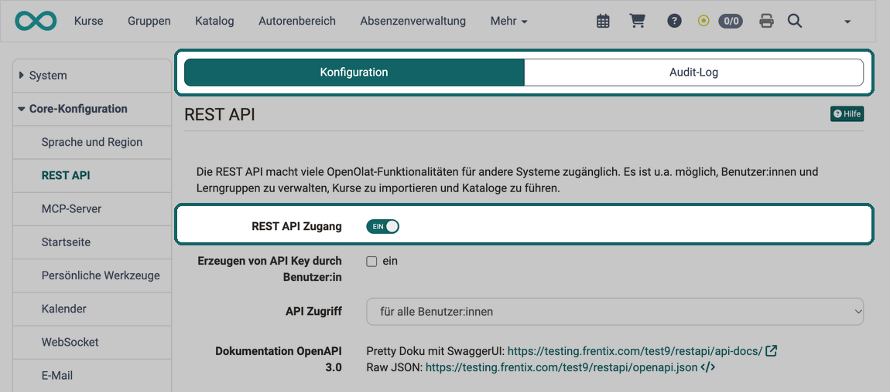
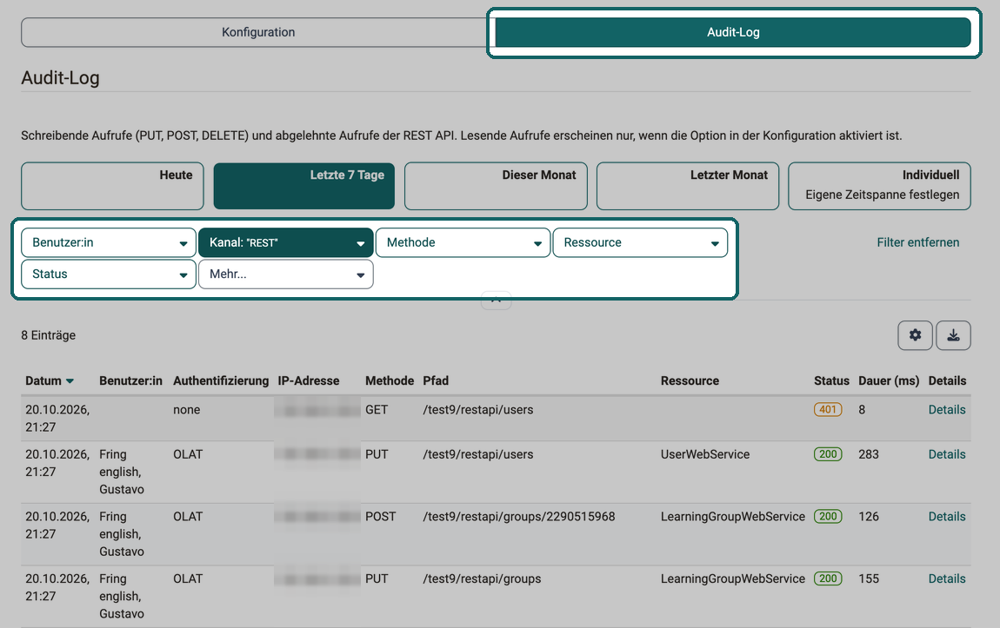
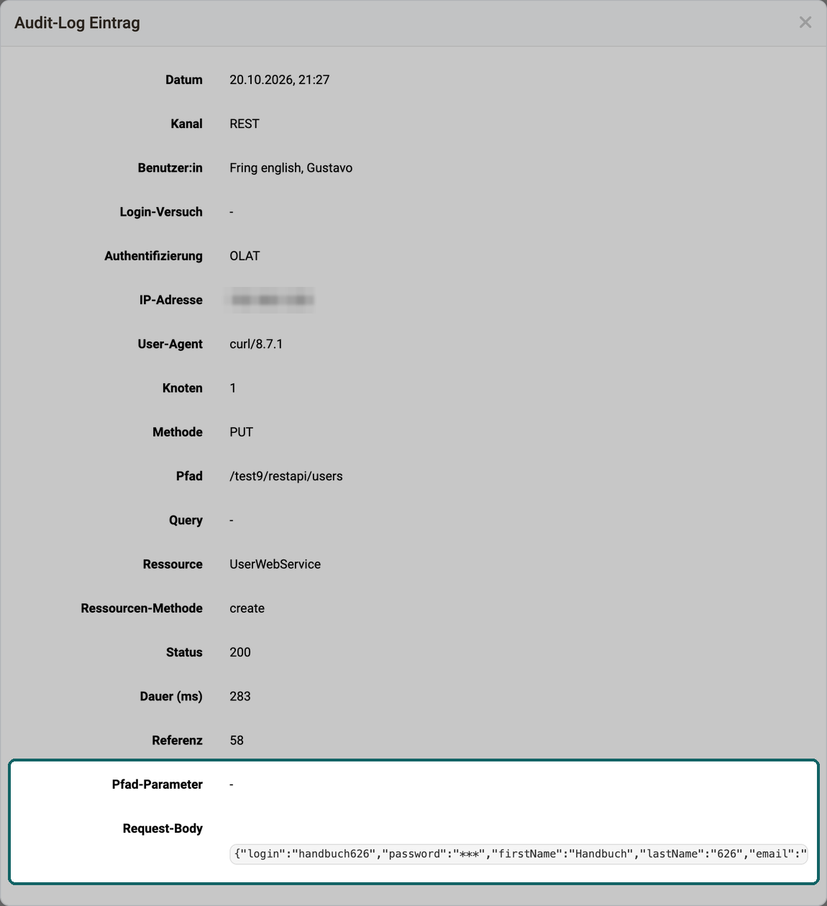
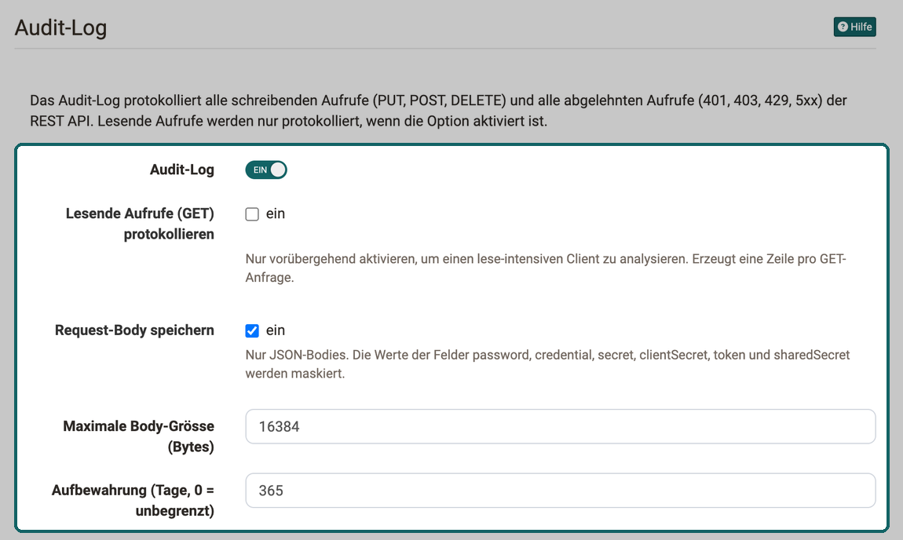

# REST API {: #REST-API}

Andere Systeme wie eine Schülerverwaltung, eine externe Kursverwaltung oder eine externe Verwaltung von Lerngruppen tauschen ihre Daten über die REST API mit OpenOlat aus. Die REST API ist eine Programmierschnittstelle nach dem Architekturstil Representational State Transfer. Über sie verwalten diese Systeme Benutzer:innen und Lerngruppen, importieren Kurse, stellen Kataloge zusammen oder legen viele Objekte auf einmal an, ohne dass jemand diese Schritte in der Benutzeroberfläche ausführt.

Die REST API schalten Sie in der System-Administration mit dem Schalter "REST API Zugang" ein und aus, unter: 
`Administration > Core-Konfiguration > REST API`

Die Seite REST API steht Systemadministrator:innen zur Verfügung. Sie hat zwei Tabs:

* **"Konfiguration"**: die REST API ein- und ausschalten, den Zugriff festlegen und die Links zur Dokumentation öffnen, dazu die Abschnitte "Limite für Anfragen (Rate Limiting)", "Audit-Log" und "Managed Objekte".
* **"Audit-Log"**: die protokollierten Aufrufe der REST API auswerten, siehe [Audit-Log](#audit-log).

{ class="shadow lightbox" title="Tab Konfiguration der Seite REST API · 2026.10.20" }

[Zum Seitenanfang ^](#REST-API)

---

## Konzept {: #concept}

REST ist ein Architekturstil, der in erster Linie mit dem HTTP-Protokoll verwendet wird, jedoch nicht ausschliesslich. Im Falle von HTTP nutzt es alle seine Funktionen: URIs zur Beschreibung von Ressourcen, HTTP-Methoden als "Verben" zur Manipulation von Ressourcen (GET zum Abrufen von Ressourcen, PUT zum Erstellen neuer Ressourcen, POST zum Ändern von Ressourcen, DELETE ...), HTTP-Header und Medientypen für die Inhaltsaushandlung ...

In OpenOlat wird JSR-311: JAX-RS (die Java-API für RESTful-Webdienste) als Backend für die Implementierung der REST API verwendet. JSR-311 ist ein Standard von J2EE. Wir verwenden die Referenzimplementierung aus dem folgenden Standard: [Jersey](https://jersey.dev.java.net/).

### API-Schlüssel für REST-Zugriff [:octicons-tag-16:{ title="ab Release 18.1.0 (OO-7290)" }](https://track.frentix.com/issue/OO-7290)

Für den Zugriff auf die REST API steht ein dedizierter API-Schlüssel zur Verfügung. Er ist ein automatisch erzeugtes, langes und damit starkes Passwort und kann deshalb auch dann verwendet werden, wenn für die Anmeldung in der Benutzeroberfläche Passkey oder eine Zwei-Faktor-Authentifizierung (2FA) vorausgesetzt wird.

Der API-Schlüssel wird wie das OpenOlat-Passwort verschlüsselt gespeichert. Er wird nur einmal bei der Erzeugung angezeigt und kann danach nicht erneut abgerufen werden. Geht der Schlüssel verloren, muss er gelöscht und ein neuer erzeugt werden.

Der API-Schlüssel kann nicht zur Anmeldung in der OpenOlat-Webanwendung verwendet werden; er ist ausschliesslich für den Zugriff auf die REST API gültig. Unabhängig davon bleibt der Zugriff über eine gültige Sitzung (Session) möglich, etwa um per JavaScript auf die Kursdatenbank zuzugreifen.

API-Schlüssel werden in der Benutzerverwaltung erzeugt, mit der Schaltfläche "API-Key hinzufügen" im Tab "Authentifizierungen" eines Kontos, siehe [Kontoeinstellungen verwalten](../usermanagement/Configure_User.de.md): 
`Benutzerverwaltung > Konto öffnen > Tab "Authentifizierungen"`

Soll es auch Benutzer:innen erlaubt sein, selbst einen Schlüssel zu erzeugen, aktivieren Sie die Option "Erzeugen von API Key durch Benutzer:in" (standardmässig deaktiviert): 
`Administration > Core-Konfiguration > REST API > Tab "Konfiguration"`

!!! info "Wichtig"

	Solange die Passkey-Funktion nicht aktiviert ist, kann für den REST-Zugriff weiterhin das OpenOlat-Passwort verwendet werden.

### Zugriff auf Benutzer:innen mit API-Schlüssel beschränken [:octicons-tag-16:{ title="ab Release 20.1.0 (OO-8745)" }](https://track.frentix.com/issue/OO-8745)

Ist die REST API aktiviert, kann sie grundsätzlich von allen Benutzer:innen mit einer authentifizierten Sitzung verwendet werden. Häufig soll der Zugriff jedoch auf bestimmte Personen beschränkt bleiben.

Über die Auswahl "API Zugriff" im Tab "Konfiguration" der Seite REST API legen Sie fest, wer die REST API nutzen darf:

* **für alle Benutzer:innen**: der Zugriff steht allen authentifizierten Personen offen.
* **nur für Benutzer:in mit API Key**: der Zugriff ist auf Personen mit einem API-Schlüssel beschränkt.

In Kombination mit der Erzeugung der Schlüssel ausschliesslich durch die Benutzerverwaltung lässt sich der Zugriff auf die REST API so gezielt einzelnen Personen gewähren.

[Zum Seitenanfang ^](#REST-API)

---

### Benutzung {: #usage}

Die REST API von OpenOlat ist für externe Verwaltungsanwendungen gebaut. Sie enthält nicht alle Funktionen der Benutzeroberfläche, und viele Anfragen sind administrativen Benutzer:innen vorbehalten, etwa Administrator:innen, Benutzerverwalter:innen, Gruppenverwalter:innen und Autor:innen.

Zu den Hauptfunktionen der REST API gehört beispielsweise das Erstellen und Organisieren von Benutzer:innen, Kursen, Gruppen, Organisationen, Produkten (curriculum) oder Kalenderereignissen (Events).

Anwesenheitskontrollen (Roll Call) liest die REST API, durchführen kann sie sie nicht: Anwesend oder abwesend lässt sich für eine Person darüber nicht setzen. Änderbar sind das Benachrichtigungsdatum an die Aufsicht, der Kommentar und der Grund.

Obwohl rein theoretisch möglich, ist es nicht im Sinne des Konzepts, die REST API für eine alternative Benutzeroberfläche zu verwenden.

[Zum Seitenanfang ^](#REST-API)

---

## Sicherheit {: #security}

Die Sicherheit basiert auf einem Mechanismus mit zwei Stufen, so wie es in OpenOlat entsprechend implementiert wurde.

  1. Die erste Stufe ist ein Servletfilter, der alle Anfragen an die REST API sammelt. Dieser Filter entscheidet, ob die URI offen für jeden (`/api`, `/ping`, `/auth`…) ist, oder ob sie eine Authentifizierung benötigt. Die Authentifizierung selbst übergibt der Filter einem Web Service.
  2. Die zweite Stufe greift bei jedem Aufruf der REST API. Jede Methode überprüft, ob die Benutzer:in (wenn diese authentifiziert sein muss) genügend Rechte hat, um auf der entsprechenden Ressource agieren zu können.

Um eine gültige Authentifizierung über mehrere Anfragen aufrecht zu erhalten,
schlägt der Filter folgende zwei Methoden vor:

  1. Verwenden Sie das Session Cookie bei jeder Anfrage wieder. Der Vorteil dieser Methode ist, dass OpenOlat nicht mit jeder Anfrage eine neue Sitzung erstellen muss.
  2. Wenn Sie kein Session Cookie benutzen, dann fügt der Filter immer einen HTTP Header (`X-OLAT-TOKEN`) der Antwort hinzu. Senden Sie dieses Token mit der nächsten Anfrage, um Ihre Rechte zu behalten.

### Bewährte Vorgehensweise

Wenn die REST API benutzt wird, um spezifische Funktionen in der OpenOlat
Benutzeroberfläche zu implementieren, wie z.B. die Verwendung der
Kursdatenbank, kann das OpenOlat Websession-Cookie wiederverwendet werden
(Methode 1). Die Benutzer:in ist schon authentifiziert im Browser.

Wenn die REST API von einer externen (Server basierten) Applikation genutzt
wird, dann ist es empfehlenswert die "Basic Authentication" zu benutzen und
Session Cookies im HTTP client der externen Applikation zu aktivieren.

Wenn die zwei genannten Methoden nicht möglich sind, dann benutzen Sie die
Methode 2 mit dem `X-OLAT-TOKEN`. Beachten Sie, dass eine Benutzer:in nur ein `X-OLAT-TOKEN` zu einem beliebigen Zeitpunkt haben kann. Wenn Ihre externe Applikation mehrere Anfragen gleichzeitig stellt, dann sollte "Basic Authentication" benutzt werden.

Wenn Sie ein externes Portal und einen eigenen single-sign-on Prozess
implementieren möchten, dann kann Methode 2 benutzt werden um ein X-OLAT-TOKEN
für jede Benutzer:in als Serveranfrage zu generieren. Das Token kann dann jedem
Link im Portal hinzugefügt werden, um die Benutzer:in basierend auf dem Token zu
authentifizieren (`?X-OLAT-TOKEN=xyz`). Wenn auf den Link geklickt wird,
identifiziert OpenOlat die Benutzer:in basierend auf dem Token und erstellt eine
gültige Sitzung. Sicherheitstechnisch gibt es bessere Optionen um das
selbe Resultat zu erhalten. Wir empfehlen OAuth als Alternative, was ebenfalls
von OpenOlat unterstützt wird.

[Zum Seitenanfang ^](#REST-API)

---

## Audit-Log [:octicons-tag-16:{ title="ab Release 21.1.0 (OO-9778)" }](https://track.frentix.com/issue/OO-9778){:target="_blank"} {: #audit-log}

Ein Konto ist plötzlich geändert, eine Mitgliedschaft fehlt, oder ein Fremdsystem scheitert bei der Anmeldung. Das Audit-Log zeigt Ihnen, welche Aufrufe die REST API erhalten hat: wer wann von welcher IP-Adresse welchen Pfad aufgerufen hat und wie OpenOlat geantwortet hat. Diese Auskunft erhalten Sie ohne Zugriff auf die Datenbank.

Die Einträge werten Sie im Tab "Audit-Log" der Seite REST API aus, die Einstellungen stehen im Tab "Konfiguration" im Abschnitt "Audit-Log". Beides steht Systemadministrator:innen zur Verfügung.

### Welche Aufrufe im Audit-Log stehen {: #audit_log_calls}

Ob ein Aufruf einen Eintrag erzeugt, hängt von seiner Methode und von der Antwort ab:

* **Schreibende Aufrufe**: Jeder Aufruf mit PUT, POST, DELETE oder PATCH erzeugt einen Eintrag, auch wenn er scheitert.
* **Abgelehnte Aufrufe**: Jeder Aufruf mit dem Status 401, 403, 429 oder 5xx erzeugt einen Eintrag, auch ein lesender.
* **Lesende Aufrufe**: Ein erfolgreicher Aufruf mit GET oder HEAD erzeugt nur dann einen Eintrag, wenn die Option "Lesende Aufrufe (GET) protokollieren" eingeschaltet ist. Im Auslieferungszustand ist sie ausgeschaltet.

Fehlt ein Aufruf im Audit-Log, war er meist ein erfolgreicher lesender Aufruf. Keine Einträge entstehen ausserdem, solange der Schalter "Audit-Log" auf "Aus" steht oder die REST API ausgeschaltet ist.

Weist die Limite für Anfragen ein Fremdsystem mit dem Status 429 ab, erscheint pro Minute nur die erste Abweisung im Audit-Log. OpenOlat zählt dabei je angemeldete Person, ohne Anmeldung je IP-Adresse. Ein Fremdsystem, das die Abweisung übergeht und weiter sendet, füllt das Audit-Log so nicht.

### Einträge auswerten {: #audit_log_evaluation}

Die Tabelle des Audit-Logs finden Sie in der System-Administration unter: 
`Administration > Core-Konfiguration > REST API > Tab "Audit-Log"`

Die neusten Einträge stehen zuoberst. Zur Auswertung stehen zur Verfügung:

* **Zeitraum**: "Heute", "Letzte 7 Tage" (Vorauswahl), "Dieser Monat", "Letzter Monat" sowie "Individuell" für eine eigene Zeitspanne.
* **Filter**: "Benutzer:in", "Methode", "Ressource" und "Status". Der Filter "Status" fasst die Antworten in Gruppen zusammen: "Erfolgreich (2xx, 3xx)", "Abgelehnt (401, 403)", "Limite für Anfragen (429)", "Client-Fehler (4xx)" und "Server-Fehler (5xx)". Den Filter "Kanal" fügen Sie über "Mehr..." hinzu.
* **Spalten**: Die Tabelle zeigt "Datum", "Benutzer:in", "Authentifizierung", "IP-Adresse", "Methode", "Pfad", "Ressource", "Status" und "Dauer (ms)". Weitere Spalten wie "Request-Body" oder "Login-Versuch" blenden Sie ein unter: `Tabelleneinstellungen > Spalten auswählen`
* **Details**: Der Link "Details" in jeder Zeile öffnet den Dialog "Audit-Log Eintrag" mit allen Angaben des Aufrufs.
* **Herunterladen**: Das Symbol "Herunterladen" über der Tabelle lädt die gefilterte Tabelle als Excel-Datei herunter.

{ class="shadow lightbox" title="Tab Audit-Log der Seite REST API · 2026.10.20" }

### Angaben eines Eintrags {: #audit_log_entry}

Ein Eintrag sagt, wer einen Aufruf geschickt hat, was der Aufruf verlangt hat und wie OpenOlat geantwortet hat. Der Dialog "Audit-Log Eintrag" zeigt alle Angaben:

{ class="shadow lightbox" title="Dialog Audit-Log Eintrag · 2026.10.20" }

| Angabe | Inhalt |
|---|---|
| Datum | Zeitpunkt des Aufrufs |
| Kanal | Weg, auf dem der Aufruf kam, für die REST API "REST" |
| Benutzer:in | angemeldete Person; leer, wenn der Aufruf ohne gültige Anmeldung kam |
| Login-Versuch | Benutzername einer gescheiterten Anmeldung |
| Authentifizierung | Art der Anmeldung des Aufrufs |
| IP-Adresse | Adresse, von der der Aufruf kam |
| User-Agent | Kennung des aufrufenden Programms |
| Knoten | Server im Cluster, der den Aufruf bearbeitet hat |
| Methode | HTTP-Methode, etwa PUT |
| Pfad | aufgerufener Pfad, etwa `/olat/restapi/users`; er beginnt mit dem Kontextpfad der Instanz |
| Query | Parameter nach dem Fragezeichen in der Adresse |
| Ressource | Webservice, der den Aufruf bearbeitet hat, etwa "UserWebService"; leer, wenn der Aufruf keinen Webservice erreicht hat |
| Ressourcen-Methode | Methode des Webservice, etwa "create" |
| Status | HTTP-Status der Antwort |
| Dauer (ms) | Bearbeitungszeit in Millisekunden |
| Referenz | interne Kennung der Anfrage |
| Pfad-Parameter | Werte aus dem Pfad, etwa `{"groupKey":"2290515968"}` bei einem Aufruf auf `/restapi/groups/{groupKey}` |
| Request-Body | Inhalt eines schreibenden Aufrufs im JSON-Format |

Passwörter und andere geheime Werte stehen nicht im Klartext im Audit-Log. Im Request-Body und in der Query ersetzt OpenOlat die Werte der Felder password, credential, secret, clientSecret, token und sharedSecret durch `***`, unabhängig von Gross- und Kleinschreibung. Die Pfad-Parameter maskiert OpenOlat nicht. Gespeichert werden nur Inhalte im JSON-Format; bei einem Datei-Upload stehen im Request-Body nur der Inhaltstyp und die Grösse. Ist ein Inhalt grösser als die "Maximale Body-Grösse (Bytes)", kürzt OpenOlat ihn.

### Einstellungen {: #audit_log_settings}

Was das Audit-Log festhält und wie lange, legen Sie in der System-Administration fest, unter: 
`Administration > Core-Konfiguration > REST API > Tab "Konfiguration"`

Der Abschnitt "Audit-Log" erscheint, sobald der Schalter "REST API Zugang" auf "Ein" steht. Ihre Änderungen übernehmen Sie mit "Speichern" am Ende der Seite. Die Vorgaben dieser Einstellungen lassen sich auch in der Serverkonfiguration festlegen. frentix-Kund:innen wenden sich dafür an den frentix Support: [support@frentix.com](mailto:support@frentix.com)

{ class="shadow lightbox" title="Abschnitt Audit-Log im Tab Konfiguration · 2026.10.20" }

#### Audit-Log {: #audit_log_switch}

Steht der Schalter auf "Ein", erzeugen Aufrufe Einträge nach den Regeln oben, und die übrigen Felder des Abschnitts erscheinen. Steht er auf "Aus", entstehen keine neuen Einträge; vorhandene Einträge bleiben bis zum Ende ihrer Aufbewahrung lesbar. Im Auslieferungszustand steht der Schalter auf "Ein". Schalten Sie die REST API ein, stellt OpenOlat den Schalter "Audit-Log" ebenfalls auf "Ein". Schalten Sie die REST API aus und speichern, schaltet OpenOlat auch das Audit-Log aus.

#### Lesende Aufrufe (GET) protokollieren {: #audit_log_reads}

Eingeschaltet erzeugt auch jeder erfolgreiche lesende Aufruf einen Eintrag, und das Audit-Log wächst entsprechend schnell. Schalten Sie die Option deshalb nur vorübergehend ein, etwa um ein Fremdsystem mit vielen lesenden Aufrufen zu untersuchen, und danach wieder aus. Im Auslieferungszustand ist die Option ausgeschaltet.

#### Request-Body speichern {: #audit_log_body}

Eingeschaltet speichert OpenOlat bei schreibenden Aufrufen den Inhalt der Anfrage im JSON-Format, mit maskierten Passwörtern. So sehen Sie später, welche Werte ein Fremdsystem geschickt hat. Ausgeschaltet bleibt die Angabe "Request-Body" leer. Im Auslieferungszustand ist die Option eingeschaltet.

#### Maximale Body-Grösse (Bytes) {: #audit_log_body_size}

Längere Inhalte kürzt OpenOlat auf diese Grösse. Erlaubt sind Werte von 1024 bis 1048576 Bytes, im Auslieferungszustand 16384. Das Feld erscheint nur, wenn "Request-Body speichern" eingeschaltet ist.

#### Aufbewahrung (Tage, 0 = unbegrenzt) {: #audit_log_retention_days}

Anzahl Tage, die ein Eintrag erhalten bleibt, im Auslieferungszustand 365. Mit 0 löscht OpenOlat keine Einträge. Wie die Löschung abläuft, beschreibt der Abschnitt [Aufbewahrung und Löschung](#audit_log_retention).

### Aufbewahrung und Löschung {: #audit_log_retention}

Das Audit-Log reicht nur so weit zurück, wie die Aufbewahrung es zulässt. Jede Nacht um 01:41 Uhr Serverzeit löscht OpenOlat die Einträge, die älter sind als die eingestellte Anzahl Tage. Gelöschte Einträge lassen sich nicht wiederherstellen. Brauchen Sie Einträge länger, laden Sie sie vorher als Excel-Datei herunter.

Ein Eintrag kann Personendaten enthalten, etwa Name und E-Mail-Adresse im Request-Body eines Aufrufs, der ein Konto anlegt. Beim Löschen eines Kontos bleiben solche Einträge erhalten, bis die Aufbewahrung sie löscht. Mehr zum Löschen von Konten: [Datenschutz](../usermanagement/Data_protection.de.md#deletion_overview)

[Zum Seitenanfang ^](#REST-API)

---

## Konfiguration der Schnittstelle im Code {: #configuration}

Ein Spring Bean erlaubt es Ressourcen, Singletons und Provider zu
konfigurieren; entweder statisch mit der XML-Konfiguration des Beans (
`/org/olat/restapi/_spring/restApiContext.xml` ), oder programmatisch mit dem
Hinzufügen oder Entfernen von Klassen und Singletons zum/vom Bean (Bean Id ist
die selbe wie im Interface: `org.olat.restapi.support.RestRegistrationService`
).

OpenOlat benutzt den Standard-JAXB-Provider von Jersey um XML von Javaobjekten
zu generieren, sowie auch JSON-Provider von
[Jackson](http://jackson.codehaus.org/), welches die selben JAXB-Annotationen
wiederbenutzt.  

!!! info "Wichtig"

	Alle Konfigurationen müssen vor dem Start des Jersey-Servlets eingestellt werden.

### Beispiel

Hier ist ein kleines Beispiel wie Sie eine Benutzer:in erstellen und diese einer
Lerngruppe hinzufügen:

    PUT https://your.openolat.domain/olat/restapi/users
    HTTP Header: Content-Type application/json
    Response: 200
    GET https://your.openolat.domain/olat/restapi/groups
    HTTP Header: Accept application/json
    Response: 200
    Choose a group
    PUT https://your.openolat.domain/olat/restapi/groups/{groupId}/users/{identityKey}
    Response: 200

[Zum Seitenanfang ^](#REST-API)

---

## Dokumentation {: #documentation}

Wer ein Fremdsystem an OpenOlat anbindet, findet alle Endpunkte der REST API in ihrer Dokumentation. Die Dokumentation basiert auf der OpenAPI-Spezifikation (früher Swagger-Spezifikation), einem Beschreibungsformat für REST-Schnittstellen. Sie beschreibt die verfügbaren Endpunkte, die Operationen je Endpunkt mit Parametern, Input und Output sowie die Objekte, die die REST API benutzt.

Die Links zur Dokumentation stehen im Tab "Konfiguration" der Seite REST API unter "Dokumentation OpenAPI 3.0", sobald die REST API eingeschaltet ist:

* **"Pretty Doku mit SwaggerUI"**: die lesbare Dokumentation unter der Adresse `/restapi/api-docs/` Ihrer Instanz.
* **"Raw JSON"**: die ganze Beschreibung in einem Dokument, der Datei openapi.json unter der Adresse `/restapi/openapi.json` Ihrer Instanz.

Die SwaggerUI erlaubt es, ein spezifisches Server-Prefix auszuwählen und die gelisteten Anfragen mit dem Button "try it out" auszuführen. Diese Anfragen sind verbindlich: Sie ändern die Daten des adressierten Systems direkt.

 [Zum Seitenanfang ^](#REST-API)

---

##  Extern verwaltete (managed) Kurse und Gruppen {: #managed}

Kurse und Gruppen können über die REST API erstellt werden. Solch extern
erstellte Kurse und Gruppen werden als "managed" bezeichnet, da ein externes
System das datenführende System ist. Die Verwendung dieser Funktion schalten Sie je Objektart im Tab "Konfiguration" im Abschnitt "Managed Objekte" ein und aus, unter: 
`Administration > Core-Konfiguration > REST API > Tab "Konfiguration"`

Über die REST API können für Kurse und Gruppen die ID des externen Systems
hinterlegt werden. Bei Kursen kann zudem eine externe Referenz verwendet
werden, die aus Benutzersicht eine Identifikation des Kurses ermöglicht.

Verwendet man die externen ID's für Kurse oder Gruppen, so ist zusätzlich zu
definieren welche Elemente einer solchen extern erstellten Ressource in
OpenOlat nicht verwaltet werden dürfen. Dies wird mit sogenannten "managed
Flags" definiert. Es können entweder alle Elemente extern verwaltet sein, oder
feingranular verwaltet sein; z.B. nur die Metadaten und die
Benutzerverwaltung. Die Konfiguration der "managed Flags" entnehmen Sie der
technischen Dokumentation der REST API.

Ist die externe Verwaltung eingeschaltet, so werden in der OpenOlat
Benutzeroberfläche für entsprechende Ressourcen die mit den "managed Flags"
konfigurierten Elemente als nicht editierbar dargestellt. Zudem werden die
externen Id's in Suchfeldern, Anzeigen und Tabellen verwendet. Andere, nicht
extern erstellte Ressourcen können parallel dazu normal verwendet und
verwaltet werden.

??? abstract "Managed Organisationen"

	* Vollständige externe Verwaltung (all)
	    * Bezeichnung (identifier)
	    * Anzeigename (displayName)
	    * Beschreibung (description)
	    * Externe Id (externalId)
	    * Typ der Organisation (type)
	    * Organisation bewegen (move)
	    * Organisation löschen (delete)
	    * Mitgliederverwaltung (members)

??? abstract "Managed Organisationstypen"

	* Vollständige externe Verwaltung (all)
	    * Bezeichnung (identifier)
	    * Anzeigename (displayName)
	    * Beschreibung (description)
	    * css Klasse (cssClass)
	    * Externe Id (externalId)
	    * Untertypen Verwaltung (subTypes)
	    * Typ löschen (delete)

??? abstract "Managed Produkte"

	* Vollständige externe Verwaltung (all)
	    * Bezeichnung (identifier)
	    * Anzeigename (displayName)
	    * Beschreibung (description)
	    * Externe Id (externalId)
	    * Produkt löschen (delete)
	    * Mitgliederverwaltung (members)

??? abstract "Managed Elemente"

	* Vollständige externe Verwaltung (all)
	    * Bezeichnung (identifier)
	    * Anzeigename (displayName)
	    * Beschreibung (description)
	    * Externe Id (externalId)
	    * Status (status)
	    * Angaben zum Datum (dates)
	    * Typ (type)
	    * Kalender (calendars)
	    * Einheiten (units)
	    * Mitgliederverwaltung (members)
	    * Ressourcen (resources)
	    * Element verschieben (move)
	    * Unterelemente hinzufügen (addChildren)
	    * Element löschen (delete)

??? abstract "Managed Elementtypen"

	* Vollständige externe Verwaltung (all)
	    * Bezeichnung (identifier)
	    * Anzeigename (displayName)
	    * css Klasse (cssClass)
	    * Beschreibung (description)
	    * Externe Id (externalId)
	    * Kalender (calendars)
	    * Einheiten (units)
	    * Untertypen (subTypes)
	    * Kopieren (copy)
	    * Den Typen löschen (delete)

??? abstract "Managed Gruppen"

	* Vollständige externe Verwaltung (all)
	    * Titel, Beschreibung und Einstellungen Plätze/Warteliste (details)
	        * Gruppentitel (title)
	        * Beschreibung (description) 
	        * Einstellungen Plätze/Warteliste (settings)
	    * Werkzeuge konfigurieren (tools)
	    * Mitgliederverwaltung und Sichtbarkeit Mitglieder (members)
	        * Sichtbarkeit Mitglieder (display)
	        * Mitgliederverwaltung (membersmanagement)
	    * Kurse einbinden (resources)
	    * Buchungsregeln (bookings)
	    * Gruppe Löschen (delete)

??? abstract "Managed Lernressourcen (Kurse)"

	* Vollständige externe Verwaltung (all)
	    * Kurseditor (editcontent)
	    * Details (details) 
	        * Titel (title)
	        * Beschreibung (description)
	        * Ziele (objectives)
	        * Anforderungen (requirements)
	        * Credits (credits)
	        * Angaben zum Ort (location)
	        * Organisationen (organisations)
	    * Einstellungen (settings)
	        * Einstellung für Zugriff (access)
	        * Einstellung für Suche (search)
	        * Einstellung für Chat (chat)
	        * Einstellung für Layout (layout)
	        * Einstellung für Ressourcenordner (resourcefolder)
	        * Einstellung für Leistungsnachweis (efficencystatement)
	        * Einstellung für Kalender (calendar)
	        * Einstellung für Glossar (glossary)
	    * Einheit (unit)
	        * Einstellungen der Einheit (unitconfig)
	        * Verwaltung der Einheit (unitmanagement)
	    * Buchungsregeln (bookings)
	    * Mitgliederverwaltung (membersmanagement)
	    * Gruppenverwaltung (groups)
	    * Kurs schliessen (close)
	    * Kurs löschen (delete)
	    * Kurs kopieren (copy)

??? abstract "Managed Termine"

	* Vollständige externe Verwaltung (all)
	    * Details (details)
	        * Titel (title)
	        * Anwesenheit obligatorisch (compulsory)
	        * Geplante Einheiten (plannedUnits)
	        * Dozenten (teachers)
	        * Gruppen (groups)
	        * Beschreibung (description)
	        * Vorbereitung/Nachbereitung (preparation)
	        * Angaben zum Ort (location)
	        * Angaben zum Datum (dates)
	    * Einstellungen (settings)
	    * Termine löschen (delete)

??? abstract "Managed Taxonomien"

	* Vollständige externe Verwaltung (all)
	    * Bezeichnung (identifier)
	    * Anzeigename (displayName)
	    * Beschreibung (description)
	    * Externe Id (externalId)
	    * Bibliothek Einstellungen (librarySettings)

??? abstract "Managed Taxonomieebenen"

	* Vollständige externe Verwaltung (all)
	    * Bezeichnung (identifier)
	    * Anzeigename (displayName)
	    * Beschreibung (description)
	    * Externe Id (externalId) 
	    * Sortierung (sortOrder)
	    * Typ (type)
	    * Alle Kompetenzen (competences)
	        * Kompetenz "Verwalten" (manageCompetence)
	        * Kompetenz "Unterrichten" ("Dozieren", teachCompetence)
	        * Kompetenz "Haben" (haveCompetence)
	        * Kompetenz "Ziel" (targetCompetence)
	    * Ebene verschieben (move)
	    * Ebene löschen (delete)

??? abstract "Managed Taxonomieebenentypen"

	* Vollständige externe Verwaltung (all)
	    * Bezeichnung (identifier)
	    * Anzeigename (displayName)
	    * Beschreibung (description)
	    * css Klasse (cssClass)
	    * Externe Id (externalId)
	    * Sichtbarkeit (visibility)
	    * Unterelemente verwalten (subTypes)
	    * Kopieren (copy)
	    * Bibliothek Einstellungen (librarySettings)
	    * Typ löschen (delete)

??? abstract "Managed Kalender"

	* Vollständige externe Verwaltung (all)
	    * Details (details)  	
	        * Fach (subject)
	        * Beschreibung (description)
	        * Angaben zum Ort (location)
	        * Angaben zum Datum (dates)
	        * Livestream URL (liveStreamUrl)
	    * Klassifizierung (classification)
	    * Links (links)

??? abstract "Managed Rollen"

	* Vollständige externe Verwaltung (all)
	    * Name (name)
	    * Rechte (rights)
	    * Rolle löschen (delete)

??? abstract "Managed Identität zu Identität Verhältnis"

	* Vollständige externe Verwaltung (all)
	    * Verhältnis löschen (delete)

[Zum Seitenanfang ^](#REST-API)

---

## Weiterführende Informationen {: #further_information}

[Jersey](<https://jersey.dev.java.net/>) 
[Kontoeinstellungen verwalten >](../usermanagement/Configure_User.de.md) 
[Datenschutz >](../usermanagement/Data_protection.de.md) 
[Jackson](<http://jackson.codehaus.org/>) 
[Externe Werkzeuge: KI-Modul >](External_Tools_AI.de.md) 
[Rollen zuweisen >](../usermanagement/Assign_roles.de.md)

[Zum Seitenanfang ^](#REST-API)

