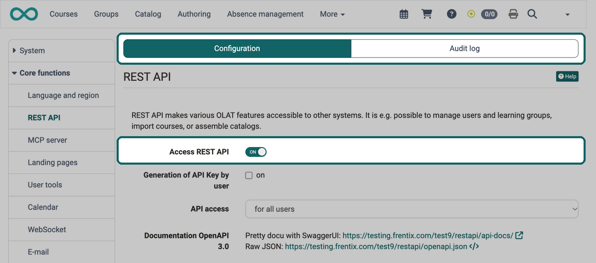
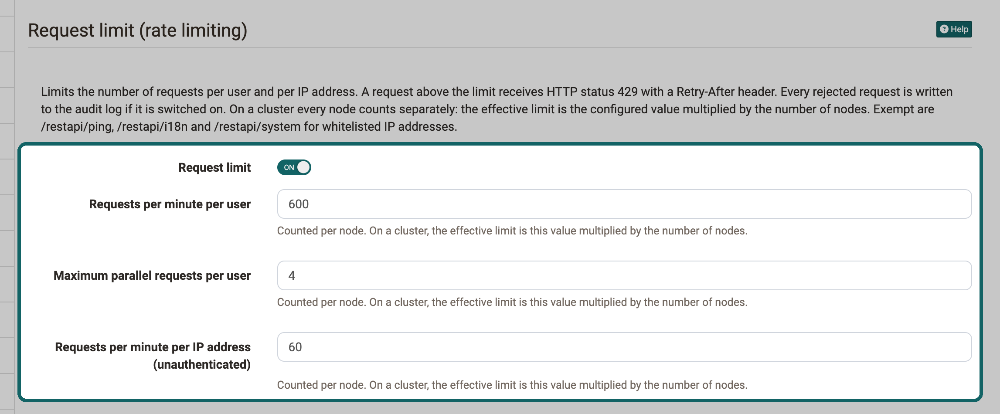
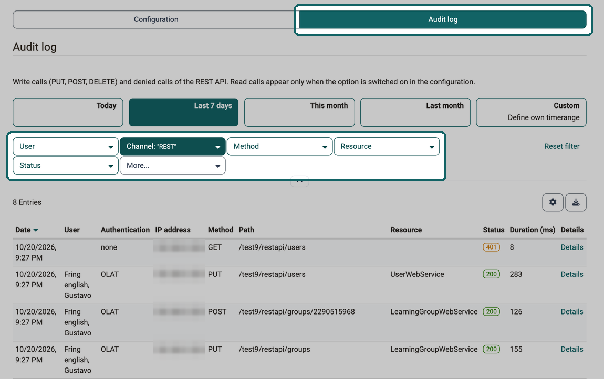
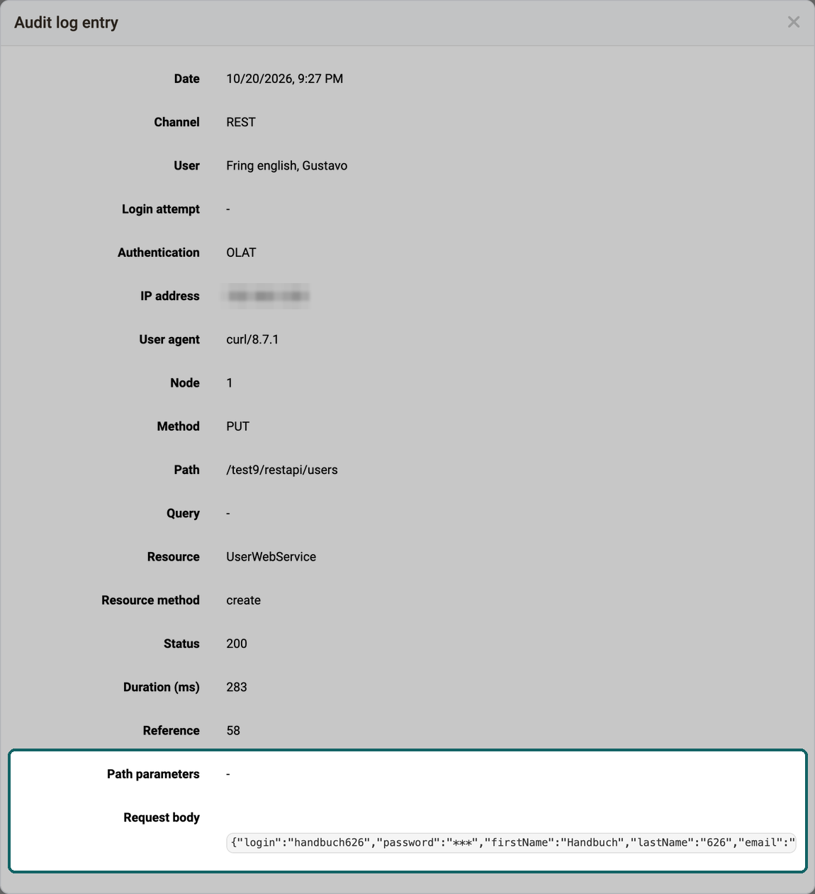
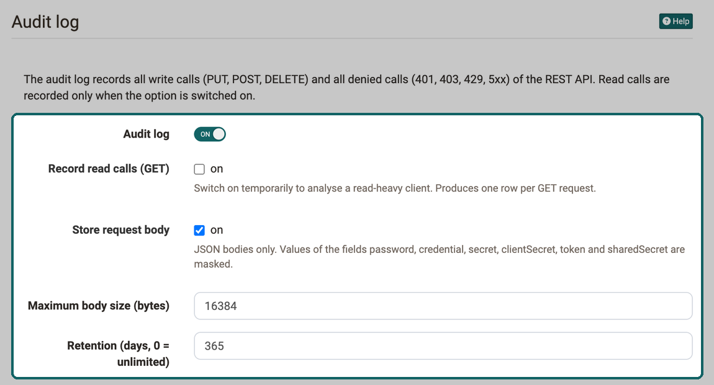

# REST API {: #REST-API}

!!! info "frentix customers"
    For frentix customers, their customer advisor at frentix takes care of this configuration.

Other systems such as a student administration, an external course administration or an external learning group administration exchange their data with OpenOlat via the REST API. The REST API is a programming interface following the Representational State Transfer architectural style. Through it, these systems manage users and learning groups, import courses, assemble catalogs or create many objects at once, without anyone carrying out these steps in the user interface.

You switch the REST API on and off in the system administration with the "Access REST API" switch, under: 
`Administration > Core functions > REST API`

The REST API page is available to system administrators. It has two tabs:

* **"Configuration"**: switch the REST API on and off, define the access and open the links to the documentation, plus the sections "Request limit (rate limiting)", "Audit log" and "Managed objects".
* **"Audit log"**: evaluate the recorded calls of the REST API, see [Audit log](#audit-log).

{ class="shadow lightbox" title="Configuration tab of the REST API page · 2026.10.20" }

[To the top of the page ^](#REST-API)

---

## Concept {: #concept}

REST is an architectural style that mostly works with the HTTP protocol, but is not limited to it. With HTTP, REST uses the means of HTTP: URIs describe the resources, the HTTP methods act on them as "verbs" (GET retrieves a resource, PUT creates a new one, POST modifies an existing one, DELETE deletes it), HTTP headers and media types define the format of the content.

The OpenOlat REST API follows the Jakarta RESTful Web Services (JAX-RS) standard. OpenOlat uses [Apache CXF](https://cxf.apache.org/) as the implementation.

### API Key for REST access [:octicons-tag-16:{ title="from Release 18.1.0 (OO-7290)" }](https://track.frentix.com/issue/OO-7290)

A dedicated API key is available for accessing the REST API. It is an automatically generated, long and therefore strong password and can be used even when Passkey or two-factor authentication (2FA) is required for signing in to the user interface.

The API key is stored encrypted, in the same way as the OpenOlat password. It is shown only once when it is generated and cannot be retrieved again afterwards. If the key is lost, it must be deleted and a new one generated.

The API key cannot be used to log in to the OpenOlat web application; it is only valid for accessing the REST API. Independently of this, access via a valid session remains possible, for example to access the course database via JavaScript.

API keys are generated in the user management, with the "Add API-Key" button in the "Authentications" tab of an account, see [Manage user settings](../usermanagement/Configure_User.md): 
`User management > open the account > "Authentications" tab`

To also allow users to generate a key themselves, activate the "Generation of API Key by user" option (disabled by default): 
`Administration > Core functions > REST API > "Configuration" tab`

!!! info "Important"

    As long as the Passkey feature is not enabled, the OpenOlat password can still be used for REST access.

### Limit access to users with API key [:octicons-tag-16:{ title="from Release 20.1.0 (OO-8745)" }](https://track.frentix.com/issue/OO-8745)

When the REST API is enabled, it can in principle be used by all users with an authenticated session. Often, however, access should be restricted to specific users.

You define who may use the REST API with the "API access" selection, under: 
`Administration > Core functions > REST API > "Configuration" tab`

* **for all users**: access is open to all authenticated users.
* **only for user with API key**: access is restricted to users who have an API key.

Combined with generating the keys exclusively through the user management, this allows access to the REST API to be granted to specific users in a targeted way.

[To the top of the page ^](#REST-API)

---

### Usage {: #usage}

The OpenOlat REST API is built for remote management applications. It does not implement all features available in the user interface, and many of the requests are reserved for administrative users such as administrators, user managers, group managers and authors.

The main functions of the REST API include, for example, creating and organizing users, courses, groups, organisations, products (curriculum) or calendar events.

The REST API reads roll calls, but it cannot execute them: you cannot set a person as present or absent through it. What you can change is the supervisor notification date, the comment and the reason.

Technically, a user interface of its own could be built on the REST API. It is not intended for that, however.

When the request limit is switched on, the REST API rejects too many calls with the status 429. A third-party system that sends many calls in a row must then wait and send the call again, see [Request limit](#rate-limit).

[To the top of the page ^](#REST-API)

---

## Security {: #security}

The REST API checks every request in two levels:

  1. The first level is a servlet filter that receives all requests to the REST API. It determines whether a URI is open to everyone (`/api`, `/ping`, `/auth`...) or needs an authentication. The filter hands the authentication itself over to a web service.
  2. The second level applies to every call of the REST API. Every method checks whether the user (if an authentication is required) has enough privileges for the resource concerned.

To keep an authentication valid over several requests, the filter supports two methods:

  1. Reuse the session cookie on every request. The advantage of this method is that OpenOlat doesn't need to create a session on every request.
  2. If you cannot use the session cookie, the filter always adds an HTTP Header (`X-OLAT-TOKEN`) to the response. Send this token with the next request to maintain your privileges.

### Best practice usage

If the REST API implements specific features in the OpenOlat user interface, such as the course database, it reuses the OpenOlat web session cookie (method 1). The user is already authenticated in the browser.

If an external, server-based application uses the REST API, "Basic Authentication" is recommended, together with session cookies switched on in the HTTP client of the external application.

If neither of these ways is possible, use method 2 with the `X-OLAT-TOKEN`. A user has only one `X-OLAT-TOKEN` at any time. If your external application sends several requests at the same time, use "Basic Authentication" instead.

If you build an external portal with a single sign-on process of your own, your server can request an `X-OLAT-TOKEN` for every user with method 2. You add the token to each link in the portal (`?X-OLAT-TOKEN=xyz`). When the user clicks the link, OpenOlat recognises the user by the token and creates a valid session. Security-wise there are better ways to the same result: we recommend OAuth, which OpenOlat supports as well.

[To the top of the page ^](#REST-API)

---

## Request limit [:octicons-tag-16:{ title="from Release 21.1.0 (OO-9779)" }](https://track.frentix.com/issue/OO-9779){:target="_blank"} {: #rate-limit}

A single third-party system can send thousands of calls per minute or many calls at the same time to the REST API, for example when a synchronisation gets out of control. This load reaches the database and slows down the user interface for everyone working in OpenOlat. The request limit restricts the calls and so protects the user interface from the load of a third-party system. Third-party systems with an account of their own keep working in the meantime.

You find the settings in the "Request limit (rate limiting)" section, under: 
`Administration > Core functions > REST API > "Configuration" tab`

The section appears as soon as the "Access REST API" switch is set to "On". It is available to system administrators.

{ class="shadow lightbox" title="Request limit section in the Configuration tab · 2026.10.21" }

### What the limit restricts {: #rate_limit_scope}

OpenOlat counts the calls of every logged-in person. Two values apply to them: how many calls they may send per minute and how many calls may run at the same time. OpenOlat counts calls without login per IP address, with a value per minute of its own; this includes the login via `/restapi/auth`. The "Maximum parallel requests per user" value applies there as well, per IP address.

A minute is the full clock minute: at the start of every minute, the count starts again at 0. Calls that OpenOlat already rejects at login with the status 401 or 403 are not counted.

### What happens when the limit is exceeded {: #rate_limit_exceeded}

If a call is above the limit, OpenOlat does not execute it and responds with the HTTP status 429 (Too Many Requests). The call does not wait in a queue, and OpenOlat does not catch it up later either.

The `Retry-After` header of the response states the waiting time in seconds until a new attempt: for too many calls per minute the time until the next full minute, for too many simultaneous calls 1 second. The content of the response is in JSON format, for example:

    {"code":429,"message":"Too many requests, retry after 23 seconds"}

### What a third-party system must do {: #rate_limit_client}

This section is for developers of third-party systems. When a third-party system receives the status 429, it waits for the seconds from `Retry-After` and then sends the call again. This way it does not run into a timeout and does not lose a call. Send at most as many calls at the same time as the "Maximum parallel requests per user" field allows.

With three further headers, a third-party system can adjust its pace before it is rejected. They are part of the response to every counted call, including a successful one:

* `X-RateLimit-Limit`: configured number of calls per minute
* `X-RateLimit-Remaining`: remaining calls in the current minute
* `X-RateLimit-Reset`: start of the next minute as a Unix timestamp in seconds

A rejection because of too many simultaneous calls only carries the `Retry-After` header.

### Settings {: #rate_limit_settings}

Choose the values so that your third-party systems work without rejection in normal operation. All three fields accept whole numbers from 1. You apply your changes with "Save" at the end of the page; they take effect immediately, without a restart. The defaults of these settings can also be set in the server configuration.

#### Request limit {: #rate_limit_switch}

When the switch is set to "On", OpenOlat checks every call against the three values below, and the three fields appear. When it is set to "Off", OpenOlat does not restrict the calls.

#### Requests per minute per user {: #rate_limit_per_minute}

Number of calls a logged-in person may send in one minute. By default 600.

#### Maximum parallel requests per user {: #rate_limit_parallel}

Number of calls of a logged-in person that may run at the same time. For calls without login, the value applies per IP address. A further call immediately receives the status 429. By default 4.

#### Requests per minute per IP address (unauthenticated) {: #rate_limit_anonymous}

Number of calls without login that may come from one IP address in one minute. By default 60.

### Restrictions {: #rate_limit_restrictions}

* **Same values for everyone**: The values apply to all third-party systems and all persons, including administrators. There is no exception and no value of its own for a single third-party system. If a third-party system needs more calls, raise the value for everyone.
* **Counted per person**: All API keys and sessions of a person share one counter. A third-party system with an account of its own is not affected by the rejection of another one. Two third-party systems with the same account share the limit.
* **Counted per node**: On a cluster, every node counts on its own. The effective limit is the configured value multiplied by the number of nodes.
* **Exempt paths**: `/restapi/ping`, `/restapi/i18n`, `/restapi/openmeetings`, `/restapi/drawio`, `/restapi/onlyoffice` and `/restapi/office365` with all their sub-paths are not limited. `/restapi/system` is not limited for IP addresses that are whitelisted for system access in the server configuration. Monitoring via `/restapi/ping` therefore keeps running, even while a third-party system is being rejected.

### Default state and update {: #rate_limit_default}

By default, the request limit is switched off. After the update to Release 21.1.0 it stays switched off, even if the REST API is switched on. Switch it on yourself if needed.

When you switch the REST API on with the "Access REST API" switch, OpenOlat also sets the "Request limit" switch to "On" and shows the three fields with their values. The limit takes effect with "Save". When you switch the REST API off and save, OpenOlat also switches the limit off.

### Rejections in the audit log {: #rate_limit_audit_log}

Rejected calls appear in the audit log with the status 429; the "Status" filter groups them under "Request limit (429)". OpenOlat writes at most one entry per person or IP address, per node, per minute and per reason. The reasons are too many calls per minute and too many simultaneous calls. Entries are only created when the "Audit log" switch is set to "On". More about it: [Audit log](#audit-log)

[To the top of the page ^](#REST-API)

---

## Audit log [:octicons-tag-16:{ title="from Release 21.1.0 (OO-9778)" }](https://track.frentix.com/issue/OO-9778){:target="_blank"} {: #audit-log}

An account has suddenly changed, a membership is missing, or a third-party system fails to log in. The audit log shows you which calls the REST API has received: who called which path, when and from which IP address, and how OpenOlat responded. You get this information without access to the database.

You evaluate the entries in the "Audit log" tab of the REST API page; the settings are in the "Configuration" tab, section "Audit log". Both are available to system administrators.

### Which calls appear in the audit log {: #audit_log_calls}

Whether a call creates an entry depends on its method and on the response:

* **Write calls**: Every call with PUT, POST, DELETE or PATCH creates an entry, even if it fails.
* **Denied calls**: Every call with the status 401, 403 or 5xx creates an entry, including a read call. Calls with the status 429 create an entry according to the rule below.
* **Read calls**: A successful call with GET or HEAD creates an entry only when the option "Record read calls (GET)" is switched on. By default, it is switched off.

If a call is missing from the audit log, it was usually a successful read call. No entries are created either while the "Audit log" switch is set to "Off" or while the REST API is switched off.

If the [request limit](#rate-limit) rejects a third-party system with the status 429, at most one entry per person, node, minute and reason appears in the audit log. The reasons are too many calls per minute and too many simultaneous calls. OpenOlat counts per logged-in person, and per IP address for calls without login. A third-party system that ignores the rejection and keeps sending does not flood the audit log this way.

### Evaluate entries {: #audit_log_evaluation}

You find the table of the audit log in the system administration under: 
`Administration > Core functions > REST API > "Audit log" tab`

The newest entries are at the top. The following options are available for the evaluation:

* **Period**: "Today", "Last 7 days" (preselected), "This month", "Last month" and "Custom" for a time range of your own.
* **Filters**: "User", "Method", "Resource" and "Status". The "Status" filter groups the responses: "Success (2xx, 3xx)", "Denied (401, 403)", "Request limit (429)", "Client error (4xx)" and "Server error (5xx)". You add the "Channel" filter via "More...".
* **Columns**: The table shows "Date", "User", "Authentication", "IP address", "Method", "Path", "Resource", "Status" and "Duration (ms)". You show further columns such as "Request body" or "Login attempt" under: `Table settings > Displayed columns`
* **Details**: The "Details" link in each row opens the "Audit log entry" dialog with all data of the call.
* **Download**: The "Download" icon above the table downloads the filtered table as an Excel file.

{ class="shadow lightbox" title="Audit log tab of the REST API page · 2026.10.20" }

### Data of an entry {: #audit_log_entry}

An entry tells who sent a call, what the call requested and how OpenOlat responded. The "Audit log entry" dialog shows all data:

{ class="shadow lightbox" title="Audit log entry dialog · 2026.10.20" }

| Field | Content |
|---|---|
| Date | Time of the call |
| Channel | Way the call came in, "REST" for the REST API |
| User | Logged-in person; empty if the call came without a valid login |
| Login attempt | User name of a failed login |
| Authentication | Type of login of the call |
| IP address | Address the call came from |
| User agent | Identifier of the calling program |
| Node | Server in the cluster that processed the call |
| Method | HTTP method, for example PUT |
| Path | Called path, for example `/olat/restapi/users`; it starts with the context path of the instance |
| Query | Parameters after the question mark in the address |
| Resource | Web service that processed the call, for example "UserWebService"; empty if the call did not reach a web service |
| Resource method | Method of the web service, for example "create" |
| Status | HTTP status of the response |
| Duration (ms) | Processing time in milliseconds |
| Reference | Internal identifier of the request |
| Path parameters | Values from the path, for example `{"groupKey":"2290515968"}` for a call to `/restapi/groups/{groupKey}` |
| Request body | Content of a write call in JSON format |

Passwords and other secret values never appear in plain text in the audit log. In the request body and in the query, OpenOlat replaces the values of the fields password, credential, secret, clientSecret, token and sharedSecret with `***`, regardless of upper and lower case. OpenOlat does not mask the path parameters. Only content in JSON format is stored; for a file upload, the request body only shows the content type and the size. If a content is larger than the "Maximum body size (bytes)", OpenOlat truncates it.

### Settings {: #audit_log_settings}

You define what the audit log records and for how long in the system administration, under: 
`Administration > Core functions > REST API > "Configuration" tab`

The "Audit log" section appears as soon as the "Access REST API" switch is set to "On". You apply your changes with "Save" at the end of the page. The defaults of these settings can also be set in the server configuration.

{ class="shadow lightbox" title="Audit log section in the Configuration tab · 2026.10.20" }

#### Audit log {: #audit_log_switch}

When the switch is set to "On", calls create entries according to the rules above, and the other fields of the section appear. When it is set to "Off", no new entries are created; existing entries remain readable until the end of their retention. By default, the switch is set to "On". When you switch the REST API on, OpenOlat also sets the "Audit log" switch to "On". When you switch the REST API off and save, OpenOlat also switches the audit log off.

#### Record read calls (GET) {: #audit_log_reads}

When switched on, every successful read call also creates an entry, and the audit log grows accordingly fast. Therefore switch the option on only temporarily, for example to analyse a third-party system with many read calls, and switch it off again afterwards. By default, the option is switched off.

#### Store request body {: #audit_log_body}

When switched on, OpenOlat stores the content of the request of write calls in JSON format, with masked passwords. This lets you see later which values a third-party system sent. When switched off, the "Request body" field remains empty. By default, the option is switched on.

#### Maximum body size (bytes) {: #audit_log_body_size}

OpenOlat truncates longer content to this size. Values from 1024 to 1048576 bytes are allowed, the default is 16384. The field appears only when "Store request body" is switched on.

#### Retention (days, 0 = unlimited) {: #audit_log_retention_days}

Number of days an entry is kept, by default 365. With 0, OpenOlat deletes no entries. The section [Retention and deletion](#audit_log_retention) describes how the deletion works.

### Retention and deletion {: #audit_log_retention}

The audit log only reaches as far back as the retention allows. Every night at 01:41 server time, OpenOlat deletes the entries that are older than the configured number of days. Deleted entries cannot be restored. If you need entries for longer, download them as an Excel file beforehand.

An entry can contain personal data, for example name and email address in the request body of a call that creates an account. When an account is deleted, such entries are kept until the retention deletes them. More about deleting accounts: [Data protection](../usermanagement/Data_protection.md#deletion_overview)

[To the top of the page ^](#REST-API)

---

## Configuration of the interface in the code {: #configuration}

A Spring bean configures resources, singletons and providers: either statically with the XML configuration of the bean (`/org/olat/restapi/_spring/restApiContext.xml`) or programmatically by adding classes and singletons to the bean or removing them from it. The bean ID is the same as its interface: `org.olat.restapi.support.RestRegistrationService`.

The REST API delivers its responses in XML or JSON format. For JSON, OpenOlat uses the provider from [Jackson](http://jackson.codehaus.org/).

!!! info "Important"

    All configuration settings must be in place before the servlet of the REST API starts.

### Example

The example creates a user and adds the user to a learning group as a participant:

    PUT https://your.openolat.domain/olat/restapi/users
    HTTP Header: Content-Type application/json
    Response: 200
    GET https://your.openolat.domain/olat/restapi/groups
    HTTP Header: Accept application/json
    Response: 200
    Choose a group
    PUT https://your.openolat.domain/olat/restapi/groups/{groupKey}/participants/{identityKey}
    Response: 200

[To the top of the page ^](#REST-API)

---

## Documentation {: #documentation}

Whoever connects a third-party system to OpenOlat finds all endpoints of the REST API in its documentation. The documentation is based on the OpenAPI specification (formerly Swagger Specification), a description format for REST interfaces. It describes the available endpoints, the operations on each endpoint with parameters, input and output, as well as the objects used by the REST API.

The links to the documentation are under "Documentation OpenAPI 3.0" as soon as the REST API is switched on, in the system administration under: 
`Administration > Core functions > REST API > "Configuration" tab`

Two links are available there:

* **"Pretty docu with SwaggerUI"**: the readable documentation at the address `/restapi/api-docs/` of your instance.
* **"Raw JSON"**: the complete description in a single document, the file openapi.json at the address `/restapi/openapi.json` of your instance.

In the SwaggerUI, you choose a server prefix and execute the listed requests with the "try it out" button. These requests are binding: they change the data of the addressed system directly.

[To the top of the page ^](#REST-API)

---

## Externally managed courses and groups {: #managed}

Courses and groups can be created via the REST API. Such externally created courses and groups are called "managed", because an external system is the leading system for their data. You switch the use of this functionality on and off per object type in the "Managed objects" section, under: 
`Administration > Core functions > REST API > "Configuration" tab`

Via the REST API, the ID from the external system can be stored for courses and groups. For courses, an external reference can in addition make the course recognisable for users.

Whoever uses the external IDs for courses or groups also defines which elements of an externally created resource may not be edited in OpenOlat. This is done with the so-called "managed flags". Either all elements are managed externally or only individual ones, for example the metadata and the user management. The technical documentation of the REST API describes the configuration of the "managed flags".

If the external management is switched on, the OpenOlat user interface shows the elements marked with "managed flags" as not editable. In addition, the external IDs appear in search fields, detail pages and tables. Other resources that were not created externally can be used and managed alongside as usual.

??? abstract "Managed organisations"

	* Fully externally managed (all)
	    * identifier
	    * displayName
	    * description
	    * externalId
	    * type
	    * move
	    * members
	    * delete

??? abstract "Managed organisation types"

	* Fully externally managed (all)
	    * identifier
	    * displayName
	    * description
	    * cssClass
	    * externalId
	    * subTypes
	    * delete

??? abstract "Managed products"

	* Fully externally managed (all)
	    * identifier
	    * displayName
	    * description
	    * externalId
	    * delete
	    * members

??? abstract "Managed elements"

	* Fully externally managed (all)
	    * identifier
	    * displayName
	    * description
	    * externalId
	    * status
	    * dates
	    * type
	    * calendars
	    * units
	    * members
	    * resources
	    * move
	    * addChildren
	    * delete

??? abstract "Managed element types"

	* Fully externally managed (all)
	    * identifier
	    * displayName
	    * cssClass
	    * description
	    * externalId
	    * calendars
	    * units
	    * subTypes
	    * copy
	    * delete

??? abstract "Managed groups"

	* Fully externally managed (all)
	    * Title, description and available seats/waiting list configuration (details)
	        * Group title (title)
	        * Description (description)
	        * Available seats/waiting list configuration (settings)
	    * Tools configuration (tools)
	    * Members management and configuration of members visibility (members)
	        * Visibility members (display)
	        * Members management (membersmanagement)
	    * Adding courses (resources)
	    * Booking rules (bookings)
	    * Delete group workflow (delete)

??? abstract "Managed learning resources (courses)"

	* Fully externally managed (all)
	    * Course Editor (editcontent)
	    * Details (details) 
	        * Title (title)
	        * Description (description)
	        * Objectives (objectives)
	        * Requirements (requirements)
	        * Credits (credits)
	        * Location (location)
	        * Organisations (organisations)
	    * Settings (settings)
	        * Access configuration (access)
	        * Search settings (search)
	        * Chat settings (chat)
	        * Layout settings (layout)
	        * Resource folder configuration (resourcefolder)
	        * Efficiency statement settings (efficencystatement)
	        * Calendar settings (calendar)
	        * Glossary settings (glossary)
	    * Units (unit)
	        * Unit configurations (unitconfig)
	        * Unit management (unitmanagement)
	    * Booking rules (bookings)
	    * Members management (membersmanagement)
	    * Group management (groups)
	    * Close course workflow (close)
	    * Delete course (delete)
	    * Copy course (copy)

??? abstract "Managed events"

	* Fully externally managed (all)
	    * details
	        * title
	        * compulsory
	        * plannedUnits
	        * teachers
	        * groups
	        * description
	        * preparation
	        * location
	        * dates
	    * settings
	    * delete

??? abstract "Managed taxonomies"

	* Fully externally managed (all)
	    * identifier
	    * displayName
	    * description
	    * externalId
	    * librarySettings

??? abstract "Managed taxonomy levels"

	* Fully externally managed (all)
	    * identifier
	    * displayName
	    * description
	    * externalId
	    * sortOrder
	    * type
	    * competences
	        * manageCompetence
	        * teachCompetence
	        * haveCompetence
	        * targetCompetence
	    * move
	    * delete

??? abstract "Managed taxonomy level types"

	* Fully externally managed (all)
	    * identifier
	    * displayName
	    * description
	    * cssClass
	    * externalId
	    * visibility
	    * subTypes
	    * librarySettings
	    * copy
	    * delete

??? abstract "Managed calendars"

	* Fully externally managed (all)
	    * details
	        * subject
	        * description
	        * location
	        * dates
	        * liveStreamUrl
	    * classification
	    * links

??? abstract "Managed roles"

	* Fully externally managed (all)
	    * name
	    * rights
	    * delete

??? abstract "Managed identity to identity relations"

	* Fully externally managed (all)
	    * delete

[To the top of the page ^](#REST-API)

---

## Further information {: #further_information}

[Apache CXF](<https://cxf.apache.org/>) 
[Manage user settings >](../usermanagement/Configure_User.md) 
[Data protection >](../usermanagement/Data_protection.md) 
[Jackson](<http://jackson.codehaus.org/>) 
[External tools: AI module >](External_Tools_AI.md) 
[Assign roles >](../usermanagement/Assign_roles.md)

[To the top of the page ^](#REST-API)

