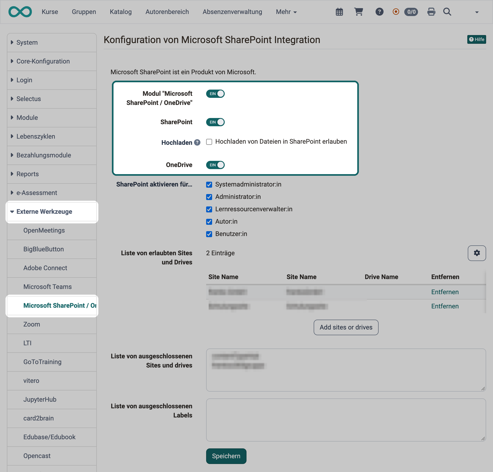

# SharePoint / OneDrive {: #sharepoint_onedrive}

!!! info "frentix-Kund:innen"

    Bei frentix-Kund:innen übernimmt die zuständige Kundenberatung bei frentix die Aktivierung.

Mit der Integration kopieren Benutzer:innen im File Hub und im Media Center von OpenOlat Dateien aus SharePoint und OneDrive und legen Dateien dort ab. Voraussetzung ist, dass Ihre Organisation die erforderlichen Lizenzen von Microsoft hat.

## SharePoint [:octicons-tag-16:{ title="ab Release 19.0.0 (OO-7510)" }](https://track.frentix.com/issue/OO-7510){:target="_blank"} {: #sharepoint}

Die Anmeldung über "Microsoft Azure AD" (Single Sign-on, SSO), Microsoft Teams und SharePoint nutzen dieselbe App bei Microsoft: die App, die Sie für den Cloud-Login "Microsoft Azure Active Directory" registrieren, siehe [Cloud-Login: Microsoft Azure Active Directory](Login_Cloud_Login.de.md#azure).

### Voraussetzung

Voraussetzung für SharePoint ist die Anmeldung über "Microsoft Azure AD": OpenOlat greift mit dem Microsoft-Konto der angemeldeten Person auf die Dateien zu. SharePoint und OneDrive erscheinen deshalb nur für Personen, die sich über "Microsoft Azure AD" angemeldet haben. Microsoft hat den Dienst Azure Active Directory in Microsoft Entra ID umbenannt. Für SharePoint ergänzen Sie in derselben App nur die entsprechenden Berechtigungen.

!!! tip "Tipp"

    Bei dieser Gelegenheit lässt sich auch "Office for the web" einschalten, mit dem Personen Word-, Excel- und PowerPoint-Dateien direkt im Browser anzeigen und bearbeiten. Dafür braucht die App bei Microsoft keine Änderung. Sie schalten es in der System-Administration ein unter `Administration > Externe Werkzeuge > Dokumenteneditoren`, Tab "Office for the web", siehe [Externe Werkzeuge: Dokumenteneditoren](External_Tools_-_Administration/index.de.md#dokumenteneditoren).

### Abfolge der Konfiguration

1. Registrieren Sie OpenOlat bei Microsoft als App, siehe [Cloud-Login: Microsoft Azure Active Directory](Login_Cloud_Login.de.md#azure).
2. Ergänzen Sie bei Microsoft in der App die Berechtigungen für die Anmeldung und für SharePoint. Nutzen Sie das Modul Microsoft Teams und dessen Funktion "Terminaufzeichnung", kommen die Berechtigungen für Teams dazu, siehe [Modul Microsoft Teams: Voraussetzungen](Teams_module.de.md#prerequisites).
3. Erzeugen Sie bei Microsoft den geheimen Clientschlüssel für OpenOlat, in OpenOlat heisst das Feld dafür "Client secret", siehe [Cloud-Login: Geheimen Clientschlüssel bei Microsoft erzeugen](Login_Cloud_Login.de.md#azure_client_secret).
4. Fügen Sie in OpenOlat im Cloud-Login "Microsoft Azure Active Directory" hinzu und tragen Sie "Client ID" und "Client secret" ein.
5. Schalten Sie nach Bedarf in OpenOlat das Modul "Microsoft SharePoint / OneDrive" ein.

### Aktivierung in der OpenOlat-Administration

Sie finden die Konfiguration in der System-Administration unter: 
`Administration > Externe Werkzeuge > Microsoft SharePoint / OneDrive`

Ist das Modul "Microsoft SharePoint / OneDrive" eingeschaltet, schalten Sie "SharePoint" und "OneDrive" einzeln und unabhängig voneinander ein.

Mit "Hochladen von Dateien in SharePoint erlauben" bietet OpenOlat beim Ablegen einer Datei auch die SharePoint-Sites als Ziel an. Ob das Ablegen in einer Site gelingt, entscheidet die Berechtigung der Person bei Microsoft. OpenOlat kennt diese Berechtigung nicht.

{ class="shadow lightbox" title="Seite Microsoft SharePoint / OneDrive in der System-Administration · 2026.11.27" }

---

## OneDrive {: #onedrive}

OneDrive richten Sie gleich ein wie SharePoint: mit derselben App bei Microsoft und derselben Anmeldung über "Microsoft Azure AD". Im Modul "Microsoft SharePoint / OneDrive" schalten Sie dazu "OneDrive" ein.

## Weiterführende Informationen {: #further_information}

**Auf dieser Seite erwähnt** 
[Cloud-Login >](Login_Cloud_Login.de.md) 
[Externe Werkzeuge: Übersicht >](External_Tools_-_Administration/index.de.md) 
[Modul Microsoft Teams >](Teams_module.de.md)

**Weiterführend** 
[Persönliche Werkzeuge: File Hub >](../../manual_user/personal_menu/File_Hub.de.md) 
[Persönliche Werkzeuge: Das Media Center >](../../manual_user/personal_menu/Media_Center.de.md)

[Zum Seitenanfang ^](#sharepoint_onedrive)

