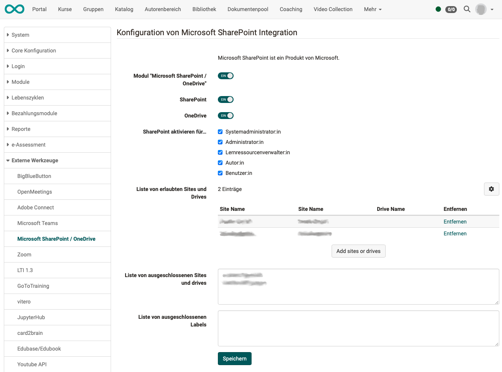

# SharePoint / OneDrive {: #sharepoint_onedrive}

!!! info "frentix-Kund:innen"

    Bei frentix-Kund:innen übernimmt die zuständige Kundenberatung bei frentix die Aktivierung.

## SharePoint [:octicons-tag-16:{ title="ab Release 19.0.0 (OO-7510)" }](https://track.frentix.com/issue/OO-7510){:target="_blank"} {: #sharepoint}

Für die Integration von SSO über Microsoft Entra ID, Microsoft Teams Online Meetings und die Microsoft SharePoint Integration wird nur eine einzige Microsoft Azure App eingerichtet.

### Voraussetzung

SSO über Microsoft Entra ID (ehemals Microsoft Azure AD Authentication) ist die Voraussetzung für die Nutzung der Microsoft SharePoint Integration in OpenOlat. Dafür wird nur die entsprechende Berechtigung in der Login App ergänzt.

!!! tip "Tipp"

    Im Rahmen dieser Konfiguration kann auch **Office for the web** aktiviert werden. Diese Einstellung braucht jedoch nicht in der Microsoft Azure App konfiguriert werden, sondern ausschliesslich in der System-Administration unter `Administration > Externe Werkzeuge > Dokumenteneditoren`, Tab "Office for the web".

### Abfolge der Konfiguration

1. Erstellung Microsoft Azure App-Registrierung
2. Ergänzung Berechtigungen in App-Registrierung für SSO über Microsoft Entra ID und für Microsoft SharePoint Integration
3. Generierung Schlüssel / Geheimnis (Key / Secret) für OpenOlat
4. Aktivierung SSO über Microsoft Azure AD Authentication (Microsoft Entra ID) in OpenOlat
5. nach Bedarf: Aktivierung der Microsoft SharePoint Integration in OpenOlat

### Aktivierung in der OpenOlat-Administration 

Sie finden die Konfiguration in der System-Administration unter: 
`Administration > Externe Werkzeuge > Microsoft SharePoint / OneDrive`

**Beachten Sie:** 
SharePoint und OneDrive können einzeln und unabhängig voneinander eingebunden werden.

{ class="shadow lightbox" title="Seite Microsoft SharePoint / OneDrive in der System-Administration" }

---

## OneDrive {: #onedrive}

Die Einbindung von OneDrive verläuft sehr ähnlich wie bei SharePoint und kann analog zur vorstehenden Beschreibung vorgenommen werden.

