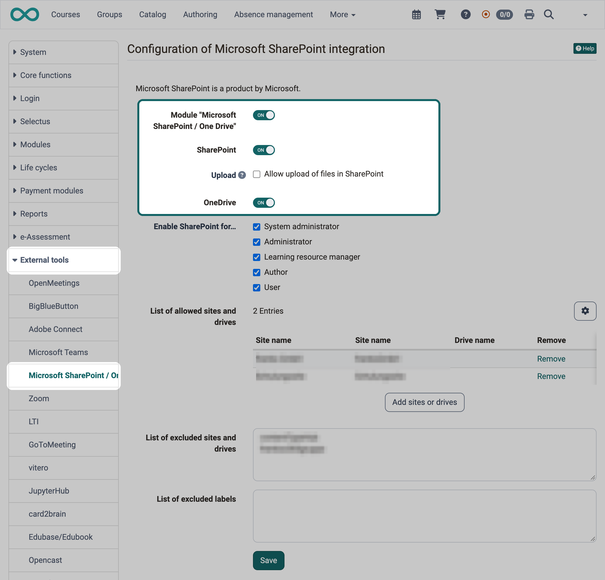

# SharePoint / OneDrive {: #sharepoint_onedrive}

!!! info "frentix customers"

    For frentix customers, their customer advisor at frentix takes care of the activation.

With the integration, users copy files from SharePoint and OneDrive in the File Hub and in the Media Center of OpenOlat and store files there. The prerequisite is that your organisation has the required licenses from Microsoft.

## SharePoint [:octicons-tag-16:{ title="from Release 19.0.0 (OO-7510)" }](https://track.frentix.com/issue/OO-7510){:target="_blank"} {: #sharepoint}

The login via "Microsoft Azure AD" (single sign-on, SSO), Microsoft Teams and SharePoint use the same app at Microsoft: the app that you register for the cloud login "Microsoft Azure Active Directory", see [Cloud login: Microsoft Azure Active Directory](Login_Cloud_Login.md#azure).

### Requirements

The prerequisite for SharePoint is the login via "Microsoft Azure AD": OpenOlat accesses the files with the Microsoft account of the logged-in person. SharePoint and OneDrive therefore only appear for persons who have logged in via "Microsoft Azure AD". Microsoft has renamed the service Azure Active Directory to Microsoft Entra ID. For SharePoint, you only add the corresponding permissions in the same app.

!!! tip "Tip"

    On this occasion, you can also switch on "Office for the web", with which persons view and edit Word, Excel and PowerPoint files directly in the browser. The app at Microsoft needs no change for this. You switch it on in the system administration under `Administration > External tools > Document editors`, tab "Office for the web", see [External tools: Document editors](External_Tools_-_Administration/index.md#dokumenteneditoren).

### Configuration sequence

1. Register OpenOlat at Microsoft as an app, see [Cloud login: Microsoft Azure Active Directory](Login_Cloud_Login.md#azure).
2. At Microsoft, add the permissions for the login and for SharePoint in the app. If you use the module Microsoft Teams and its function "Meeting recording", the permissions for Teams are added, see [Microsoft Teams module: Prerequisites](Teams_module.md#prerequisites).
3. Create the client secret for OpenOlat at Microsoft, in OpenOlat the field for it is called "Client secret", see [Cloud login: Create the client secret at Microsoft](Login_Cloud_Login.md#azure_client_secret).
4. In OpenOlat, add "Microsoft Azure Active Directory" in the cloud login and enter "Client ID" and "Client secret".
5. As required, switch on the module "Microsoft SharePoint / OneDrive" in OpenOlat.

### Activation in the OpenOlat administration

You find the configuration in the system administration under: 
`Administration > External tools > Microsoft SharePoint / OneDrive`

If the module "Microsoft SharePoint / OneDrive" is switched on, you switch on "SharePoint" and "OneDrive" individually and independently of each other.

With "Allow upload of files in SharePoint", OpenOlat also offers the SharePoint sites as a target when someone saves a file. Whether saving to a site works depends on the permission of the person at Microsoft. OpenOlat does not know this permission.

{ class="shadow lightbox" title="Microsoft SharePoint / OneDrive page in the system administration · 2026.11.27" }

---

## OneDrive {: #onedrive}

You set up OneDrive in the same way as SharePoint: with the same app at Microsoft and the same login via "Microsoft Azure AD". In the module "Microsoft SharePoint / OneDrive", you switch on "OneDrive" for this.

## Further information {: #further_information}

**Mentioned on this page** 
[Cloud login >](Login_Cloud_Login.md) 
[External Tools: Overview >](External_Tools_-_Administration/index.md) 
[Microsoft Teams module >](Teams_module.md)

**Further reading** 
[User tools: File Hub >](../../manual_user/personal_menu/File_Hub.md) 
[User tools: Media Center >](../../manual_user/personal_menu/Media_Center.md)

[To the top of the page ^](#sharepoint_onedrive)
