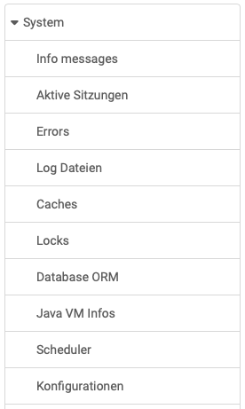

# System {: #system}

{ class="shadow lightbox aside-left-lg" }

Im Bereich "System" der System-Administration erhalten Systemadministrator:innen allgemeine Informationen zum laufenden OpenOlat, etwa zum genutzten Speicher, zu den aktuellen Klickzahlen oder zu den Verzeichnissen. Sie öffnen den Bereich unter `Administration > System`.

Das nebenstehende Bild zeigt die Einträge des Menüs. Jeder Eintrag hat auf dieser Seite einen eigenen Abschnitt.

---

## Info messages {: #info_message}

Mit einer Meldung informieren Systemadministrator:innen alle Personen, die OpenOlat aufrufen, zum Beispiel über Wartungsarbeiten. Zwei Meldungen stehen zur Wahl:

- "Info Meldung": erscheint auf der Login-Seite neben dem Anmeldebereich.
- "Wartungsmeldung": erscheint auf allen OpenOlat-Seiten.

Beide Meldungen schreiben Sie im HTML-Editor von OpenOlat. Weitere Dokumente, etwa eine PDF-Datei, legen Sie im "Static Ordner" ab, der auf derselben Seite unter den Meldungen steht, und verlinken sie in der Meldung.

[Zum Seitenanfang ^](#system)

## Aktive Sitzungen {: #active_sessions}

Hier sehen Systemadministrator:innen, wer gerade in OpenOlat angemeldet ist und über welchen Zugang. Der Tab "Sitzungen von Benutzer:innen" listet die Sitzungen der angemeldeten Personen: `Administration > System > Aktive Sitzungen > Tab "Sitzungen von Benutzer:innen"`. Die Spalte "Modus" zeigt, über welchen Zugang eine Sitzung entstanden ist: "web 2.0" für die Weboberfläche, "WebDAV" oder "REST". Dieselbe Person kann deshalb mehrmals in der Liste stehen, etwa mit einer Sitzung in der Weboberfläche und einer WebDAV-Sitzung.

Öffnet eine Person einen Inhalt, den OpenOlat über die [Inhaltsdomäne](../../manual_user/basic_concepts/Content_Domain.de.md) (separate Adresse für Inhalte) ausliefert, erhält dieser Zugriff eine eigene Sitzung. Sie liefert nur den Inhalt aus und erhält keine OpenOlat-Oberfläche. Die Liste führt solche Sitzungen nicht auf.

[Zum Seitenanfang ^](#system)

## Errors {: #errors}

!!! info "frentix-Kund:innen"
    Bei frentix-Kund:innen übernimmt die zuständige Kundenberatung bei frentix die Einstellung "Log levels".

Im Tab "Fehler" suchen Systemadministrator:innen eine Fehlermeldung nach Fehlernummer und Datum.

Im Tab "Log levels" legen Systemadministrator:innen für jeden Logger fest, wie ausführlich OpenOlat protokolliert: "Error", "Warn", "Info" oder "Debug".

[Zum Seitenanfang ^](#system)

## Log Dateien {: #log_files}

!!! info "frentix-Kund:innen"
    Bei frentix-Kund:innen übernimmt die zuständige Kundenberatung bei frentix diese Konfiguration.

Hier finden Systemadministrator:innen die Dateien im Log-Verzeichnis des Servers, je mit Dateiname und Grösse. Ein Klick auf einen Dateinamen lädt die Datei herunter. Die Dateien "olat.log", "catalina.out" und "syncher.log" stehen zuoberst, die übrigen folgen nach dem Datum der letzten Änderung, die neueste zuerst.

[Zum Seitenanfang ^](#system)

## Caches {: #caches}

!!! info "frentix-Kund:innen"
    Bei frentix-Kund:innen übernimmt die zuständige Kundenberatung bei frentix diese Konfiguration.

Hier sehen Systemadministrator:innen die Cache-Einstellungen und leeren die OpenOlat-Caches.

[Zum Seitenanfang ^](#system)

## Locks {: #locks}

Hier sehen Systemadministrator:innen die Objekte, die Benutzer:innen gesperrt haben.

[Zum Seitenanfang ^](#system)

## Database ORM {: #database}

!!! info "frentix-Kund:innen"
    Bei frentix-Kund:innen übernimmt die zuständige Kundenberatung bei frentix diese Konfiguration.

Die Seite "Database ORM" liefert Statistik-Angaben und listet JPA Queries und JPA Entities.

[Zum Seitenanfang ^](#system)

## Java VM Infos {: #java}

Hier finden Systemadministrator:innen Informationen zum Java Speicher, zu Threads und Umgebungsvariablen und können die Java Garbage Collection starten.

[Zum Seitenanfang ^](#system)

## Scheduler {: #scheduler}

Hier finden Systemadministrator:innen eine Übersicht über Scheduler-Jobs.

[Zum Seitenanfang ^](#system)

## Konfigurationen {: #system_config}

!!! info "frentix-Kund:innen"
    Bei frentix-Kund:innen übernimmt die zuständige Kundenberatung bei frentix diese Konfiguration.

Hier finden Systemadministrator:innen eine Auflistung aller Keys der Standard-Variablen und die Modul-Konfigurationen.

[Zum Seitenanfang ^](#system)

## Weiterführende Informationen {: #further_information}

[Inhaltsdomäne >](../../manual_user/basic_concepts/Content_Domain.de.md) 
[WebDAV >](WebDAV.de.md) 
[REST API >](REST_API.de.md)

[Zum Seitenanfang ^](#system)
