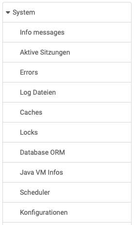

# System {: #system}

{ class="shadow lightbox aside-left-lg" }

In the "System" area of the OpenOlat administration, system administrators receive general information about the runtime, such as memory used, current click counts or directories.

System administrators have access to the adjacent menu here.

---

## Info messages {: #info_message}

Here you can create an info message in the OpenOlat HTML editor which appears on the **login page** next to the login access area.

There is also a separate area for **maintenance messages**. This information, which appears on all OpenOlat pages, can also be created in the OpenOlat Editor.

In addition, documents (e.g. further information in pdf form) can be linked. A "static folder" is available for this purpose.

[To the top of the page ^](#system)

## Active sessions {: #active_sessions}

Here you see the sessions of the persons currently logged in. The column "Mode" shows through which access a session was created, for example "WebDAV", "REST" or "Content". The value "Content" stands for an access through the [content domain](../../manual_user/basic_concepts/Content_Domain.md) (separate address for content). Such a session only delivers content and does not receive an OpenOlat user interface. This is why the same person can appear twice in the list: once with their session in OpenOlat and once with the mode "Content".

[To the top of the page ^](#system)

## Errors {: #errors}

!!! info "frentix customers"
    For frentix customers, their customer advisor at frentix takes care of the setting "Log levels".

In the "Errors" tab, system administrators search for an error message by error number and date.

In the "Log levels" tab, system administrators define for each logger how detailed OpenOlat logs: "Error", "Warn", "Info" or "Debug".

[To the top of the page ^](#system)

## Log files {: #log_files}

!!! info "frentix customers"
    For frentix customers, their customer advisor at frentix takes care of this configuration.

Here system administrators find the files in the log directory of the server, each with file name and size. A click on a file name downloads the file. The files "olat.log", "catalina.out" and "syncher.log" are at the top, the other files follow by the date of their last change, the newest first.

[To the top of the page ^](#system)

## Caches {: #caches}

!!! info "frentix customers"
    For frentix customers, their customer advisor at frentix takes care of this configuration.

Here system administrators see the cache settings and empty the OpenOlat caches.

[To the top of the page ^](#system)

## Locks {: #locks}

Here system administrators see the objects that users have locked.

[To the top of the page ^](#system)

## Database ORM {: #database}

!!! info "frentix customers"
    For frentix customers, their customer advisor at frentix takes care of this configuration.

The "Database ORM" page provides statistical information and lists JPA queries and JPA entities.

[To the top of the page ^](#system)

## Java VM Info {: #java}

Here, system administrators can find information about Java memory, threads, and environment variables and can start the Java Garbage Collection.

[To the top of the page ^](#system)

## Scheduler {: #scheduler}

System administrators can find an overview of scheduler jobs here.

[To the top of the page ^](#system)

## Configuration overview {: #system_config}

!!! info "frentix customers"
    For frentix customers, their customer advisor at frentix takes care of this configuration.

Here system administrators can find a list of all keys for the standard variables and the module configurations.

[To the top of the page ^](#system)

## Further information {: #further_information}

[Content domain >](../../manual_user/basic_concepts/Content_Domain.md) 
[WebDAV >](WebDAV.md) 
[REST API >](REST_API.md)

[To the top of the page ^](#system)
