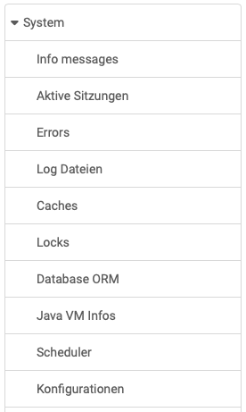

# System {: #system}

{ class="shadow lightbox aside-left-lg" }

In the "System" area of the system administration, system administrators receive general information about the running OpenOlat, for example about the memory used, the current click counts or the directories. You open the area under `Administration > System`.

The adjacent image shows the entries of the menu. Each entry has its own section on this page.

---

## Info messages {: #info_message}

With a message, system administrators inform all persons who call up OpenOlat, for example about maintenance work. Two messages are available:

- "Info message": appears on the login page next to the login area.
- "Maintenance message": appears on all OpenOlat pages.

You write both messages in the HTML editor of OpenOlat. You store further documents, for example a PDF file, in the "Static folder", which is on the same page below the messages, and link them in the message.

[To the top of the page ^](#system)

## Active sessions {: #active_sessions}

Here system administrators see who is currently logged in to OpenOlat and through which access. The tab "User sessions" lists the sessions of the persons logged in: `Administration > System > Active sessions > Tab "User sessions"`. The column "Mode" shows through which access a session was created: "web 2.0" for the web interface, "WebDAV" or "REST". This is why the same person can appear several times in the list, for example with a session in the web interface and a WebDAV session.

If a person opens content that OpenOlat delivers through the [content domain](../../manual_user/basic_concepts/Content_Domain.md) (separate address for content), this access receives a session of its own. It only delivers the content and does not receive an OpenOlat user interface. The list does not show such sessions.

[To the top of the page ^](#system)

## Errors {: #errors}

!!! info "frentix customers"
    For frentix customers, their customer advisor at frentix takes care of the setting "Log levels".

In the "Errors" tab, system administrators search for an error message by error number and date.

In the "Log levels" tab, system administrators define for each logger how detailed OpenOlat logs: "Error", "Warn", "Info" or "Debug".

[To the top of the page ^](#system)

## Log files {: #log_files}

!!! info "frentix customers"
    For frentix customers, their customer advisor at frentix takes care of this configuration.

Here system administrators find the files in the log directory of the server, each with file name and size. A click on a file name downloads the file. The files "olat.log", "catalina.out" and "syncher.log" are at the top, the other files follow by the date of their last change, the newest first.

[To the top of the page ^](#system)

## Caches {: #caches}

!!! info "frentix customers"
    For frentix customers, their customer advisor at frentix takes care of this configuration.

Here system administrators see the cache settings and empty the OpenOlat caches.

[To the top of the page ^](#system)

## Locks {: #locks}

Here system administrators see the objects that users have locked.

[To the top of the page ^](#system)

## Database ORM {: #database}

!!! info "frentix customers"
    For frentix customers, their customer advisor at frentix takes care of this configuration.

The "Database ORM" page provides statistical information and lists JPA queries and JPA entities.

[To the top of the page ^](#system)

## Java VM Infos {: #java}

Here, system administrators can find information about Java memory, threads, and environment variables and can start the Java Garbage Collection.

[To the top of the page ^](#system)

## Scheduler {: #scheduler}

System administrators can find an overview of scheduler jobs here.

[To the top of the page ^](#system)

## Configuration overview {: #system_config}

!!! info "frentix customers"
    For frentix customers, their customer advisor at frentix takes care of this configuration.

Here system administrators can find a list of all keys for the standard variables and the module configurations.

[To the top of the page ^](#system)

## Further information {: #further_information}

[Content domain >](../../manual_user/basic_concepts/Content_Domain.md) 
[WebDAV >](WebDAV.md) 
[REST API >](REST_API.md)

[To the top of the page ^](#system)
