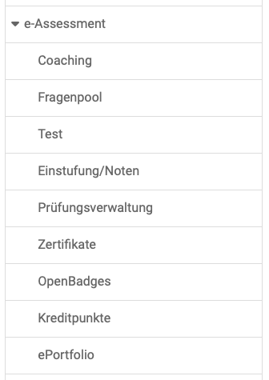

# e-Assessment Administration: Übersicht {: #e-assessments}

{ class="shadow lightbox aside-left-lg" }

Administrator:innen richten im Menü e-Assessment der System-Administration die Werkzeuge rund um Bewertung und Prüfungen für die ganze Instanz ein. Jeder Abschnitt dieser Seite gehört zu einem Eintrag des Menüs und führt zu dessen Detailseite.

## Coaching {: #coaching}

Unter "Coaching" sehen Administrator:innen, dass das Coaching auf der Instanz eingeschaltet ist. Die Checkbox "Coaching Zugang" ist ausgegraut, weil Betreuer:innen und Besitzer:innen ihre Lernressourcen über das Coaching erreichen. [:octicons-tag-16:{ title="ab Release 21.0.1 (OO-9661)" }](https://track.frentix.com/issue/OO-9661)

[Zu den Details >](../../manual_user/area_modules/Coaching.de.md#availability) 
[Zum Seitenanfang ^](#e-assessments)

## Fragenpool {: #questionpool}

Hier legen Sie die Grundeinstellungen des Fragenpools für die ganze Instanz fest.

[Zu den Details >](../administration/eAssessment_Question_bank.de.md) 
[Zum Seitenanfang ^](#e-assessments)

## Test {: #test}

An dieser Stelle wird die Testquittung konfiguriert und werden Einstellungen für den Korrektur-Workflow von Tests definiert. Mit Hilfe des Korrektur-Workflows können Sie persönliche Korrekturaufträge generieren und diese definierten Korrektor:innen zuweisen. Die Korrektur über das Bewertungswerkzeug im Kurs ist dann nicht mehr möglich.

[Zu den Details >](../administration/e-Assessment_Test.de.md)  
[Zum Seitenanfang ^](#e-assessments)

## Einstufung/Noten [:octicons-tag-16:{ title="ab Release 16.2 (OO-6007)" }](https://track.frentix.com/issue/OO-6007) {: #grading_levels}

Neben der Bewertung mit Punkten lässt sich das Modul "Einstufung/Noten" einschalten. Dort ergänzen und konfigurieren Administrator:innen Bewertungssysteme und legen das Standard-Bewertungssystem fest, das in neuen Bewertungsskalen vorausgewählt ist. [:octicons-tag-16:{ title="ab Release 21.1.0 (OO-9596)" }](https://track.frentix.com/issue/OO-9596)

[Zu den Details >](../administration/Assessment_translate_points_in_grades_admin.de.md)  
[Zum Seitenanfang ^](#e-assessments)

## Prüfungsverwaltung {: #exam_admin}

An dieser Stelle können Administrator:innen Prüfungsmodus und Prüfungseinsicht für die OpenOlat Instanz grundsätzlich aktivieren und nach Prüfungen suchen. Ausserdem können Konfigurationsvorlagen für den Safe Exam Browser hinzugefügt und verwaltet werden.

[Zu den Details >](../administration/e-Assessment_AssessmentMgmt.de.md) 
[Zum Seitenanfang ^](#e-assessments)

## Zertifikate {: #certificates}

Hier kann eine E-Mail-Adresse hinterlegt werden, an die Kopien der erstellten Zertifikate geschickt werden. Auch sind Kopien an Linienvorgesetzte möglich.

Der Upload externer Zertifikate kann ebenfalls hier freigeschaltet werden. 

Zusätzlich ist diese Funktion auch für Benutzerverwalter:innen, Linienvorgesetzte derselben Organisation oder für verantwortliche Personen mit einer Beziehungsrolle verfügbar und kann jeweils separat konfiguriert werden.

[Zu den Details >](../administration/e-Assessment_Certificates.de.md)  
[Zum Seitenanfang ^](#e-assessments)

## OpenBadges [:octicons-tag-16:{ title="ab Release 18.0 (OO-6999)" }](https://track.frentix.com/issue/OO-6999) {: #openbadges}

Hier schalten Administrator:innen die Badges ein. Ausserdem erstellen und verwalten sie hier die globalen Badges.

[Zu den Details >](../administration/e-Assessment_openBadges.de.md) 
[Zum Seitenanfang ^](#e-assessments)

## Kreditpunkte [:octicons-tag-16:{ title="ab Release 20.1.1 (OO-8558)" }](https://track.frentix.com/issue/OO-8558) {: #credit_points}

Sind die Kreditpunkte hier eingeschaltet, vergeben Kursbesitzer:innen ihren Teilnehmenden Kreditpunkte für das erfolgreiche Bestehen eines Kurses.

[Zu den Details >](../administration/e-Assessment_Credit_Points.de.md) 
[Zum Seitenanfang ^](#e-assessments)

## ePortfolio {: #portfolio}

Das ePortfolio kann von Administrator:innen ein- oder ausgeschaltet werden. Ist es aktiviert, können verschiedene Einstellungen zu den Nutzungsmöglichkeiten festgelegt werden.

[Zu den Details >](eAssessment_ePortfolio.de.md) 
[Zum Seitenanfang ^](#e-assessments)

---

## Weiterführende Informationen {: #further_information}

[Wie richte ich als Administrator:in den Safe Exam Browser (SEB) systemweit ein? >](../../manual_how-to/SEB_Admin/SEB_Admin.de.md) 
[Prüfungsverwaltung: Übersicht >](../../manual_user/learningresources/Assessment_Management.de.md)

[Zum Seitenanfang ^](#e-assessments)
