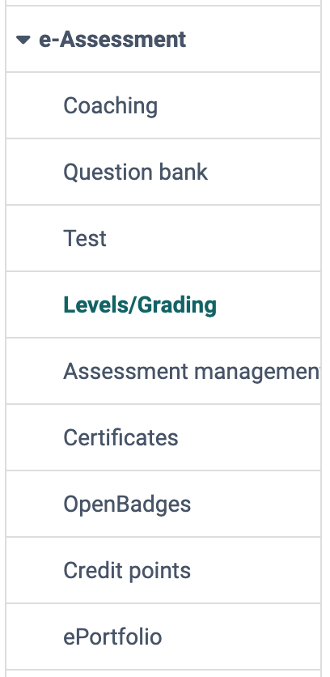

# e-Assessment Administration: Overview {: #e-assessments}

{ width="204" class="shadow lightbox aside-left-lg" }

In the e-Assessment menu of the system administration, administrators set up the tools for assessment and exams for the whole instance. Each section of this page belongs to an entry of the menu and leads to its detail page.

## Coaching {: #coaching}

Under "Coaching", administrators see that coaching is switched on for the instance. The checkbox "Coaching enabled" is greyed out, because coaches and owners reach their learning resources through coaching. [:octicons-tag-16:{ title="from Release 21.0.1 (OO-9661)" }](https://track.frentix.com/issue/OO-9661)

[See the details >](../../manual_user/area_modules/Coaching.md#availability) 
[To the top of the page ^](#e-assessments)

## Question bank {: #questionpool}

Here you set the basic settings of the question bank for the whole instance.

[See the details >](../administration/eAssessment_Question_bank.md) 
[To the top of the page ^](#e-assessments)

## Test {: #test}

This is where the test receipt is configured and settings for the correction flow of tests are defined. You can use the correction workflow to generate personal correction orders and assign them to defined correctors. Correction via the assessment tool in the course is then no longer possible.

[See the details >](../administration/e-Assessment_Test.md)  
[To the top of the page ^](#e-assessments)

## Levels/Grading [:octicons-tag-16:{ title="from Release 16.2 (OO-6007)" }](https://track.frentix.com/issue/OO-6007) {: #grading_levels}

In addition to the assessment with points, the module "Levels/Grading" can be switched on. There, administrators add and configure rating systems and set the default rating system that is preselected in new rating scales. [:octicons-tag-16:{ title="from Release 21.1.0 (OO-9596)" }](https://track.frentix.com/issue/OO-9596)

[See the details >](../administration/Assessment_translate_points_in_grades_admin.md)  
[To the top of the page ^](#e-assessments)

## Assessment management {: #exam_admin}

Here, administrators can enable exam mode and exam viewing for the OpenOlat instance and search for exams. They can also add and manage configuration templates for the Safe Exam Browser.

[See the details >](../administration/e-Assessment_AssessmentMgmt.md) 
[To the top of the page ^](#e-assessments)

## Certificates {: #certificates}

An email address can be stored here to which copies of the certificates created can be sent. Copies to line managers are also possible.

The upload of external certificates can also be enabled here.

In addition, this function is also available for user administrators, line managers in the same organization or for responsible persons with a relation role and can be configured separately in each case.

[See the details >](../administration/e-Assessment_Certificates.md)  
[To the top of the page ^](#e-assessments)

## OpenBadges [:octicons-tag-16:{ title="from Release 18.0 (OO-6999)" }](https://track.frentix.com/issue/OO-6999) {: #openbadges}

Here, administrators switch on badges. They also create and manage the global badges here.

[See the details >](../administration/e-Assessment_openBadges.md) 
[To the top of the page ^](#e-assessments)

## Credit points [:octicons-tag-16:{ title="from Release 20.1.1 (OO-8558)" }](https://track.frentix.com/issue/OO-8558) {: #credit_points}

When credit points are switched on here, course owners award credit points to their participants for successfully completing a course.

[See the details >](../administration/e-Assessment_Credit_Points.md) 
[To the top of the page ^](#e-assessments)

## ePortfolio {: #portfolio}

The ePortfolio can be switched on or off by administrators. If it is activated, various settings can be defined for the usage options.

[See the details >](eAssessment_ePortfolio.md) 
[To the top of the page ^](#e-assessments)

---

## Further information {: #further_information}

[As an administrator, how do I set up the Safe Exam Browser (SEB) system-wide? >](../../manual_how-to/SEB_Admin/SEB_Admin.md) 
[Assessment Management: Overview >](../../manual_user/learningresources/Assessment_Management.md)

[To the top of the page ^](#e-assessments)
