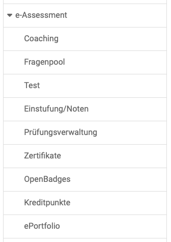

# e-Assessment Administration: Übersicht {: #e-assessments}

{ class="shadow lightbox aside-left-lg" }

Systemadministrator:innen richten im Menü e-Assessment der System-Administration die Werkzeuge rund um Bewertung und Prüfungen für die ganze Instanz ein. Sie finden das Menü in der System-Administration unter: 
`Administration > e-Assessment`

## Menüpunkte {: #menu_items}

Suchen Sie einen Menüpunkt, sagt Ihnen die Übersicht in einem Satz, wozu er dient, und führt Sie mit dem Link zu seiner Beschreibung. Die Tabelle folgt der Reihenfolge des Menüs "e-Assessment".

| Menüpunkt | Wozu |
|---|---|
| [Coaching](#coaching) | Sehen, dass das Coaching auf der Instanz eingeschaltet ist. Beschrieben weiter unten auf dieser Seite. |
| [Fragenpool](../eAssessment_Question_bank.de.md) | Die Grundeinstellungen des Fragenpools für die ganze Instanz festlegen. |
| [Test](../e-Assessment_Test.de.md) | Die Testquittung einrichten, die Korrektur und den Korrektur-Workflow für Tests festlegen und die Zusatzseite für handschriftliche Prüfungen definieren. |
| [Einstufung/Noten](../Assessment_translate_points_in_grades_admin.de.md) | Das Modul "Einstufung/Noten" einschalten, Bewertungssysteme ergänzen und konfigurieren und das Standard-Bewertungssystem festlegen, das in neuen Bewertungsskalen vorausgewählt ist. |
| [Prüfungsverwaltung](../e-Assessment_AssessmentMgmt.de.md) | Prüfungsmodus und Prüfungseinsicht für die ganze Instanz einschalten, nach Prüfungsmodi suchen und die Konfigurationsvorlagen für den Safe Exam Browser verwalten. |
| [Zertifikate](../e-Assessment_Certificates.de.md) | Festlegen, wer externe Zertifikate hochladen darf und wer eine Kopie neuer Zertifikate erhält, die Zertifikatsvorlagen bestimmen und fehlerhafte Zertifikate reparieren. |
| [OpenBadges](../e-Assessment_openBadges.de.md) | Die Badges einschalten und die globalen Badges erstellen und verwalten. |
| [Kreditpunkte](../e-Assessment_Credit_Points.de.md) | Die Kreditpunkte einschalten, damit Kursbesitzer:innen ihren Teilnehmenden Kreditpunkte für das Bestehen eines Kurses vergeben. |
| [ePortfolio](../eAssessment_ePortfolio.de.md) | Das ePortfolio ein- oder ausschalten und festlegen, in welchem Umfang Teilnehmende eigene Mappen erstellen und nutzen. |

[Zum Seitenanfang ^](#e-assessments)

## Coaching {: #coaching}

Unter "Coaching" sehen Systemadministrator:innen, dass das Coaching auf der Instanz eingeschaltet ist. Die Checkbox "Coaching Zugang" ist ausgegraut, weil Betreuer:innen und Besitzer:innen ihre Lernressourcen über das Coaching erreichen. [:octicons-tag-16:{ title="ab Release 21.0.1 (OO-9661)" }](https://track.frentix.com/issue/OO-9661)

[Zu den Details >](../../../manual_user/area_modules/Coaching/index.de.md#availability) 
[Zum Seitenanfang ^](#e-assessments)

---

## Weiterführende Informationen {: #further_information}

[Wie richte ich als Systemadministrator:in den Safe Exam Browser (SEB) systemweit ein? >](../../../manual_how-to/SEB_Admin/SEB_Admin.de.md) 
[Prüfungsverwaltung: Übersicht >](../../../manual_user/learningresources/Assessment_Management/index.de.md)

[Zum Seitenanfang ^](#e-assessments)
