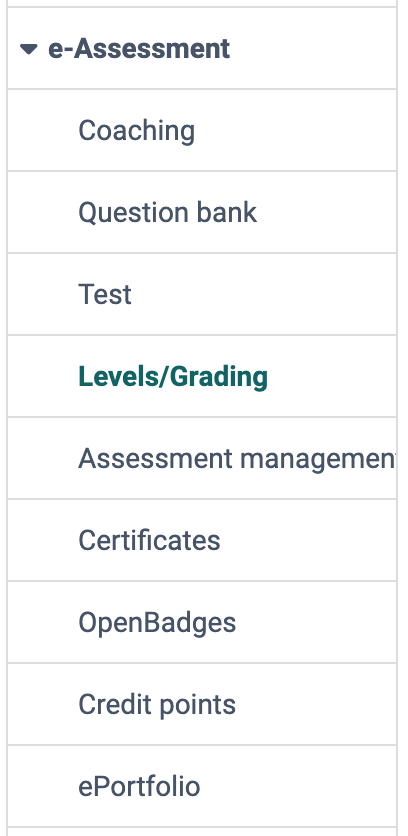

# e-Assessment Administration: Overview {: #e-assessments}

{ width="204" class="shadow lightbox aside-left-lg" }

In the e-Assessment menu of the system administration, system administrators set up the tools for assessment and exams for the whole instance. You find the menu in the system administration under: 
`Administration > e-Assessment`

## Menu items {: #menu_items}

If you are looking for a menu item, the overview tells you in one sentence what it is for, and the link takes you to its description. The table follows the order of the menu "e-Assessment".

| Menu item | Purpose |
|---|---|
| [Coaching](#coaching) | See that coaching is switched on for the instance. Described further down on this page. |
| [Question bank](../eAssessment_Question_bank.md) | Define the basic settings of the question bank for the whole instance. |
| [Test](../e-Assessment_Test.md) | Set up the test receipt, define the correction and the correction workflow for tests and define the additional page for handwritten exams. |
| [Levels/Grading](../Assessment_translate_points_in_grades_admin.md) | Switch on the module "Levels/Grading", add and configure rating systems and define the default rating system that is preselected in new rating scales. |
| [Assessment management](../e-Assessment_AssessmentMgmt.md) | Switch on assessment mode and assessment inspection for the whole instance, search for assessment modes and manage the configuration templates for the Safe Exam Browser. |
| [Certificates](../e-Assessment_Certificates.md) | Define who may upload external certificates and who receives a copy of new certificates, determine the certificate templates and repair broken certificates. |
| [OpenBadges](../e-Assessment_openBadges.md) | Switch on badges and create and manage the global badges. |
| [Credit points](../e-Assessment_Credit_Points.md) | Switch on credit points so that course owners award credit points to their participants for passing a course. |
| [ePortfolio](../eAssessment_ePortfolio.md) | Switch the ePortfolio on or off and define to what extent participants create and use their own binders. |

[To the top of the page ^](#e-assessments)

## Coaching {: #coaching}

Under "Coaching", system administrators see that coaching is switched on for the instance. The checkbox "Coaching enabled" is greyed out, because coaches and owners reach their learning resources through coaching. [:octicons-tag-16:{ title="from Release 21.0.1 (OO-9661)" }](https://track.frentix.com/issue/OO-9661)

[See the details >](../../../manual_user/area_modules/Coaching/index.md#availability) 
[To the top of the page ^](#e-assessments)

---

## Further information {: #further_information}

[As a system administrator, how do I set up the Safe Exam Browser (SEB) system-wide? >](../../../manual_how-to/SEB_Admin/SEB_Admin.md) 
[Assessment Management: Overview >](../../../manual_user/learningresources/Assessment_Management/index.md)

[To the top of the page ^](#e-assessments)
