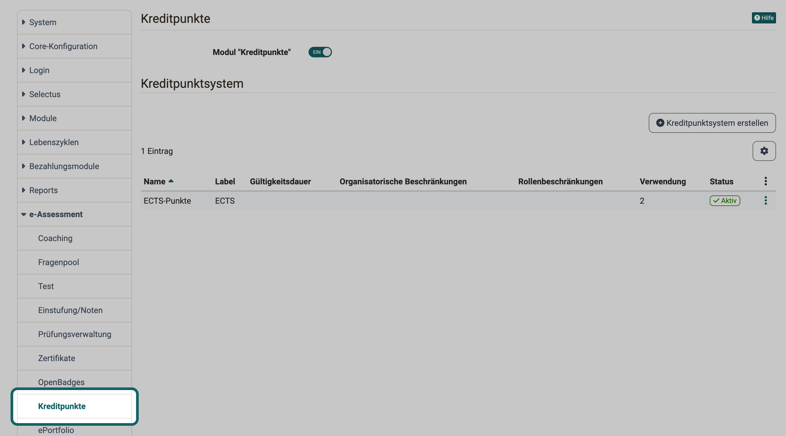
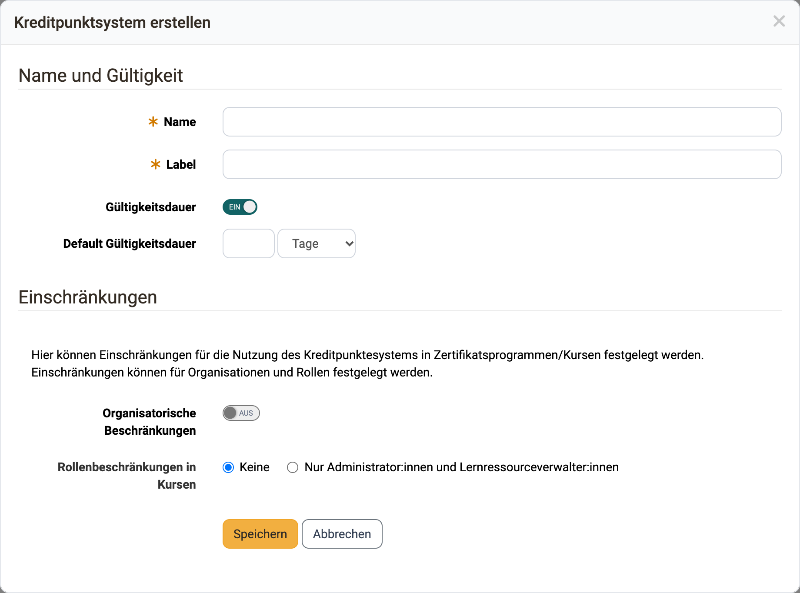

# e-Assessment Administration: Kreditpunkte {: #credit_points}

Nach Aktivierung der Kreditpunkte in der System-Administration unter `Administration > e-Assessment > Kreditpunkte` können Kursbesitzer:innen ihren Kursteilnehmer:innen Kreditpunkte für das erfolgreiche Bestehen eines Kurses vergeben. Teilnehmende sammeln die Punkte und verwenden sie in OpenOlat weiter, auch in Zertifikatsprogrammen.

{ class="shadow lightbox" title="Seite Kreditpunkte in der System-Administration · 2026.10.26" }

[Zum Seitenanfang ^](#credit_points)

---

## Eigenes Kreditpunktesystem erstellen [:octicons-tag-16:{ title="ab Release 20.1.1 (OO-8558)" }](https://track.frentix.com/issue/OO-8558){:target="_blank"} {: #define_credit_point_system}

Über das Modul können eigene Kreditpunktesysteme global definiert werden. Diese ermöglichen später den Teilnehmenden für das Bestehen von Kursen Bildungspunkte/Credits, wie zum Beispiel ECTS oder LearnCoins, zu sammeln.

Den Dialog öffnen Sie mit "Kreditpunktsystem erstellen". Im Abschnitt "Name und Gültigkeit" vergeben Sie Name und Label und legen bei Bedarf eine "Default Gültigkeitsdauer" fest. Im Abschnitt "Einschränkungen" begrenzen Sie mit "Organisatorische Beschränkungen" die Nutzung des Kreditpunktesystems in Zertifikatsprogrammen und Kursen auf bestimmte Organisationen, und mit "Rollenbeschränkungen in Kursen" legen Sie fest, ob nur Administrator:innen und Lernressourcenverwalter:innen das Kreditpunktesystem in Kursen verwenden können.

{ class="shadow lightbox" title="Dialog Kreditpunktsystem erstellen · 2026.10.26" }

[Zum Seitenanfang ^](#credit_points)

---

## Kreditpunkte im Coaching einsehen lassen [:octicons-tag-16:{ title="ab Release 21.1 (OO-9490)" }](https://track.frentix.com/issue/OO-9490){:target="_blank"} {: #credit_points_coaching}

Linienvorgesetzte und Ausbildungsverantwortliche sehen die Kreditpunkte der Personen in ihrer Organisation im Coaching Tool, nur lesend, wenn Sie ihnen das Recht "Kreditpunkte anzeigen" erteilen. Sie setzen das Recht im [Modul Organisationen](Modules_Organisations.de.md#rights_linemanager) im Tab "Linienvorgesetzte:r" bzw. "Ausbildungsverantwortliche" einer Organisation auf oberster Ebene. Für eigene Rollen setzen Sie es unter `Administration > Module > Rolle Person zu Person`. Ab Werk ist das Recht aus. Ist ein Kreditpunktesystem auf Organisationen beschränkt, sehen diese Personen es nur, wenn sie selbst einer dieser Organisationen angehören. Was der Tab zeigt, beschreibt [Coaching - Personen](../../manual_user/area_modules/Coaching_People.de.md#tab_credit_points).

[Zum Seitenanfang ^](#credit_points)

---

## Weiterführende Informationen {: #further_information}

[Kreditpunkte in Kursen vergeben >](../../manual_user/learningresources/Course_Settings_Assessment.de.md) 
[Course Planner: Zertifikatsprogramme >](../../manual_user/area_modules/Course_Planner_Certification_Programs.de.md) 
[Persönliche Erfolge/Leistungen: Kreditpunkte >](../../manual_user/personal_menu/Credit_Points.de.md) 
[e-Assessment Administration: Zertifikate >](e-Assessment_Certificates.de.md) 
[Modul Organisationen >](Modules_Organisations.de.md) 
[Coaching - Personen >](../../manual_user/area_modules/Coaching_People.de.md)

[Zum Seitenanfang ^](#credit_points)