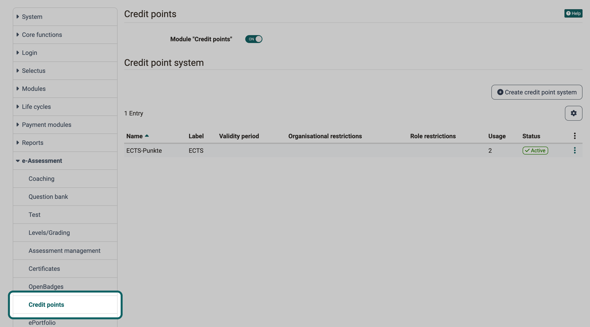
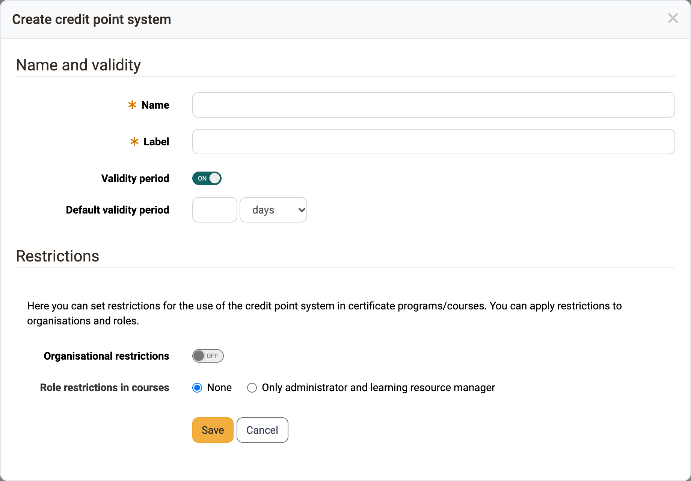

# e-Assessment Administration: Credit points {: #credit_points}

After activating credit points in the System Administration under `Administration > e-Assessment > Credit points`, course owners can award credit points to their course participants for successfully completing a course. Participants collect the points and use them further in OpenOlat, including in certification programs.

{ class="shadow lightbox" title="Credit points page in the System Administration · 2026.10.26" }

[To the top of the page ^](#credit_points)

---

## Define your own credit point system [:octicons-tag-16:{ title="from Release 20.1.1 (OO-8558)" }](https://track.frentix.com/issue/OO-8558){:target="_blank"} {: #define_credit_point_system}

The module allows you to define your own credit point systems globally. These enable participants to collect educational points/credits, such as ECTS or LearnCoins, for passing courses.

You open the dialog with "Create credit point system". In the section "Name and validity", you enter the name and the label and set a "Default validity period" if required. In the section "Restrictions", you use "Organisational restrictions" to limit the use of the credit point system in certification programs and courses to certain organisations, and with "Role restrictions in courses" you define whether only administrators and learning resource managers can use the credit point system in courses.

{ class="shadow lightbox" title="Create credit point system dialog · 2026.10.26" }

[To the top of the page ^](#credit_points)

---

## Let credit points be viewed in Coaching [:octicons-tag-16:{ title="from Release 21.1 (OO-9490)" }](https://track.frentix.com/issue/OO-9490){:target="_blank"} {: #credit_points_coaching}

Line managers and education managers see the credit points of the people in their organisation in the Coaching Tool, read-only, if you grant them the right "View credit points". You set the right in the [Module Organisations](Modules_Organisations.md#rights_linemanager) in the tab "Line managers" or "Education managers" of an organisation at the top level. For own roles, you set it under `Administration > Modules > Role user to user`. By default, the right is off. If a credit point system is restricted to organisations, these people only see it if they belong to one of these organisations themselves. What the tab shows is described in [Coaching - People](../../manual_user/area_modules/Coaching_People.md#tab_credit_points).

[To the top of the page ^](#credit_points)

---

## Further information {: #further_information}

[Awarding credit points in courses >](../../manual_user/learningresources/Course_Settings_Assessment.md) 
[Course Planner: Certification programs >](../../manual_user/area_modules/Course_Planner_Certification_Programs.md) 
[Personal achievements/successes: Credit points >](../../manual_user/personal_menu/Credit_Points.md) 
[e-Assessment Administration: Certificates >](e-Assessment_Certificates.md) 
[Module Organisations >](Modules_Organisations.md) 
[Coaching - People >](../../manual_user/area_modules/Coaching_People.md)

[To the top of the page ^](#credit_points)
