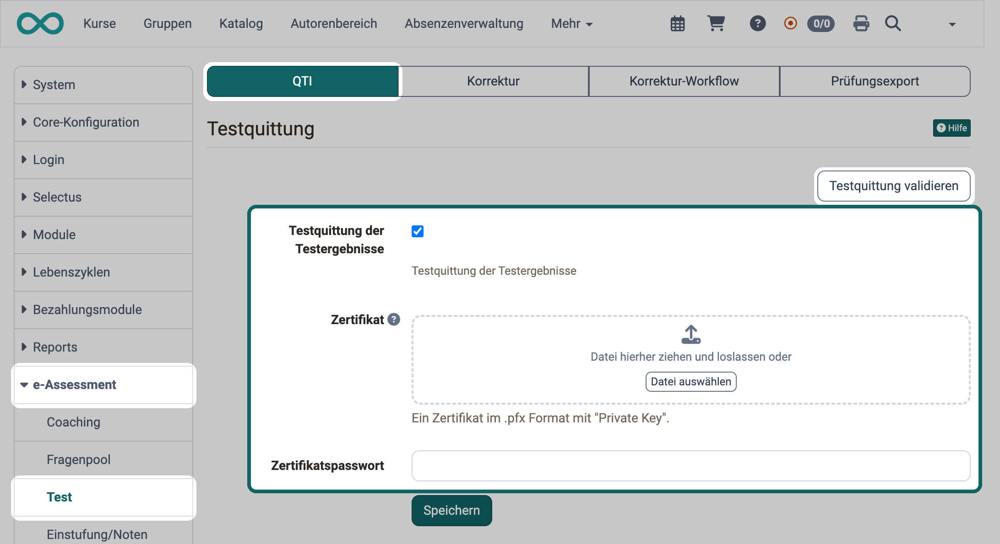
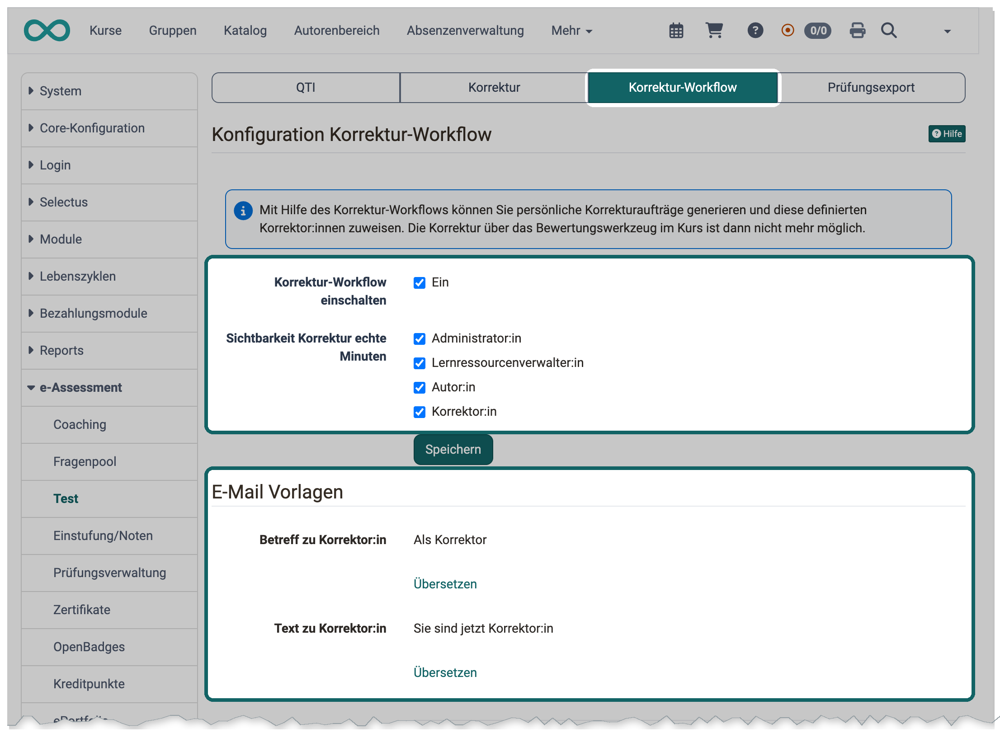

# e-Assessment Administration: Test {: #test}

Hier legen Systemadministrator:innen die Vorgaben fest, die für alle Tests gelten: die signierte Testquittung, die anonyme Korrektur, die Freigabe der Bewertung, den Korrektur-Workflow und die zusätzliche Seite beim Prüfungsexport. Die Einstellungen liegen in der System-Administration unter `Administration > e-Assessment > Test`, verteilt auf vier Tabs.

## Tab QTI [:octicons-tag-16:{ title="ab Release 11.3 (OO-2535)" }](https://track.frentix.com/issue/OO-2535) {: #tab_QTI}

Der Tab heisst nach QTI (Question and Test Interoperability), dem Standard, in dem OpenOlat Tests speichert. Die Testquittung bestätigt Teilnehmer:innen, dass sie den Test zum angegebenen Zeitpunkt absolviert haben. Auf diesem Tab schalten Sie mit "Testquittung der Testergebnisse" die digital signierte Testquittung ein. Für die Signatur laden Sie unter "Zertifikat" ein Zertifikat im Format .pfx mit privatem Schlüssel hoch und geben im Feld "Zertifikatspasswort" das zugehörige Passwort ein.

Die Testquittung ist eine XML-Datei. Teilnehmer:innen laden sie nach dem Test im Kursbaustein herunter oder erhalten sie per Mail, wenn der Test das vorsieht. Mit "Testquittung validieren" laden Sie eine solche Datei hoch, und OpenOlat prüft, ob die Testquittung gültig ist.

{ class="shadow lightbox" title="Tab QTI auf der Seite Test · 2026.11.27" }

[Zum Seitenanfang ^](#test)

---

## Tab Korrektur  {: #tab_correction}

Systemadministrator:innen legen mit "Anonym" unter "Korrekturwerkzeug" fest, ob das Korrekturwerkzeug für anonyme Korrekturen eingerichtet ist.

Unter "Freigabe Bewertung" legen sie ausserdem fest, ob eine Bewertung nach der manuellen Korrektur freigegeben ist und Teilnehmer:innen sie einsehen können: "Nicht freigegeben" oder "Freigegeben". Diese Einstellung ist die Vorgabe für den Kursbaustein Test; im Kursbaustein lässt sie sich unter "Freigabe Bewertung" für den einzelnen Test ändern.

{ class="shadow lightbox" title="Tab Korrektur auf der Seite Test · 2026.11.18" }

[Zum Seitenanfang ^](#test)

---

## Tab Korrektur-Workflow  {: #tab_correction-workflow}

Auch Korrektor:innen, die nicht Mitglied des Kurses sind, können Tests korrigieren. Sie sind in OpenOlat registriert, gehören aber nicht zum Kurs. Diesen Weg öffnet der Korrektur-Workflow, den Sie hier mit einem Häkchen bei "Korrektur-Workflow einschalten" aktivieren.

Mit dem Korrektur-Workflow erstellen Sie persönliche Korrekturaufträge und weisen sie festgelegten Korrektor:innen zu. Steht die Korrektur eines Tests auf "Manuell durch Korrektor:innen", korrigieren Betreuer:innen ihn nicht mehr über das Bewertungswerkzeug im Kurs. Wie Sie den Korrektur-Workflow für einen Test einrichten, beschreibt [Test: Korrektur-Workflow](../../manual_user/learningresources/Test_correction_workflow.de.md).

Der Korrektur-Workflow informiert die Beteiligten per E-Mail: Korrektor:innen bei ihrer Ernennung, bei jeder neuen Zuweisung und mit zwei Erinnerungen, Teilnehmer:innen, sobald ihre Resultate sichtbar sind. Unter "E-Mail-Vorlagen" formulieren Sie diese Mails vor, mit "Übersetzen" auch in weiteren Sprachen.

Unter "Sichtbarkeit Korrektur echte Minuten" legen Sie fest, welche Rollen die tatsächlich aufgewendete Korrekturzeit sehen. Zur Wahl stehen Administrator:in, Lernressourcenverwalter:in, Autor:in und Korrektor:in.

{ class="shadow lightbox" title="Tab Korrektur-Workflow auf der Seite Test · 2026.11.18" }

[Zum Seitenanfang ^](#test)

---

## Tab Prüfungsexport [:octicons-tag-16:{ title="ab Release 16.1 (OO-5648)" }](https://track.frentix.com/issue/OO-5648) {: #tab_tests_export}

Werden OpenOlat-Prüfungen als handschriftliche Prüfungen ausgegeben, kann eine zusätzliche Seite angehängt werden. Den Text dieser Seite legen Sie hier unter "Zusätzliche Seite" mit "Bearbeiten" fest. Wie Autor:innen einen Test als handschriftliche Prüfung exportieren, beschreibt [Test: Handschriftliche Prüfungen generieren](../../manual_user/learningresources/Test_handwritten_exams.de.md).

{ class="shadow lightbox" title="Tab Prüfungsexport auf der Seite Test · 2026.11.18" }

[Zum Seitenanfang ^](#test)

---

## Weiterführende Informationen {: #further_information}

[Test: Korrektur-Workflow >](../../manual_user/learningresources/Test_correction_workflow.de.md) 
[Test: Handschriftliche Prüfungen generieren >](../../manual_user/learningresources/Test_handwritten_exams.de.md) 
[Bewertungswerkzeug - Übersicht >](../../manual_user/learningresources/Assessment_tool_overview/index.de.md) 
[Coaching - Übersicht >](../../manual_user/area_modules/Coaching/index.de.md) 
[Test: Einstellungen >](../../manual_user/learningresources/Test_settings.de.md)

[Zum Seitenanfang ^](#test)
