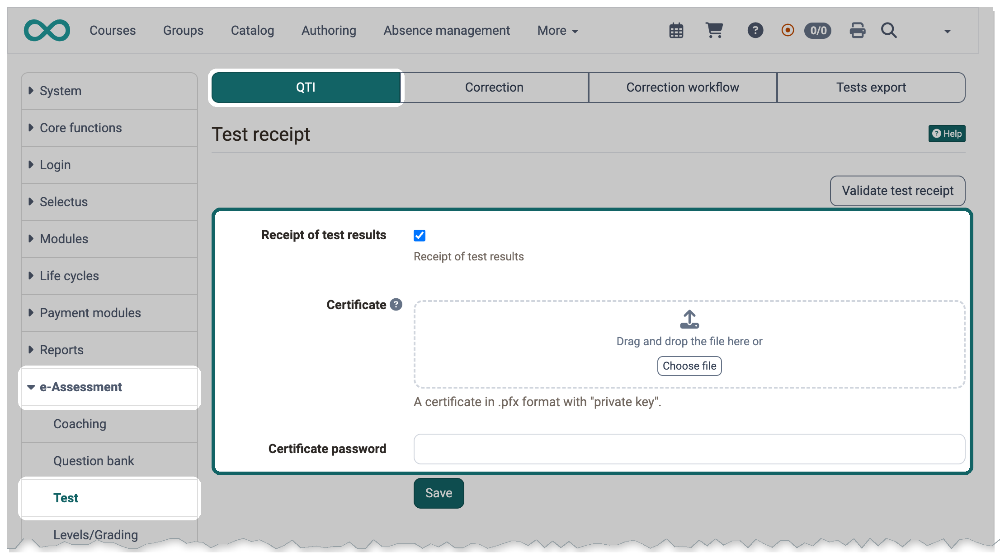
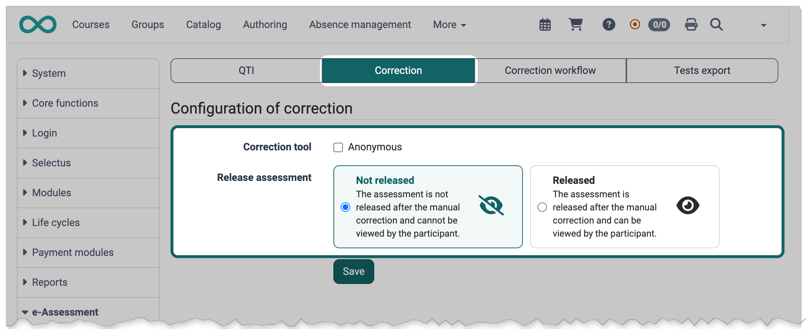
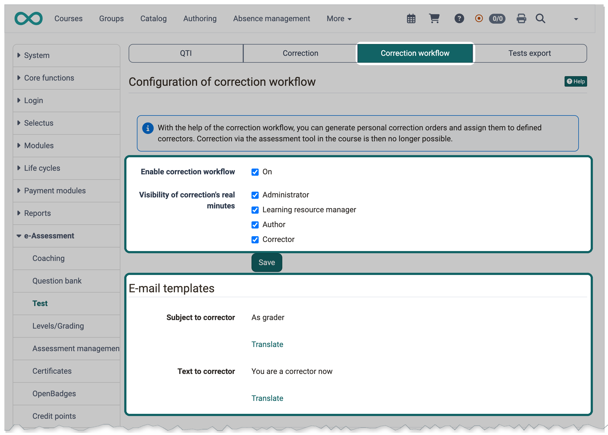
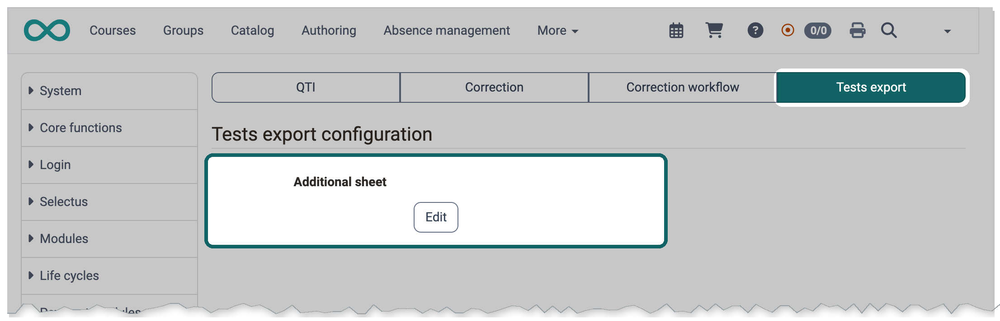

# e-Assessment Administration: Test {: #test}

Here, system administrators define the defaults that apply to all tests: the signed test receipt, anonymous correction, the release of the assessment, the correction workflow and the additional sheet for the tests export. The settings are located in the System Administration under `Administration > e-Assessment > Test`, spread across four tabs.

## Tab QTI [:octicons-tag-16:{ title="from Release 11.3 (OO-2535)" }](https://track.frentix.com/issue/OO-2535) {: #tab_QTI}

The tab is named after QTI (Question and Test Interoperability), the standard in which OpenOlat stores tests. The test receipt confirms to participants that they completed the test at the stated time. On this tab, you enable the digitally signed test receipt with "Receipt of test results". For the signature, upload a certificate in .pfx format with a private key under "Certificate" and enter the corresponding password in the field "Certificate password".

The test receipt is an XML file. Participants download it after the test in the course element or receive it by e-mail if the test provides for this. With "Validate test receipt" you upload such a file, and OpenOlat checks whether the test receipt is valid.

{ class="shadow lightbox" title="QTI tab on the Test page · 2026.11.18" }

[To the top of the page ^](#test)

---

## Tab Correction  {: #tab_correction}

System administrators use "Anonymous" under "Correction tool" to specify whether the correction tool is set up for anonymous corrections.

Under "Release assessment" they also specify whether an assessment is released after the manual correction and participants can view it: "Not released" or "Released". This setting is the default for the course element Test; in the course element, it can be changed for the individual test under "Release assessment".

{ class="shadow lightbox" title="Correction tab on the Test page · 2026.11.18" }

[To the top of the page ^](#test)

---

## Tab Correction workflow {: #tab_correction-workflow}

Correctors who are not members of the course can also correct tests. They are registered in OpenOlat, but do not belong to the course. This option is provided by the correction workflow, which you activate here with a tick at "Enable correction workflow".

With the correction workflow you create personal grading assignments and assign them to defined correctors. If the correction of a test is set to "Manual by correctors", coaches no longer correct it via the assessment tool in the course. How you set up the correction workflow for a test is described in [Test: Correction workflow](../../manual_user/learningresources/Test_correction_workflow.md).

The correction workflow informs the people involved by e-mail: correctors when they are appointed, on each new assignment and with two reminders, participants as soon as their results are visible. Under "E-mail templates" you pre-write these e-mails, with "Translate" also in other languages.

Under "Visibility of correction's real minutes" you specify which roles see the correction time actually spent. The choices are administrator, learning resource manager, author and corrector.

{ class="shadow lightbox" title="Correction workflow tab on the Test page · 2026.11.18" }

[To the top of the page ^](#test)

---

## Tab Tests export [:octicons-tag-16:{ title="from Release 16.1 (OO-5648)" }](https://track.frentix.com/issue/OO-5648) {: #tab_tests_export}

If OpenOlat exams are printed as handwritten exams, an additional page can be attached. You define the text of this page here under "Additional sheet" with "Edit". How authors export a test as a handwritten exam is described in [Test: Export handwritten exams](../../manual_user/learningresources/Test_handwritten_exams.md).

{ class="shadow lightbox" title="Tests export tab on the Test page · 2026.11.18" }

[To the top of the page ^](#test)

---

## Further information {: #further_information}

[Test: Correction workflow >](../../manual_user/learningresources/Test_correction_workflow.md) 
[Test: Export handwritten exams >](../../manual_user/learningresources/Test_handwritten_exams.md) 
[Assessment tool - overview >](../../manual_user/learningresources/Assessment_tool_overview/index.md) 
[Coaching - Overview >](../../manual_user/area_modules/Coaching/index.md) 
[Test: Settings >](../../manual_user/learningresources/Test_settings.md)

[To the top of the page ^](#test)