# e-Assessment Administration: OpenBadges {: #badges}

Systemadministrator:innen richten in der System-Administration die Badges für die ganze OpenOlat-Instanz ein: 
`Administration > e-Assessment > OpenBadges`

Dort schalten sie die Badges ein, pflegen die Badge-Vorlagen, erstellen globale Badges und prüfen die Echtheit von Badges. OpenOlat setzt den [OpenBadges-Standard](https://www.imsglobal.org/activity/openbadges) um und ist voll kompatibel mit ihm.

## Tab "Konfiguration" [:octicons-tag-16:{ title="ab Release 18.0 (OO-6999)" }](https://track.frentix.com/issue/OO-6999) {: #tab_config}

* Mit der Checkbox "OpenBadges" schalten Sie Badges für die gesamte OpenOlat-Instanz ein. Sobald OpenBadges eingeschaltet ist, lassen sich die Tabs "Globale Badges" und "Vergebene globale Badges" anklicken. Dieser Tab zeigt dann zusätzlich die Einstellung "Verifizierung" und die Liste der LinkedIn-Organisationen.
* Unter "Verifizierung" legen Sie fest, wie sich die Echtheit der Badges Ihrer Instanz prüfen lässt. Bei "Hosted" holt die Prüfung die Angaben des Badges von Ihrer OpenOlat-Instanz ab. Bei "Signed" trägt jeder vergebene Badge zusätzlich eine digitale Signatur, die belegt, dass er von Ihrer Instanz stammt und unverändert ist. Voreingestellt ist "Hosted". Die Einstellung gilt für Badges, die Sie danach erstellen. Bestehende Badges behalten ihre Methode, auch in neuen Versionen. [:octicons-tag-16:{ title="ab Release 20.1 (OO-8288)" }](https://track.frentix.com/issue/OO-8288)
* Mit dem Button "LinkedIn-Organisation hinzufügen" erfassen Sie LinkedIn-Organisationen. Die erfassten Organisationen stehen beim Erstellen eines Badges im Schritt "Details" unter "LinkedIn-Organisation" zur Wahl.

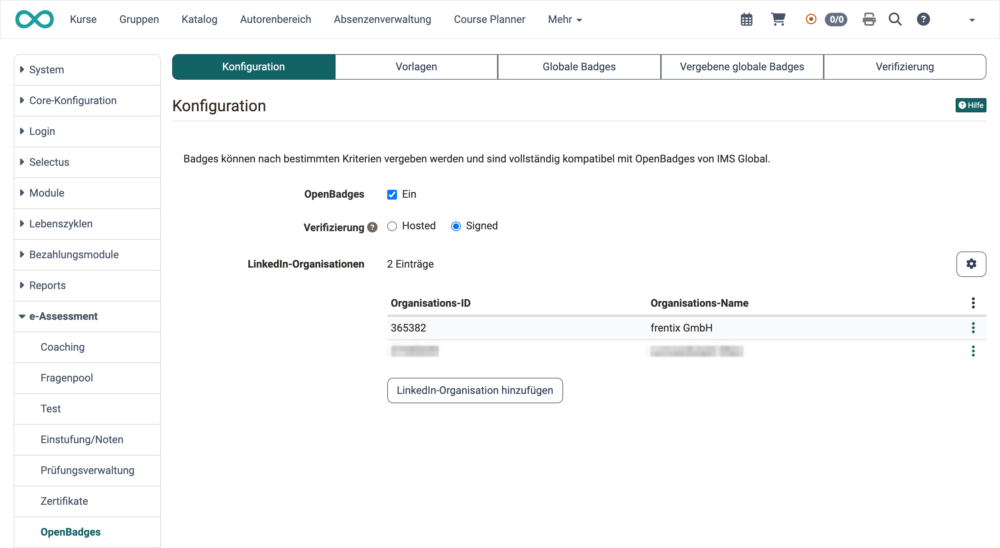{ class="shadow lightbox" title="Tab Konfiguration in der Administration OpenBadges · 2026.11.10" }

[Zum Seitenanfang ^](#badges)

---

## Tab "Vorlagen" {: #tab-templates}

Mit Vorlagen geben Sie das Bild eines Badges vor, damit Autor:innen beim Erstellen schnell loslegen. Ein Standardset von Vorlagen ist auf der OpenOlat-Instanz bereits vorbereitet. Die Tabelle zeigt je Vorlage "Bild", "Name", "Anwendungsbereich" und "Tags". Unter "Tags" stehen die Kategorien der Vorlage. Mit "Bearbeiten" und "Löschen" ändern oder entfernen Sie eine Vorlage.

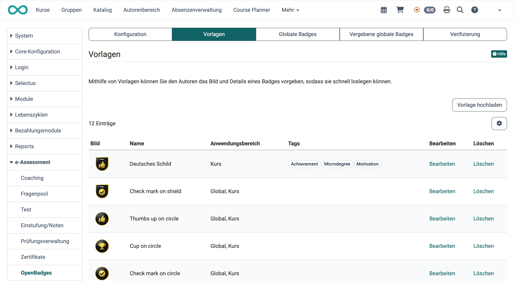{ class="shadow lightbox" title="Tab Vorlagen in der Administration OpenBadges · 2026.11.10" }

Mit dem Button "Vorlage hochladen" fügen Sie eine eigene Vorlage hinzu. Im gleichnamigen Dialog laden Sie das Bild hoch und legen Name, Beschreibung, Kategorien und Anwendungsbereich fest.

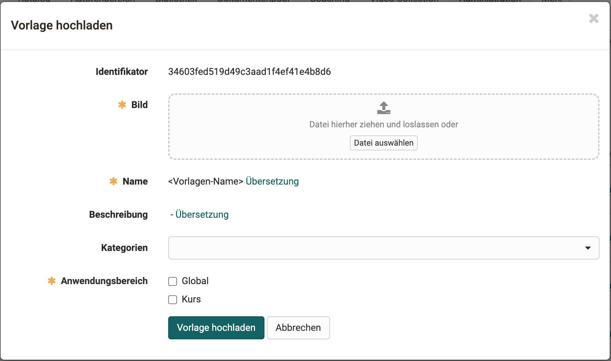{ class="shadow lightbox" title="Dialog Vorlage hochladen im Tab Vorlagen" }

#### Name {: #name }

Der Name erscheint in der Liste der Vorlagen und im Wizard. Sie geben ihn über den Link "Übersetzung" für jede Sprache ein.

#### Beschreibung {: #description }

Auch die Beschreibung geben Sie über den Link "Übersetzung" ein. Im Dialog selbst ist sie nicht bearbeitbar.

#### Kategorien {: #categories }

Mit Kategorien gruppieren Sie die Vorlagen. Im Schritt "Bild" des Wizards stehen die Kategorien über den Vorlagen. Ein Klick auf eine Kategorie zeigt nur noch deren Vorlagen.

#### Anwendungsbereich {: #scope }

Der Anwendungsbereich legt fest, wo die Vorlage zur Wahl steht: mit "Global" beim Erstellen globaler Badges, mit "Kurs" beim Erstellen von Kurs-Badges. Sie können beide Optionen zusammen wählen.

[Zum Seitenanfang ^](#badges)

---

## Tab "Globale Badges" {: #global_badges}

Globale Badges sind nicht an einen Kurs gebunden. Im Tab "Globale Badges" behalten Sie alle globalen Badges der Instanz im Blick, sehen, wie oft sie vergeben sind, und bearbeiten oder löschen sie.

Die Tabelle zeigt in der Standardansicht die Spalten "Bild", "Name", "Erstellt am", "Status", "Typ", "Version" und "Vergeben an". Der Status ist "Vorbereitung", "Aktiv" oder "Widerrufen". Die Spalte "Typ" zeigt, ob der Badge automatisch oder nur manuell vergeben wird: "Automatisch" steht für das Vergabeverfahren "Automatisch vergeben", "Manuell" für "Nur manuell vergeben". Die Spalte "Vergeben an" zeigt, wie oft der Badge über alle seine Versionen vergeben ist. Widerrufene Vergaben zählen nicht mit. Die Spalte "Verifizierung" mit der Methode "Hosted" oder "Signed" ist ausgeblendet. Sie blenden sie über das Zahnrad "Spalten auswählen" ein.

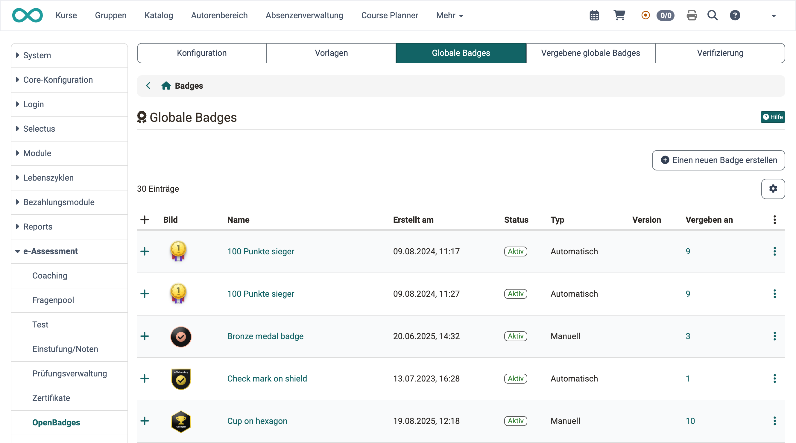{ class="shadow lightbox" title="Tab Globale Badges in der Administration OpenBadges · 2026.11.10" }

### Erstellen und Bearbeiten eines globalen Badges

Mit dem Button "Einen neuen Badge erstellen" über der Tabelle im Tab "Globale Badges" starten Sie den Wizard. Gibt es noch keinen globalen Badge, steht derselbe Button zusätzlich in der Mitte der leeren Tabelle. Der Wizard führt durch die folgenden Schritte:

1. **Bild**: Wählen Sie eine Vorlage oder laden Sie ein eigenes Bild hoch. OpenOlat unterstützt die Bildformate SVG und PNG. Für ein eigenes Bild wählen Sie "Eigener Badge" und laden die Datei hoch.
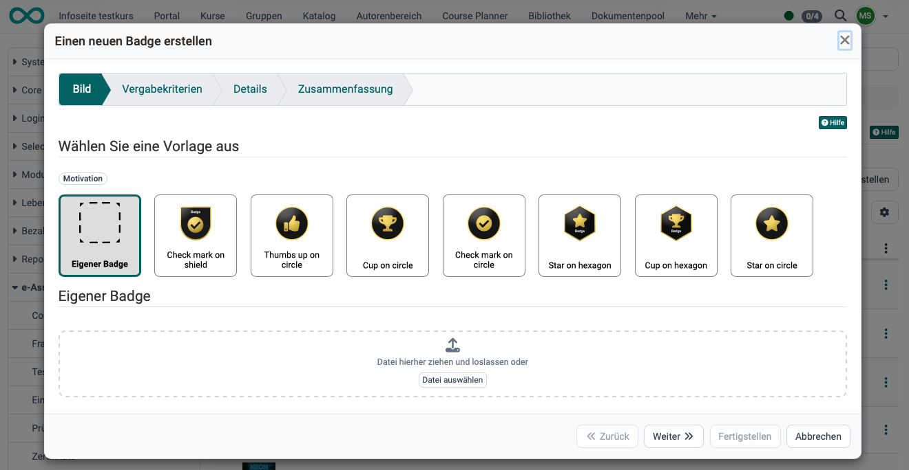{ class="shadow lightbox" title="Schritt Bild im Wizard für globale Badges" }
2. **Anpassung**: Dieser Schritt erscheint, wenn die gewählte Vorlage anpassbar ist. Hier ändern Sie zum Beispiel Hintergrundfarbe und Titel des Badges.
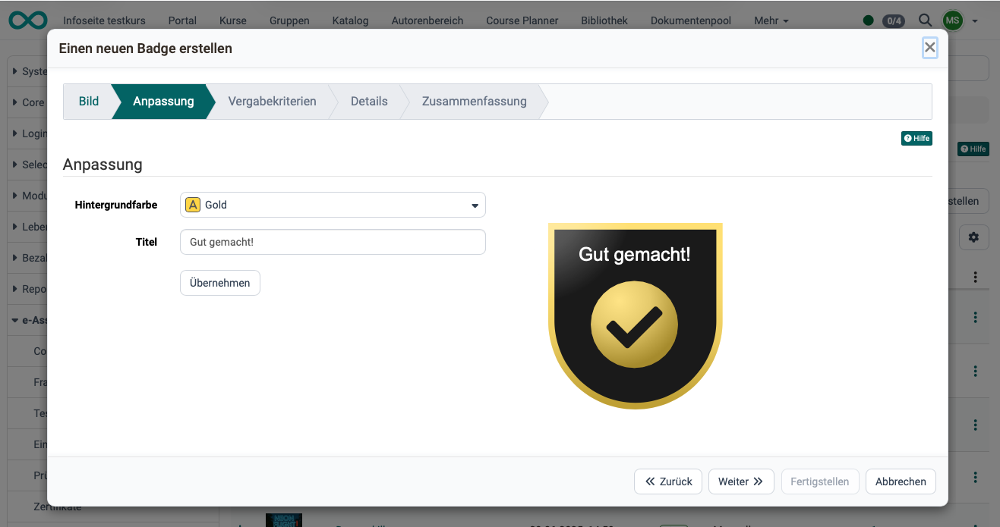{ class="shadow lightbox" title="Schritt Anpassung im Wizard für globale Badges" }
3. **Vergabekriterien**: Unter "Kriterien-Beschreibung" erklären Sie, wofür der Badge vergeben wird. Unter "Vergabeverfahren" wählen Sie "Automatisch vergeben" oder "Nur manuell vergeben", unter "Kriterien" die Regeln für die automatische Vergabe. Anders als Kurs-Badges, die Autor:innen in einem Kurs vergeben, vergeben Sie globale Badges auch kursübergreifend, zum Beispiel für das Bestehen mehrerer Kurse.
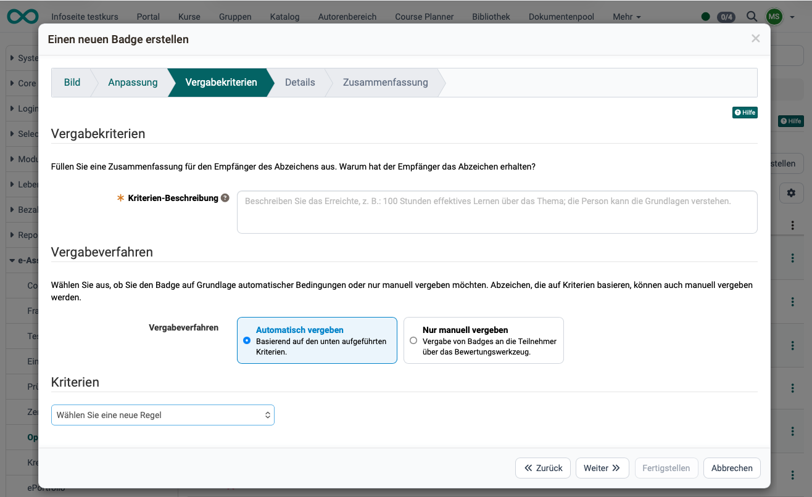{ class="shadow lightbox" title="Schritt Vergabekriterien im Wizard für globale Badges" }
4. **Details**: Pflichtangaben sind Name und Beschreibung des Badges sowie der Herausgeber. Unter "Sprache" wählen Sie die Sprache des Badges. Sie können zusätzlich eine Herausgeber-URL und eine Herausgeber-E-Mail hinzufügen. Sind im Tab "Konfiguration" LinkedIn-Organisationen hinzugefügt, wählen Sie unter "LinkedIn-Organisation" zusätzlich eine davon aus. [:octicons-tag-16:{ title="ab Release 19.0 (OO-7741)" }](https://track.frentix.com/issue/OO-7741) Unter "Verfall" wählen Sie "Nie" oder "Gültig für" mit einer Gültigkeitsdauer, z.B. 12 Monate.
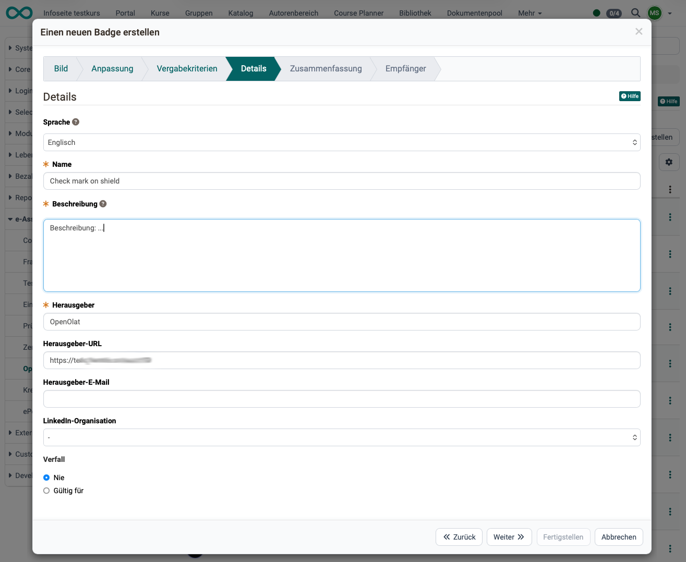{ class="shadow lightbox" title="Schritt Details im Wizard für globale Badges" }
5. **Zusammenfassung**: Zeigt zur Kontrolle Bild, Name, Sprache, Beschreibung, Ablauf des Badges und die Vergabekriterien.
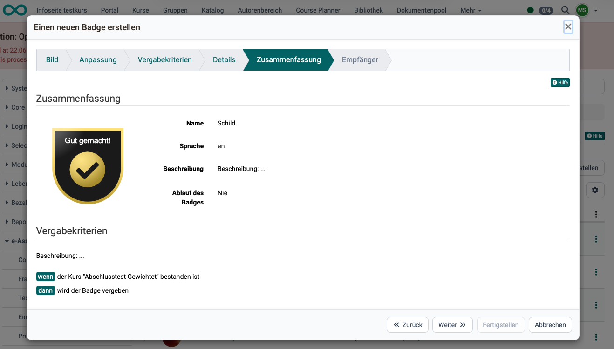{ class="shadow lightbox" title="Schritt Zusammenfassung im Wizard für globale Badges" }
6. **Empfänger**: Zeigt in einer Tabelle, welche Teilnehmer:innen die gewählten Kriterien bereits erfüllen. Diese Personen erhalten den Badge, sobald Sie auf "Fertigstellen" klicken. Dieser Schritt erscheint nur, wenn Sie unter "Vergabeverfahren" die Option "Automatisch vergeben" gewählt haben.
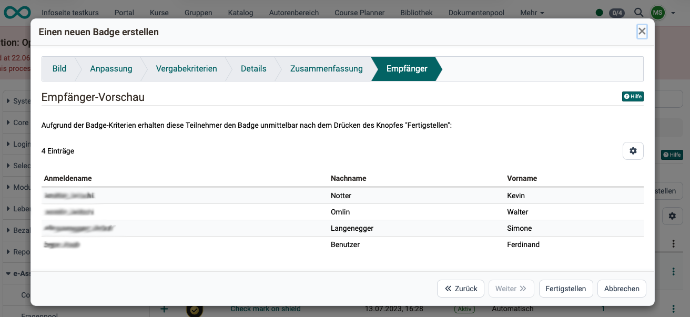{ class="shadow lightbox" title="Schritt Empfänger im Wizard für globale Badges" }

Solange ein globaler Badge den Status "Vorbereitung" hat, bearbeiten Sie ihn im Tab "Globale Badges" mit "Badge bearbeiten". Hat er den Status "Aktiv", steht stattdessen "Neue Version erstellen und bearbeiten" zur Verfügung. Beide Aktionen öffnen den Wizard erneut. [:octicons-tag-16:{ title="ab Release 20.1 (OO-8287)" }](https://track.frentix.com/issue/OO-8287)

### Globale Badges manuell vergeben

Einen globalen Badge vergeben Sie manuell in der System-Administration unter: 
`Administration > e-Assessment > OpenBadges > Tab "Globale Badges" > "Badgename" > Tab "Übersicht" > Button "Manuell vergeben"`

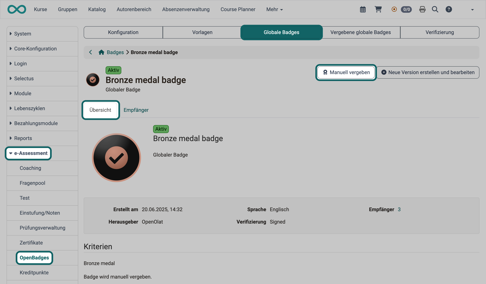{ class="shadow lightbox" title="Tab Übersicht eines globalen Badges in der Administration OpenBadges · 2026.11.10" }

### Globale Badges automatisch vergeben

Die automatische Vergabe richten Sie beim Erstellen im Wizard ein, im Schritt "Vergabekriterien".

!!! note "Hinweis"

    OpenOlat stellt jeden vergebenen globalen Badge der empfangenden Person zusätzlich per E-Mail zu, ob er manuell oder automatisch vergeben wird.

[Zum Seitenanfang ^](#badges)

---

## Tab "Vergebene globale Badges" {: #tab-awarded-global-badges}

In diesem Tab sehen Sie, wer welchen globalen Badge erhalten hat. Die Tabelle zeigt je Vergabe unter anderem "Empfänger", "Vergeben von" und "Vergeben am". Mit "Widerrufen" entziehen Sie eine Vergabe. Kurs-Badges erscheinen hier nicht.

!!! note "Hinweis"

    Kurs-Badges sehen Betreuer:innen und Besitzer:innen im Bewertungswerkzeug des Kurses. Dort vergeben sie Kurs-Badges auch manuell, siehe [Badges im Bewertungswerkzeug](../../manual_user/learningresources/OpenBadges.de.md).

!!! note "Hinweis"

    Teilnehmer:innen finden ihre erworbenen Badges im persönlichen Menü, siehe [Persönliche Erfolge/Leistungen: Badges](../../manual_user/personal_menu/OpenBadges.de.md).

[Zum Seitenanfang ^](#badges)

---

## Tab "Verifizierung" {: #verification}

Im Tab "Verifizierung" prüfen Sie, ob ein Badge echt ist. Laden Sie die Badge-Datei hoch oder ziehen Sie sie per Drag and Drop in das Feld. Nach einem Klick auf den Button "Badge verifizieren" prüft OpenOlat, ob der Badge rechtmässig ausgestellt ist, und zeigt das Ergebnis unter "Verifizierungs-Bericht".

[Zum Seitenanfang ^](#badges)

---

## Weiterführende Informationen {: #further_information}

[Badges im Bewertungswerkzeug >](../../manual_user/learningresources/OpenBadges.de.md) 
[Persönliche Erfolge/Leistungen: Badges >](../../manual_user/personal_menu/OpenBadges.de.md) 
[Wie vergebe ich in meinem Kurs Badges? >](../../manual_how-to/badges/badges.de.md) 
[Der OpenBadges-Standard >](https://www.imsglobal.org/activity/openbadges) 
[e-Assessment Administration: Übersicht >](e-Assessment_Administration/index.de.md) 
[Wie mache ich Erfolge und Leistungen sichtbar? >](../../manual_how-to/achievements/achievements.de.md)

[Zum Seitenanfang ^](#badges)
