# e-Assessment Administration: OpenBadges {: #badges}

Badges are digital credentials with an image, criteria and an issuing body. Whoever receives a badge can also show it outside OpenOlat, and anyone can check by machine whether it is genuine. For this, OpenOlat implements the [OpenBadges standard](https://www.imsglobal.org/activity/openbadges) and is fully compatible with it.

System administrators switch badges on for the whole OpenOlat instance, maintain the badge templates, create global badges and check the authenticity of badges. All these settings are in the system administration under: 
`Administration > e-Assessment > OpenBadges`

## Tab "Configuration" [:octicons-tag-16:{ title="from Release 18.0 (OO-6999)" }](https://track.frentix.com/issue/OO-6999) {: #tab_config}

In the "Configuration" tab you switch badges on and define how their authenticity can be checked.

* With the checkbox "OpenBadges" you switch badges on for the entire OpenOlat instance. As soon as OpenBadges is switched on, the tabs "Global badges" and "Awarded global badges" can be clicked. The "Configuration" tab then also shows the "Verification" setting and the list of LinkedIn organizations.
* Under "Verification" you define how the authenticity of the badges of your instance can be checked. With "Hosted", the check fetches the badge data from your OpenOlat instance. With "Signed", every awarded badge additionally carries a digital signature that proves it comes from your instance and has not been changed. OpenOlat creates the key for the signature for each badge itself. The default is "Hosted". The setting applies to all badges created afterwards, global badges as well as course badges. Existing badges keep their method, also when you later create a new version of a badge. [:octicons-tag-16:{ title="from Release 20.1 (OO-8288)" }](https://track.frentix.com/issue/OO-8288)
* With the button "Add LinkedIn organization" you add LinkedIn organizations. When you create a badge, the organizations added here are available in the "Details" step under "LinkedIn organization". When a recipient adds the badge to their LinkedIn profile with "Add to LinkedIn", LinkedIn names the selected organization as the issuer.

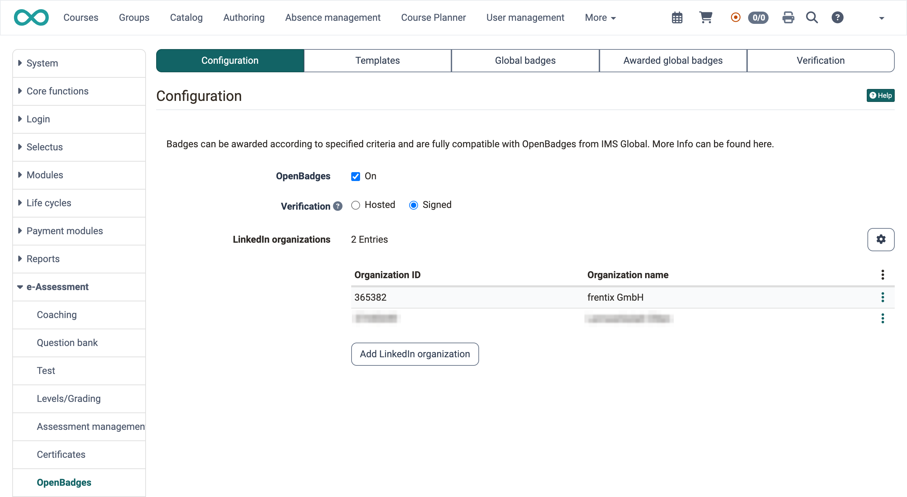{ class="shadow lightbox" title="Configuration tab under OpenBadges in the system administration · 2026.11.18" }

[To the top of the page ^](#badges)

---

## Tab "Templates" {: #tab-templates}

Templates let you specify the image of a badge so that authors can get started quickly when creating one. A standard set of templates is already prepared on the OpenOlat instance. The table shows "Image", "Name", "Scope" and "Tags" for each template. "Tags" shows the categories of the template. With "Edit" and "Delete" you change or remove a template.

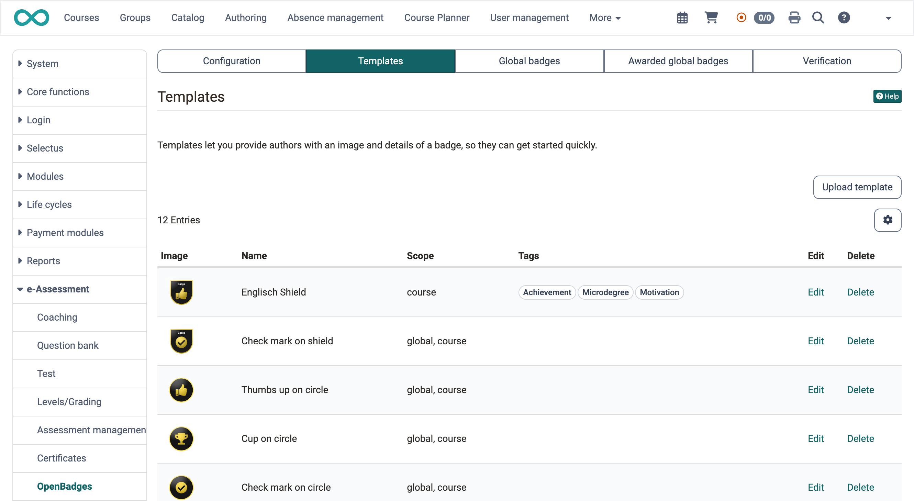{ class="shadow lightbox" title="Templates tab under OpenBadges in the system administration · 2026.11.18" }

With the button "Upload template" you add your own template. In the dialog of the same name you upload the image and set the name, description, categories and scope.

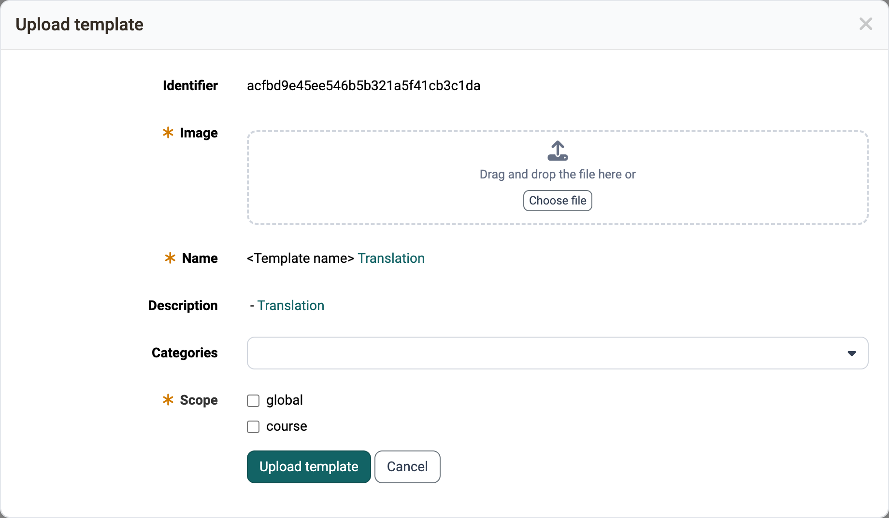{ class="shadow lightbox" title="Upload template dialog in the Templates tab · 2026.11.05" }

#### Name {: #name }

The name appears in the list of templates and in the wizard. You enter it for each language via the link "Translation".

#### Description {: #description }

You also enter the description for each language via the link "Translation". The dialog then shows the text you entered.

#### Categories {: #categories }

Categories group the templates. In the "Image" step of the wizard, the categories are shown above the templates. A click on a category shows only its templates.

#### Scope {: #scope }

The scope defines where the template is available: with "global" when creating global badges, with "course" when creating course badges. You can select both options together.

[To the top of the page ^](#badges)

---

## Tab "Global badges" {: #global_badges}

Global badges are not linked to a course. In the "Global badges" tab you keep track of all global badges of the instance, see how often they have been awarded, and edit or delete them. The tab can be clicked as soon as OpenBadges is switched on in the "Configuration" tab.

In the default view, the table shows the columns "Image", "Name", "Created on", "Status", "Type", "Version" and "Awarded to". The status results from the awards: "Preparation" as long as the badge has not been awarded yet, "Active" as soon as at least one award is valid, and "Revoked" when all awards are revoked. The "Type" column shows whether the badge is awarded automatically or manually only: "Automatic" stands for the award procedure "Award automatically", "Manual" for "Award manually only". The "Awarded to" column shows how often the badge has been awarded across all its versions. Revoked awards are not counted. The "Verification" column with the method "Hosted" or "Signed" is hidden. You show it with the gear icon "Customize columns" above the table.

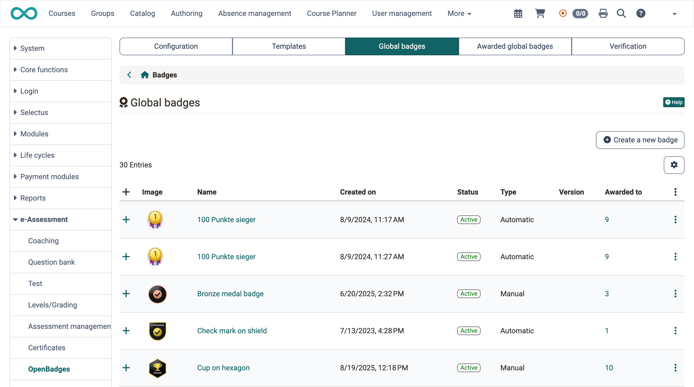{ class="shadow lightbox" title="Global badges tab under OpenBadges in the system administration · 2026.11.18" }

You reach the actions for a badge directly in its row, in two places. The plus icon at the start of the row ("Show the details of this row") expands the row: it shows the criteria of the badge as a sentence, with buttons below them. For a badge of the type "Manual", the criteria area stays empty. The "More actions" menu at the end of the row additionally offers "Copy" and "Delete". Which actions appear depends on the status of the badge:

| Status | Buttons in the details of the row | "More actions" menu |
|---|---|---|
| Preparation | "Edit badge", "Award manually" | "Award manually", "Edit", "Copy", "Delete" |
| Active | "Create a new version and edit", "Award manually" | "Award manually", "Revoke", "Create a new version and edit", "Copy", "Delete" |

"Revoke" in the menu revokes all awards of the badge. The entry only appears as long as the badge has at least one award that is not revoked.

### Creating and editing a global badge

The button "Create a new badge" above the table in the "Global badges" tab starts the wizard. If there is no global badge yet, the same button also appears in the middle of the empty table. The wizard leads through the following steps:

1. **Image**: Select a template or upload your own image. OpenOlat supports the image formats SVG and PNG. For your own image, select "Own badge" and upload the file.
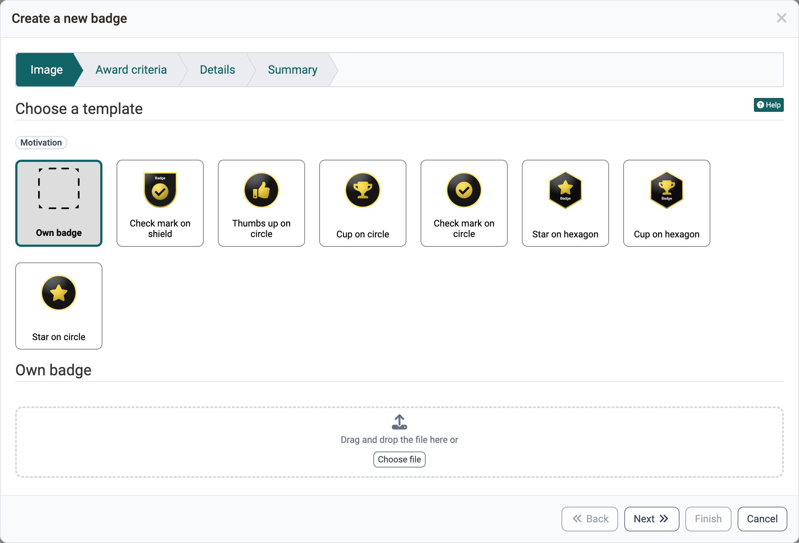{ class="shadow lightbox" title="Step Image in the wizard for global badges · 2026.11.05" }
2. **Customization**: This step appears if the selected template can be customized. Here you change, for example, the background color and title of the badge.
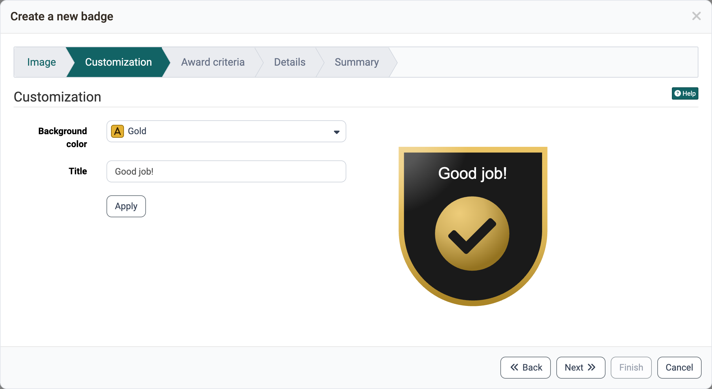{ class="shadow lightbox" title="Step Customization in the wizard for global badges · 2026.11.05" }
3. **Award criteria**: Under "Criteria description" you explain what the badge is awarded for. Under "Award procedure" you choose "Award automatically" or "Award manually only", under "Criteria" the rules for automatic awarding. For global badges these are "Courses passed" (the selected courses are passed) and "Badges earned" (the selected other global badges have already been awarded). Unlike course badges, which authors award in a course, you can also award global badges across courses, for example for passing multiple courses.
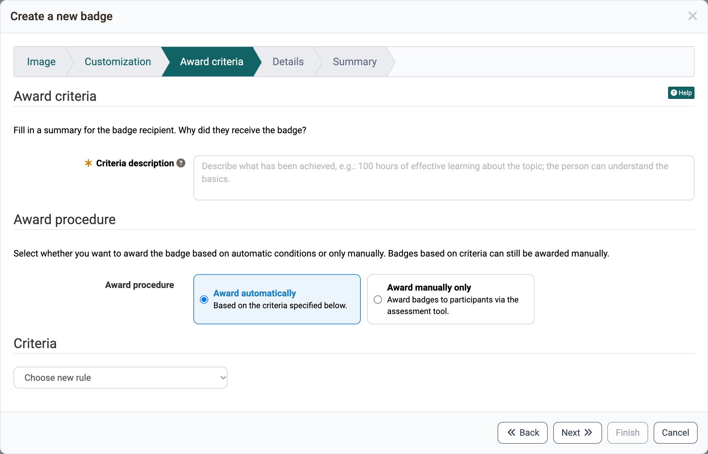{ class="shadow lightbox" title="Step Award criteria in the wizard for global badges · 2026.11.05" }
4. **Details**: Mandatory details are the name and description of the badge and the issuer. Under "Language" you select the language of the badge. You can also add an issuer URL and an issuer email. If LinkedIn organizations have been added in the "Configuration" tab, you additionally select one of them under "LinkedIn organization". [:octicons-tag-16:{ title="from Release 19.0 (OO-7741)" }](https://track.frentix.com/issue/OO-7741) Under "Expiration" you choose "Never" or "Valid for" with a validity period, e.g. 12 months.
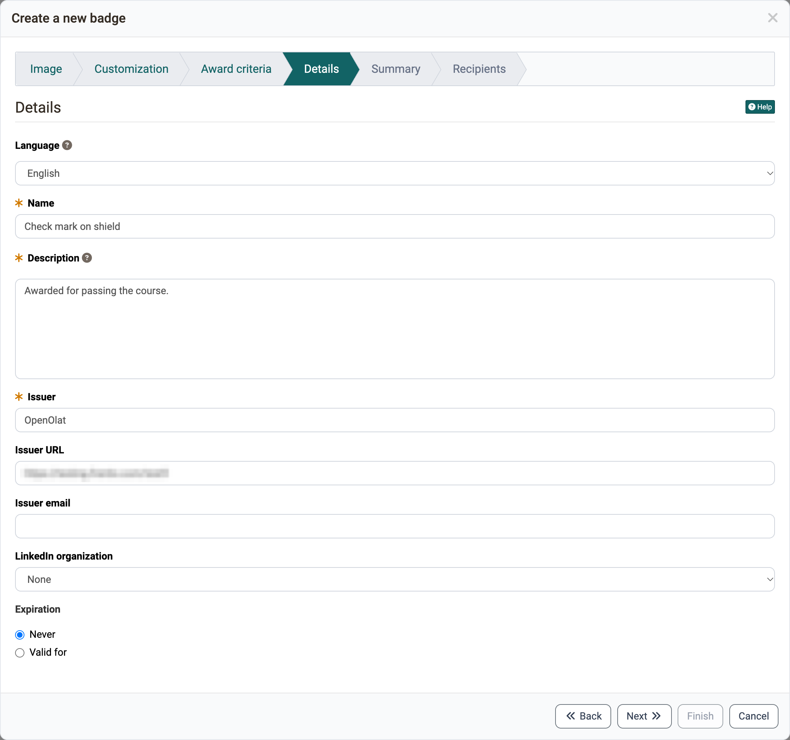{ class="shadow lightbox" title="Step Details in the wizard for global badges · 2026.11.05" }
5. **Summary**: Shows the image, name, language, description, badge expiry (the setting under "Expiration") and the award criteria for checking.
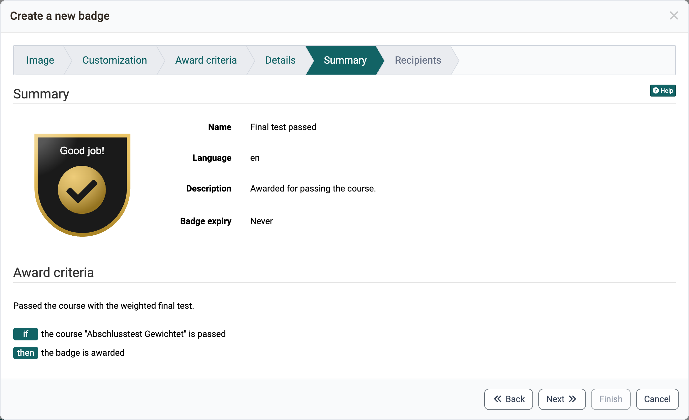{ class="shadow lightbox" title="Step Summary in the wizard for global badges · 2026.11.05" }
6. **Recipients**: Shows in a table which persons already meet the selected criteria. These persons receive the badge as soon as you click "Finish". This step only appears if you have chosen the option "Award automatically" under "Award procedure".
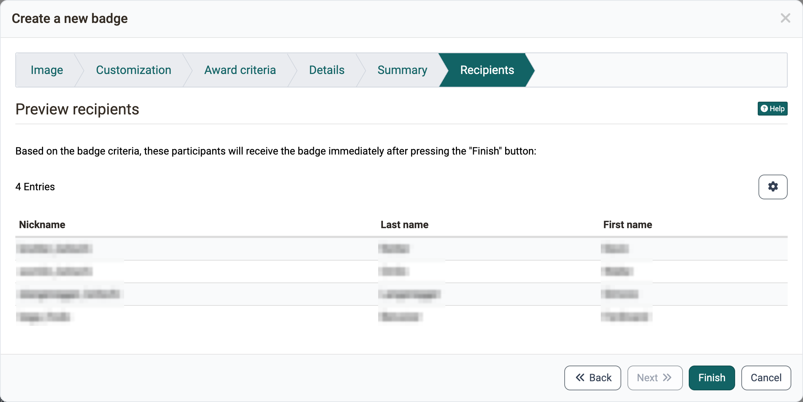{ class="shadow lightbox" title="Step Recipients in the wizard for global badges · 2026.11.05" }

As long as a global badge has the status "Preparation", you edit it in the "Global badges" tab with "Edit badge". If it has the status "Active", "Create a new version and edit" is available instead. Both actions open the wizard again. [:octicons-tag-16:{ title="from Release 20.1 (OO-8287)" }](https://track.frentix.com/issue/OO-8287)

### Award global badges manually

You award a global badge manually in the system administration under: 
`Administration > e-Assessment > OpenBadges > Tab "Global badges" > "Badge name" > Tab "Overview" > Button "Award manually"`

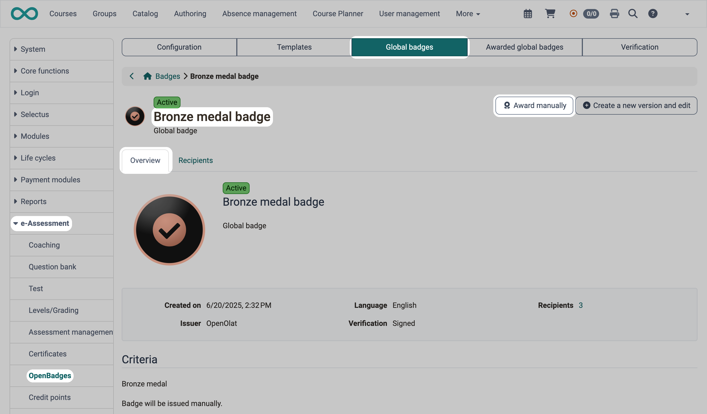{ class="shadow lightbox" title="Overview tab of a global badge under OpenBadges in the system administration · 2026.11.18" }

You also find the same button in the list of the "Global badges" tab, in the details of a row and in the "More actions" menu. The button opens the wizard "Award global badge …". In the "User search" step you select the persons, in the "Review" step you check the selection. With "Finish" the selected persons receive the badge. You see who has already received the badge in the "Recipients" tab next to the "Overview" tab.

### Award global badges automatically

You set up automatic awarding in the wizard during creation, in the "Award criteria" step. Persons who meet the rules only later also receive the badge automatically, for example as soon as they have passed the last of the selected courses.

!!! note "Note"

    OpenOlat additionally sends every awarded global badge to the recipient by email, whether it is awarded manually or automatically.

[To the top of the page ^](#badges)

---

## Tab "Awarded global badges" {: #tab-awarded-global-badges}

In this tab you see who has received which global badge. For each award, the table shows among others "Recipient", "Awarded by" and "Issued on". With the link "Revoke" in the row of an active award you withdraw it. You then remove a revoked award with the trash icon: it only appears in rows of revoked awards, in a column of its own without a label, whose header also shows only the icon. If the expiry date of a revoked award has passed, the "Status" column shows "Expired" instead of "Revoked", because OpenOlat displays the expiry before the revocation; the trash icon is still in the row. Course badges do not appear here.

!!! note "Note"

    Coaches and owners see course badges in the assessment tool of the course under `Course > Administration > Assessment tool`. There they also award course badges manually, see [Badges in Assessment tool](../../manual_user/learningresources/OpenBadges.md).

!!! note "Note"

    Participants find their acquired badges in the personal menu, see [Personal achievements/successes: Badges](../../manual_user/personal_menu/OpenBadges.md).

[To the top of the page ^](#badges)

---

## Tab "Verification" {: #verification}

In the "Verification" tab you check whether a badge is genuine. Upload the badge file or drag and drop it into the field. After a click on the "Verify badge" button, OpenOlat checks whether the badge was issued legitimately and shows the result under "Verification report".

[To the top of the page ^](#badges)

---

## Further information {: #further_information}

[Badges in Assessment tool >](../../manual_user/learningresources/OpenBadges.md) 
[Personal achievements/successes: Badges >](../../manual_user/personal_menu/OpenBadges.md) 
[How do I award badges in my course? >](../../manual_how-to/badges/badges.md) 
[The OpenBadges standard >](https://www.imsglobal.org/activity/openbadges) 
[e-Assessment Administration: Overview >](e-Assessment_Administration/index.md) 
[How do I make successes and achievements visible? >](../../manual_how-to/achievements/achievements.md)

[To the top of the page ^](#badges)

