# e-Assessment Administration: OpenBadges {: #badges}

OpenBadges are implemented after the OpenBadges standard and fully compatible with it.
More information [here](https://www.imsglobal.org/activity/openbadges).

## Tab "Configuration" {: #tab_config}

* Here you can switch badges on/off for the entire instance of your OpenOlat.
* In addition, LinkedIn organizations that use badges can be added here.

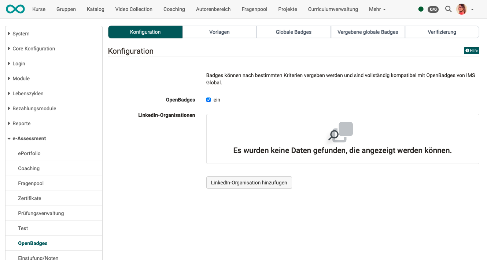{ class="shadow lightbox" title="Configuration tab in the OpenBadges administration" }

[To the top of the page ^](#badges)

---

## Tab "Templates" {: #tab_templates}

A standard set of templates is already instantiated on the OpenOlat instance.

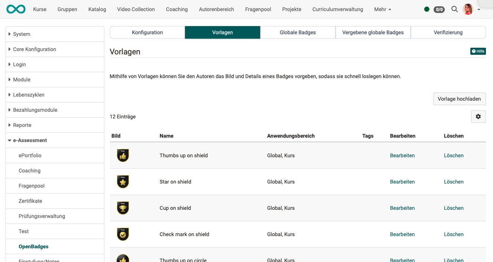{ class="shadow lightbox" title="Templates tab in the OpenBadges administration" }

Additional templates can be created by specifying the image, name and a description of the template.

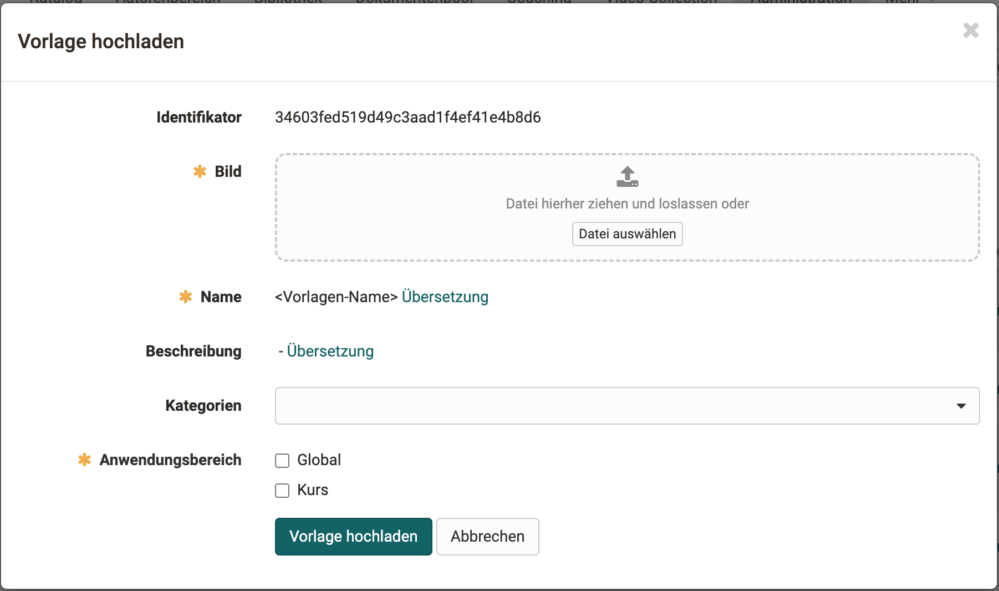{ class="shadow lightbox" title="Upload template dialog in the Templates tab" }

#### Name {: #name }

The name of the template is displayed in the wizard.

#### Description {: #description }

The description of the template is automatically taken from the template translation and cannot be edited here.

#### Categories {: #categories }

Here you can divide the templates into categories. Badge templates with the same category are displayed in the same tab in the wizard.

#### Scope {: #scope }

The scope defines whether a badge should be available globally (for issuing across the whole OpenOlat instance) or for courses.

[To the top of the page ^](#badges)

---

## Tab "Global badges" {: #tab_global_badges}

Global badges can be viewed in a separate tab, along with their status (active / in preparation) and whether they have already been awarded. They can also be edited and deleted. Global badges are not linked to a course.

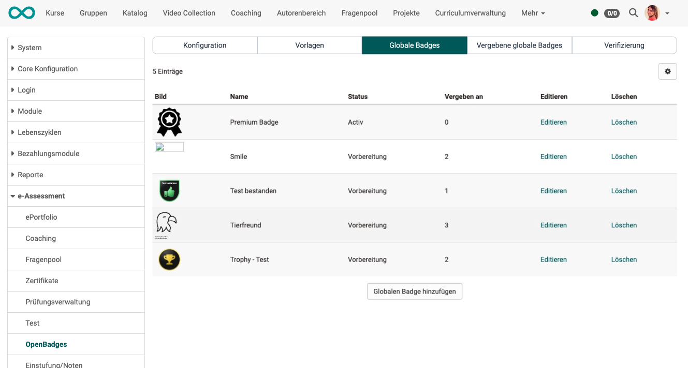{ class="shadow lightbox" title="Global badges tab in the OpenBadges administration" }

### Creating and editing a global badge

The tab "Global badges" also contains the button "Add global badge". It starts the wizard with the following steps:

1. **Image**: The first step is to select a template or upload your own image. OpenOlat supports the image formats SVG and PNG. For your own image, select "Own badge" and upload the file.
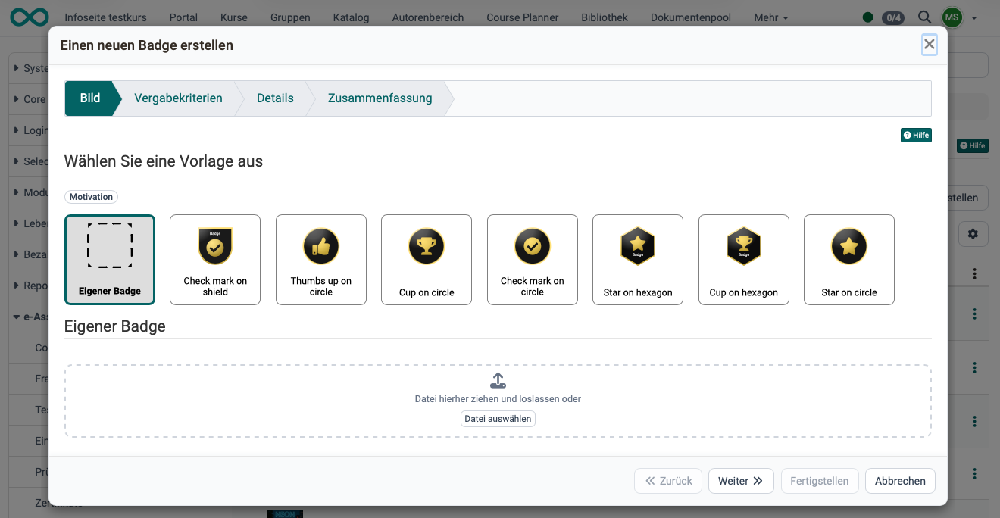{ class="shadow lightbox" title="Step Image in the wizard for global badges" }
2. **Customization**: If the template was created accordingly, you can change colors and text while creating the badge.
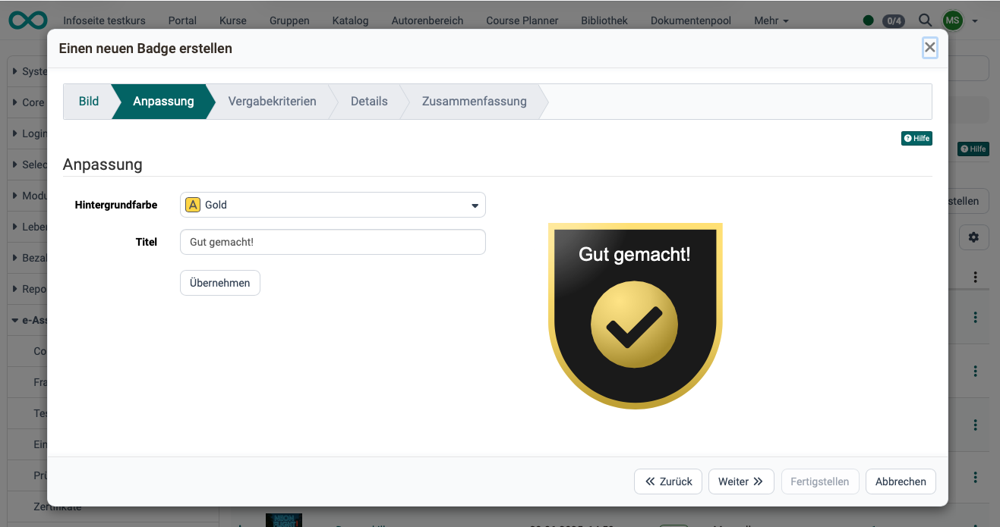{ class="shadow lightbox" title="Step Customization in the wizard for global badges" }
3. **Award criteria**: Enter the criteria and explanation for the rules you have chosen. Unlike badges awarded by authors in a course, global badges can, for example, also be awarded across courses for passing multiple courses.
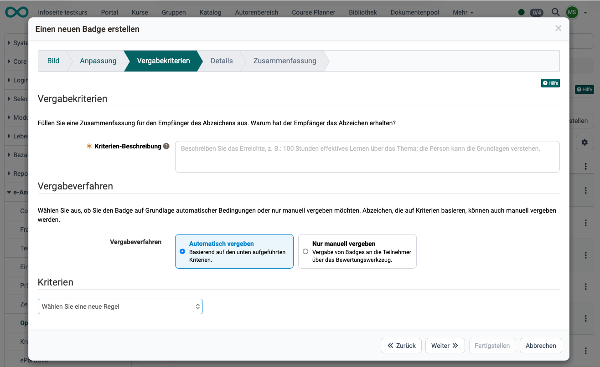{ class="shadow lightbox" title="Step Award criteria in the wizard for global badges" }
4. **Details**: Mandatory details are the name and description of the badge and the issuer. Under "Language" you select the language of the badge. You can also add an issuer URL and an issuer email. If LinkedIn organizations have been added in the "Configuration" tab, you additionally select one of them under "LinkedIn organization". [:octicons-tag-16:{ title="from Release 19.0 (OO-7741)" }](https://track.frentix.com/issue/OO-7741) Under "Expiration" you choose "Never" or "Valid for" with a validity period, e.g. 12 months.
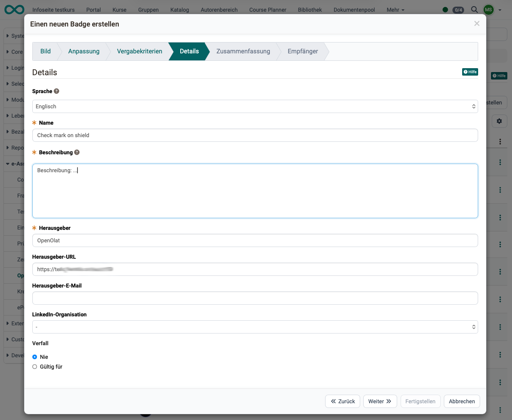{ class="shadow lightbox" title="Step Details in the wizard for global badges" }
5. **Summary**: Shows the image, name, language, description, badge expiry and the award criteria for checking.
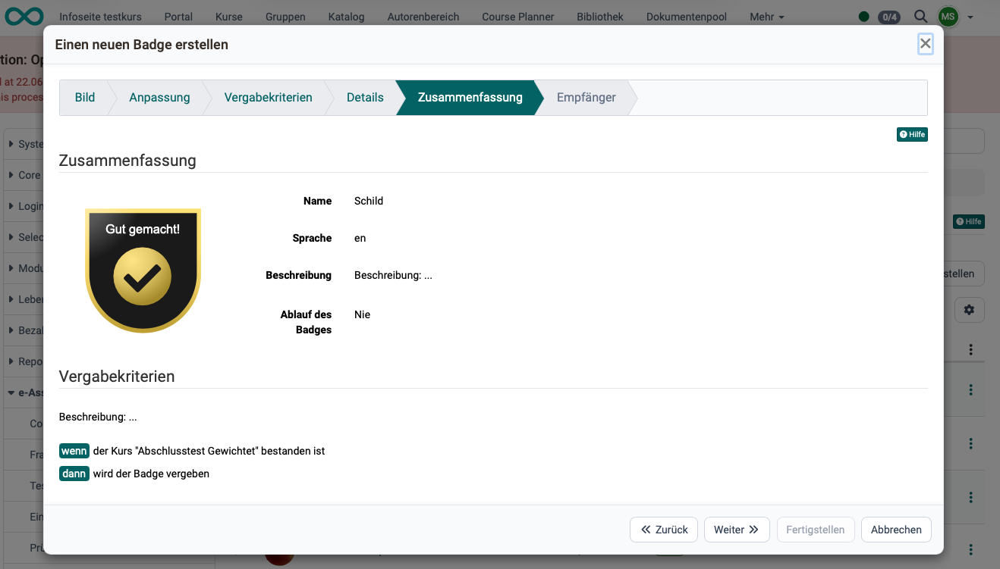{ class="shadow lightbox" title="Step Summary in the wizard for global badges" }
6. **Recipients**: Displays the recipients in a table to see which participants already qualify according to the criteria you have selected. This step only appears if you have chosen the option "Award automatically" under "Award procedure".
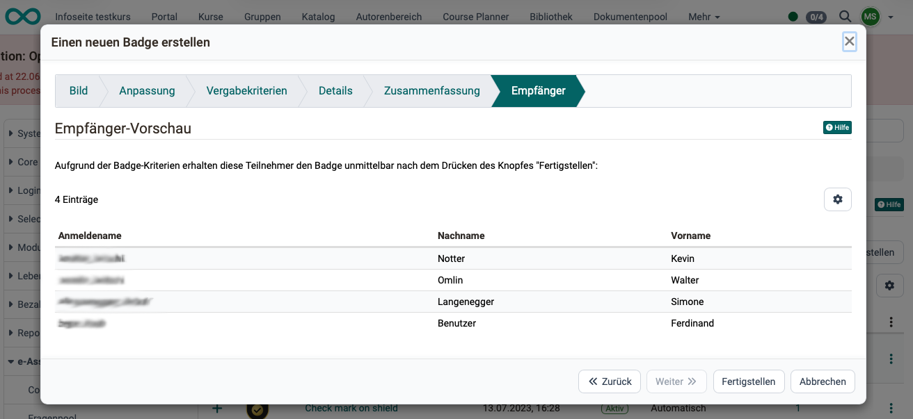{ class="shadow lightbox" title="Step Recipients in the wizard for global badges" }

As long as a global badge has the status "Preparation", you edit it in the "Global badges" tab with "Edit badge". If it has the status "Active", "Create a new version and edit" is available instead. Both actions open the wizard again. [:octicons-tag-16:{ title="from Release 20.1 (OO-8287)" }](https://track.frentix.com/issue/OO-8287)

### Assign global badges manually

Manual awarding is possible in the system administration under: 
`Administration > e-Assessment > OpenBadges > Tab "Global badges" > "Badge name" > Tab "Overview" > Button "Award manually"`

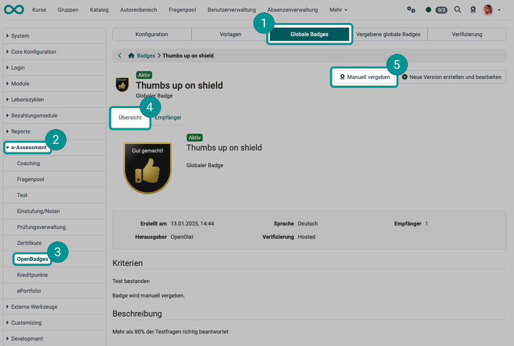{ class="shadow lightbox" title="Overview tab of a global badge in the OpenBadges administration" }

### Assign global badges automatically

Automatic assignment is set up in the wizard during creation.

!!! note "Note"

    When a global badge is assigned, the recipient is also automatically sent the badge by email, regardless of whether it is assigned manually or automatically.

[To the top of the page ^](#badges)

---

## Tab "Awarded global badges" {: #tab_awarded}

This tab lists **global badges** that have been awarded. (The course badges are not included here).

!!! note "Note"

    **Course badges** can be viewed by coaches and owners in the assessment tool. The automatically assigned course badges can be viewed there and course badges can be assigned manually.

!!! note "Note"

    For course participants, acquired badges are listed in the personal menu. [Here](../../manual_user/personal_menu/OpenBadges.md) for more information.

[To the top of the page ^](#badges)

---

## Tab "Verification" {: #verification}

In the "Verification" tab, you can upload a badge file. (You can simply drag and drop it into a field.) After clicking the "Verify badge" button, OpenOlat checks whether the badge was issued legitimately.

[To the top of the page ^](#badges)

---

## Further information {: #further_information}

[Badges in Assessment tool >](../../manual_user/learningresources/OpenBadges.md) 
[Personal achievements/successes: Badges >](../../manual_user/personal_menu/OpenBadges.md) 
[How do I award badges in my course? >](../../manual_how-to/badges/badges.md) 
[The OpenBadges standard >](https://www.imsglobal.org/activity/openbadges) 

[To the top of the page ^](#badges)

