# e-Assessment Administration: OpenBadges {: #badges}

System administrators set up badges for the whole OpenOlat instance in the system administration: 
`Administration > e-Assessment > OpenBadges`

There they switch badges on, maintain the badge templates, create global badges and check the authenticity of badges. OpenOlat implements the [OpenBadges standard](https://www.imsglobal.org/activity/openbadges) and is fully compatible with it.

## Tab "Configuration" [:octicons-tag-16:{ title="from Release 18.0 (OO-6999)" }](https://track.frentix.com/issue/OO-6999) {: #tab_config}

* With the checkbox "OpenBadges" you switch badges on for the entire OpenOlat instance. As soon as OpenBadges is switched on, the tabs "Global badges" and "Awarded global badges" can be clicked. This tab then also shows the "Verification" setting and the list of LinkedIn organizations.
* Under "Verification" you define how the authenticity of the badges of your instance can be checked. With "Hosted", the check fetches the badge data from your OpenOlat instance. With "Signed", every awarded badge additionally carries a digital signature that proves it comes from your instance and has not been changed. The default is "Hosted". The setting applies to badges you create afterwards. Existing badges keep their method, also in new versions. [:octicons-tag-16:{ title="from Release 20.1 (OO-8288)" }](https://track.frentix.com/issue/OO-8288)
* With the button "Add LinkedIn organization" you add LinkedIn organizations. When you create a badge, the organizations added here are available in the "Details" step under "LinkedIn organization".

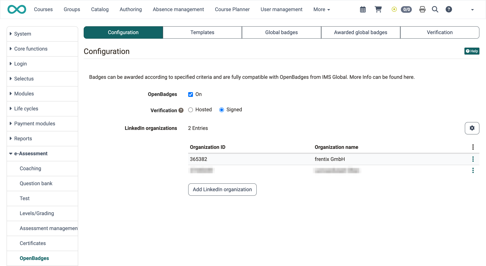{ class="shadow lightbox" title="Configuration tab in the OpenBadges administration · 2026.11.05" }

[To the top of the page ^](#badges)

---

## Tab "Templates" {: #tab-templates}

Templates let you specify the image of a badge so that authors can get started quickly when creating one. A standard set of templates is already prepared on the OpenOlat instance. The table shows "Image", "Name", "Scope" and "Tags" for each template. "Tags" shows the categories of the template. With "Edit" and "Delete" you change or remove a template.

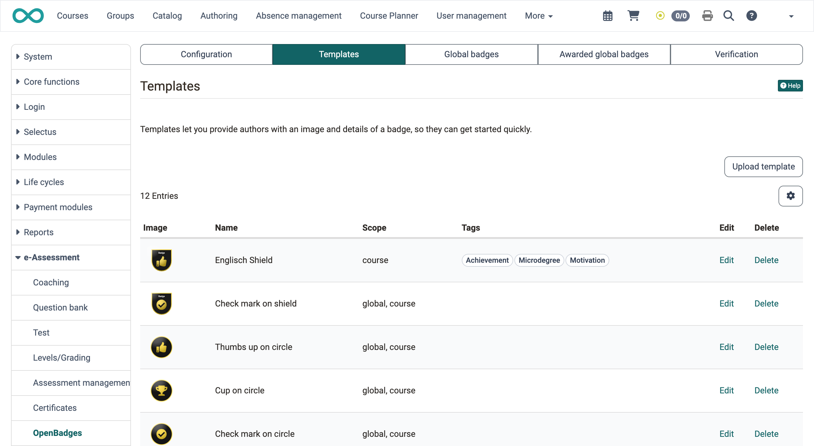{ class="shadow lightbox" title="Templates tab in the OpenBadges administration · 2026.11.05" }

With the button "Upload template" you add your own template. In the dialog of the same name you upload the image and set the name, description, categories and scope.

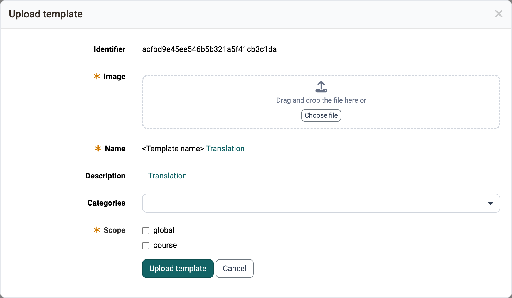{ class="shadow lightbox" title="Upload template dialog in the Templates tab · 2026.11.05" }

#### Name {: #name }

The name appears in the list of templates and in the wizard. You enter it for each language via the link "Translation".

#### Description {: #description }

You also enter the description via the link "Translation". It cannot be edited in the dialog itself.

#### Categories {: #categories }

Categories group the templates. In the "Image" step of the wizard, the categories are shown above the templates. A click on a category shows only its templates.

#### Scope {: #scope }

The scope defines where the template is available: with "global" when creating global badges, with "course" when creating course badges. You can select both options together.

[To the top of the page ^](#badges)

---

## Tab "Global badges" {: #global_badges}

Global badges are not linked to a course. In the "Global badges" tab you keep track of all global badges of the instance, see how often they have been awarded, and edit or delete them.

In the default view, the table shows the columns "Image", "Name", "Created on", "Status", "Type", "Version" and "Awarded to". The status is "Preparation", "Active" or "Revoked". The "Type" column shows whether the badge is awarded automatically or manually only: "Automatic" stands for the award procedure "Award automatically", "Manual" for "Award manually only". The "Awarded to" column shows how often the badge has been awarded across all its versions. Revoked awards are not counted. The "Verification" column with the method "Hosted" or "Signed" is hidden. You show it with the gear "Displayed columns".

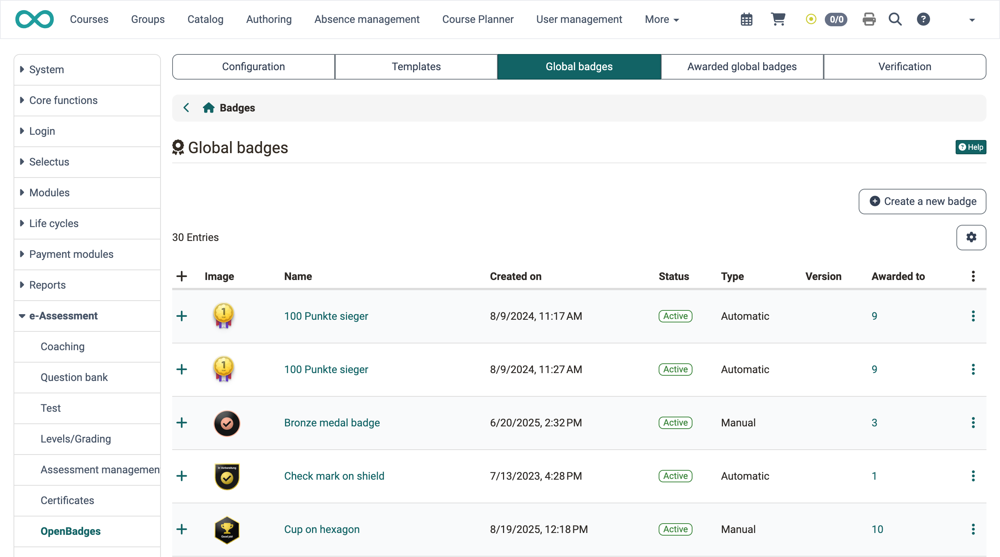{ class="shadow lightbox" title="Global badges tab in the OpenBadges administration · 2026.11.05" }

### Creating and editing a global badge

The button "Create a new badge" above the table in the "Global badges" tab starts the wizard. If there is no global badge yet, the same button also appears in the middle of the empty table. The wizard leads through the following steps:

1. **Image**: Select a template or upload your own image. OpenOlat supports the image formats SVG and PNG. For your own image, select "Own badge" and upload the file.
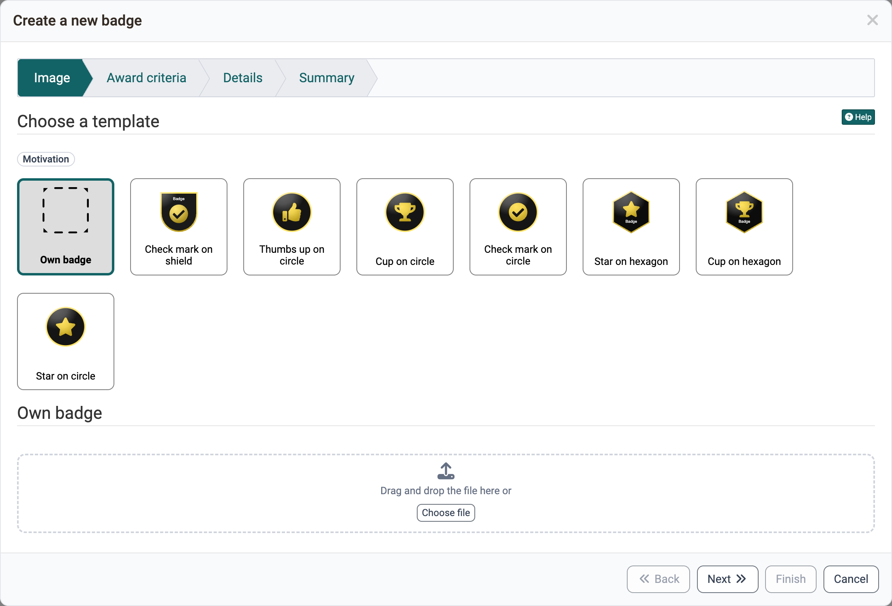{ class="shadow lightbox" title="Step Image in the wizard for global badges · 2026.11.05" }
2. **Customization**: This step appears if the selected template can be customized. Here you change, for example, the background color and title of the badge.
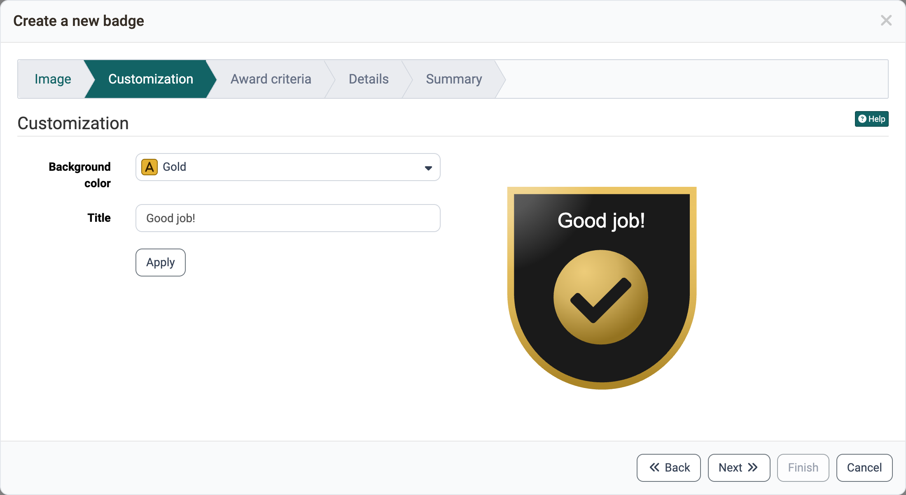{ class="shadow lightbox" title="Step Customization in the wizard for global badges · 2026.11.05" }
3. **Award criteria**: Under "Criteria description" you explain what the badge is awarded for. Under "Award procedure" you choose "Award automatically" or "Award manually only", under "Criteria" the rules for automatic awarding. Unlike course badges, which authors award in a course, you can also award global badges across courses, for example for passing multiple courses.
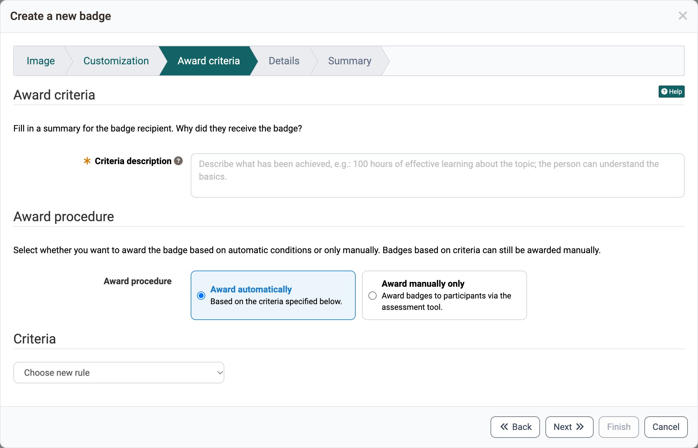{ class="shadow lightbox" title="Step Award criteria in the wizard for global badges · 2026.11.05" }
4. **Details**: Mandatory details are the name and description of the badge and the issuer. Under "Language" you select the language of the badge. You can also add an issuer URL and an issuer email. If LinkedIn organizations have been added in the "Configuration" tab, you additionally select one of them under "LinkedIn organization". [:octicons-tag-16:{ title="from Release 19.0 (OO-7741)" }](https://track.frentix.com/issue/OO-7741) Under "Expiration" you choose "Never" or "Valid for" with a validity period, e.g. 12 months.
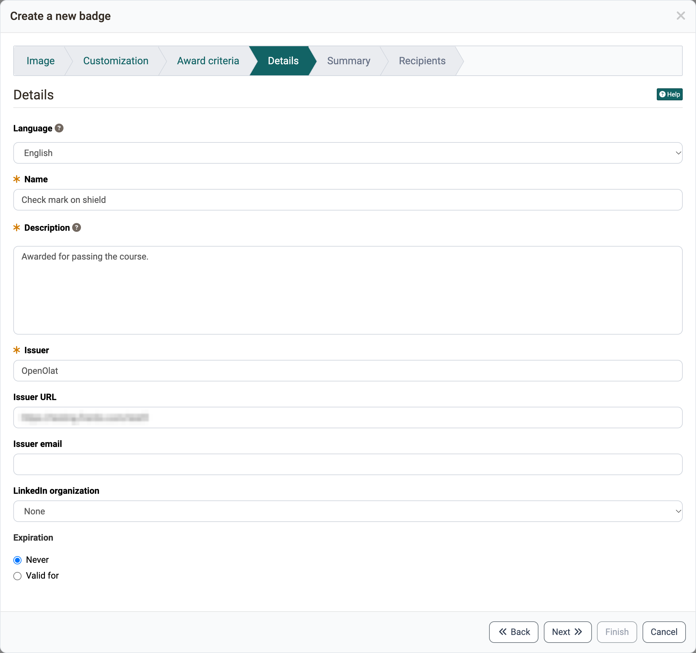{ class="shadow lightbox" title="Step Details in the wizard for global badges · 2026.11.05" }
5. **Summary**: Shows the image, name, language, description, badge expiry and the award criteria for checking.
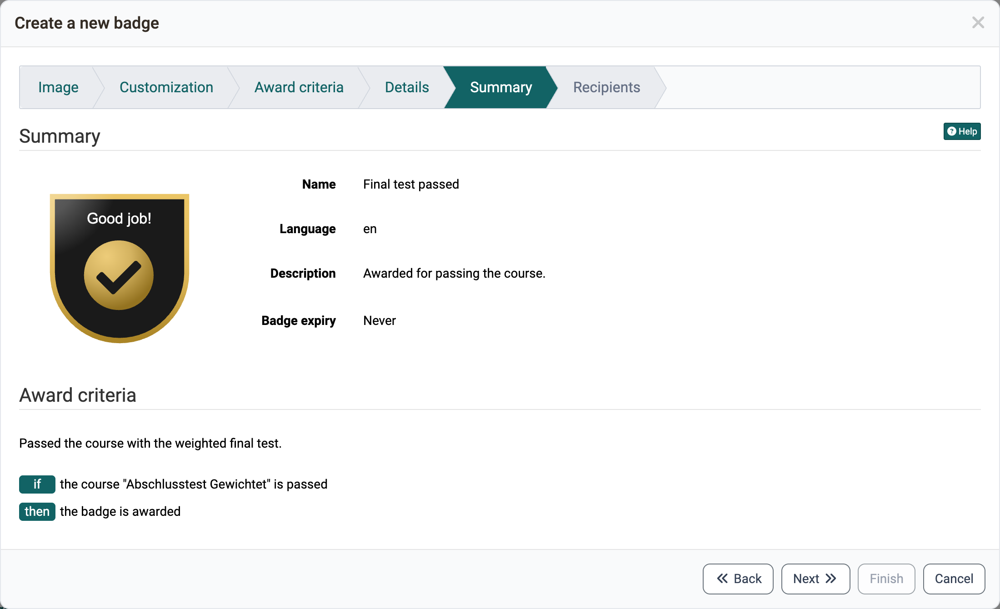{ class="shadow lightbox" title="Step Summary in the wizard for global badges · 2026.11.05" }
6. **Recipients**: Shows in a table which participants already meet the selected criteria. These persons receive the badge as soon as you click "Finish". This step only appears if you have chosen the option "Award automatically" under "Award procedure".
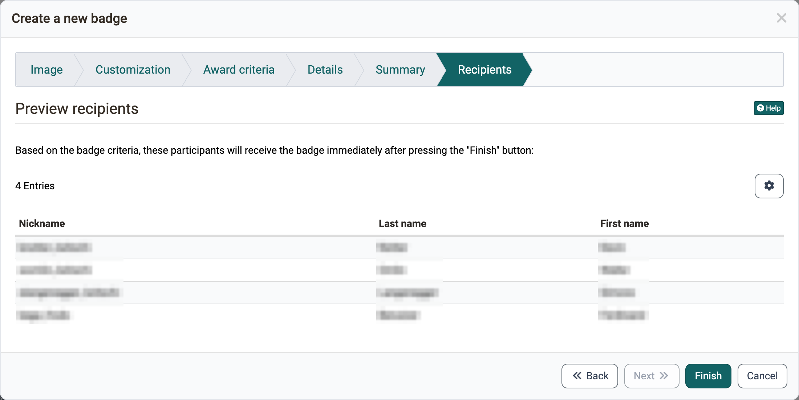{ class="shadow lightbox" title="Step Recipients in the wizard for global badges · 2026.11.05" }

As long as a global badge has the status "Preparation", you edit it in the "Global badges" tab with "Edit badge". If it has the status "Active", "Create a new version and edit" is available instead. Both actions open the wizard again. [:octicons-tag-16:{ title="from Release 20.1 (OO-8287)" }](https://track.frentix.com/issue/OO-8287)

### Award global badges manually

You award a global badge manually in the system administration under: 
`Administration > e-Assessment > OpenBadges > Tab "Global badges" > "Badge name" > Tab "Overview" > Button "Award manually"`

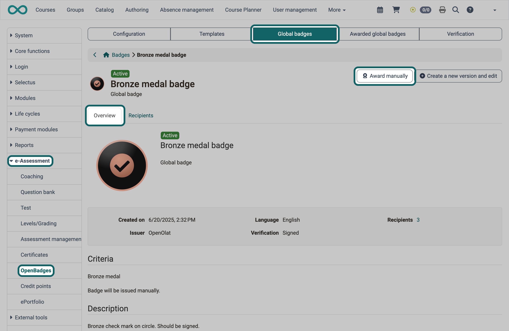{ class="shadow lightbox" title="Overview tab of a global badge in the OpenBadges administration · 2026.11.05" }

### Award global badges automatically

You set up automatic awarding in the wizard during creation, in the "Award criteria" step.

!!! note "Note"

    OpenOlat additionally sends every awarded global badge to the recipient by email, whether it is awarded manually or automatically.

[To the top of the page ^](#badges)

---

## Tab "Awarded global badges" {: #tab-awarded-global-badges}

In this tab you see who has received which global badge. For each award, the table shows among others "Recipient", "Awarded by" and "Issued on". With "Revoke" you withdraw an award. Course badges do not appear here.

!!! note "Note"

    Coaches and owners see course badges in the assessment tool of the course. There they also award course badges manually, see [Badges in Assessment tool](../../manual_user/learningresources/OpenBadges.md).

!!! note "Note"

    Participants find their acquired badges in the personal menu, see [Personal achievements/successes: Badges](../../manual_user/personal_menu/OpenBadges.md).

[To the top of the page ^](#badges)

---

## Tab "Verification" {: #verification}

In the "Verification" tab you check whether a badge is genuine. Upload the badge file or drag and drop it into the field. After a click on the "Verify badge" button, OpenOlat checks whether the badge was issued legitimately and shows the result under "Verification report".

[To the top of the page ^](#badges)

---

## Further information {: #further_information}

[Badges in Assessment tool >](../../manual_user/learningresources/OpenBadges.md) 
[Personal achievements/successes: Badges >](../../manual_user/personal_menu/OpenBadges.md) 
[How do I award badges in my course? >](../../manual_how-to/badges/badges.md) 
[The OpenBadges standard >](https://www.imsglobal.org/activity/openbadges) 
[e-Assessment Administration: Overview >](e-Assessment_Administration.md) 
[How do I make successes and achievements visible? >](../../manual_how-to/achievements/achievements.md)

[To the top of the page ^](#badges)

