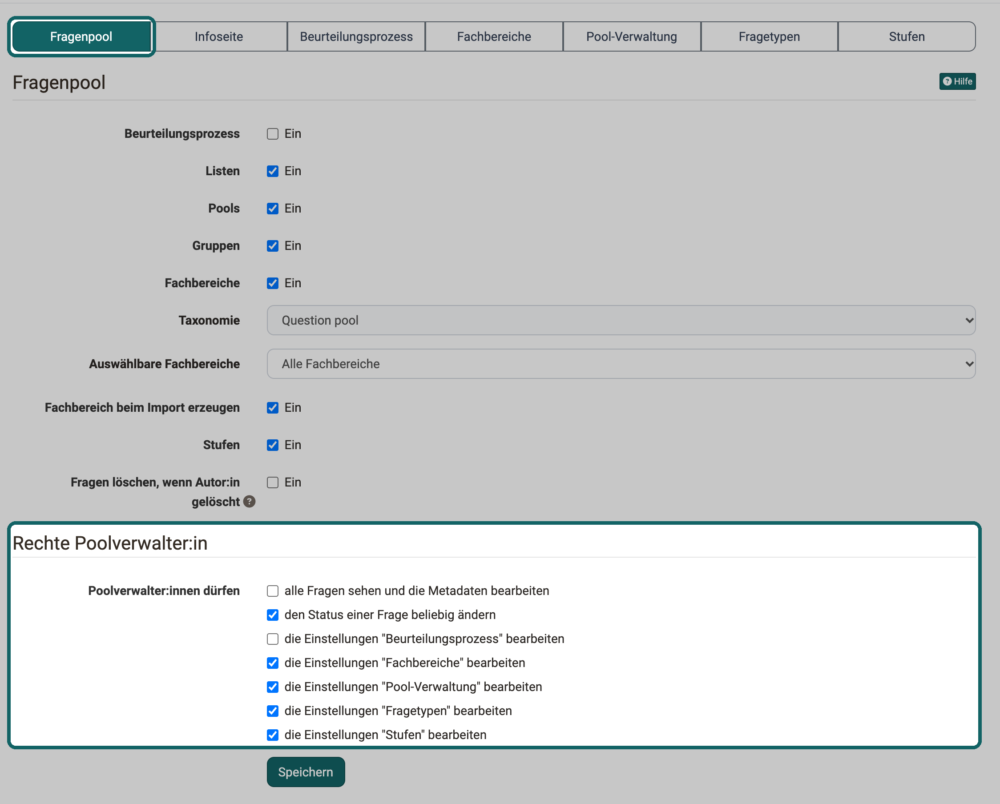
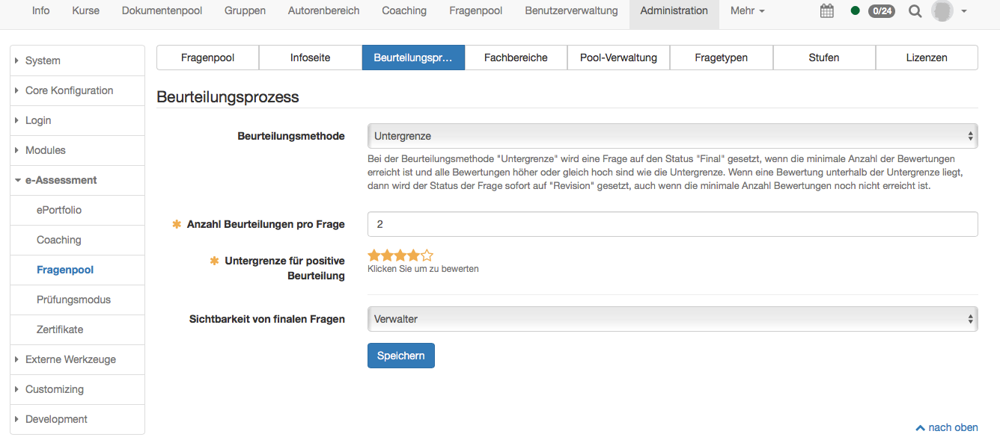

# e-Assessment Administration: Fragenpool {: #question_bank}

Mit den Einstellungen des Fragenpools bestimmen Administrator:innen, welche Funktionen Autor:innen im Fragenpool nutzen: Listen, Pools, Gruppen, Fachbereiche, Stufen und auf Wunsch einen Beurteilungsprozess für Fragen. Die Einstellungen gelten für die ganze Plattform und liegen in der System-Administration unter: 
`Administration > e-Assessment > Fragenpool`

Einige der Einstellungen bearbeiten auch Poolverwalter:innen in der [Administration der Poolverwalter:innen](../../manual_user/area_modules/Question_Bank_Administration.de.md).

{ class="shadow lightbox" title="Tab Fragenpool in der System-Administration · 2026.10.26" }

## Tab Fragenpool

Im ersten Tab Fragenpool legen Sie fest, welche Funktionen der Fragenpool anbietet: ob der Beurteilungsprozess eingeschaltet ist und ob Listen, Pools und Gruppen zur Verfügung stehen. Standardmässig ist der Beurteilungsprozess ausgeschaltet, Listen, Pools und Gruppen sind eingeschaltet.

Schalten Sie beispielsweise die Listen aus, zeigt der Fragenpool keine Listen mehr an, und Fragen lassen sich nicht mehr zu Listen hinzufügen. Fragen, die in Listen waren, bleiben unter "Meine Fragen" sichtbar und werden nicht gelöscht. Schalten Sie die Listen wieder ein, sind dieselben Fragen wie zuvor mit den Listen verknüpft. Für Pools und Gruppen gilt dasselbe.

Der Schalter "Fachbereiche" lässt sich nicht ausschalten, solange der Beurteilungsprozess eingeschaltet ist.

Weitere Informationen zum [Beurteilungsprozess](../../manual_user/area_modules/Question_Bank_Review_Process.de.md) finden Sie im entsprechenden Kapitel.

  * Taxonomie: Zeigt die Taxonomie, aus der die Fachbereiche des Fragenpools stammen. Das ist die Taxonomie "Question pool", die Auswahl lässt sich nicht ändern. Die Fachbereiche selbst bearbeiten Sie im Tab "Fachbereiche". Weitere Informationen zur Taxonomie finden Sie [hier](Modules_Taxonomy.de.md).
  * Auswählbare Fachbereiche: Ist "Alle Fachbereiche" ausgewählt, lässt sich einer Frage jeder Fachbereich zuordnen, unabhängig von den eigenen Kompetenzen. Ist "Fachbereiche mit der Kompetenz "Dozieren" oder "Verwalten"" ausgewählt, ordnen Benutzer:innen Fragen nur den Fachbereichen zu, in denen sie selbst eine dieser Kompetenzen haben. Die Kompetenzen vergeben Sie entweder in der System-Administration unter `Administration > Module > Taxonomie` oder in der Benutzerverwaltung.
  * Fachbereich beim Import erzeugen: Fragen lassen sich per Excel-Import zum Fragenpool hinzufügen. Bei jeder Frage kann der Fachbereich als Metadatum mitkommen. Ist diese Option eingeschaltet, legt der Import Fachbereiche, die noch nicht bestehen, neu an. Auch ein Tippfehler im Fachbereich erzeugt dabei einen neuen Fachbereich.
  * Stufen: Schaltet die Stufen ein, die im Tab "Stufen" erstellt und in den Metadaten einer Frage ausgewählt werden.
  * Fragen löschen, wenn Autor:in gelöscht: Beim Löschen eines Kontos wird die Person als Autor:in von allen Fragen ausgetragen. Ist diese Option eingeschaltet und ist die Person die einzige Autor:in einer Frage, wird die Frage ebenfalls gelöscht. Ist die Option ausgeschaltet, bleiben solche Fragen ohne Autor:in im Fragenpool. Administrator:innen finden sie im Bereich Fragenpool unter `Fragenpool > Fragen > Ohne Autor:in` und können ihnen neue Autor:innen zuordnen.

!!! tip "Tipp"

    Wenn Sie mit einer Taxonomie und Kompetenzen arbeiten, empfiehlt es sich, die Option "Fachbereich beim Import erzeugen" _nicht_ einzuschalten. Nur so vermeiden Sie einen Wildwuchs der Fachbereiche und behalten die Kontrolle über die Struktur.

### Rechte Poolverwalter:in {: #pool_manager_rights}

Im Abschnitt "Rechte Poolverwalter:in" legen Sie fest, was Poolverwalter:innen im Fragenpool tun dürfen. Die Rolle Poolverwalter:in vergeben Sie in der Benutzerverwaltung unter: 
`Benutzerverwaltung > "Name der Person" > Rollen`

Je nach eingeschalteter Option dürfen Poolverwalter:innen:

  * alle Fragen sehen und die Metadaten bearbeiten
  * den Status einer Frage beliebig ändern
  * die Einstellungen "Beurteilungsprozess", "Fachbereiche", "Pool-Verwaltung", "Fragetypen" und "Stufen" bearbeiten, also die gleichnamigen Tabs dieser Seite

Poolverwalter:innen bearbeiten die freigegebenen Einstellungen im Bereich Fragenpool unter `Fragenpool > Administration`.

## Tab Infoseite

Im Tab Infoseite erstellen Sie eine Seite, die Benutzer:innen sehen, wenn sie den Bereich Fragenpool öffnen und auf der obersten Ebene "Mein Fragenpool" stehen. Hinterlegen Sie dort beispielsweise eine Erklärung zum Beurteilungsprozess Ihrer Organisation. So finden sich die Benutzer:innen des Fragenpools schneller zurecht.

## Tab Beurteilungsprozess [:octicons-tag-16:{ title="ab Release 12.3 (OO-3111)" }](https://track.frentix.com/issue/OO-3111)

Im Tab Beurteilungsprozess legen Sie fest, wann eine Frage als geprüft gilt und wer geprüfte Fragen sieht. Die Einstellungen wirken, wenn der Schalter "Beurteilungsprozess" im Tab Fragenpool eingeschaltet ist.

{ class="shadow lightbox" title="Tab Beurteilungsprozess in der System-Administration" }

  * Beurteilungsmethode: Zur Auswahl steht die Beurteilungsmethode "Untergrenze". Sie setzt eine Frage auf den Status "Final", wenn die minimale Anzahl der Bewertungen erreicht ist und alle Bewertungen höher oder gleich hoch sind wie die Untergrenze. Liegt eine Bewertung unterhalb der Untergrenze, setzt sie die Frage sofort auf den Status "Revision", auch wenn die minimale Anzahl Bewertungen noch nicht erreicht ist.
  * Anzahl Beurteilungen pro Frage: So viele Personen müssen eine Frage positiv beurteilen, also oberhalb der Untergrenze, damit die Frage in den Status "Final" wechselt.
  * Untergrenze für positive Beurteilung: Diese Anzahl Sterne müssen die Beurteiler:innen mindestens vergeben, damit die Frage in den Status "Final" wechseln kann. Vergibt jemand weniger Sterne, wechselt die Frage direkt in den Status "Revision".
  * Sichtbarkeit von finalen Fragen: Legt fest, wer im Fragenpool den Eintrag "Final" und damit die Fragen im Status "Final" sieht. Mit "Verwalter:in" sind es nur Personen mit der Kompetenz "Verwalten" im entsprechenden Fachbereich. Mit "Verwalter:in, Dozent:in" sind es alle Personen mit der Kompetenz "Unterrichten" ("Dozieren") oder "Verwalten" im entsprechenden Fachbereich.

## Tab Fachbereiche

Im Tab Fachbereiche fügen Sie Fachbereiche hinzu, bearbeiten sie, führen sie zusammen oder löschen sie. Weitere Informationen finden Sie unter [Taxonomie](Modules_Taxonomy.de.md).

## Tab Pool-Verwaltung

Im Tab Pool-Verwaltung erstellen, bearbeiten und löschen Sie Pools. Pools wie auch Gruppen erlauben es, Fragen mit anderen Personen zu teilen. Mit dem Kontrollkästchen "Öffentlich" eines Pools legen Sie fest, wer Zugriff hat:

  * **Öffentlich eingeschaltet**: Alle Autor:innen haben Zugriff auf den Pool.
  * **Öffentlich ausgeschaltet**: Nur die Besitzer:innen des Pools haben Zugriff.

## Tab Fragetypen

Der Tab Fragetypen listet alle Fragetypen auf, die im Fragenpool vorkommen. Das sind zum einen die [Fragetypen](../../manual_user/learningresources/Test_question_types.de.md), die Sie in OpenOlat erstellen. Zum anderen sind es Fragetypen aus Fragen, die aus externen Systemen importiert wurden. Reichen die Standard-Fragetypen von OpenOlat nicht aus, erstellen Sie mit "Fragetyp erstellen" weitere. Die Standard-Fragetypen lassen sich nicht löschen.

## Tab Stufen

Im Tab Stufen erstellen Sie mit "Stufe erstellen" die Stufen, die in den Metadaten einer Frage zur Auswahl stehen, zum Beispiel Schwierigkeitsgrade oder Kompetenzstufen. Die Stufen erscheinen, wenn der Schalter "Stufen" im Tab Fragenpool eingeschaltet ist.

## Weiterführende Informationen {: #further_information}

[Fragenpool: Administration >](../../manual_user/area_modules/Question_Bank_Administration.de.md) 
[Fragenpool: Beurteilungsprozess >](../../manual_user/area_modules/Question_Bank_Review_Process.de.md) 
[Modul Taxonomie >](Modules_Taxonomy.de.md) 
[Test Fragetypen >](../../manual_user/learningresources/Test_question_types.de.md) 
[Fragenpool: Übersicht >](../../manual_user/area_modules/Question_Bank.de.md) 
[Rollen und Rechte: Übersicht >](../../manual_user/basic_concepts/Roles_Rights.de.md) 
[Rollen zuweisen >](../usermanagement/Assign_roles.de.md)

[Zum Seitenanfang ^](#question_bank)