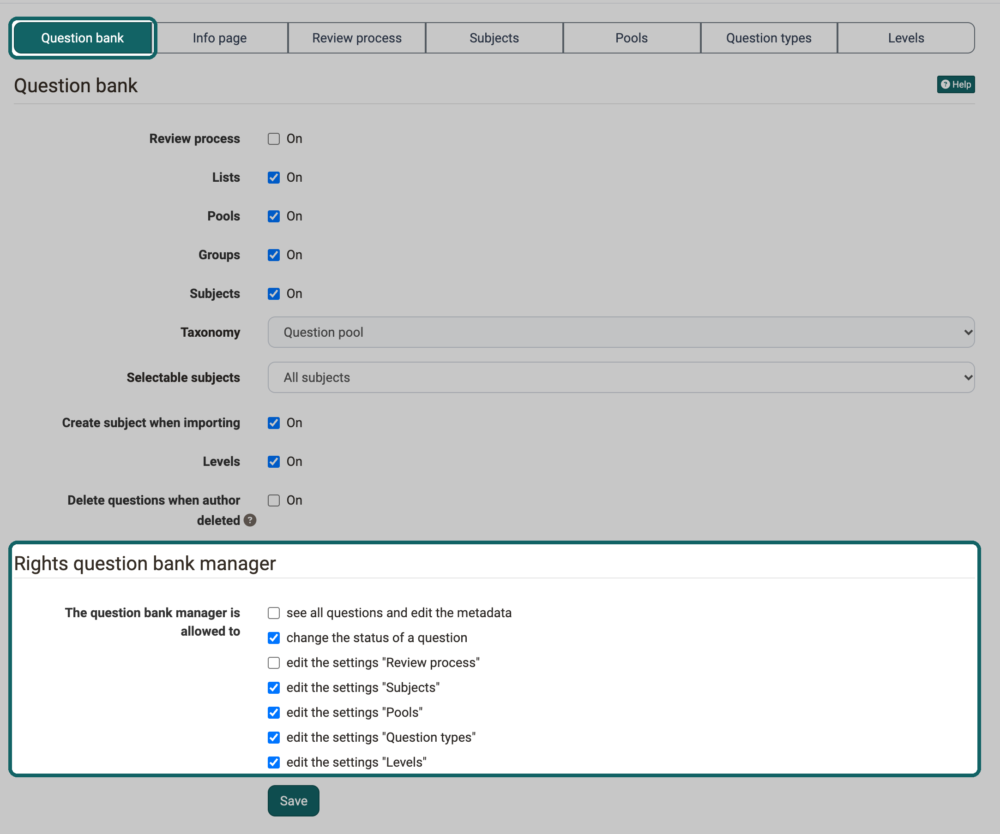
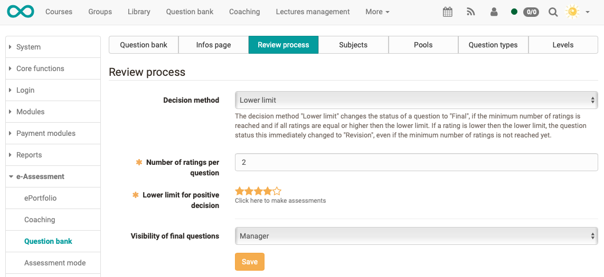

# e-Assessment Administration: Question bank {: #question_bank}

With the question bank settings, administrators decide which functions authors use in the question bank: lists, pools, groups, subjects, levels and, if required, a review process for questions. The settings apply to the whole platform and are located in the system administration under: 
`Administration > e-Assessment > Question bank`

Question bank managers also edit some of the settings in the [administration of the question bank managers](../../manual_user/area_modules/Question_Bank_Administration.md).

{ class="shadow lightbox" title="Tab Question bank in the system administration · 2026.10.26" }

## Tab Question bank

In the first tab Question bank, you define which functions the question bank offers: whether the review process is switched on and whether lists, pools and groups are available. By default, the review process is switched off, while lists, pools and groups are switched on.

For example, if you switch off the lists, the question bank no longer shows any lists, and questions can no longer be added to lists. Questions that were in lists remain visible under "My questions" and are not deleted. If you switch the lists on again, the same questions as before are linked to the lists. The same applies to pools and groups.

The switch "Subjects" cannot be switched off while the review process is switched on.

For more information on the [review process](../../manual_user/area_modules/Question_Bank_Review_Process.md), please refer to the corresponding chapter.

  * Taxonomy: Shows the taxonomy that provides the subjects of the question bank. This is the taxonomy "Question pool", the selection cannot be changed. You edit the subjects themselves in the "Subjects" tab. More information about the taxonomy can be found [here](Modules_Taxonomy.md).
  * Selectable subjects: If "All subjects" is selected, any subject can be assigned to a question, regardless of one's own competences. If "Subjects with competence "teach" or "manage"" is selected, users assign questions only to the subjects in which they themselves have one of these competences. You assign the competences either in the system administration under `Administration > Modules > Taxonomy` or in the user management.
  * Create subject when importing: Questions can be added to the question bank via Excel import. For each question, the subject can come along as metadata. If this option is switched on, the import creates subjects that do not yet exist. A typo in the subject also creates a new subject.
  * Levels: Switches on the levels that are created in the "Levels" tab and selected in the metadata of a question.
  * Delete questions when author deleted: When an account is deleted, the person is removed as author from all questions. If this option is switched on and the person is the only author of a question, the question is deleted as well. If the option is switched off, such questions remain in the question bank without an author. Administrators find them in the Question bank site under `Question bank > Questions > Without author` and can assign new authors to them.

!!! tip "Tip"

    If you work with a taxonomy and competences, it is recommended *not* to switch on the "Create subject when importing" option. This is the only way to avoid a wild growth of subjects and to keep control over the structure.

### Rights question bank manager {: #pool_manager_rights}

In the section "Rights question bank manager", you define what question bank managers are allowed to do in the question bank. You assign the role Question bank manager in the user management under: 
`User management > "Name of the person" > Roles`

Depending on the options switched on, question bank managers are allowed to:

  * see all questions and edit the metadata
  * change the status of a question
  * edit the settings "Review process", "Subjects", "Pools", "Question types" and "Levels", i.e. the tabs of the same name on this page

Question bank managers edit the released settings in the Question bank site under `Question bank > Administration`.

## Tab Info page

In the tab Info page, you create a page that users see when they open the Question bank site and are on the top level "My question bank". For example, store an explanation of your organisation's review process there. This helps the users of the question bank to find their way around more quickly.

## Tab Review process [:octicons-tag-16:{ title="from Release 12.3 (OO-3111)" }](https://track.frentix.com/issue/OO-3111)

In the tab Review process, you define when a question counts as reviewed and who sees reviewed questions. The settings take effect when the switch "Review process" in the tab Question bank is switched on.

{ class="shadow lightbox" title="Tab Review process in the system administration" }

  * Decision method: The decision method "Lower limit" is available for selection. It sets a question to the status "Final" if the minimum number of ratings is reached and all ratings are equal to or higher than the lower limit. If a rating is below the lower limit, it immediately sets the question to the status "Revision", even if the minimum number of ratings has not yet been reached.
  * Number of ratings per question: This many people must rate a question positively, i.e. above the lower limit, for the question to change to the status "Final".
  * Lower limit for positive decision: The reviewers must award at least this number of stars for the question to change to the status "Final". If someone awards fewer stars, the question changes directly to the status "Revision".
  * Visibility of final questions: Defines who sees the entry "Final" in the question bank and thus the questions in the status "Final". With "Manager", these are only persons with the competence "Manage" in the corresponding subject. With "Manager, Teacher", these are all persons with the competence "Teach" or "Manage" in the corresponding subject.

## Tab Subjects

In the tab Subjects, you add, edit, merge and delete subjects. For more information, see [Taxonomy](Modules_Taxonomy.md).

## Tab Pools

In the tab Pools, you create, edit and delete pools. Pools as well as groups allow you to share questions with other people. With the checkbox "Public" of a pool, you define who has access:

  * **Public switched on**: All authors have access to the pool.
  * **Public switched off**: Only the owners of the pool have access.

## Tab Question types

The tab Question types lists all question types that occur in the question bank. On the one hand, these are the [question types](../../manual_user/learningresources/Test_question_types.md) that you create in OpenOlat. On the other hand, these are question types from questions that were imported from external systems. If the standard question types of OpenOlat are not sufficient, create more with "Create type". The standard question types cannot be deleted.

## Tab Levels

In the tab Levels, you use "Create level" to create the levels that are available for selection in the metadata of a question, for example difficulty levels or competence levels. The levels appear when the switch "Levels" in the tab Question bank is switched on.

## Further information {: #further_information}

[Question Bank: Administration >](../../manual_user/area_modules/Question_Bank_Administration.md) 
[Question Bank Review Process >](../../manual_user/area_modules/Question_Bank_Review_Process.md) 
[Module Taxonomy >](Modules_Taxonomy.md) 
[Test question types >](../../manual_user/learningresources/Test_question_types.md) 
[Question Bank: Overview >](../../manual_user/area_modules/Question_Bank/index.md) 
[Roles and Rights: Overview >](../../manual_user/basic_concepts/Roles_Rights.md) 
[Assign roles >](../usermanagement/Assign_roles.md)

[To the top of the page ^](#question_bank)

