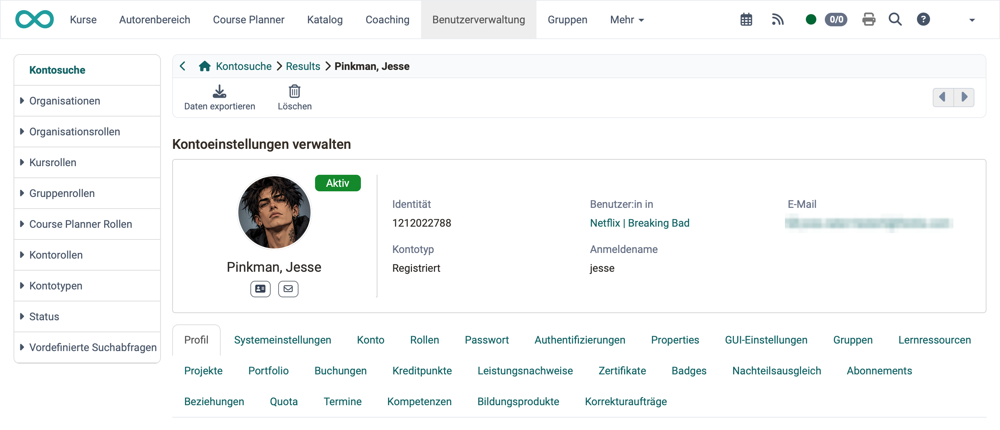
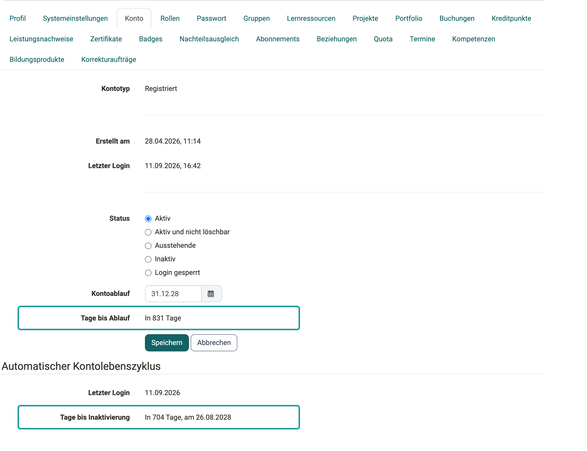
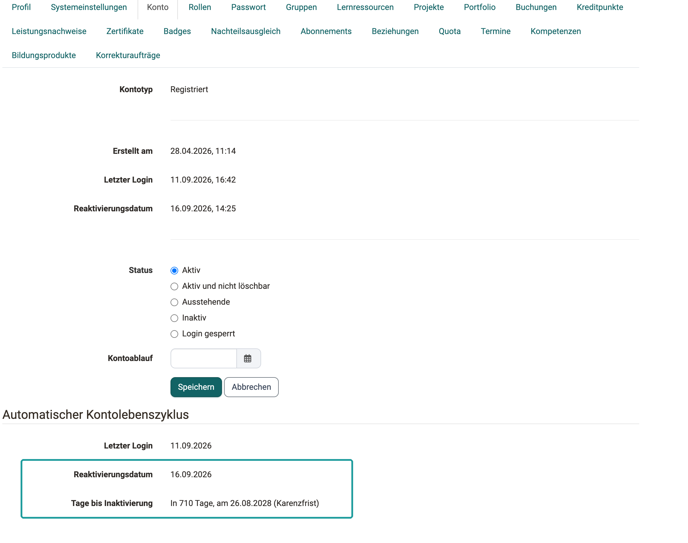
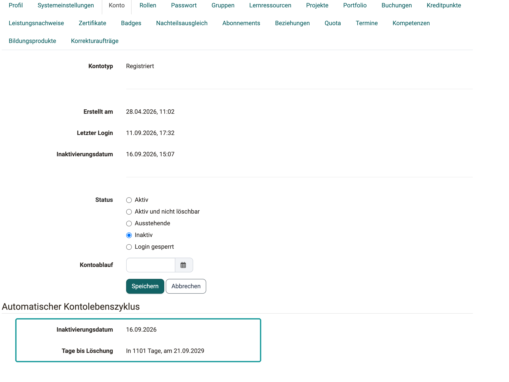
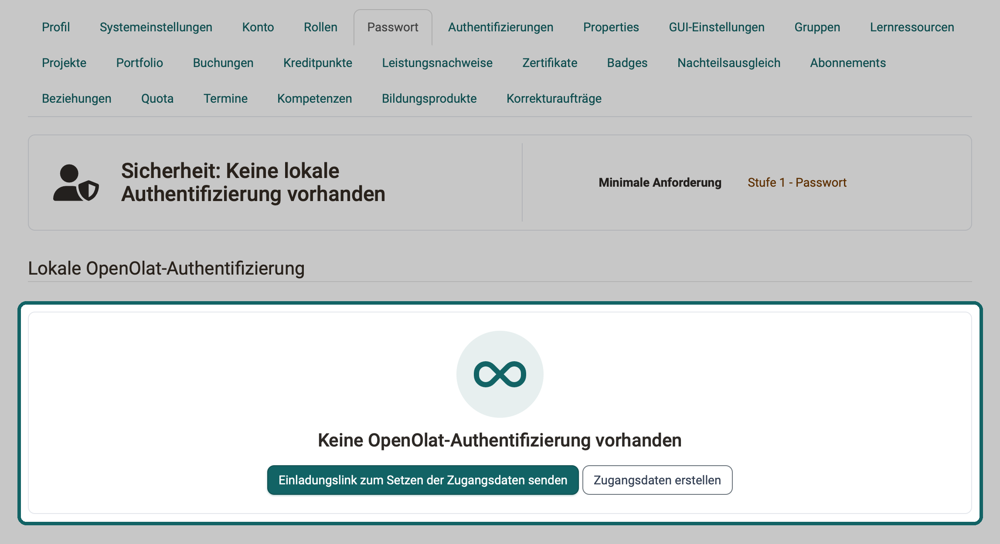
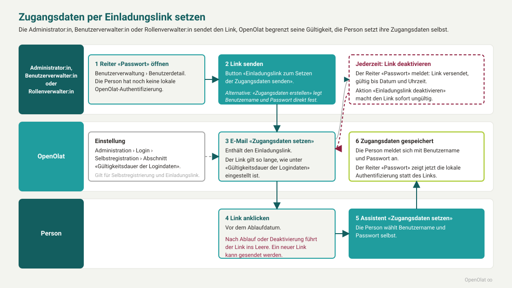
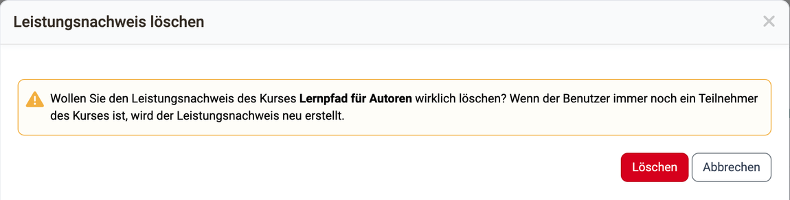
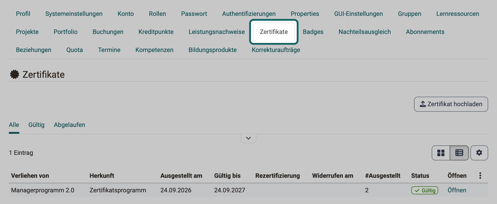
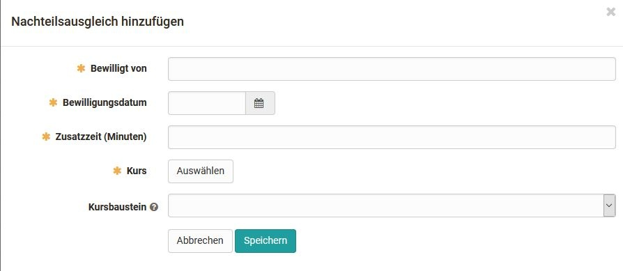
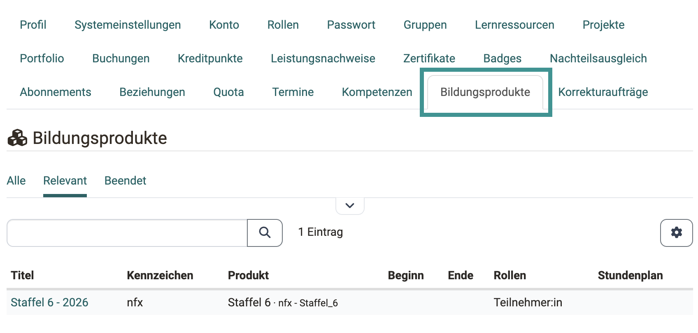

# Kontoeinstellungen verwalten {: #user_configuration}

Braucht eine Person Hilfe bei ihrem Konto, etwa ein neues Passwort, eine weitere Rolle oder mehr Speicherplatz, öffnen Sie ihre Kontoeinstellungen: Dort sehen Sie an einem Ort, was zu diesem Konto gehört, und ändern es. Die Person finden Sie über die [Kontosuche](Search_Users.de.md). Die Kontoeinstellungen erreichen Administrator:innen, Benutzerverwalter:innen, Rollenverwalter:innen und Principals.

Administrator:innen sehen alle im Folgenden beschriebenen Reiter, sofern die zugehörigen Module eingeschaltet sind. Die übrigen Rollen sehen weniger Reiter; welche Rollen einen Reiter erreichen, steht im jeweiligen Abschnitt.

{ class="shadow lightbox" title="Kontoeinstellungen eines Kontos in der Benutzerverwaltung · 2026.10.31" }

Der Kopfbereich über den Reitern zeigt auf einen Blick, wem das Konto gehört, in welchen Organisationen die Person ist und welche Rollen sie hat. Neben dem Bild der Person steht der Status des Kontos, zum Beispiel "Aktiv". Unter dem Namen öffnen zwei Symbole die "Visitenkarte" der Person und ein Formular, mit dem Sie ihr eine "E-Mail" schreiben. [:octicons-tag-16:{ title="ab Release 20.0.2 (OO-8515)" }](https://track.frentix.com/issue/OO-8515)

- **Identität**: die Nummer, unter der OpenOlat das Konto führt.
- **Benutzer:in in**: die Organisationen, in denen die Person die Rolle Benutzer:in hat. Hat sie diese Rolle in keiner Organisation, steht hier "Keine Daten vorhanden". Das ist bei jedem Konto vom Kontotyp "Extern" oder "Anonymer Zugang" der Fall, denn diese Konten haben die Rolle Benutzer:in nicht.
- **Zusätzliche Rollen**: alle Rollen der Person ausser Benutzer:in, zum Beispiel Autor:in oder Lernressourcenverwalter:in. Hat die Person eine Rolle in mehreren Organisationen, steht die Anzahl dieser Organisationen in Klammern hinter der Rolle. Hat sie keine weitere Rolle, fehlt die Zeile.
- **E-Mail**: die E-Mail-Adresse aus dem Profil.
- **Kontotyp**: "Registriert", "Extern" oder "Anonymer Zugang".
- **Anmeldename**: der Name, mit dem sich die Person anmeldet.

Ein Klick auf die Organisationen oder auf die Rollen öffnet den Reiter "Rollen", der die Rollen der Person je Organisation zeigt.

In der Werkzeugleiste über dem Kopfbereich stehen zwei Aktionen. "Daten exportieren" startet den Export der Daten, die OpenOlat zu diesem Konto gespeichert hat, siehe [Datenschutz](Data_protection.de.md#export_user_data). "Löschen" löscht das Konto, siehe [Benutzer:in löschen](Delete_User.de.md). Die Aktion "Löschen" sehen nur Administrator:innen.

OpenOlat führt jedes Benutzerkonto für sich; Konten lassen sich nicht zusammenführen. Was eine Person in OpenOlat erarbeitet hat, also Kursmitgliedschaften, Testresultate, Leistungsnachweise, Zertifikate und Badges, bleibt dauerhaft mit dem Konto verbunden, auf dem es entstanden ist. So bleibt jeder Nachweis eindeutig einer Anmeldung zugeordnet und später überprüfbar, und die personenbezogenen Daten bleiben auf ein Konto begrenzt.

Ist die Option "Eindeutig" in der System-Administration aktiviert, entstehen keine zwei Konten mit derselben E-Mail-Adresse. Systemadministrator:innen finden die Option im Abschnitt "E-Mail Adresse" unter: 
`Administration > Core-Konfiguration > E-Mail`, Segment "Einstellungen", siehe [E-Mail Einstellungen](../administration/E-Mail_Settings.de.md#email_address).

!!! tip "Zwei Konten derselben Person"
    Bestehen dennoch zwei Konten derselben Person, entscheiden Sie, welches Konto weitergeführt wird. Zertifikate des zweiten Kontos laden Sie im Reiter "Zertifikate" über "Zertifikat herunterladen" herunter und erfassen sie im weitergeführten Konto über "Zertifikat hochladen". Das zweite Konto setzen Sie danach im Reiter "Konto" auf inaktiv.

### Profil {: #profile}

Stimmen Name, E-Mail-Adresse oder Kontaktdaten einer Person nicht mehr, korrigieren Sie sie im Reiter "Profil", ohne dass die Person selbst tätig werden muss. Der Reiter zeigt die Personalien, die Angaben zur Person, die Kontaktdaten und im Abschnitt "Institution" die Angaben zur Institution, dazu die Visitenkarte und das persönliche Bild der Person. Es sind dieselben Angaben, die die Person selbst unter `Persönliches Menü > Profil` pflegt, siehe [Profil](../../manual_user/personal_menu/Profile.de.md). Zu den verbindlichen Einträgen des Benutzerprofils gehören: Anmeldename, Vorname, Nachname und E-Mail. Mit "E-Mail Versand sperren" verhindern Sie, dass OpenOlat Mails an diese Adresse versendet.

Den Reiter erreichen alle Rollen, welche die Kontoeinstellungen öffnen. Ändern können die Angaben Administrator:innen, Benutzerverwalter:innen und Rollenverwalter:innen; Principals sehen das Profil, ohne es zu bearbeiten.

Ist die [Debitorennummer](../administration/Modules_Organisations.de.md#customer_number) im Modul Organisationen eingeschaltet, zeigt der Abschnitt "Institution" zusätzlich das Feld "Debitorennummer". Hier tragen Sie die Nummer ein, unter der Ihre Buchhaltung die Person führt. Die Person selbst sieht das Feld in ihrem eigenen Profil nicht. [:octicons-tag-16:{ title="ab Release 21.1 (OO-9736)" }](https://track.frentix.com/issue/OO-9736)

[zum Seitenanfang ^](#user_configuration)

### Systemeinstellungen

Erhält eine Person OpenOlat in der falschen Sprache oder keine E-Mails an ihre Adresse, sehen Sie im Reiter "Systemeinstellungen" ihre eigenen Einstellungen, zum Beispiel die voreingestellte Sprache und ob E-Mails nur OpenOlat-intern oder auch an die Adresse im Profil gehen. Die Person selbst pflegt sie unter `Persönliches Menü > Einstellungen`, siehe [Einstellungen](../../manual_user/personal_menu/Settings.de.md).

Den Reiter erreichen Administrator:innen, Benutzerverwalter:innen und Rollenverwalter:innen. Bei eingeladenen Konten zeigt OpenOlat den Reiter allen Rollen, welche die Kontoeinstellungen öffnen.

Trägt das Konto ein Ablaufdatum, zeigt der Reiter es unter "Kontoablauf" an. Eine Anzahl verbleibender Tage steht hier nicht; die Fristen führt der Reiter "Konto". Bei inaktiven Konten blendet OpenOlat die Angabe aus. [:octicons-tag-16:{ title="ab Release 21.1 (OO-8382)" }](https://track.frentix.com/issue/OO-8382)

[zum Seitenanfang ^](#user_configuration)

### Konto

Der Reiter "Konto" zeigt den Zustand eines Kontos und den Punkt, an dem es im automatischen Kontolebenszyklus steht. Hier beurteilen Sie, ob und wann OpenOlat ein Konto automatisch deaktiviert oder löscht, und hier setzen Sie es manuell auf inaktiv.

Den Reiter erreichen Administrator:innen, Benutzerverwalter:innen, Rollenverwalter:innen und Principals; Principals sehen das Feld "Status" nicht. Welche Felder er zeigt, hängt von der Rolle des bearbeiteten Kontos und von den Schaltern des automatischen Kontolebenszyklus ab, siehe [Lebenszyklen: Konto](../administration/Life_cycles_-_Administration.de.md#lifecycle_accounts).

#### Kontotyp {: #account_type }

Der Kontotyp unterscheidet registrierte Konten, Gastkonten und eingeladene Konten. Ein eingeladenes Konto wandeln Sie über "In registriertes Konto umwandeln" um.

#### Erstellt am {: #creation_date }

Datum und Uhrzeit, zu der das Konto angelegt wurde.

#### Letzter Login {: #last_login }

Datum und Uhrzeit der letzten Anmeldung. Dieser Wert ist die Bezugsgrösse des automatischen Kontolebenszyklus. Bei Gastkonten entfällt die Angabe.

#### Inaktivierungsdatum {: #inactivation_date }

Datum, an dem das Konto deaktiviert wurde. Das Feld erscheint nur bei einem Konto, das bereits einmal deaktiviert war.

#### Reaktivierungsdatum {: #reactivation_date }

Datum, an dem ein deaktiviertes Konto wieder freigeschaltet wurde. Das Feld erscheint nur nach einer Reaktivierung.

#### Status {: #account_status }

Der Status steuert, ob sich die Person anmelden kann. Zur Auswahl stehen "Aktiv", "Aktiv und nicht löschbar", "Ausstehende", "Inaktiv" und "Login gesperrt". Bei Konten mit der Rolle Administrator:in, Systemadministrator:in oder Rollenverwalter:in lässt sich der Status nicht ändern.

#### Kontoablauf {: #account_expiration }

Hier hinterlegen Sie das Datum, an dem OpenOlat das Konto deaktivieren soll. Das eignet sich für befristete Zugänge, etwa für Gastdozierende oder Projektmitarbeit. Bei Administrator:innen, Systemadministrator:innen und Gastkonten steht das Feld nicht zur Verfügung.

#### Tage bis Ablauf {: #days_until_expiry }

Ist ein Ablaufdatum gesetzt, zeigt dieses Feld die verbleibende Zeit im Format "In 14 Tage". Liegt das Datum in der Vergangenheit, erscheint in Rot die Anzahl überfälliger Tage mit dem Hinweis, dass OpenOlat das Konto beim nächsten Durchlauf deaktiviert. Ohne Ablaufdatum entfällt das Feld.

#### Automatischer Kontolebenszyklus {: #automatic_user_lifecycle }

Dieser Abschnitt zeigt, wie der systemweite automatische Kontolebenszyklus auf dieses Konto wirkt. Er entfällt bei Gastkonten. OpenOlat deaktiviert ein Konto, das sich in der eingestellten Frist nicht anmeldet. Die Oberfläche nennt diesen Schritt "Inaktivierung", das Konto trägt danach den Status "Inaktiv", siehe [Deaktivierung und Reaktivierung](../administration/Life_cycles_-_Administration.de.md#account_reactivation). Welche Angaben erscheinen, hängt vom Zustand des Kontos ab:

| Zustand | Anzeige | Bedeutung |
|---------|---------|-----------|
| Aktiv | "Letzter Login", "Tage bis Inaktivierung" | OpenOlat deaktiviert das Konto nach dieser Frist ohne Login automatisch. |
| Reaktiviert | zusätzlich "Reaktivierungsdatum", die Frist trägt den Zusatz "(Karenzfrist)" | Das Konto wurde nach einer Deaktivierung wieder freigeschaltet und läuft in einer Karenzfrist (Schonfrist): In dieser Zeit deaktiviert OpenOlat es nicht erneut. |
| Inaktiv | "Inaktivierungsdatum", "Tage bis Löschung" | Das Konto ist deaktiviert und wird nach dieser Frist automatisch gelöscht. |

Beide Fristen nennen neben der Anzahl Tage auch das Datum, an dem der Schritt fällig wird.

"Tage bis Inaktivierung" erscheint nur bei aktivem Schalter "Konten nach Inaktivität deaktivieren", "Tage bis Löschung" nur bei aktivem Schalter "Inaktive Konten löschen". Beide Schalter finden Systemadministrator:innen in der System-Administration unter: 
`Administration > Lebenszyklen > Konto`

Sind die Schalter aus, greift kein automatischer Prozess, und die Fristen entfallen.

Ein aktives Konto mit hinterlegtem Ablaufdatum führt beide Fristen nebeneinander: "Tage bis Ablauf" für das Datum, "Tage bis Inaktivierung" für den letzten Login.

{ class="shadow lightbox" title="Reiter Konto eines aktiven Kontos" }

Nach einer Reaktivierung kommt das Reaktivierungsdatum dazu, und die Frist trägt den Zusatz "(Karenzfrist)".

{ class="shadow lightbox" title="Reiter Konto eines reaktivierten Kontos" }

Bei einem inaktiven Konto treten Inaktivierungsdatum und "Tage bis Löschung" an die Stelle der Inaktivierungsfrist.

{ class="shadow lightbox" title="Reiter Konto eines inaktiven Kontos" }

[zum Seitenanfang ^](#user_configuration)

### Rollen

Im Reiter "Rollen" legen Sie fest, welche Rollen die Person hat und was sie damit in OpenOlat tun darf. Bei eingeschaltetem Modul "Organisationen" vergeben Sie die Rollen je Organisation, siehe [Rollen zuweisen](Assign_roles.de.md).

Den Reiter erreichen alle Rollen, welche die Kontoeinstellungen öffnen. Bei eingeladenen Konten und bei Gastkonten zeigt OpenOlat ihn nicht.

[zum Seitenanfang ^](#user_configuration)

### Passwort [:octicons-tag-16:{ title="ab Release 20.3.0 (OO-9139)" }](https://track.frentix.com/issue/OO-9139) {: #password}

Kann sich eine Person nicht anmelden, weil ihr die Zugangsdaten fehlen oder sie ihr Passwort vergessen hat, helfen Sie ihr im Reiter "Passwort": Sie senden ihr einen Einladungslink, legen die Zugangsdaten selbst fest oder setzen ein bestehendes Passwort neu.

Den Reiter "Passwort" erreichen Administrator:innen, Benutzerverwalter:innen und Rollenverwalter:innen. Benutzerverwalter:innen sehen den Reiter nicht bei Konten, die selbst Administrator:in oder Rollenverwalter:in sind.

Oben im Reiter steht die Sicherheitsstufe des Kontos, bei einem Konto ohne lokale Authentifizierung zum Beispiel "Sicherheit: Keine lokale Authentifizierung vorhanden". Ist in der System-Administration "Sicherheitsstufen / Passkey verwenden" eingeschaltet, nennt die Zeile "Minimale Anforderung" darunter die Stufe, die für die Rolle der Person mindestens gilt.

Verfügt die Benutzer:in noch über keine lokale Authentifizierung, zeigt der Abschnitt "Lokale OpenOlat-Authentifizierung" den Button "Zugangsdaten erstellen": Damit legen Sie die Zugangsdaten direkt fest. Der Button "Einladungslink zum Setzen der Zugangsdaten senden" versendet einen Link per Mail; die Person setzt ihre Zugangsdaten damit selbst. Diesen Button zeigt OpenOlat nicht, wenn sich die Person nur mit Passkey anmeldet (Stufe 2) oder für ihre Rolle die Mindeststufe 2 gilt.

{ class="shadow lightbox" title="Reiter Passwort eines Kontos ohne lokale Authentifizierung · 2026.10.31" }

Wurde ein Einladungslink bereits versendet, zeigt eine Meldung dessen Gültigkeitsdauer an. Über die Aktion "Einladungslink deaktivieren" kann der Link jederzeit ungültig gemacht werden. Nach Ablauf oder Deaktivierung führt der Link ins Leere; Sie können danach einen neuen Einladungslink senden.

Hat die Person bereits ein Passwort, zeigt der Abschnitt "Lokale OpenOlat-Authentifizierung" die Aktionen "Passwort neu setzen" und "Passwortlink senden". Mit "Passwort neu setzen" legen Sie ein neues Passwort direkt fest, "Passwortlink senden" schickt der Person einen Link, mit dem sie es selbst neu setzt. Diese beiden Aktionen stehen nur Administrator:innen und Benutzerverwalter:innen zur Verfügung. Rollenverwalter:innen senden den Einladungslink, deaktivieren ihn und erstellen Zugangsdaten; nur bei eingeladenen Konten setzen auch sie ein bestehendes Passwort neu oder senden einen Passwortlink.

Wie lange ein Einladungslink gültig bleibt, legen Systemadministrator:innen in der System-Administration im Abschnitt "Gültigkeitsdauer der Logindaten" fest: 
`Administration > Login > Selbstregistration`, Reiter "Konfiguration", siehe [Selbstregistration](../administration/Login_Self-Registration.de.md#tab_configuration).

{ class="shadow lightbox" title="Ablauf mit dem Einladungslink" }

Der Abschnitt "Passkeys" listet die Passkeys der Person, auch wenn Passkey in der System-Administration ausgeschaltet ist. Mit "Löschen" entfernen Sie einen Passkey. Hat die Person keinen Passkey, ist der Abschnitt ausgeblendet, wenn Passkey ausgeschaltet ist oder als Minimum die Sicherheitsstufe 1 (Passwort) gilt. Den Abschnitt "Wiederherstellungsoption" mit dem Button "Recovery Key senden" zeigt OpenOlat nur bei eingeschaltetem Passkey.

Hat sich die Person bisher nur mit Passkey angemeldet (Stufe 2) und ist Passkey inzwischen ausgeschaltet, zeigt der Reiter die Warnung "Die Anmeldung ist nicht möglich: Das Konto verfügt nur über Passkeys, doch die Passkey-Funktion ist deaktiviert." Die Person kommt auf einem von zwei Wegen wieder in ihr Konto:

* **Zugangsdaten erstellen:** Mit "Zugangsdaten erstellen" legen Sie ein Passwort fest. Teilen Sie es der Person auf sicherem Weg mit; sie ändert es nach der Anmeldung unter `Persönliches Menü > Passwort`.
* **Passkeys löschen:** Sie löschen im Abschnitt "Passkeys" alle Passkeys der Person. Danach verschwindet die Warnung, und der Button "Einladungslink zum Setzen der Zugangsdaten senden" erscheint. Mit dem Link setzt die Person ihr Passwort selbst.

Was Sie vor dem Ausschalten von Passkey beachten, steht unter [Passwort und Authentifizierung](../administration/Login_Password_and_Authentication.de.md#use_security_levels_passkey).

[zum Seitenanfang ^](#user_configuration)

### Authentifizierungen

Meldet sich eine Person über einen weiteren Anmeldeweg an oder ändert sich ihr Anmeldename, passen Sie das im Reiter "Authentifizierungen" an. Hier ändern Sie den Anmeldenamen, fügen mit "Authentifizierung hinzufügen" eine Authentifizierung hinzu, bearbeiten und löschen bestehende Authentifizierungen und legen mit "API-Key hinzufügen" einen API-Key an.

Den Reiter erreichen nur Administrator:innen.

[zum Seitenanfang ^](#user_configuration)

### Properties

Der Reiter "Properties" listet die technischen Einträge, die OpenOlat zu diesem Konto speichert, mit den Spalten "Kategorie", "Gruppe", "Ressource", "Name", "Wert", "Erstellt" und "Geändert". Die Tabelle laden Sie bei Bedarf herunter, einen einzelnen Eintrag löschen Sie mit "Löschen".

Den Reiter erreichen nur Administrator:innen.

[zum Seitenanfang ^](#user_configuration)

### GUI-Einstellungen

Zeigt OpenOlat einer Person eine Liste oder Ansicht nicht mehr wie erwartet, setzen Sie im Reiter "GUI-Einstellungen" die gespeicherten Einstellungen der Oberfläche zurück. Jede Zeile hat den Button "Zurücksetzen", mehrere ausgewählte Einträge setzen Sie mit "Mehrere Einträge zurücksetzen" auf einmal zurück.

Den Reiter erreichen nur Administrator:innen.

[zum Seitenanfang ^](#user_configuration)

### Gruppen

Der Reiter "Gruppen" zeigt alle Gruppen, in denen die Person Teilnehmer:in oder Betreuer:in ist. Hier tragen Sie die Person in weitere Gruppen ein oder aus einer Gruppe aus.

Den Reiter erreichen Administrator:innen, Benutzerverwalter:innen, Rollenverwalter:innen und Principals. Ein- und austragen können Administrator:innen, Benutzerverwalter:innen und Rollenverwalter:innen.

[zum Seitenanfang ^](#user_configuration)

### Lernressourcen [:octicons-tag-16:{ title="ab Release 9.1.0 (OO-788)" }](https://track.frentix.com/issue/OO-788)

Der Reiter "Lernressourcen" zeigt alle Kurse und Lernressourcen der Person. Von hier aus öffnen Sie eine Lernressource, tragen die Person aus einer Lernressource aus oder tragen sie als Besitzer:in, Betreuer:in oder Teilnehmer:in in weitere Kurse ein.

Den Reiter erreichen Administrator:innen, Benutzerverwalter:innen, Rollenverwalter:innen und Principals. Ein- und austragen können Administrator:innen, Benutzerverwalter:innen und Rollenverwalter:innen.

Die Liste führt einzelne Lernressourcen mit den Kurs- und Gruppenrollen der Person. Durchführungen des Course Planners stehen dagegen im Reiter "Bildungsprodukte".

[zum Seitenanfang ^](#user_configuration)

### Projekte [:octicons-tag-16:{ title="ab Release 19.1.0 (OO-7417)" }](https://track.frentix.com/issue/OO-7417)

Der Reiter "Projekte" listet alle Projekte, in denen die Person Mitglied ist.

Den Reiter erreichen Administrator:innen, Benutzerverwalter:innen, Rollenverwalter:innen und Principals.

[zum Seitenanfang ^](#user_configuration)

### Portfolio

Der Reiter "Portfolio" zeigt alle Portfolio-Mappen, zu denen die Person eingeladen ist. Ihre eigenen Mappen stehen nicht in dieser Liste.

Den Reiter erreichen Administrator:innen, Benutzerverwalter:innen, Rollenverwalter:innen und Principals.

[zum Seitenanfang ^](#user_configuration)

### Buchungen

Der Reiter "Buchungen" zeigt die Buchungsaufträge und Vorbestellungen der Person.

Den Reiter erreichen Administrator:innen, Rollenverwalter:innen und Principals.

[zum Seitenanfang ^](#user_configuration)

### Kreditpunkte [:octicons-tag-16:{ title="ab Release 20.1.1 (OO-8558)" }](https://track.frentix.com/issue/OO-8558)

Der Reiter "Kreditpunkte" zeigt die Kreditpunkte, welche die Person erworben hat.

Den Reiter zeigt OpenOlat nur bei eingeschaltetem Modul "Kreditpunkte". Ihn erreichen Administrator:innen, Benutzerverwalter:innen, Rollenverwalter:innen und Principals.

[zum Seitenanfang ^](#user_configuration)

### Leistungsnachweise

Der Reiter "Leistungsnachweise" zeigt die Leistungsnachweise, Punkte und den Fortschritt der Person aus ihren Kursen. Die Tabelle führt pro Kurs "Fortschritt", "Punkte" und "Bestanden"; bei aktivem Notenmodul kommt die Spalte "Bewertung" mit der erreichten Note dazu. Über das Zahnrad "Spalten auswählen" blenden Sie weitere Spalten ein, darunter die standardmässig ausgeblendete Spalte "Kennzeichen". [:octicons-tag-16:{ title="ab Release 21.0 (OO-9581)" }](https://track.frentix.com/issue/OO-9581)

Den Reiter erreichen Administrator:innen, Principals, Benutzerverwalter:innen und Rollenverwalter:innen.

#### Leistungsnachweis löschen {: #delete_evidence }

Über das Aktionsmenü (drei Punkte) einer Zeile lässt sich ein einzelner Leistungsnachweis löschen [:octicons-tag-16:{ title="ab Release 21.0 (OO-9551)" }](https://track.frentix.com/issue/OO-9551). Ein Bestätigungsdialog erklärt die Folge: Ist die Person noch Teilnehmer:in des Kurses, wird der Leistungsnachweis automatisch neu erstellt; ist sie nicht mehr im Kurs, wird er endgültig gelöscht.

{ class="shadow lightbox" title="Dialog Leistungsnachweis löschen" }

Einen Leistungsnachweis löschen Sie ausschliesslich hier in der Benutzerverwaltung, die betroffene Person kann ihre eigenen Leistungsnachweise nicht löschen. Die Aktion "Leistungsnachweis löschen" steht nur Administrator:innen und Rollenverwalter:innen zur Verfügung. Principals und Benutzerverwalter:innen sehen den Reiter ohne diese Aktion. [:octicons-tag-16:{ title="ab Release 21.0.3 (OO-9733)" }](https://track.frentix.com/issue/OO-9733)

[zum Seitenanfang ^](#user_configuration)

### Zertifikate [:octicons-tag-16:{ title="ab Release 20.2.0 (OO-8984)" }](https://track.frentix.com/issue/OO-8984)

Dieser Reiter fasst alle Zertifikate der Person zusammen, sowohl die in Kursen erworbenen als auch die manuell hochgeladenen. Die Tabelle führt pro Zertifikat "Verliehen von", "Herkunft", "Ausgestellt am", "Gültig bis", "Rezertifizierung", "Widerrufen am", "#Ausgestellt" und "Status"; mit den vordefinierten Filtern "Alle", "Gültig" und "Abgelaufen" grenzen Sie die Liste ein. Rechts über der Tabelle schalten Sie zwischen Kachel- und Tabellenansicht um. Mit "Zertifikat hochladen" erfassen Sie extern erworbene Zertifikate, damit das Profil den gesamten Leistungsnachweis abbildet.

Den Reiter erreichen Administrator:innen, Benutzerverwalter:innen, Rollenverwalter:innen und Principals.

{ class="shadow lightbox" title="Reiter Zertifikate eines Kontos · 2026.10.31" }

[zum Seitenanfang ^](#user_configuration)

### Badges

Der Reiter "Badges" zeigt alle Badges, welche die Person erworben hat.

Den Reiter erreichen Administrator:innen, Benutzerverwalter:innen, Rollenverwalter:innen und Principals.

[zum Seitenanfang ^](#user_configuration)

### Nachteilsausgleich [:octicons-tag-16:{ title="ab Release 15.3 (OO-4934)" }](https://track.frentix.com/issue/OO-4934)

Braucht eine Person wegen einer Einschränkung mehr Zeit für einen Test, erfassen Sie im Reiter "Nachteilsausgleich" die zusätzliche Zeit. Der Dialog "Nachteilsausgleich hinzufügen" verlangt "Bewilligt von", "Bewilligungsdatum", "Zusatzzeit (Minuten)" und den Kurs. Das Feld "Kursbaustein" grenzt den Ausgleich auf einen einzelnen Test des Kurses ein.

Den Reiter erreichen Administrator:innen, Benutzerverwalter:innen, Rollenverwalter:innen und Principals. Einen Nachteilsausgleich erfassen und ändern können Administrator:innen und Rollenverwalter:innen.

{ class="shadow lightbox" title="Dialog Nachteilsausgleich hinzufügen" }

[zum Seitenanfang ^](#user_configuration)

### Abonnements [:octicons-tag-16:{ title="ab Release 8.1.2 (OO-265)" }](https://track.frentix.com/issue/OO-265)

Erhält eine Person zu viele oder die falschen Benachrichtigungen, sehen Sie im Reiter "Abonnements" alle ihre Abonnements. Hier deaktivieren oder löschen Sie einzelne Abonnements.

Den Reiter erreichen Administrator:innen, Benutzerverwalter:innen und Rollenverwalter:innen.

[zum Seitenanfang ^](#user_configuration)

### Beziehungen [:octicons-tag-16:{ title="ab Release 13.2 (OO-3305)" }](https://track.frentix.com/issue/OO-3305)

Soll eine vorgesetzte Person, ein Elternteil oder eine ausbildungsverantwortliche Person Rechte gegenüber einer anderen Person erhalten, legen Sie im Reiter "Beziehungen" diese Beziehung zwischen den beiden Konten fest. Voraussetzung ist, dass in der System-Administration Rollen für Person zu Person definiert sind. Diese Rollen erteilen den verbundenen Personen die Rechte, die dort festgelegt sind. Sie finden die Rollen unter: 
`Administration > Module > Rolle Person zu Person`, siehe [Rolle Person zu Person](../administration/Modules.de.md#role_user_to_user). Einen Überblick über die Rollen gibt [Benutzerrollen](index.de.md).

Den Reiter zeigt OpenOlat nur, wenn Rollen für Person zu Person eingeschaltet sind. Ihn erreichen Administrator:innen, Benutzerverwalter:innen, Rollenverwalter:innen und Principals; Beziehungen festlegen können Administrator:innen, Benutzerverwalter:innen und Rollenverwalter:innen.

[zum Seitenanfang ^](#user_configuration)

### Quota {: #quota}

Braucht eine Person mehr Speicherplatz, als der systemweite Standardwert vorsieht, etwa weil sie als Autor:in viele Videos in ihre Kurse einbindet, erhöhen Sie hier ihre Quota, ohne den Wert für alle anderen zu verändern. Den Reiter erreichen Administrator:innen, Benutzerverwalter:innen und Rollenverwalter:innen.

Der Reiter zeigt eine Tabelle mit zwei Zeilen, "Persönliche Dateien" und "Media Center". Je Zeile stehen "Anzahl Dateien", "Grösse", "Quota", "Upload Limite" und unter "Derzeit verwendet" ein Balken für den belegten Anteil der Quota. [:octicons-tag-16:{ title="ab Release 18.1 (OO-7024)" }](https://track.frentix.com/issue/OO-7024)

Die Aktion "Quota editieren" am Ende einer Zeile öffnet den gleichnamigen Dialog mit den Feldern "Pfad", "Quota (KB)" und "Upload Limite (KB)". Darunter listet der Dialog unter "Default Quotas" die Standardwerte und hebt die Zeile hervor, die für diese Person gilt. Eine hier gesetzte Quota gilt nur für diese Person und übersteuert den Standardwert. Öffnen Sie den Dialog aus der Zeile "Media Center" des Reiters, trägt das Feld "Pfad" den Pfad des Media Centers: Die neue Quota vergrössert nur das Media Center, die persönlichen Dateien behalten ihren Wert. Mit "Auf Default Quota zurücksetzen" gilt wieder der Standardwert.

Welcher Standardwert gilt, hängt von der Rolle ab: Autor:innen, Lernressourcenverwalter:innen und Administrator:innen erhalten den Wert für Poweruser, alle übrigen den Wert für normale Benutzer:innen. Derselbe Wert gilt zugleich für die persönlichen Dateien und das Media Center. Einen eigenen Standardwert nur für das Media Center gibt es nicht. Die Werte und ihre Bedeutung beschreibt [Dateien und Ordner](../administration/Files_and_Folders.de.md#files_and_folders_quotas).

[zum Seitenanfang ^](#user_configuration)

### Termine

Der Reiter "Termine" zeigt die Termine und Absenzen der Person, etwa um ihre Anwesenheit in einem Kurs nachzuvollziehen.

Den Reiter zeigt OpenOlat nur bei eingeschaltetem Modul "Termine / Absenzen". Ihn erreichen Administrator:innen, Benutzerverwalter:innen, Rollenverwalter:innen und Principals.

[zum Seitenanfang ^](#user_configuration)

### Kompetenzen

Im Reiter "Kompetenzen" ordnen Sie der Person Kompetenzbereiche zu. Sie sind kategorisiert nach "Verwalten", "Unterrichten" ("Dozieren"), "Haben" und "Ziel".

Den Reiter zeigt OpenOlat nur bei eingeschaltetem Modul "Taxonomie". Ihn erreichen Administrator:innen, Benutzerverwalter:innen, Rollenverwalter:innen und Principals; Kompetenzen zuordnen können Administrator:innen, Benutzerverwalter:innen und Rollenverwalter:innen.

[zum Seitenanfang ^](#user_configuration)

### Bildungsprodukte [:octicons-tag-16:{ title="ab Release 20.3.0 (OO-9288)" }](https://track.frentix.com/issue/OO-9288)

Der Reiter "Bildungsprodukte" zeigt alle Durchführungen der Person, unabhängig davon, welche Rolle sie darin hat [:octicons-tag-16:{ title="ab Release 21.0 (OO-9374)" }](https://track.frentix.com/issue/OO-9374){:target="_blank"}.

Den Reiter zeigt OpenOlat nur bei aktivem Course Planner. Ihn erreichen Administrator:innen, Benutzerverwalter:innen, Rollenverwalter:innen und Principals.

Die Liste führt Durchführungen, nicht einzelne Kurse. Ein Kurs erscheint hier als Teil der Durchführung, über die die Person gebucht wurde, und im Reiter "Lernressourcen" zusätzlich als einzelne Lernressource. Die beiden Reiter beantworten verschiedene Fragen: "Bildungsprodukte" zeigt, welche Bildungsangebote die Person durchläuft, "Lernressourcen" zeigt, in welchen Kursen sie eingetragen ist. Anders als dort tragen Sie die Person hier weder ein noch aus.

{ class="shadow lightbox" title="Reiter Bildungsprodukte in der Benutzerverwaltung" }

Als Filter-Tabs stehen "Alle", "Relevant" und "Beendet" zur Verfügung, "Relevant" ist vorausgewählt. Gegenüber dem Coaching Tool zeigt die Liste zusätzlich die Spalte "Rollen", die je Durchführung ausweist, in welcher Rolle die Person beteiligt ist. Dafür fehlen die Spalten "Favorit" und "Status" sowie die Tabs "Favoriten" und "Vorbereitung". Ein Klick auf den Titel einer Durchführung öffnet deren Struktur mit den enthaltenen Kursen.

Was die einzelnen Tabs zeigen, beschreibt der Abschnitt [Die Liste filtern](../../manual_user/area_modules/Coaching_Educational_Products.de.md#filter) im Benutzerhandbuch.

[zum Seitenanfang ^](#user_configuration)

### Korrekturaufträge [:octicons-tag-16:{ title="ab Release 15.0 (OO-4447)" }](https://track.frentix.com/issue/OO-4447)

Der Reiter "Korrekturaufträge" zeigt, welche Korrekturaufträge der Person als Korrektor:in zugewiesen sind.

Den Reiter zeigt OpenOlat nur bei eingeschaltetem Korrektur-Workflow und nicht bei eingeladenen Konten und Gastkonten. Ihn erreichen alle Rollen, welche die Kontoeinstellungen öffnen.

[zum Seitenanfang ^](#user_configuration)

## Weiterführende Informationen {: #further_information}

**Auf dieser Seite erwähnt** 
[Kontosuche >](Search_Users.de.md) 
[Datenschutz >](Data_protection.de.md) 
[Benutzer:in löschen >](Delete_User.de.md) 
[E-Mail Einstellungen >](../administration/E-Mail_Settings.de.md) 
[Profil >](../../manual_user/personal_menu/Profile.de.md) 
[Modul Organisationen >](../administration/Modules_Organisations.de.md) 
[Einstellungen >](../../manual_user/personal_menu/Settings.de.md) 
[Lebenszyklen: Übersicht >](../administration/Life_cycles_-_Administration.de.md) 
[Rollen zuweisen >](Assign_roles.de.md) 
[Selbstregistration >](../administration/Login_Self-Registration.de.md) 
[Passwort und Authentifizierung >](../administration/Login_Password_and_Authentication.de.md) 
[Module: Übersicht >](../administration/Modules.de.md) 
[Benutzerrollen >](index.de.md) 
[Dateien und Ordner >](../administration/Files_and_Folders.de.md) 
[Coaching: Bildungsprodukte >](../../manual_user/area_modules/Coaching_Educational_Products.de.md)

**Weiterführend** 
[Konto erstellen >](Create_User.de.md) 
[Media Center: Konzept >](../../manual_user/basic_concepts/Media_Center_Concept.de.md)

[zum Seitenanfang ^](#user_configuration)
