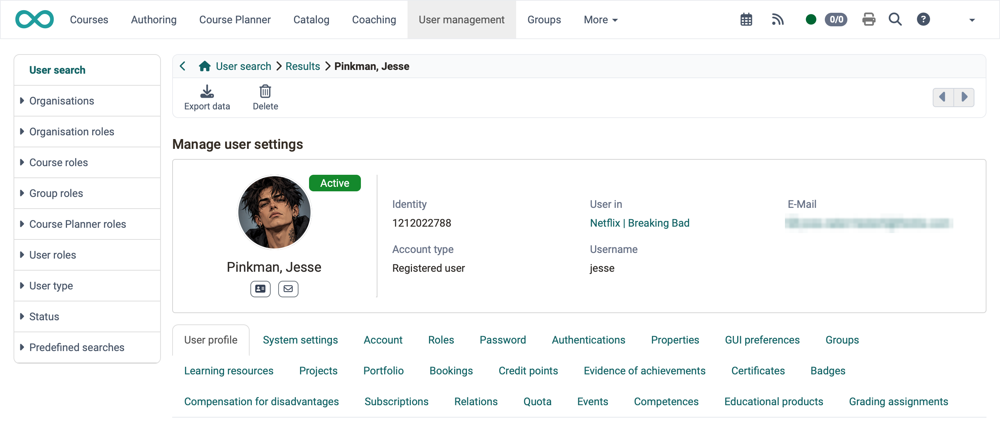
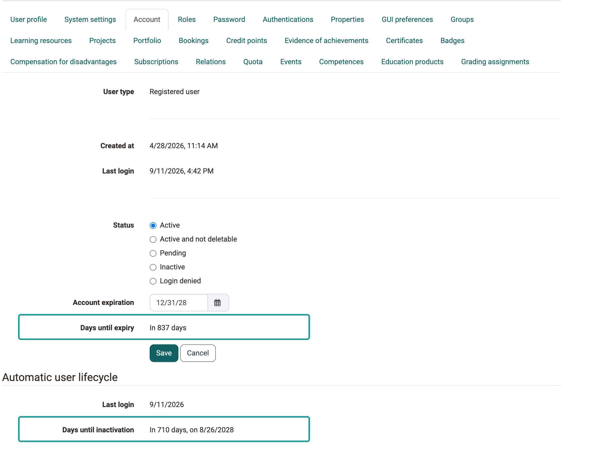
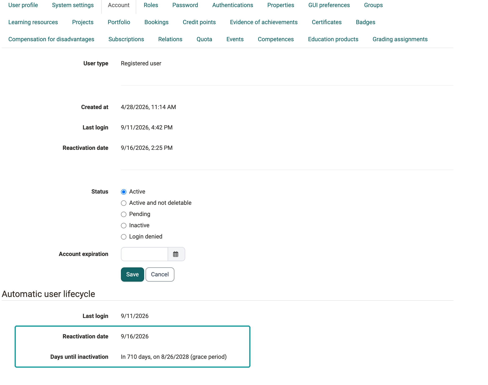
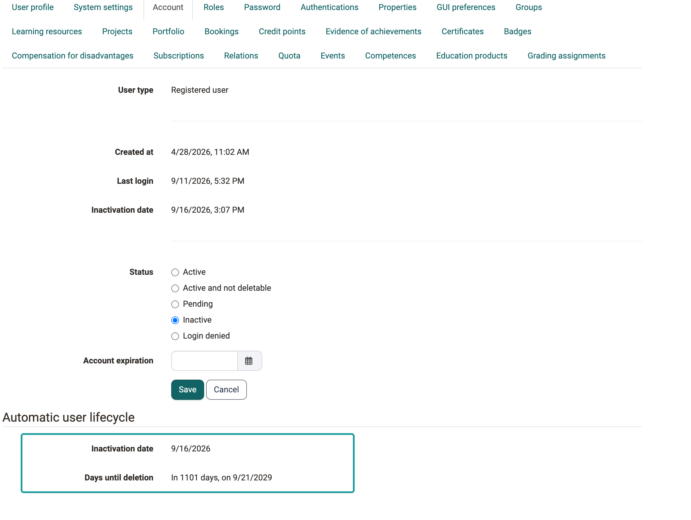
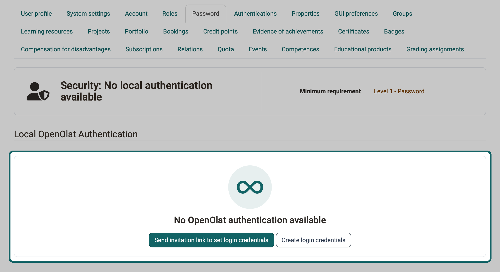
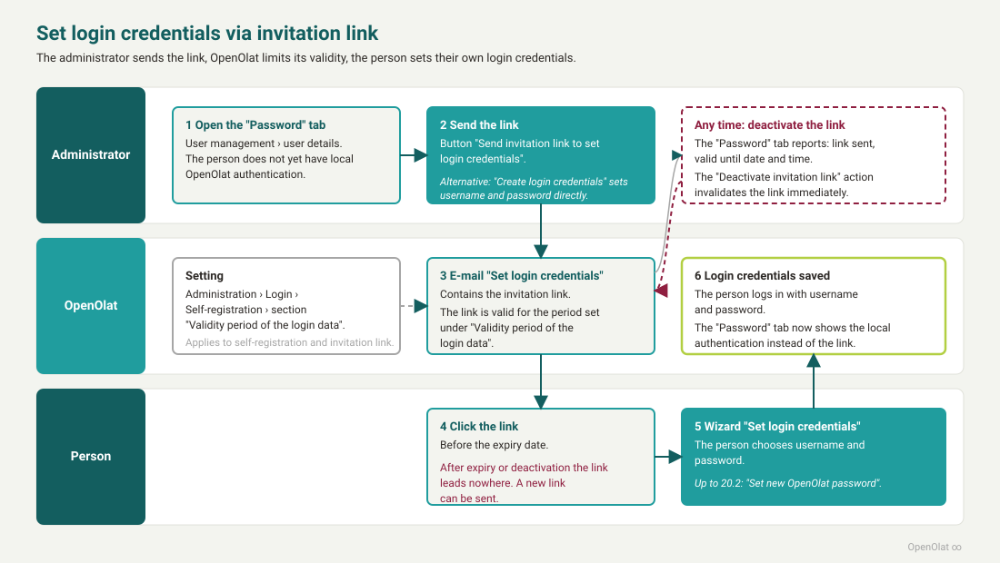
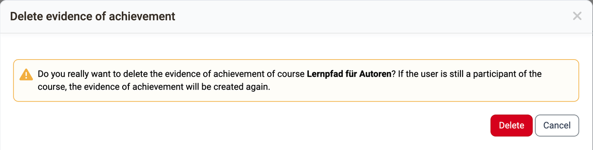
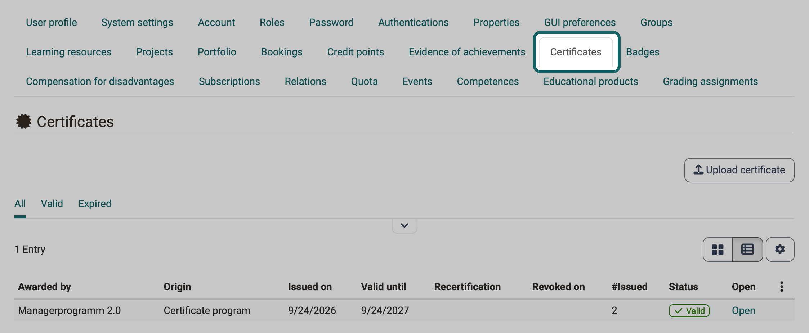
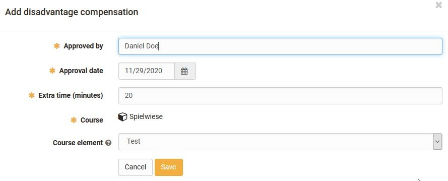
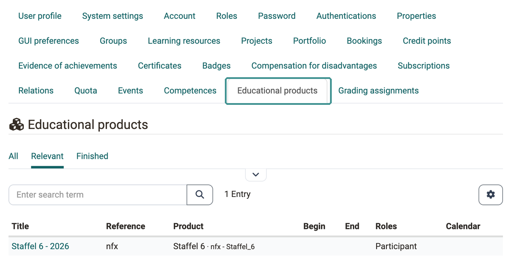

# Manage user settings {: #user_configuration}

If a person needs help with their account, for example a new password, an additional role or more storage space, open their user settings: there you see in one place what belongs to this account, and you change it. You find the person with the [account search](Search_Users.md). Administrators, user managers, roles managers and principals reach the user settings.

Administrators see all tabs described below, provided the related modules are switched on. The other roles see fewer tabs; which roles reach a tab is stated in the respective section.

{ class="shadow lightbox" title="User settings of an account in User management · 2026.10.31" }

The header area above the tabs shows at a glance whose account it is, which organisations the person belongs to and which roles they have. Next to the picture of the person, the status of the account is displayed, for example "Active". Below the name, two icons open the "Visiting card" of the person and a form with which you write them an "E-mail". [:octicons-tag-16:{ title="from Release 20.0.2 (OO-8515)" }](https://track.frentix.com/issue/OO-8515)

- **Identity**: the number under which OpenOlat maintains the account.
- **User in**: the organisations in which the person has the User role. If the person does not have this role in any organisation, "No data available" is displayed here. This is the case for every account of the account type "External user" or "Anonymous guest", because these accounts do not have the User role.
- **Additional Roles**: all roles of the person except User, for example Author or Learning resource manager. If the person has a role in several organisations, the number of these organisations is shown in brackets after the role. If the person has no further role, the line is missing.
- **E-Mail**: the email address from the profile.
- **Account type**: "Registered user", "External user" or "Anonymous guest".
- **Username**: the name with which the person logs in.

A click on the organisations or on the roles opens the "Roles" tab, which shows the roles of the person per organisation.

The toolbar above the header area holds two actions. "Export data" starts the export of the data that OpenOlat has stored for this account, see [Data protection](Data_protection.md#export_user_data). "Delete" deletes the account, see [Delete user](Delete_User.md). Only administrators see the action "Delete".

OpenOlat keeps each user account on its own; accounts cannot be merged. What a person has achieved in OpenOlat, that is course memberships, test results, evidence of achievements, certificates and badges, remains permanently linked to the account on which it was created. This keeps every record unambiguously assigned to one login and verifiable later on, and personal data stays limited to a single account.

If the option "Unique" is activated in the system administration, no two accounts with the same email address are created. System administrators find the option in the section "User email address" under: 
`Administration > Core functions > E-mail`, segment "Settings", see [Email Settings](../administration/E-Mail_Settings.md#email_address).

!!! tip "Two accounts of the same person"
    If two accounts of the same person exist nevertheless, decide which account is continued. Download the certificates of the second account in the "Certificates" tab with "Download certificate" and record them in the continued account with "Upload certificate". Then set the second account to inactive in the "Account" tab.

### User profile {: #profile}

If the name, email address or contact details of a person are no longer correct, you correct them in the "User profile" tab without the person having to act. The tab shows the personal data, the personal details, the contact details and, in the "Institution" section, the details of the institution, together with the visiting card and the personal picture of the person. These are the same entries the person maintains under `Personal menu > Profile`, see [Profile](../../manual_user/personal_menu/Profile/index.md). The mandatory entries in the user profile include: Login name, first name, surname and email address. With "Block E-Mail delivery" you prevent OpenOlat from sending mails to this address.

All roles that open the user settings reach the tab. Administrators, user managers and roles managers can change the entries; principals see the profile without editing it.

If the [customer number](../administration/Modules_Organisations.md#customer_number) is switched on in the Organisations module, the "Institution" section additionally shows the "Customer number" field. Here you enter the number under which your accounting keeps the person. The person themselves does not see the field in their own profile. [:octicons-tag-16:{ title="from Release 21.1 (OO-9736)" }](https://track.frentix.com/issue/OO-9736)

[To the top of the page ^](#user_configuration)

### System settings

If a person receives OpenOlat in the wrong language or gets no emails at their address, the "System settings" tab shows their own settings, for example the default language and whether emails stay within OpenOlat or also go to the address in the profile. The person maintains them under `Personal menu > System settings`, see [Settings](../../manual_user/personal_menu/Settings.md).

Administrators, user managers and roles managers reach the tab. For invited accounts OpenOlat shows the tab to all roles that open the user settings.

If the account carries an expiry date, the tab shows it under "Account expiration". A number of remaining days is not given here; the periods are listed in the "Account" tab. For inactive accounts OpenOlat hides the entry. [:octicons-tag-16:{ title="from Release 21.1 (OO-8382)" }](https://track.frentix.com/issue/OO-8382)

[To the top of the page ^](#user_configuration)

### Account

The "Account" tab shows the state of an account and the point it has reached in the automatic user lifecycle. Here you judge whether and when OpenOlat deactivates or deletes an account automatically, and here you set it to inactive manually.

Administrators, user managers, roles managers and principals reach the tab; principals do not see the "Status" field. Which fields it shows depends on the role of the edited account and on the toggles of the automatic user lifecycle, see [Life cycles: Account](../administration/Life_cycles_-_Administration/index.md#lifecycle_accounts).

#### User type {: #account_type }

The user type distinguishes registered accounts, guest accounts and invited accounts. You convert an invited account with "Convert to registered user".

#### Created at {: #creation_date }

Date and time at which the account was created.

#### Last login {: #last_login }

Date and time of the last login. This value is the reference for the automatic user lifecycle. For guest accounts the entry is omitted.

#### Inactivation date {: #inactivation_date }

Date on which the account was deactivated. The field only appears for an account that has already been deactivated once.

#### Reactivation date {: #reactivation_date }

Date on which a deactivated account was released again. The field only appears after a reactivation.

#### Status {: #account_status }

The status controls whether the person can log in. Available are "Active", "Active and not deletable", "Pending", "Inactive" and "Login denied". For accounts with the role administrator, system administrator or roles manager the status cannot be changed.

#### Account expiration {: #account_expiration }

Here you store the date on which OpenOlat should deactivate the account. This suits fixed-term access, for example for guest lecturers or project work. For administrators, system administrators and guest accounts the field is not available.

#### Days until expiry {: #days_until_expiry }

If an expiry date is set, this field shows the remaining time in the format "In 14 days". If the date lies in the past, the number of overdue days appears in red, with the note that OpenOlat will deactivate the account in the next run. Without an expiry date the field is omitted.

#### Automatic user lifecycle {: #automatic_user_lifecycle }

This section shows how the system-wide automatic user lifecycle affects this account. It is omitted for guest accounts. OpenOlat deactivates an account that does not log in within the configured period. The interface calls this step "Inactivation", and the account then carries the status "Inactive", see [Deactivation and reactivation](../administration/Life_cycles_-_Administration/index.md#account_reactivation). Which entries appear depends on the state of the account:

| State | Entry | Meaning |
|-------|-------|---------|
| Active | "Last login", "Days until inactivation" | OpenOlat deactivates the account automatically after this period without a login. |
| Reactivated | additionally "Reactivation date", the period carries the addition "(grace period)" | The account was released again after a deactivation and runs in a grace period. During this time OpenOlat does not deactivate it again. |
| Inactive | "Inactivation date", "Days until deletion" | The account is deactivated and will be deleted automatically after this period. |

Besides the number of days, both periods also name the date on which the step falls due.

"Days until inactivation" only appears when the toggle "Deactivate user after inactivity" is active, "Days until deletion" only when the toggle "Delete inactive user" is active. System administrators find both toggles in the system administration under: 
`Administration > Life cycles > User`

If the toggles are off, no automatic process takes effect and the periods are omitted.

An active account with a stored expiry date carries both periods next to each other: "Days until expiry" for the date, "Days until inactivation" for the last login.

{ class="shadow lightbox" title="Account tab of an active account" }

After a reactivation the reactivation date is added, and the period carries the addition "(grace period)".

{ class="shadow lightbox" title="Account tab of a reactivated account" }

For an inactive account the inactivation date and "Days until deletion" take the place of the inactivation period.

{ class="shadow lightbox" title="Account tab of an inactive account" }

[To the top of the page ^](#user_configuration)

### Roles

In the "Roles" tab you define which roles the person has and what they may do with them in OpenOlat. If the "Organisations" module is switched on, you assign the roles per organisation, see [Assign roles](Assign_roles.md).

All roles that open the user settings reach the tab. For invited accounts and guest accounts OpenOlat does not show it.

[To the top of the page ^](#user_configuration)

### Password [:octicons-tag-16:{ title="from Release 20.3.0 (OO-9139)" }](https://track.frentix.com/issue/OO-9139) {: #password}

If a person cannot log in because they lack login credentials or have forgotten their password, you help them in the "Password" tab: you send them an invitation link, set the login credentials yourself or reset an existing password.

Administrators, user managers and roles managers reach the "Password" tab. User managers do not see the tab for accounts that are themselves administrator or roles manager.

At the top, the tab shows the security level of the account, for an account without local authentication for example "Security: No local authentication available". If "Use security levels / Passkey" is switched on in the system administration, the line "Minimum requirement" below it names the level that applies at least to the role of the person.

If the user does not yet have local authentication, the "Local OpenOlat Authentication" section shows the button "Create login credentials": with it you set the login credentials directly. The button "Send invitation link to set login credentials" sends a link by mail; the person then sets their own login credentials. OpenOlat does not show this button if the person logs in with a passkey only (level 2) or if the minimum level 2 applies to their role.

{ class="shadow lightbox" title="Password tab of an account without local authentication · 2026.10.31" }

If an invitation link has already been sent, a message shows its validity period. The "Deactivate invitation link" action can be used to invalidate the link at any time. After expiry or deactivation the link leads nowhere; you can then send a new invitation link.

If the person already has a password, the "Local OpenOlat Authentication" section shows the actions "Reset password" and "Send password link". With "Reset password" you set a new password directly, "Send password link" sends the person a link with which they reset it themselves. These two actions are available only to administrators and user managers. Roles managers send the invitation link, deactivate it and create login credentials; only for invited accounts do they also reset an existing password or send a password link.

System administrators define how long an invitation link remains valid in the system administration in the section "Validity period of the login data": 
`Administration > Login > Self-registration`, tab "Configuration", see [Self-registration](../administration/Login_Self-Registration.md#tab_configuration).

{ class="shadow lightbox" title="Flow with the invitation link" }

The "Passkeys" section lists the passkeys of the person, even if passkey is switched off in the system administration. With "Delete" you remove a passkey. If the person has no passkey, the section is hidden if passkey is switched off or if security level 1 (Password) applies as the minimum. OpenOlat shows the "Recovery option" section with the button "Send recovery key" only when passkey is switched on.

If the person has so far logged in with a passkey only (level 2) and passkey has since been switched off, the tab shows the warning "Login is not possible: The account only has passkeys, but the passkey feature is disabled." The person gets back into their account in one of two ways:

* **Create login credentials:** With "Create login credentials" you set a password. Pass it on to the person in a secure way; they change it after logging in under `Personal Menu > Password`.
* **Delete passkeys:** You delete all passkeys of the person in the "Passkeys" section. The warning then disappears, and the button "Send invitation link to set login credentials" appears. With the link, the person sets their password themselves.

What to consider before switching passkey off is described under [Password and Authentication](../administration/Login_Password_and_Authentication.md#use_security_levels_passkey).

[To the top of the page ^](#user_configuration)

### Authentications

If a person logs in through a further login method or their username changes, you adjust this in the "Authentications" tab. Here you change the username, add an authentication with "Add authentication", edit and delete existing authentications and create an API key with "Add API-Key".

Only administrators reach the tab.

[To the top of the page ^](#user_configuration)

### Properties

The "Properties" tab lists the technical entries that OpenOlat stores for this account, with the columns "Category", "Group", "Resource", "Name", "Value", "Created" and "Modified". You can download the table if needed, and you delete a single entry with "Delete".

Only administrators reach the tab.

[To the top of the page ^](#user_configuration)

### GUI preferences

If OpenOlat no longer shows a person a list or view as expected, you reset the saved settings of the interface in the "GUI preferences" tab. Each row has the button "Reset", and you reset several selected entries at once with "Bulk reset".

Only administrators reach the tab.

[To the top of the page ^](#user_configuration)

### Groups

The "Groups" tab shows all groups in which the person is a participant or coach. Here you add the person to further groups or remove them from a group.

Administrators, user managers, roles managers and principals reach the tab. Administrators, user managers and roles managers can add and remove the person.

[To the top of the page ^](#user_configuration)

### Learning resources [:octicons-tag-16:{ title="from Release 9.1.0 (OO-788)" }](https://track.frentix.com/issue/OO-788)

The "Learning resources" tab shows all courses and learning resources of the person. From here you open a learning resource, remove the person from a learning resource or add them as owner, coach or participant to further courses.

Administrators, user managers, roles managers and principals reach the tab. Administrators, user managers and roles managers can add and remove the person.

The list carries single learning resources with the course and group roles of the person. Implementations of the Course Planner are listed in the "Educational products" tab instead.

[To the top of the page ^](#user_configuration)

### Projects [:octicons-tag-16:{ title="from Release 19.1.0 (OO-7417)" }](https://track.frentix.com/issue/OO-7417)

The "Projects" tab lists all projects in which the person is a member.

Administrators, user managers, roles managers and principals reach the tab.

[To the top of the page ^](#user_configuration)

### Portfolio

The "Portfolio" tab shows all portfolio binders to which the person is invited. Their own binders are not in this list.

Administrators, user managers, roles managers and principals reach the tab.

[To the top of the page ^](#user_configuration)

### Bookings

The "Bookings" tab shows the booking orders and pre-orders of the person.

Administrators, roles managers and principals reach the tab.

[To the top of the page ^](#user_configuration)

### Credit points [:octicons-tag-16:{ title="from Release 20.1.1 (OO-8558)" }](https://track.frentix.com/issue/OO-8558)

The "Credit points" tab shows the credit points the person has acquired.

OpenOlat only shows the tab when the "Credit points" module is switched on. Administrators, user managers, roles managers and principals reach it.

[To the top of the page ^](#user_configuration)

### Evidence of achievements

The "Evidence of achievements" tab shows the evidence of achievements, score and progress of the person from their courses. The table lists "Progress", "Score" and "Passed" per course; if the grading module is active, the "Rating" column with the achieved grade is added. Use the gear "Displayed columns" to show further columns, among them the "Reference" column, which is hidden by default. [:octicons-tag-16:{ title="from Release 21.0 (OO-9581)" }](https://track.frentix.com/issue/OO-9581)

The tab is available to administrators, principals, user managers and roles managers.

#### Delete evidence of achievement {: #delete_evidence }

Via the actions menu (three dots) of a row, a single evidence of achievement can be deleted [:octicons-tag-16:{ title="from Release 21.0 (OO-9551)" }](https://track.frentix.com/issue/OO-9551). A confirmation dialog explains the effect: if the person is still a participant of the course, the evidence of achievement is automatically regenerated; if they are no longer enrolled, it is permanently deleted.

{ class="shadow lightbox" title="Dialog Delete evidence of achievement" }

You delete an evidence of achievement only here in the user management; the person concerned cannot delete their own evidence of achievement. The action "Delete Statement" is available only to administrators and roles managers. Principals and user managers see the tab without this action. [:octicons-tag-16:{ title="from Release 21.0.3 (OO-9733)" }](https://track.frentix.com/issue/OO-9733)

[To the top of the page ^](#user_configuration)

### Certificates [:octicons-tag-16:{ title="from Release 20.2.0 (OO-8984)" }](https://track.frentix.com/issue/OO-8984)

This tab brings together all of the person's certificates, both those acquired in courses and those uploaded manually. For each certificate the table lists "Awarded by", "Origin", "Issued on", "Valid until", "Recertification", "Revoked on", "#Issued" and "Status"; with the predefined filters "All", "Valid" and "Expired" you narrow down the list. Above the table on the right you switch between tile and table view. With "Upload certificate" you record externally acquired certificates so that the profile reflects the entire transcript of records.

Administrators, user managers, roles managers and principals reach the tab.

{ class="shadow lightbox" title="Certificates tab of an account · 2026.10.31" }

[To the top of the page ^](#user_configuration)

### Badges

The "Badges" tab shows all badges the person has earned.

Administrators, user managers, roles managers and principals reach the tab.

[To the top of the page ^](#user_configuration)

### Compensation for disadvantages [:octicons-tag-16:{ title="from Release 15.3 (OO-4934)" }](https://track.frentix.com/issue/OO-4934)

If a person needs more time for a test because of a restriction, you record the extra time in the "Compensation for disadvantages" tab. The dialog "Add disadvantage compensation" requires "Approved by", "Approval date", "Extra time (minutes)" and the course. The field "Course element" narrows the compensation down to a single test of the course.

Administrators, user managers, roles managers and principals reach the tab. Administrators and roles managers can record and change a compensation for disadvantages.

{ class="shadow lightbox" title="Dialog Add disadvantage compensation" }

[To the top of the page ^](#user_configuration)

### Subscriptions [:octicons-tag-16:{ title="from Release 8.1.2 (OO-265)" }](https://track.frentix.com/issue/OO-265)

If a person receives too many or the wrong notifications, the "Subscriptions" tab shows all their subscriptions. Here you deactivate or delete single subscriptions.

Administrators, user managers and roles managers reach the tab.

[To the top of the page ^](#user_configuration)

### Relations [:octicons-tag-16:{ title="from Release 13.2 (OO-3305)" }](https://track.frentix.com/issue/OO-3305)

If a superior, a parent or a person responsible for training is to receive rights towards another person, you define this relation between the two accounts in the "Relations" tab. The prerequisite is that roles for person to person are defined in the system administration. These roles grant the linked people the rights that are set there. You find the roles under: 
`Administration > Modules > Role user to user`, see [Role user to user](../administration/Modules/index.md#role_user_to_user). An overview of the roles is given in [User roles](index.md).

OpenOlat only shows the tab when roles for person to person are switched on. Administrators, user managers, roles managers and principals reach it; administrators, user managers and roles managers can define relations.

[To the top of the page ^](#user_configuration)

### Quota {: #quota}

If a person needs more storage space than the system-wide default value provides, for example because as an author they include many videos in their courses, you increase their quota here without changing the value for everyone else. Administrators, user managers and roles managers can access the tab.

The tab shows a table with two rows, "Personal files" and "Media Center". Each row shows "Number of files", "Size", "Quota", "Upload limit" and, under "Currently used", a bar for the occupied share of the quota. [:octicons-tag-16:{ title="from Release 18.1 (OO-7024)" }](https://track.frentix.com/issue/OO-7024)

The "Edit quota" action at the end of a row opens the dialog of the same name with the fields "Path", "Quota (KB)" and "Upload limit (KB)". Below them, the dialog lists the default values under "Default quotas" and highlights the row that applies to this person. A quota set here only applies to this person and overrides the default value. If you open the dialog from the "Media Center" row of the tab, the "Path" field contains the path of the Media Center. The new quota then only enlarges the Media Center, the personal files keep their value. With "Reset to default quota", the default value applies again.

Which default value applies depends on the role. Authors, learning resource managers and administrators receive the value for power users, all others the value for normal users. The same value applies to both the personal files and the Media Center. There is no separate default value for the Media Center only. The values and their meaning are described in [Files and Folders](../administration/Files_and_Folders.md#files_and_folders_quotas).

[To the top of the page ^](#user_configuration)

### Events

The "Events" tab shows the events and absences of the person, for example to trace their attendance in a course.

OpenOlat only shows the tab when the "Events / Absences" module is switched on. Administrators, user managers, roles managers and principals reach it.

[To the top of the page ^](#user_configuration)

### Competences

In the "Competences" tab you assign areas of competence to the person. They are categorized according to "Manage", "Teach", "Have" and "Target". What each competence type does is explained on the page [Taxonomy](../../manual_user/basic_concepts/Taxonomy_Concept.md#competences) in the user manual.

OpenOlat only shows the tab when the "Taxonomy" module is switched on. Administrators, user managers, roles managers and principals reach it; administrators, user managers and roles managers can assign competences.

Administrators assign the same competence to several people in one step, in the system administration via the taxonomy level: 
`Administration > Modules > Taxonomy > "Title of the taxonomy" > Tab "Levels" > "Title of the level" > Tab "Competences"` 
They assign the competence type "Manage" in the same level in the "Management" tab.

[To the top of the page ^](#user_configuration)

### Educational products [:octicons-tag-16:{ title="from Release 20.3.0 (OO-9288)" }](https://track.frentix.com/issue/OO-9288)

The "Educational products" tab shows all implementations of the person, regardless of the role they hold in them [:octicons-tag-16:{ title="from Release 21.0 (OO-9374)" }](https://track.frentix.com/issue/OO-9374){:target="_blank"}.

OpenOlat only shows the tab when the Course Planner is active. Administrators, user managers, roles managers and principals reach it.

The list carries implementations, not single courses. A course appears here as part of the implementation through which the person was booked, and in the "Learning resources" tab additionally as a single learning resource. The two tabs answer different questions: "Educational products" shows which educational offerings the person passes through, "Learning resources" shows which courses they are registered in. Unlike there, you neither add nor remove the person here.

{ class="shadow lightbox" title="Educational products tab in User management" }

The filter tabs available are "All", "Relevant" and "Finished", "Relevant" is preselected. Compared to the Coaching Tool, the list shows the additional column "Roles", which states for each implementation in which role the person takes part. In return, the columns "Favourite" and "Status" and the tabs "Favourites" and "Preparation" are missing. A click on the title of an implementation opens its structure with the contained courses.

What the individual tabs show is described in the section [Filtering the list](../../manual_user/area_modules/Coaching_Educational_Products.md#filter) in the user manual.

[To the top of the page ^](#user_configuration)

### Grading assignments [:octicons-tag-16:{ title="from Release 15.0 (OO-4447)" }](https://track.frentix.com/issue/OO-4447)

The "Grading assignments" tab shows which grading assignments are assigned to the person as corrector.

OpenOlat only shows the tab when the correction workflow is switched on, and not for invited accounts and guest accounts. All roles that open the user settings reach it.

[To the top of the page ^](#user_configuration)

## Further information {: #further_information}

**Mentioned on this page** 
[Account search >](Search_Users.md) 
[Data protection >](Data_protection.md) 
[Delete user >](Delete_User.md) 
[E-mail settings >](../administration/E-Mail_Settings.md) 
[User profile >](../../manual_user/personal_menu/Profile/index.md) 
[Module Organisations >](../administration/Modules_Organisations.md) 
[Settings >](../../manual_user/personal_menu/Settings.md) 
[Life cycles: Overview >](../administration/Life_cycles_-_Administration/index.md) 
[Assign roles >](Assign_roles.md) 
[Self-registration >](../administration/Login_Self-Registration.md) 
[Password and Authentication >](../administration/Login_Password_and_Authentication.md) 
[Modules: Overview >](../administration/Modules/index.md) 
[User roles >](index.md) 
[Files and Folders >](../administration/Files_and_Folders.md) 
[Taxonomy >](../../manual_user/basic_concepts/Taxonomy_Concept.md) 
[Coaching: Educational products >](../../manual_user/area_modules/Coaching_Educational_Products.md)

**Further reading** 
[Create user >](Create_User.md) 
[Media Center Concept >](../../manual_user/basic_concepts/Media_Center_Concept/index.md)

[To the top of the page ^](#user_configuration)
