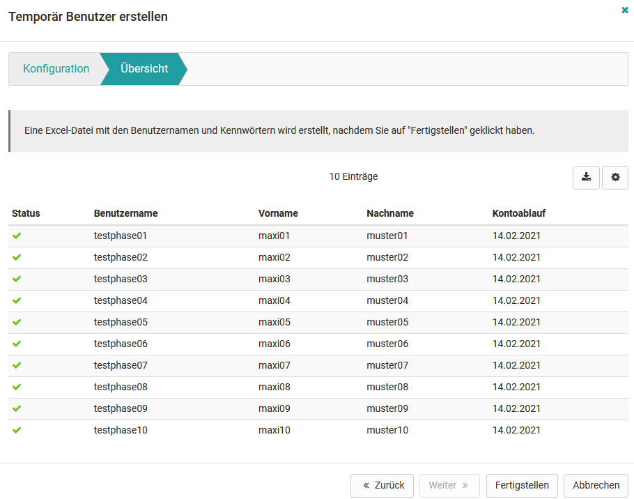
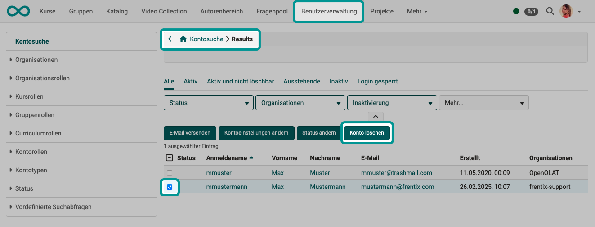

# Konto erstellen {: #create_user}

Wer mit OpenOlat arbeitet, braucht ein Konto. Konten entstehen entweder über ein angebundenes externes System oder direkt in OpenOlat in der Benutzerverwaltung. Dort legen Sie ein Konto einzeln an, importieren viele Konten aus einer Excel-Liste oder erzeugen temporäre Konten für Tests und Veranstaltungen. Ist die Selbstregistrierung eingeschaltet, legen Personen ihr Konto auch selbst an.

Die Aktionen "Konto erstellen", "Konten importieren" und "Temporäres Konto erstellen" sehen Administrator:innen, Benutzerverwalter:innen und Rollenverwalter:innen über jeder Ansicht der Benutzerverwaltung, zum Beispiel über der [Kontosuche](Search_Users.de.md): 
`Benutzerverwaltung > Kontosuche`

{ class="shadow lightbox" title="Aktionen der Benutzerverwaltung" }

Ist links im Menü unter "Organisationen" eine Organisation gewählt, übernehmen die drei Aktionen sie als Organisation der neuen Konten.

Jedes neue Konto erhält in seiner Organisation die Rolle "Benutzer:in". Weitere Rollen weisen Sie danach im Konto zu, siehe [Rollen zuweisen](Assign_roles.de.md).

[Zum Seitenanfang ^](#create_user)

## Einzelnes Konto erstellen {: #create_account}

Für eine einzelne Person legen Sie das Konto über "Konto erstellen" an. Pflicht sind "Anmeldename", "Vorname" und "Nachname", dazu "E-Mail", solange in den [E-Mail Einstellungen](../administration/E-Mail_Settings.de.md#email_address) die Option "Obligatorisch" eingeschaltet ist. Weitere Angaben zur Person sind freiwillig.

Verwalten Sie mehrere Organisationen, wählen Sie unter "Organisation" die Organisation des Kontos. Im Feld "[Kontoablauf](Configure_User.de.md#account_expiration)" setzen Sie bei Bedarf ein Datum, ab dem sich die Person nicht mehr anmelden kann. Ist "OpenOlat-Passwort" angekreuzt, setzen Sie unter "Passwort" und "Passwort verifizieren" das erste Passwort des Kontos.

Nach "Speichern" öffnet OpenOlat das neue Konto, und Sie weisen ihm gleich die Rollen zu.

[Zum Seitenanfang ^](#create_user)

## Konten importieren {: #import_accounts}

Viele Konten legen Sie schneller mit einer Excel-Liste an als einzeln. Klicken Sie in der Benutzerverwaltung auf "Konten importieren" und danach auf "Import von Benutzer:innen starten". Ein Wizard führt Sie Schritt für Schritt durch den Import.

Im ersten Schritt "Datenbeispiele und Daten einfügen" laden Sie über den Link "Excel-Vorlage herunterladen" die Vorlage für Ihre Liste herunter. Sie enthält die Kopfzeile mit den Spalten "Anmeldename", "Passwort" und "Sprache", danach die Felder, die Ihre OpenOlat-Instanz für den Import vorsieht, und zuletzt "Kontoablauf", dazu eine Zeile mit Beispielwerten. Die Spalten der Pflichtfelder tragen einen Stern (*), der Anmeldename ist immer Pflicht. Weil die Felder von der Konfiguration der Instanz abhängen, erstellt OpenOlat die Vorlage bei jedem Herunterladen neu. Ein ausgefülltes Beispiel zeigt der Wizard unter "Beispielabbildung".

Tragen Sie die Konten in die Vorlage ein, eine Zeile je Konto. Bleibt "Sprache" leer, erhält das Konto die Standardsprache der Instanz. Bleibt "Passwort" leer, setzen Sie das Passwort später. Kopieren Sie die Zeilen ohne Kopfzeile und fügen Sie sie in das Feld "Kopierte Zeilen aus Excel" ein.

In den folgenden Schritten sehen Sie in der "Vorschau der Kontodaten", welche Konten neu sind und welche schon bestehen. Stehen bestehende Konten in der Liste, wählen Sie, ob der Import ihre Daten und ihre Passwörter aktualisiert. Unter "Gruppe(n) auswählen" fügen Sie die Konten bei Bedarf Gruppen hinzu. Mit "E-Mail versenden" im Schritt "E-Mail-Benachrichtigung" erhalten neue Konten eine E-Mail mit Anmeldename und Passwort.

[Zum Seitenanfang ^](#create_user)

## Konten aus LDAP oder Azure übernehmen {: #import_external_users}

Ist OpenOlat an ein LDAP-Verzeichnis oder an Azure angebunden, übernehmen Sie eine Person von dort, statt ihr Konto von Hand anzulegen. Die Aktion "Externe Benutzer importieren" sehen dieselben Rollen wie "Konten importieren", aber nur, wenn die Suche im angebundenen Verzeichnis in der Serverkonfiguration eingeschaltet ist. frentix-Kund:innen wenden sich für eine Änderung an den frentix Support: [support@frentix.com](mailto:support@frentix.com)

Suchen Sie die Person mit Vorname, Nachname oder E-Mail-Adresse und wählen Sie sie aus. Im folgenden Formular ergänzen Sie die fehlenden Angaben. Die Person meldet sich danach mit ihren Zugangsdaten aus dem angebundenen Verzeichnis an.

[Zum Seitenanfang ^](#create_user)

## Temporäres Konto erstellen [:octicons-tag-16:{ title="ab Release 15.4 (OO-5195)" }](https://track.frentix.com/issue/OO-5195) {: #create_temporary_accounts}

Für Tests oder eine Veranstaltung brauchen Sie oft viele Konten für kurze Zeit. "Temporäres Konto erstellen" legt sie in einem Durchgang an.

Im Schritt "Konfiguration" geben Sie die "Anzahl Konten" an, höchstens 4000, dazu "Präfix Anmeldename", "Präfix Vorname" und "Präfix Nachname". OpenOlat hängt an jedes Präfix eine laufende Nummer, bei 10 Konten etwa test01 bis test10. Im Feld "Kontoablauf" setzen Sie bei Bedarf das Datum, ab dem sich mit den Konten niemand mehr anmelden kann. Verwalten Sie mehrere Organisationen, wählen Sie unter "Organisation" die Organisation der Konten.

Der Schritt "Übersicht" listet die Konten auf, die entstehen. Ein Konto mit einem bereits vergebenen Anmeldenamen legt OpenOlat nicht an. Nach "Fertigstellen" erzeugt OpenOlat die Konten mit zufälligen Passwörtern und lädt eine Excel-Datei mit den Anmeldenamen und Passwörtern auf Ihren Computer herunter.

{ class="shadow lightbox" title="Schritt Übersicht beim Erstellen temporärer Konten" }

[Zum Seitenanfang ^](#create_user)

## Selbstregistrierung [:octicons-tag-16:{ title="ab Release 8.1.1 (OO-226)" }](https://track.frentix.com/issue/OO-226) {: #self_registration}

Sollen sich Personen ohne Zutun der Benutzerverwaltung ein Konto anlegen, schalten Sie die Selbstregistrierung ein. Administrator:innen schalten "Selbstregistration aktivieren" in der System-Administration ein unter: 
`Administration > Login > Selbstregistration`

Dort schränken Sie die Selbstregistrierung bei Bedarf weiter ein, etwa auf bestimmte E-Mail-Domänen, siehe [Selbstregistration](../administration/Login_Self-Registration.de.md).

[Zum Seitenanfang ^](#create_user)

## Konten löschen {: #delete_accounts}

Konten, die niemand mehr braucht, löschen Administrator:innen über "Konten löschen". Die Ansicht zeigt in den Tabs "Konten ohne Aktivität", "Deaktivierte Konten" und "Bereit zu löschen" die Kandidaten für eine Löschung. In der Trefferliste der Kontosuche löschen Administrator:innen markierte Konten zusätzlich über den Button "Konto löschen".

{ class="shadow lightbox" title="Trefferliste der Kontosuche" }

Beim Löschen ersetzt OpenOlat den Anmeldenamen durch eine anonyme Kennung und leert die Profildaten. Was genau gelöscht wird und was erhalten bleibt, beschreibt [Benutzer:in löschen](Delete_User.de.md).

[Zum Seitenanfang ^](#create_user)

## Weiterführende Informationen {: #further_information}

**Auf dieser Seite erwähnt** 
[Kontosuche >](Search_Users.de.md) 
[Rollen zuweisen >](Assign_roles.de.md) 
[E-Mail Einstellungen >](../administration/E-Mail_Settings.de.md) 
[Kontoeinstellungen verwalten >](Configure_User.de.md) 
[Selbstregistration >](../administration/Login_Self-Registration.de.md) 
[Benutzer:in löschen >](Delete_User.de.md)

**Weiterführend** 
[Login: Übersicht >](../administration/Login.de.md) 
[Lebenszyklen: Übersicht >](../administration/Life_cycles_-_Administration.de.md) 
[Datenschutz >](Data_protection.de.md) 
[Importvorlagen >](../../manual_user/basic_concepts/Import_Templates.de.md)

[Zum Seitenanfang ^](#create_user)
