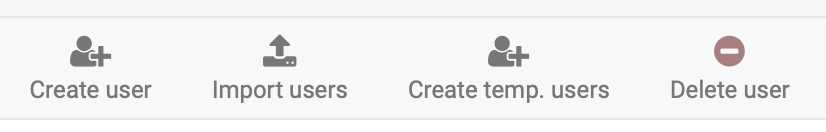
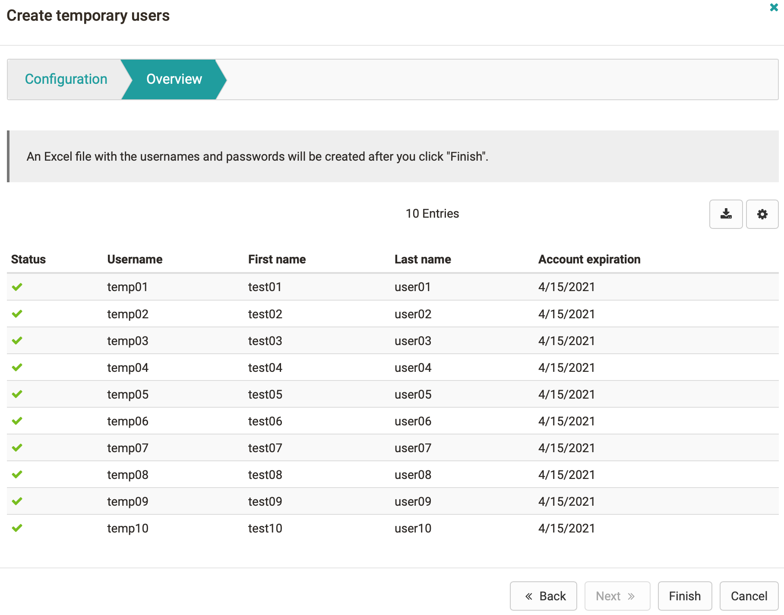

# Create account {: #create_user}

Anyone who works with OpenOlat needs an account. Accounts come either from a connected external system or directly from the user management in OpenOlat. There you create a single account, import many accounts from an Excel list or generate temporary accounts for tests and events. If self-registration is switched on, people also create their account themselves.

Administrators, user managers and roles managers see the actions "Create account", "Import accounts" and "Create temporary account" above every view of the user management, for example above the [account search](Search_Users.md): 
`User management > Account search`

{ class="shadow lightbox" title="Actions of the user management" }

If an organisation is selected on the left in the menu under "Organisations", the three actions take it over as the organisation of the new accounts.

Every new account receives the role "User" in its organisation. You assign further roles afterwards in the account, see [Assign roles](Assign_roles.md).

[To the top of the page ^](#create_user)

## Create a single account {: #create_account}

For a single person you create the account via "Create account". Mandatory are "Username", "First name" and "Last name", plus "E-mail" as long as the option "Mandatory" is switched on in the [Email Settings](../administration/E-Mail_Settings.md#email_address). Further details about the person are optional.

If you manage several organisations, select the organisation of the account under "Organisation". In the field "[Account expiration](Configure_User.md#account_expiration)" you set a date if required, from which the person can no longer log in. If "OpenOlat password" is ticked, you set the first password of the account under "Password" and "Verify password".

After "Save", OpenOlat opens the new account, and you assign the roles to it right away.

[To the top of the page ^](#create_user)

## Import accounts {: #import_accounts}

You create many accounts faster with an Excel list than one by one. In the user management, click "Import accounts" and then "Start user import". A wizard guides you step by step through the import.

In the first step "View examples and insert data", you download the template for your list via the link "Download Excel template". It contains the header row with the columns "Username", "Password" and "Language", then the fields that your OpenOlat instance provides for the import, and finally "Account expiration", plus a row with example values. The columns of the mandatory fields carry an asterisk (*), the username is always mandatory. Because the fields depend on the configuration of the instance, OpenOlat creates the template anew with every download. The wizard shows a filled-in example under "Sample image".

Enter the accounts in the template, one row per account. If "Language" stays empty, the account receives the default language of the instance. If "Password" stays empty, you set the password later. Copy the rows without the header row and paste them into the field "Copied rows from Excel".

In the following steps, the "Preview of account data" shows which accounts are new and which already exist. If existing accounts are in the list, you choose whether the import updates their data and their passwords. Under "Choose group(s)" you add the accounts to groups if required. With "Send E-Mail" in the step "E-Mail notification", new accounts receive an email with username and password.

[To the top of the page ^](#create_user)

## Take over accounts from LDAP or Azure {: #import_external_users}

!!! info "frentix customers"
    The search in the connected directory is part of the server configuration. For frentix customers, their customer advisor at frentix takes care of the change.

If OpenOlat is connected to an LDAP directory or to Azure, you take over a person from there instead of creating their account by hand. The action "Import external users" is visible to the same roles as "Import accounts", but only if the search in the connected directory is switched on in the server configuration.

Search for the person by first name, last name or email address and select them. In the following form you complete the missing details. The person then logs in with their credentials from the connected directory.

[To the top of the page ^](#create_user)

## Create temporary account [:octicons-tag-16:{ title="from Release 15.4 (OO-5195)" }](https://track.frentix.com/issue/OO-5195) {: #create_temporary_accounts}

For tests or an event you often need many accounts for a short time. "Create temporary account" creates them in one go.

In the step "Configuration" you enter the "Number of accounts", at most 4000, plus "Prefix username", "Prefix first name" and "Prefix last name". OpenOlat appends a sequential number to each prefix, for 10 accounts for example test01 to test10. In the field "Account expiration" you set a date if required, from which nobody can log in with the accounts any more. If you manage several organisations, select the organisation of the accounts under "Organisation".

The step "Overview" lists the accounts that will be created. OpenOlat does not create an account whose username is already taken. After "Finish", OpenOlat creates the accounts with random passwords and downloads an Excel file with the usernames and passwords to your computer.

{ class="shadow lightbox" title="Step Overview when creating temporary accounts" }

[To the top of the page ^](#create_user)

## Self-registration [:octicons-tag-16:{ title="from Release 8.1.1 (OO-226)" }](https://track.frentix.com/issue/OO-226) {: #self_registration}

If people are to create an account without the help of the user management, switch on self-registration. Administrators switch on "Activate self-registration" in the system administration under: 
`Administration > Login > Self-registration`

There you restrict self-registration further if required, for example to certain email domains, see [Self-registration](../administration/Login_Self-Registration.md).

[To the top of the page ^](#create_user)

## Delete accounts {: #delete_accounts}

Administrators delete accounts that nobody needs any more via "Delete accounts". The view shows the candidates for deletion in the tabs "Accounts without activity", "Deactivated accounts" and "Ready to delete". In the result list of the account search, administrators additionally delete marked accounts via the button "Delete account".

{ class="shadow lightbox" title="Result list of the account search" }

When deleting, OpenOlat replaces the username with an anonymous identifier and empties the profile data. What exactly is deleted and what is kept is described in [Delete user](Delete_User.md).

[To the top of the page ^](#create_user)

## Further information {: #further_information}

**Mentioned on this page** 
[Account search >](Search_Users.md) 
[Assign roles >](Assign_roles.md) 
[Email Settings >](../administration/E-Mail_Settings.md) 
[Manage user settings >](Configure_User.md) 
[Self-registration >](../administration/Login_Self-Registration.md) 
[Delete user >](Delete_User.md)

**Further reading** 
[Login: Overview >](../administration/Login.md) 
[Life cycles: Overview >](../administration/Life_cycles_-_Administration.md) 
[Data protection >](Data_protection.md) 
[Import templates >](../../manual_user/basic_concepts/Import_Templates.md)

[To the top of the page ^](#create_user)
