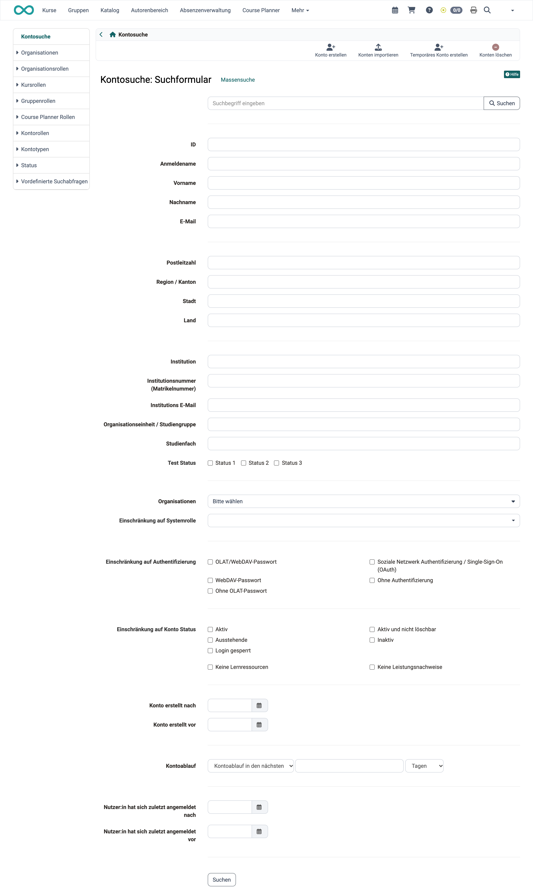
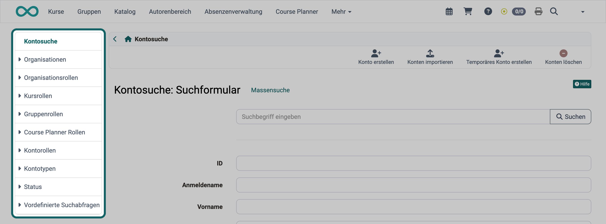
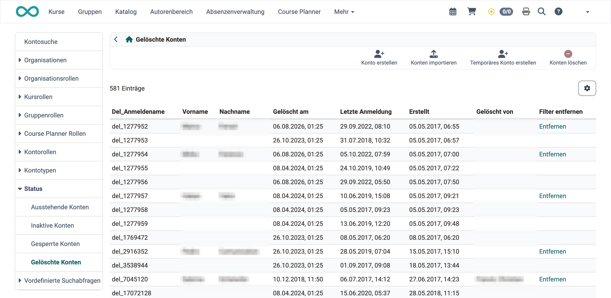
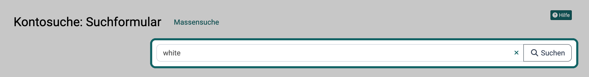
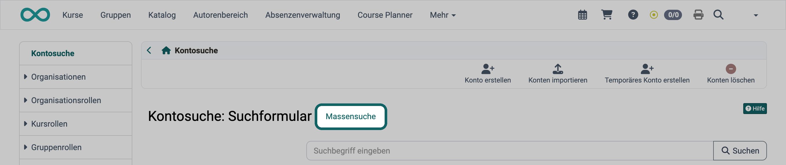
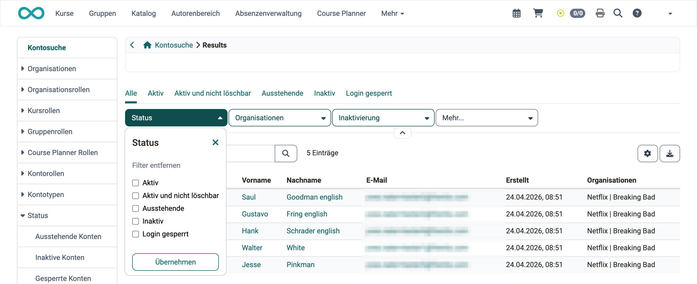

# Kontosuche {: #search_user}

Wer ein Konto bearbeiten will, findet es zuerst in der Kontosuche. Je nachdem, was Sie über die gesuchten Konten wissen, führt ein anderer Weg schneller ans Ziel: einzelne Merkmale, eine Rolle oder Zuordnung, ein Suchbegriff oder eine ganze Liste. Die Kontosuche erreichen Administrator:innen, Benutzerverwalter:innen, Rollenverwalter:innen und Principals unter: 
`Benutzerverwaltung > Kontosuche`

!!! note "Quick Links"

    * [Eingabe von Kriterien im Suchformular](#search_user_form)
    * [Konten nach unterschiedlichen Rollen und Zuordnungen anzeigen lassen](#search_user_roles)
    * [Schnelle Suche über das Suchfeld](#search_user_quick_search)
    * [Massensuche](#search_user_bulk_search)
    * [Suchergebnisse filtern](#search_user_filter_searchresults)
    * [Spalten der Ergebnistabelle](#search_user_result_columns)

## Eingabe von Kriterien im Suchformular {: #search_user_form}

Suchen Sie Konten mit bestimmten Merkmalen, etwa alle Konten einer Institution oder mit einer bestimmten Rolle, füllen Sie im Suchformular die passenden Felder aus. Bestätigen Sie mit der Eingabetaste oder mit "Suchen".

{ class="shadow lightbox" title="Suchformular der Kontosuche · 2026.10.22" }

Über der Ansicht stehen die Aktionen "Konto erstellen", "Konten importieren", "Temporäres Konto erstellen" und "Konten löschen".

Das Feld "Kontoablauf" sucht nach dem Ablaufdatum der Konten. Die Auswahl links bestimmt die Richtung: "Kontoablauf in den nächsten" findet Konten, die demnächst ablaufen, "Inaktiv seit den letzten" findet Konten, deren Ablauf zurückliegt. Rechts geben Sie die Anzahl und die Einheit an, etwa 30 Tage.

[Zum Seitenanfang ^](#search_user)

## Konten nach unterschiedlichen Rollen und Zuordnungen anzeigen lassen {: #search_user_roles}

Wollen Sie alle Konten mit derselben Rolle oder Zuordnung sehen, wählen Sie links im Menü einen Eintrag und darunter die gewünschte Rolle oder Zuordnung. Die Liste zeigt dann alle passenden Konten.

{ class="shadow lightbox" title="Linkes Menü der Kontosuche · 2026.10.22" }

### Organisationen {: #organizations}

Verwendet eine OpenOlat Instanz mehrere "Organisationen", lassen sich die Konten hier danach sortiert darstellen.

### Organisationsrollen {: #organizational-roles}

Für jede Organisationsrolle zeigt ein eigener Eintrag alle Konten, die sie innehaben:

* Alle Systembenutzer:innen
* Autor:innen
* Gruppenverwalter:innen
* Absenzenverwalter:innen
* Projektverwalter:innen
* Qualitätsverwalter:innen
* Poolverwalter:innen
* Benutzerverwalter:innen
* Rollenverwalter:innen
* Kursplaner:innen
* Lernressourcenverwalter:innen
* Linienvorgesetzte
* Ausbildungsverantwortliche
* Selectusverwalter:innen
* Principals
* Administrator:innen
* Systemadministrator:innen

Die Einträge für Absenzenverwalter:innen, Projektverwalter:innen, Qualitätsverwalter:innen, Poolverwalter:innen, Kursplaner:innen und Selectusverwalter:innen erscheinen nur, wenn das zugehörige Modul eingeschaltet ist.

### Kursrollen {: #course-roles}

Es werden drei Kursrollen unterschieden:

  * Kursbesitzer:innen
  * [Kursbetreuer:innen](../../manual_user/basic_concepts/Roles_Rights.de.md#kursbezogene-rollen-und-rechte) und
  * Kursteilnehmer:innen

Die Mitglieder der jeweiligen Rollen können hier angezeigt und bearbeitet werden.

### Gruppenrollen {: #group-roles}

Es existieren zwei Gruppenrollen, die angezeigt und bearbeitet werden können:

* [Gruppenbetreuer:innen](../../manual_user/groups/Group_Administration/index.de.md) und
* Gruppenteilnehmer:innen

### Course Planner Rollen {: #course-planner-roles}

Nutzt eine OpenOlat Instanz den Course Planner, stehen neben üblichen Kursrollen noch weitere Rollen zur Verfügung, deren Mitglieder angezeigt und bearbeitet werden können.

* Produktbesitzer:innen
* Elementbesitzer:innen
* Klassenlehrer:innen
* Kursbesitzer:innen
* Kursbetreuer:innen
* Kursteilnehmer:innen

### Kontorollen {: #user_roles}

Hier sehen Sie, welche Konten über eine Rolle Person zu Person verbunden sind, etwa wer wessen Vorgesetzte:r ist. Für jede Rolle und jede Gegenrolle steht ein eigener Eintrag mit den Konten, die sie innehaben. Der Menüeintrag "Kontorollen" erscheint erst, wenn "Rolle Person zu Person" eingeschaltet und mindestens eine Rolle eingerichtet ist. Sie richten die Rollen in der System-Administration ein unter: 
`Administration > Module > Rolle Person zu Person`, siehe [Rolle Person zu Person](../administration/Modules.de.md#role_user_to_user)

Zum Beispiel:

* Vorgesetzte:r
* Untergebene:r
* Lehrlingsverantwortliche:r
* Lehrling
* Expert:in
* Mentor:in
* Mentee
* Zu Beurteilende:r
* ...

### Kontotypen {: #account-types}

Hier suchen Sie innerhalb vorselektierter Kontotypen.

* Externe Konten
* Registrierte Konten
* Anonyme Konten

### Status {: #status}

Hier sehen Sie die Konten mit einem bestimmten Status:

* Ausstehende Konten
* Inaktive Konten
* Gesperrte Konten
* Gelöschte Konten

{ class="shadow lightbox" title="Status Gelöschte Konten in der Kontosuche · 2026.10.22" }

Die Tabelle "Gelöschte Konten" in der Benutzerverwaltung enthält folgende Spalten, die im Löschprozess eine Rolle spielen:

  *  **Del_Anmeldename:** Im Löschprozess ersetzt OpenOlat den Anmeldenamen des gelöschten Kontos durch eine ID.
  *  **Vorname / Nachname:** Trug das gelöschte Konto eine administrative Rolle, stehen Vor- und Nachname hier. Über die Aktion "Entfernen" löschen Sie auch diese Daten.
  *  **Gelöscht am:** Datum der Löschung
  *  **Letzte Anmeldung:** Datum der letzten Anmeldung
  *  **Erstellt:** Datum der Kontenerstellung
  *  **Rollen:** Die administrativen Rollen des gelöschten Kontos
  *  **Gelöscht von:** Person, die die Löschung vorgenommen hat
  *  **Filter entfernen:** Spalte mit der Aktion "Entfernen", die Vor- und Nachname administrativer Konten löscht.

!!! tip "Spalten einblenden"

    Fehlt eine Spalte, blenden Sie sie über das Zahnrad-Symbol rechts über der Tabelle ein.

### Vordefinierte Suchabfragen {: #predefined-search-queries}

Unter dem Menü "Vordefinierte Suchabfragen" finden Sie oft benutzte Suchabfragen:

* Konten ohne Gruppe
* Konten ohne E-Mail
* Benutzer:innen ohne Organisation
* Konten E-Mail-Duplikate
* Fehlende Authentifizierung
* Neu seit 1 Woche
* Neu seit 1 Monat
* Neu seit 6 Monaten
* Neue Konten
* Globale Rollen ausserhalb der Standard-org

Die Einträge "Konten ohne E-Mail", "Benutzer:innen ohne Organisation" und "Konten E-Mail-Duplikate" sehen nur Administrator:innen und Rollenverwalter:innen.

[Zum Seitenanfang ^](#search_user)

## Schnelle Suche über das Suchfeld [:octicons-tag-16:{ title="ab Release 21.1 (OO-9627)" }](https://track.frentix.com/issue/OO-9627) {: #search_user_quick_search}

Kennen Sie den Namen, die E-Mail-Adresse oder die Institutionsnummer einer Person, finden Sie ihr Konto am schnellsten über das Suchfeld über dem Suchformular. Geben Sie den Begriff oder seinen Anfang in das Feld "Suchbegriff eingeben" ein und bestätigen Sie mit "Suchen" oder der Eingabetaste. OpenOlat findet die Konten, bei denen der Anmeldename, der Vorname, der Nachname, die E-Mail, die Institutions E-Mail, die Institutionsnummer, die Organisationseinheit / Studiengruppe oder das Studienfach mit dem Begriff beginnt. Mehrere Begriffe trennen Sie mit Leerzeichen; ein Konto erscheint, sobald einer der Begriffe zutrifft. Eine ID findet das Suchfeld nur, wenn Sie sie vollständig und als einzigen Begriff eingeben. Gesucht wird in den Organisationen, die Sie verwalten. Die Treffer erscheinen in einer eigenen Liste.

{ class="shadow lightbox" title="Suchfeld über dem Suchformular der Kontosuche · 2026.10.22" }

Sobald im Feld etwas steht, erscheint rechts darin ein Kreuz. Ein Klick darauf leert das Feld, siehe [Suche zurücksetzen](../../manual_user/basic_concepts/Search_General.de.md#search_reset). Kehren Sie von der Trefferliste zum Suchformular zurück, steht Ihr Begriff noch im Feld.

[Zum Seitenanfang ^](#search_user)

## Massensuche [:octicons-tag-16:{ title="ab Release 15.4 (OO-5233)" }](https://track.frentix.com/issue/OO-5233) {: #search_user_bulk_search}

Haben Sie eine Liste von Personen, etwa aus einer Tabelle, deren Konten Sie gemeinsam bearbeiten wollen, suchen Sie alle in einem Schritt. Klicken Sie neben dem Titel "Kontosuche: Suchformular" auf "Massensuche".

{ class="shadow lightbox" title="Kopf des Suchformulars der Kontosuche · 2026.10.22" }

Tragen Sie im Feld "Anmeldename, E-Mail oder Institutionsnummer" je Zeile einen Eintrag ein, höchstens 16'000 Zeilen, und klicken Sie auf "Suchen". Die Zeilennummern am Rand zeigen, wie viele Einträge die Liste hat. OpenOlat findet die Konten, deren Anmeldename, E-Mail oder Institutionsnummer genau einem Eintrag entspricht; Gross- und Kleinschreibung spielen keine Rolle. Gelöschte Konten und Konten ausserhalb der Organisationen, die Sie verwalten, findet die Massensuche nicht. Über "Suchformular" kehren Sie zum Suchformular zurück.

[Zum Seitenanfang ^](#search_user)

## Suchergebnisse filtern {: #search_user_filter_searchresults}

In der Trefferliste grenzen Sie die Auswahl mit Filtern weiter ein. Ein Beispiel: Sie suchen zuerst alle Konten einer Organisation und zeigen danach mit "Inaktiv" über der Trefferliste nur die inaktiven Konten dieser Organisation.

{ class="shadow lightbox" title="Trefferliste der Kontosuche · 2026.10.22" }

Über der Trefferliste stehen die Filter-Tabs "Alle", "Aktiv", "Aktiv und nicht löschbar", "Ausstehende", "Inaktiv" und "Login gesperrt" sowie die Filter "Status", "Organisationen" und "Inaktivierung". Der Filter "Inaktivierung" grenzt auf einen Zeitraum ein, in dem Konten deaktiviert wurden oder deaktiviert werden.

[Zum Seitenanfang ^](#search_user)

## Spalten der Ergebnistabelle [:octicons-tag-16:{ title="ab Release 21.1 (OO-8382)" }](https://track.frentix.com/issue/OO-8382) {: #search_user_result_columns}

Die Trefferliste führt neben den Personendaten fünf Spalten zum Lebenszyklus eines Kontos. Sie stehen in dieser Reihenfolge und beantworten die Frage, wann OpenOlat ein Konto automatisch deaktiviert oder löscht.

OpenOlat deaktiviert ein Konto, das sich in der eingestellten Frist nicht anmeldet. Die Oberfläche nennt diesen Schritt "Inaktivierung", das Konto trägt danach den Status "Inaktiv", siehe [Deaktivierung und Reaktivierung](../administration/Life_cycles_-_Administration.de.md#account_reactivation).

| Spalte | Bedeutung |
|--------|-----------|
| Kontoablauf | Das pro Konto hinterlegte Ablaufdatum. |
| Tage bis Ablauf | Verbleibende Tage bis zu diesem Datum. |
| Tage bis Inaktivierung | Verbleibende Tage, bis OpenOlat das Konto deaktiviert. Nur vorhanden bei aktivem Schalter "Konten nach Inaktivität deaktivieren". |
| Inaktivierungsdatum | Datum, an dem das Konto deaktiviert wurde. |
| Tage bis Löschung | Verbleibende Tage bis zur automatischen Löschung. Nur vorhanden bei aktivem Schalter "Inaktive Konten löschen". |

Die beiden Schalter setzen Sie in der System-Administration unter: 
`Administration > Lebenszyklen > Konto`, siehe [Lebenszyklen: Konto](../administration/Life_cycles_-_Administration.de.md#lifecycle_accounts)

Alle fünf Spalten sind standardmässig ausgeblendet. Blenden Sie sie über das Zahnrad-Symbol rechts über der Tabelle ein.

Dieselben Fristen führt der Reiter "Konto" einer einzelnen Person, siehe [Kontoeinstellungen verwalten](Configure_User.de.md#automatic_user_lifecycle).

[Zum Seitenanfang ^](#search_user)

## Weiterführende Informationen {: #further_information}

**Auf dieser Seite erwähnt** 
[Rollen und Rechte >](../../manual_user/basic_concepts/Roles_Rights.de.md) 
[Gruppenverwaltung >](../../manual_user/groups/Group_Administration/index.de.md) 
[Module >](../administration/Modules.de.md) 
[Allgemeines zur Suche >](../../manual_user/basic_concepts/Search_General.de.md) 
[Lebenszyklen: Übersicht >](../administration/Life_cycles_-_Administration.de.md) 
[Kontoeinstellungen verwalten >](Configure_User.de.md)

**Weiterführend** 
[Konto erstellen >](Create_User.de.md) 
[Benutzer:in löschen >](Delete_User.de.md)

[Zum Seitenanfang ^](#search_user)
