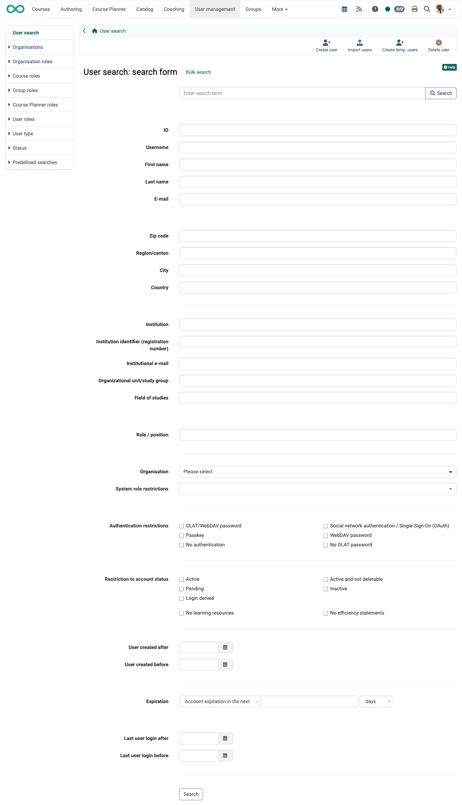
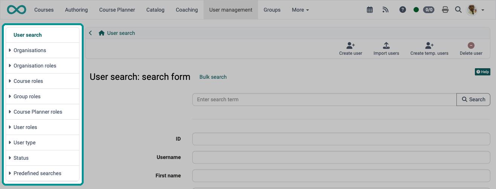
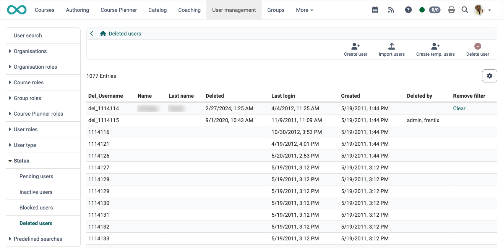
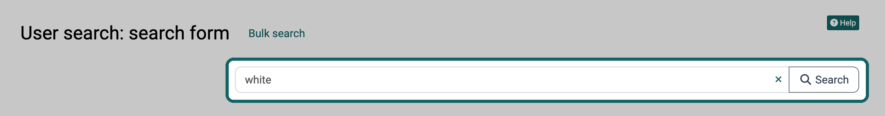
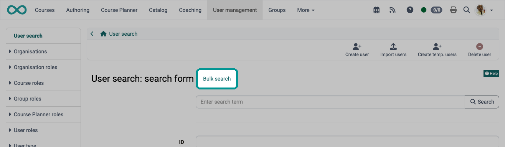
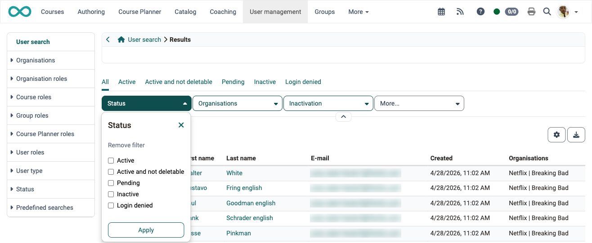

# Account search {: #search_user}

If you want to edit an account, you first find it in the account search. Depending on what you know about the accounts you are looking for, a different way leads to the goal faster: individual attributes, a role or assignment, a search term or a whole list. Administrators, user managers, roles managers and principals reach the account search under: 
`User management > Account search`

!!! note "Quick Links"

    * [Enter criteria in the search form](#search_user_form)
    * [Display accounts according to different roles and assignments](#search_user_roles)
    * [Quick search with the search field](#search_user_quick_search)
    * [Bulk search](#search_user_bulk_search)
    * [Filter search results](#search_user_filter_searchresults)
    * [Columns of the result table](#search_user_result_columns)

## Enter criteria in the search form {: #search_user_form}

If you are looking for accounts with specific attributes, for example all accounts of an institution or with a specific role, fill in the matching fields of the search form. Confirm with the Enter key or with "Search".

{ class="shadow lightbox" title="Search form of the account search" }

Administrators, user managers and roles managers see the actions "Create account", "Import accounts" and "Create temporary account" above the view. In the standard version, only administrators see "Delete accounts", see [Delete user](Delete_User.md).

The field "Account expiration" searches by the expiry date of the accounts. The selection on the left determines the direction: "Account expiration in the next" finds accounts that expire shortly, "Inactive since the last" finds accounts whose expiry lies in the past. On the right you enter the number and the unit, for example 30 days.

[To the top of the page ^](#search_user)

## Display accounts according to different roles and assignments {: #search_user_roles}

If you want to see all accounts with the same role or assignment, select an entry in the menu on the left and below it the role or assignment you need. The list then shows all matching accounts.

{ class="shadow lightbox" title="Left menu of the account search" }

### Organizations {: #organizations}

If an OpenOlat instance uses several "organisations", the accounts can be displayed here sorted accordingly.

### Organisation roles {: #organizational-roles}

For each organisation role, an entry of its own shows all accounts that hold it:

* All system users
* Authors
* Group administrator
* Absence managers
* Project managers
* Quality managers
* Question bank managers
* User managers
* Roles managers
* Course planners
* Learning resource managers
* Line managers
* Education managers
* Selectus managers
* Principals
* Administrators
* System administrators

The entries for absence managers, project managers, quality managers, question bank managers, course planners and Selectus managers only appear when the corresponding module is switched on.

### Course roles {: #course-roles}

We distinguish three course roles:

  * Course owners
  * [Course coaches](../../manual_user/basic_concepts/Roles_Rights.md#course-rights-and-roles) and
  * Course participants

The members of the respective roles can be displayed and edited here.

### Group roles {: #group-roles}

There are two group roles, which can be displayed and edited:

* [Group coaches](../../manual_user/groups/Group_Administration/index.md) and
* Group participants

### Course Planner roles {: #course-planner-roles}

If an OpenOlat instance uses the Course Planner, there are other roles available in addition to the usual course roles, whose members can be displayed and edited.

* Product owners
* Element owners
* Master coaches
* Course owners
* Course coaches
* Course participants

### Account roles {: #user_roles}

Here you see which accounts are linked through a role user to user, for example who is whose supervisor. Each role and each contra-role has its own entry with the accounts that hold it. The menu entry "Account roles" only appears when "Role user to user" is switched on and at least one role is set up. You set up the roles in the system administration under: 
`Administration > Modules > Role user to user`, see [Role user to user](../administration/Modules.md#role_user_to_user)

For example:

* Supervisor
* Subordinate
* Apprentice manager
* Apprentice
* Expert
* Mentor
* Mentee
* User to be assessed
* ...

### User type {: #account-types}

Here you search within pre-selected user types.

* External user
* Registered user
* Anonymous guests

### Status {: #status}

Here you see the accounts with a specific status:

* Pending accounts
* Inactive accounts
* Blocked accounts
* Deleted accounts

{ class="shadow lightbox" title="Status Deleted accounts in the account search" }

The table "Deleted accounts" in the user management contains the following columns, which play a role in the deletion process:

  *  **Del_Username:** In the deletion process, OpenOlat replaces the username of the deleted account with an ID.
  *  **Name / Last name:** If the deleted account held an administrative role, the first name and last name stand here. The "Clear" action deletes this data as well.
  *  **Deleted:** Date of deletion
  *  **Last login:** Date of last login
  *  **Created:** Date of account creation
  *  **Roles:** The administrative roles of the deleted account
  *  **Deleted by:** Person who deleted the account
  *  **Remove filter:** Column with the "Clear" action that deletes the first and last name of administrative accounts.

!!! tip "Show columns"

    If a column is missing, show it with the gear symbol on the right above the table.

### Predefined searches {: #predefined-search-queries}

Under the menu "Predefined searches" you find frequently used searches:

* Accounts without group
* Accounts without e-mail
* Users without organisation
* Account e-mail duplicates
* Authentication missing
* New since last week
* New since last month
* New since the last six months
* New accounts
* Global roles outside default org

Only administrators and roles managers see the entries "Accounts without e-mail", "Users without organisation" and "Account e-mail duplicates".

[To the top of the page ^](#search_user)

## Quick search with the search field [:octicons-tag-16:{ title="from Release 21.1 (OO-9627)" }](https://track.frentix.com/issue/OO-9627) {: #search_user_quick_search}

If you know the name, the e-mail address or the institution identifier of a person, the search field above the search form finds the account fastest. Enter the term or its beginning in the field "Enter search term" and confirm with "Search" or the Enter key. OpenOlat finds the accounts whose username, first name, last name, e-mail, institutional e-mail, institution identifier, organizational unit/study group or field of studies begins with the term. Separate several terms with spaces; an account appears as soon as one of the terms applies. The search field only finds an ID when you enter it completely and as the only term. The search covers the organisations you manage. The hits appear in a list of their own.

{ class="shadow lightbox" title="Search field above the search form of the account search · 2026.10.22" }

As soon as the field contains text, a cross appears on its right. A click on it clears the field, see [Reset search](../../manual_user/basic_concepts/Search_General.md#search_reset). When you return from the result list to the search form, your term is still in the field.

[To the top of the page ^](#search_user)

## Bulk search [:octicons-tag-16:{ title="from Release 15.4 (OO-5233)" }](https://track.frentix.com/issue/OO-5233) {: #search_user_bulk_search}

If you have a list of people, for example from a spreadsheet, whose accounts you want to edit together, you search for all of them in one step. Next to the title "Account search: search form", click "Bulk search".

{ class="shadow lightbox" title="Header of the search form of the account search" }

In the field "Usernames, E-mail or Institution identifier", enter one entry per line, at most 16'000 lines, and click "Search". The line numbers at the margin show how many entries the list holds. OpenOlat finds the accounts whose username, e-mail or institution identifier matches an entry exactly; upper and lower case do not matter. The bulk search does not find deleted accounts and accounts outside the organisations you manage. With "Search form" you return to the search form.

[To the top of the page ^](#search_user)

## Filter search results {: #search_user_filter_searchresults}

In the result list, you narrow the selection further with filters. An example: you first search for all accounts of an organisation and then show only the inactive accounts of this organisation with "Inactive" above the result list.

{ class="shadow lightbox" title="Result list of the account search" }

Above the result list you find the filter tabs "All", "Active", "Active and not deletable", "Pending", "Inactive" and "Login denied" as well as the filters "Status", "Organisations" and "Inactivation". The filter "Inactivation" narrows the list to a period in which accounts were deactivated or will be deactivated.

[To the top of the page ^](#search_user)

## Columns of the result table [:octicons-tag-16:{ title="from Release 21.1 (OO-8382)" }](https://track.frentix.com/issue/OO-8382) {: #search_user_result_columns}

Besides the personal data, the result list carries five columns on the lifecycle of an account. They stand in this order and answer the question when OpenOlat deactivates or deletes an account automatically.

OpenOlat deactivates an account that does not log in within the configured period. The interface calls this step "Inactivation", and the account then carries the status "Inactive", see [Deactivation and reactivation](../administration/Life_cycles_-_Administration.md#account_reactivation).

| Column | Meaning |
|--------|---------|
| Account expiration | The expiry date stored per account. |
| Days until expiry | Remaining days until this date. |
| Days until inactivation | Remaining days until OpenOlat deactivates the account. Only present when the toggle "Deactivate accounts after inactivity" is active. |
| Inactivation date | Date on which the account was deactivated. |
| Days until deletion | Remaining days until the automatic deletion. Only present when the toggle "Delete inactive accounts" is active. |

You set both toggles in the system administration under: 
`Administration > Life cycles > User`, see [Life cycles: Account](../administration/Life_cycles_-_Administration.md#lifecycle_accounts)

All five columns are hidden by default. Show them with the gear symbol above the table on the right.

The "Account" tab of a single person carries the same periods, see [Manage user settings](Configure_User.md#automatic_user_lifecycle).

[To the top of the page ^](#search_user)

## Further information {: #further_information}

**Mentioned on this page** 
[Delete user >](Delete_User.md) 
[Roles and rights >](../../manual_user/basic_concepts/Roles_Rights.md) 
[Group administration >](../../manual_user/groups/Group_Administration/index.md) 
[Modules >](../administration/Modules.md) 
[General information on the search >](../../manual_user/basic_concepts/Search_General.md) 
[Life cycles: Overview >](../administration/Life_cycles_-_Administration.md) 
[Manage user settings >](Configure_User.md)

**Further reading** 
[Create account >](Create_User.md) 
[Assign roles >](Assign_roles.md)

[To the top of the page ^](#search_user)
