# Wie gebe ich Lernenden KI-Feedback auf Freitextantworten im Quiz? {: #ai_essay}

??? abstract "Ziel und Inhalt dieser Anleitung"

    Sie möchten Lernenden eine offene Frage stellen und ihnen sofort eine Rückmeldung geben, ohne jede Antwort selbst zu lesen? 
    Die folgende Anleitung zeigt, wie Sie eine Freitextfrage anlegen, das Bewertungskit für die KI füllen und das Ergebnis vor dem Einsatz prüfen.

??? abstract "Zielgruppe"

    [x] Autor:innen [ ] Betreuer:innen  [ ] Teilnehmer:innen

    [ ] Anfänger:innen [x] Fortgeschrittene  [ ] Expert:innen

??? abstract "Erwartete Vorkenntnisse"

    * ["Wie erstelle ich meinen ersten OpenOlat-Kurs?"](../my_first_course/my_first_course.de.md)
    * [Kursbaustein Seite](../../manual_user/learningresources/Course_Element_Page.de.md)
    * [Content Editor](../../manual_user/basic_concepts/Content_Editor.de.md)

---

## Was das KI-Feedback leistet {: #concept}

Mit dem KI-Feedback erhalten Lernende zu ihrer Antwort auf eine Freitextfrage ein **formatives Feedback**. Die KI vergleicht die Antwort mit den Angaben, die Sie als Autor:in hinterlegen, und beschreibt, was gelungen ist und was fehlt.

OpenOlat benennt die Funktion für jede Rolle mit dem Wort, das zu ihrer Aufgabe passt. Als Autor:in richten Sie im Tab "KI-Feedback" ein, was Lernende später erhalten. Lernende erlauben im Dialog "KI-Korrektur", dass die KI ihre Antwort prüft, und lesen danach ihr KI-Feedback. Lassen Sie Fragen von der KI erzeugen, steht "Essay" für die Freitextfrage. Die Tabelle zeigt je Ziel, wer handelt, wo und unter welchem Wort der Oberfläche, in der Reihenfolge dieser Anleitung.

| Ziel | Wer | Wo | Wort in der Oberfläche |
|---|---|---|---|
| Das [Bewertungskit](#grading_kit) füllen: die Angaben, an denen die KI eine Antwort misst | Autor:in | Tab der Freitextfrage | "KI-Feedback" |
| Die Prüfung der Antwort durch die KI erlauben oder ablehnen | Lernende | Dialog beim Start des Quiz | "KI-Korrektur" |
| Die Rückmeldung der KI auf die Antwort erhalten | Lernende | Hinweis während der Prüfung Block unter der Antwort | "Wartet auf KI-Korrektur" "KI-Feedback" |
| Festlegen, wie viele Freitextfragen die KI erzeugt, jede mit vorgefülltem Bewertungskit | Autor:in | Dialog "Importieren" im Content Editor Dialog "KI Fragen" im Fragenpool | "Essay-Frage mit KI-Korrektur" "Essay-Fragen mit KI-Korrektur" |

!!! info "frentix-Kund:innen"

    Die Funktion "Essay Bewertung" setzt bei frentix-Kund:innen eine Vereinbarung mit frentix voraus. Danach schaltet die zuständige Kundenberatung bei frentix die Funktion frei.

Drei Punkte bestimmen den Einsatz:

* Das Feedback **vergibt keine Punkte**. Es dient der Selbsteinschätzung und ersetzt keine Bewertung durch die Kursbetreuung.
* Sie legen die Frage im **Inhaltselement "Quiz"** des Content Editors an, also auf einer Seite im Kursbaustein "Seite" oder im [Media Center](../../manual_user/personal_menu/Media_Center.de.md). In den Kursbausteinen "Test" und "Selbsttest" gibt es kein KI-Feedback.
* Lernende rufen das Feedback selbst ab. Mit "Neuer Versuch" beantworten sie das Quiz von vorn und schreiben so eine überarbeitete Antwort.

Für eine bewertete Prüfung nutzen Sie weiterhin den [Kursbaustein Test](../../manual_user/learningresources/Course_Element_Test/index.de.md) mit manueller Korrektur.

[Zum Seitenanfang ^](#ai_essay)

---

## Voraussetzungen prüfen {: #requirements}

!!! info "frentix-Kund:innen"

    Bei frentix-Kund:innen übernimmt die zuständige Kundenberatung bei frentix die Einstellungen in den Tabs "KI-Anbieter", "KI-Funktionen" und "KI-Verarbeitungs-Pools".

Die Freitextfrage im Quiz erscheint nur, wenn die KI-Funktion "Essay Bewertung" in der System-Administration aktiviert ist. Die Prüfung übernimmt eine Person mit der Rolle Systemadministrator:in. Für die Aktivierung wenden Sie sich an Ihre Organisation.

1. Öffnen Sie als Systemadministrator:in die System-Administration: `Administration > Externe Werkzeuge > KI-Modul`.
2. Wählen Sie den Tab "KI-Funktionen".
3. Prüfen Sie die Funktion "Essay Bewertung": Der Schalter "Funktion aktivieren" steht auf "EIN", ein KI-Anbieter und ein Sprachmodell sind gewählt. Den Anbieter richten Sie vorher im Tab [KI-Anbieter](../../manual_admin/administration/External_Tools_AI.de.md#ai_provider) ein.
4. Für [erzeugte Fragen](#import) prüfen Sie zusätzlich die Funktion "Essay Fragen Generator". Der Button "KI Fragen" im Fragenpool erscheint ausserdem nur mit der Funktion "MC Fragen Generator".

Zwei Grenzwerte der Funktion "Essay Bewertung" wirken direkt auf Lernende und Autor:innen:

| Feld | Standardwert | Wirkung |
|---|---|---|
| "Maximale Anzahl Eingabewörter" | 400 | Bei längeren Antworten erhalten Lernende statt des KI-Feedbacks eine Meldung mit dem eingestellten Wert. Die Antwort bleibt gespeichert. |
| "Timeout (Sekunden)" | 600 | Dauert die Bewertung länger, bricht OpenOlat sie ab und meldet dies. Der Wert gilt auch für die Vorschau "Feedback testen". |

Details zu diesen Feldern beschreibt [Externe Werkzeuge: KI-Modul](../../manual_admin/administration/External_Tools_AI.de.md#ai_function_limits).

[Zum Seitenanfang ^](#ai_essay)

---

## Schritt 1: Quiz und Freitextfrage anlegen {: #create_question}

1. Fügen Sie im Kurseditor einen **Kursbaustein "Seite"** ein und öffnen Sie den Tab **"Seiteninhalt"**.
2. Klicken Sie auf **"Seite editieren"**.
3. Wählen Sie **"Inhalt hinzufügen"** und im Bereich "Wissen" das Element **"Quiz"**.
4. Klicken Sie im Quiz rechts oben auf **"Hinzufügen"** und wählen Sie **"Freitext"**.  
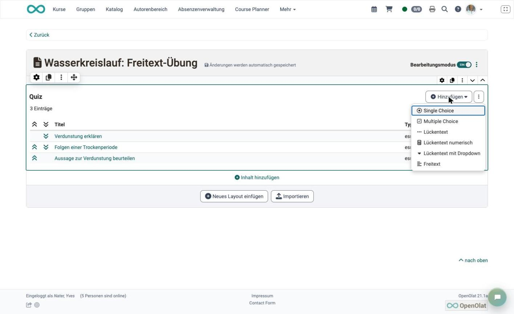{ class="shadow lightbox" title="Quiz-Element im Content Editor einer Seite" }

5. Erfassen Sie im Tab "Freitext" den **Titel** und die **Frage**.
6. Legen Sie bei Bedarf **"Min Anzahl Wörter"** und **"Max Anzahl Wörter"** fest. Der Zähler unter dem Eingabefeld zeigt Lernenden ihren Stand und das Maximum. Setzen Sie das Maximum höchstens auf den Wert "Maximale Anzahl Eingabewörter" im KI-Modul, so erhält jede zulässige Antwort ein KI-Feedback.
7. Speichern Sie die Frage.

!!! info "Wichtig"

    Der Eintrag "Freitext" erscheint im Menü "Hinzufügen" nur, wenn die KI-Funktion "Essay Bewertung" aktiviert und mit einem KI-Anbieter und einem Sprachmodell verbunden ist. Fehlt der Eintrag, prüfen Sie die Voraussetzungen im KI-Modul.

[Zum Seitenanfang ^](#ai_essay)

---

## Schritt 2: Das Bewertungskit füllen {: #grading_kit}

Das Bewertungskit im Tab **"KI-Feedback"** legt fest, woran die KI die Antworten misst. Erst mit gespeichertem Bewertungskit erhalten Lernende zu dieser Frage ein KI-Feedback. Dafür nutzt die KI den Quelltext-Auszug, die Musterantwort, die Schlüsselpunkte, die Bewertungskriterien, die Korrekturhinweise, den Schwierigkeitsgrad und die Sprache.

Fünf Angaben sind Pflicht und mit einem Stern markiert:

| Feld | Was hineingehört |
|---|---|
| "Lernziel" | Was die Lernenden mit der Antwort zeigen sollen, in einem Satz. |
| "Quelltext-Auszug" | Der Abschnitt aus dem Lerntext, auf dem die Frage beruht. Der Lerntext ist der Text, den Ihre Lernenden durcharbeiten, etwa ein Skript. Die KI nutzt den Abschnitt als Referenz. |
| "Musterantwort" | Die erwartete Antwort in der Länge und Sprache, die Sie von Lernenden erwarten. |
| "Bloom-Stufe" | Die kognitive Stufe der Frage nach der Taxonomie von Bloom, vom einfachsten zum anspruchsvollsten Denkschritt: "Erinnern", "Verstehen", "Anwenden", "Analysieren", "Bewerten" oder "Erschaffen". |
| "Sprache (BCP-47)" | Die Sprache, in der Lernende antworten sollen, als Sprach-Tag wie `de`, `en` oder `fr`. Tragen Sie den Sprach-Tag ohne Region ein, etwa `en`. OpenOlat belegt das leere Feld mit der Sprache Ihrer Benutzeroberfläche vor. Antworten Lernende in einer anderen Sprache, weist das KI-Feedback darauf hin. |

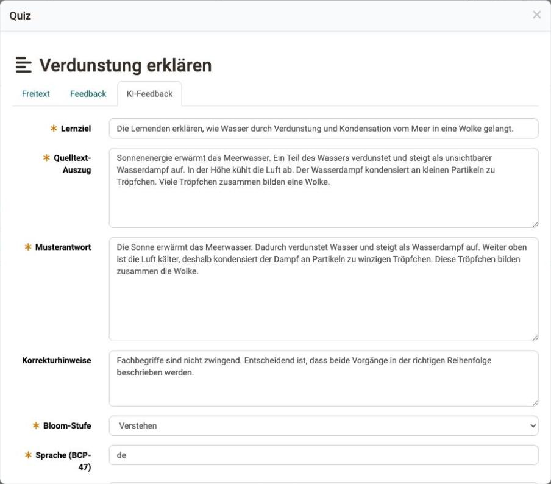{ class="shadow lightbox" title="Tab KI-Feedback einer Freitextfrage im Quiz" }

Das Feedback an Lernende schreibt die KI in der Sprache, die die lernende Person in ihren [persönlichen Einstellungen](../../manual_user/personal_menu/Settings.de.md#language) gewählt hat. Die Vorschau "Feedback testen" in Schritt 3 schreibt es in der Sprache aus dem Feld "Sprache (BCP-47)".

Die übrigen Felder sind optional:

* **"Korrekturhinweise"**: Regeln für die Beurteilung, etwa dass Fachbegriffe nicht zwingend sind.
* **"Schwierigkeitsgrad (1–5)"**: Der Anspruch, den die KI beim Beurteilen anlegt. 1 ist sehr leicht, eine kurze Antwort genügt; 5 ist sehr schwer.
* **"Schlüsselpunkte"**: Die Kernaspekte, die eine gute Antwort abdeckt. Jeder Punkt erhält eine Beschreibung, ein Gewicht von 0.0 bis 1.0 und die Markierung "erforderlich". Gewicht und Markierung zeigen der KI, wie stark ein Punkt zählt. Sind Zeilen ausgefüllt, muss die Summe der Gewichte 1.0 ergeben (Toleranz 0.01).
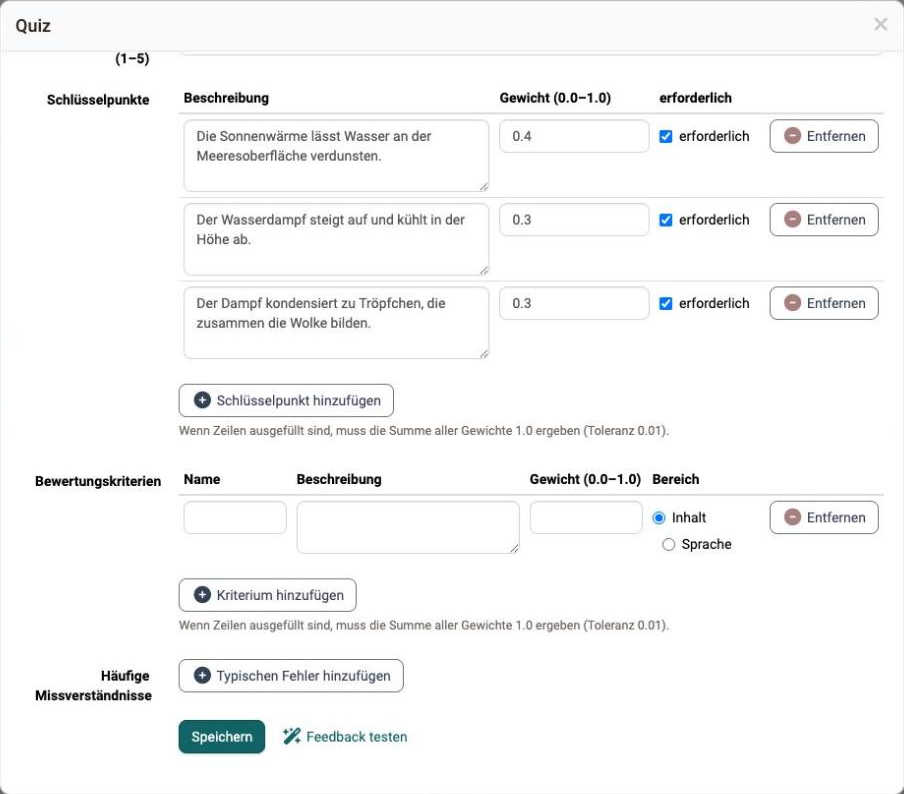{ class="shadow lightbox" title="Abschnitt Schlüsselpunkte im Tab KI-Feedback" }

* **"Bewertungskriterien"**: Benannte Kriterien mit Beschreibung, Gewicht und dem Bereich "Inhalt" oder "Sprache". Der Bereich zeigt der KI, ob das Kriterium den Inhalt oder die Sprache der Antwort betrifft. Sind Zeilen ausgefüllt, muss auch hier die Summe der Gewichte 1.0 ergeben.
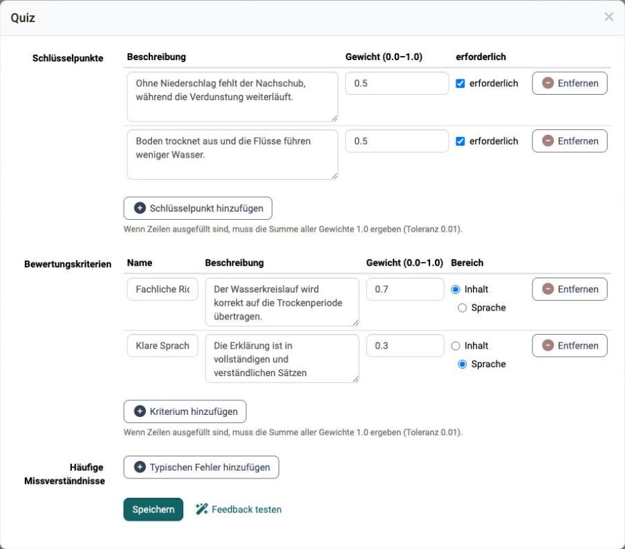{ class="shadow lightbox" title="Abschnitt Bewertungskriterien im Tab KI-Feedback" }

* **"Häufige Missverständnisse"**: Typische Falsch-Annahmen zur Frage, als Merkliste im Bewertungskit. Beim Erzeugen von Fragen füllt die KI sie vor. Soll das KI-Feedback auf eine Falsch-Annahme eingehen, nennen Sie sie zusätzlich in den Korrekturhinweisen.
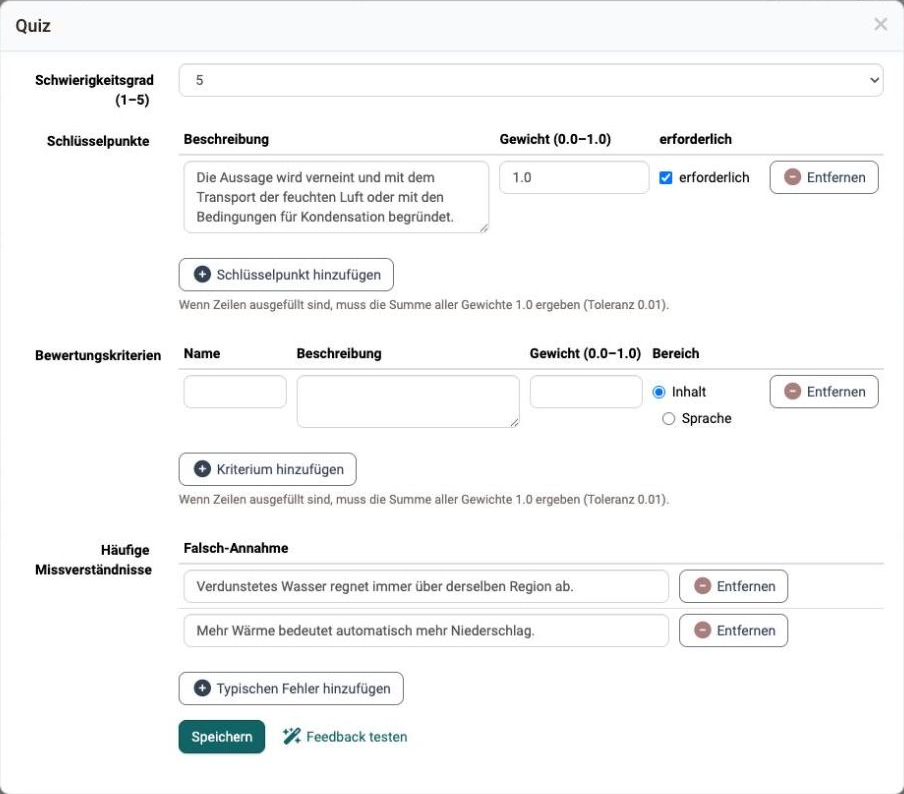{ class="shadow lightbox" title="Abschnitt Häufige Missverständnisse im Tab KI-Feedback" }

Eine weitere Zeile fügen Sie mit "Schlüsselpunkt hinzufügen", "Kriterium hinzufügen" oder "Typischen Fehler hinzufügen" an, "Entfernen" löscht eine Zeile.

Duplizieren Sie eine Frage im Quiz, erhält die Kopie kein Bewertungskit. Füllen Sie es bei der Kopie neu aus.

Lässt sich das Bewertungskit nicht speichern, zeigt OpenOlat den Fehler direkt am Feld oder an der Zeile der Tabelle. Ergeben die Gewichte nicht 1.0, steht die Meldung "Summe der Gewichte muss 1.0 ergeben (±0.01)." beim Gewicht der ersten Zeile.

[Zum Seitenanfang ^](#ai_essay)

---

## Schritt 3: Das Feedback testen {: #test_feedback}

Prüfen Sie das Bewertungskit, bevor Sie den Kurs publizieren und Lernende die Frage sehen.

1. Klicken Sie im Tab "KI-Feedback" auf **"Feedback testen"**.
2. Geben Sie eine Beispielantwort ein, am besten eine bewusst unvollständige.
3. Klicken Sie auf **"Feedback generieren"**. Je nach Sprachmodell dauert die Auswertung einige Sekunden bis zu zwei Minuten. Spätestens nach dem Wert "Timeout (Sekunden)" im KI-Modul bricht OpenOlat ab.

Die Vorschau zeigt unter "Bewertungssignale", wie die KI die Antwort liest.

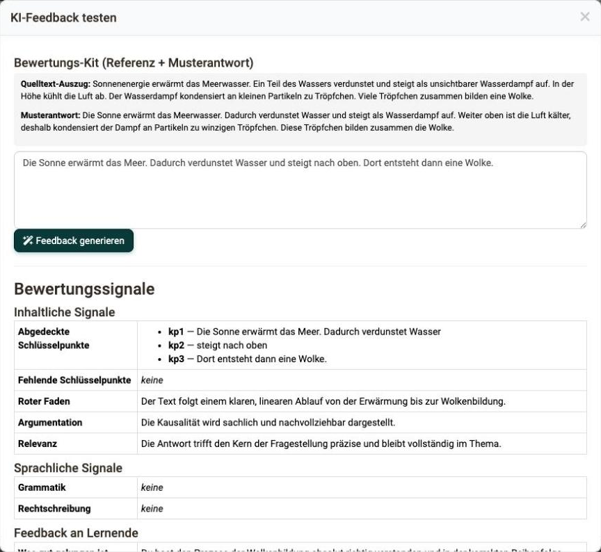{ class="shadow lightbox" title="Dialog KI-Feedback testen" }

* **"Inhaltliche Signale"**: abgedeckte und fehlende Schlüsselpunkte, dazu "Roter Faden", "Argumentation" und "Relevanz".
* **"Sprachliche Signale"**: "Grammatik" und "Rechtschreibung".
* **"Feedback an Lernende"**: der Text, den Lernende später sehen.
* **"Gesamt"**: "Gesamteinschätzung", "Geschätzter Erfüllungsgrad", "Themenverfehlung", "Verlässlichkeit" und "Feedback an die Betreuung".

Das "Feedback an die Betreuung" sehen Sie in dieser Vorschau. Die Antworten der Lernenden und ihr KI-Feedback bleiben bei den Lernenden.

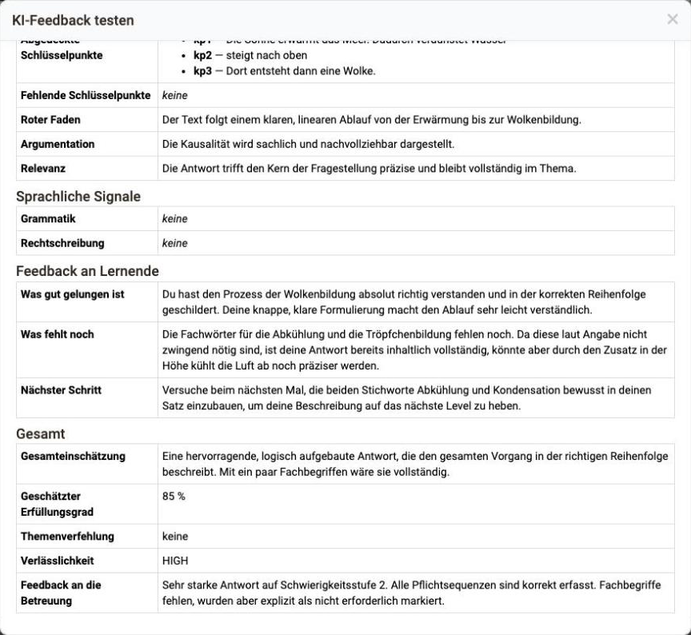{ class="shadow lightbox" title="Unterer Teil des Dialogs KI-Feedback testen" }

Weicht das Feedback von Ihrer Erwartung ab, schärfen Sie die Musterantwort, die Schlüsselpunkte oder die Korrekturhinweise nach und testen Sie erneut.

[Zum Seitenanfang ^](#ai_essay)

---

## Drei Beispiele für Fragen und Bewertungskits {: #examples}

Die Angaben im Bewertungskit richten sich nach dem Anspruch der Frage. Drei Muster:

| Frage | Bloom-Stufe | Schwierigkeit | Schwerpunkt im Bewertungskit |
|---|---|---|---|
| "Erklären Sie in eigenen Worten, wie Wasser aus dem Meer in eine Wolke gelangt." | Verstehen | 2 | Drei Schlüsselpunkte mit den Gewichten 0.4, 0.3 und 0.3, Musterantwort, die genau diese drei Punkte enthält |
| "In einer Region fällt drei Wochen lang kein Regen. Erklären Sie, welche Folgen für Boden und Flüsse zu erwarten sind." | Anwenden | 3 | Zwei Bewertungskriterien: "Fachliche Richtigkeit" im Bereich Inhalt mit 0.7, "Klare Sprache" im Bereich Sprache mit 0.3 |
| "Beurteilen Sie die Aussage: Mehr Verdunstung führt immer zu mehr Regen in derselben Region." | Bewerten | 5 | Ein Schlüsselpunkt mit Gewicht 1.0, dazu Korrekturhinweise zu zwei typischen Falsch-Annahmen und "Max Anzahl Wörter" 150 in der Frage |

Je offener die Frage, desto wichtiger sind Korrekturhinweise und Bewertungskriterien. Bei einer Wissensfrage genügen Musterantwort und Schlüsselpunkte.

[Zum Seitenanfang ^](#ai_essay)

---

## Die Ansicht der Lernenden {: #learner_view}

Beim Start des Quiz fragt OpenOlat die Lernenden im Dialog "KI-Korrektur", ob die KI ihre Freitextantworten korrigieren darf: "Einmal erlauben", "Immer erlauben" oder "Jetzt nicht". Das KI-Feedback ist eine Rückmeldung für die Lernenden, Punkte und Bestanden-Status bleiben davon unberührt. Ohne Erlaubnis beantworten Lernende die Frage wie gewohnt, es erscheint nur kein KI-Feedback. "Immer erlauben" speichert die Wahl im Tab "KI-Einstellungen" der persönlichen Einstellungen, danach erscheint der Dialog nicht mehr. Nach "Einmal erlauben" oder "Jetzt nicht" fragt OpenOlat beim nächsten Durchgang durch das Quiz erneut, etwa nach "Neuer Versuch". Im Tab "KI-Einstellungen" ändern Lernende ihre Wahl jederzeit: "Aus" schaltet das KI-Feedback ab, "Vorgabe (ein)" oder "Vorgabe (aus)" lässt OpenOlat wieder beim Start fragen. Details beschreibt [Einwilligung zur KI-Korrektur](../../manual_user/basic_concepts/Content_Editor.de.md#ai_consent).

1. Lernende starten das Quiz auf der Seite und beantworten die Freitextfrage im Eingabefeld. Hat die KI die Frage erzeugt, über den Import oder über "KI Fragen" im Fragenpool, endet der Fragetext mit "Hinweise zur Bearbeitung": die erwartete Länge, die Anzahl der Schlüsselkonzepte und die Bereiche, nach denen bewertet wird. Eine von Hand erstellte Frage hat diesen Block nicht. Der Block ist Teil des Fragetexts, Sie können ihn also im Feld "Frage" anpassen oder entfernen. Der Zähler zeigt die Anzahl Wörter und, falls ein Maximum gesetzt ist, das erlaubte Maximum.
2. Mit **"Überprüfen"** senden die Lernenden die Antwort ab. Während die KI arbeitet, erscheint der Hinweis "Wartet auf KI-Korrektur". Dauert es länger, bittet OpenOlat darum, die Seite offen zu lassen: Das Feedback erscheint auf der offenen Seite. Danach führt "Weiter" zur nächsten Frage.

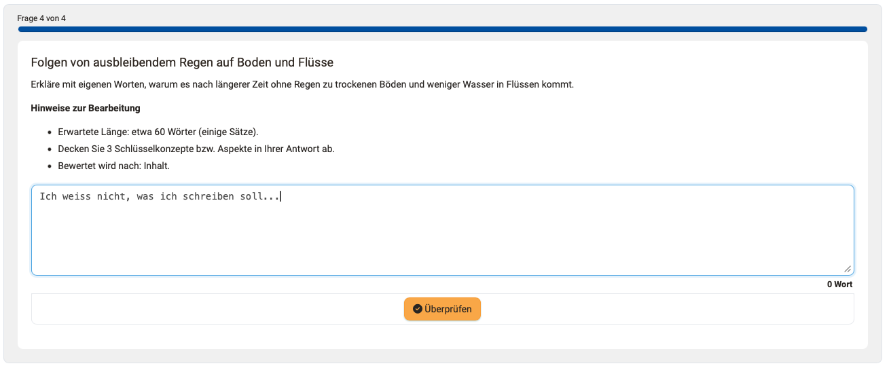{ class="shadow lightbox" title="Lernendenansicht des Quiz auf einer Kursseite" }

3. Das Ergebnis erscheint im Block **"KI-Feedback"**.

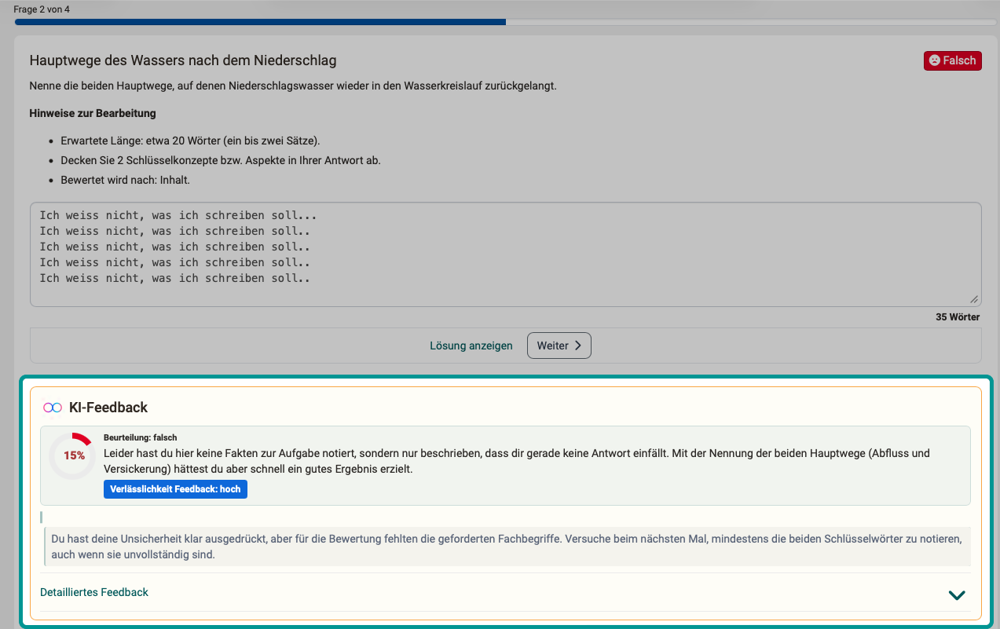{ class="shadow lightbox" title="Block KI-Feedback im Quiz nach dem Überprüfen" }

Der Block beginnt mit der **"Beurteilung"** in fünf Stufen: "sehr gut", "gut", "mittelmässig", "ungenügend" und "falsch". Daneben steht die **"Verlässlichkeit Feedback"** mit "hoch", "mittel" oder "niedrig". Sie zeigt, wie sicher die KI ihre eigene Einschätzung einstuft.

Die Beurteilung ist eine Einschätzung der KI für die Lernenden. Auf der Ergebnisseite des Quiz zählt eine Freitextantwort ab 50 Prozent als korrekt.

OpenOlat erkennt die Sprache der Antwort und vergleicht sie mit dem Feld "Sprache (BCP-47)" im Bewertungskit. Weicht sie ab, zeigt der Block "KI-Feedback" den Hinweis "Die Sprache deiner Antwort scheint nicht der erwarteten Sprache zu entsprechen." Die KI bewertet die Antwort trotzdem.

Unter **"Detailliertes Feedback"** lassen sich weitere Abschnitte aufklappen: "Was gut gelungen ist", "Was fehlt noch" und "Nächster Schritt", dazu die abgedeckten und fehlenden Punkte sowie Rückmeldungen zu Grammatik und Rechtschreibung.

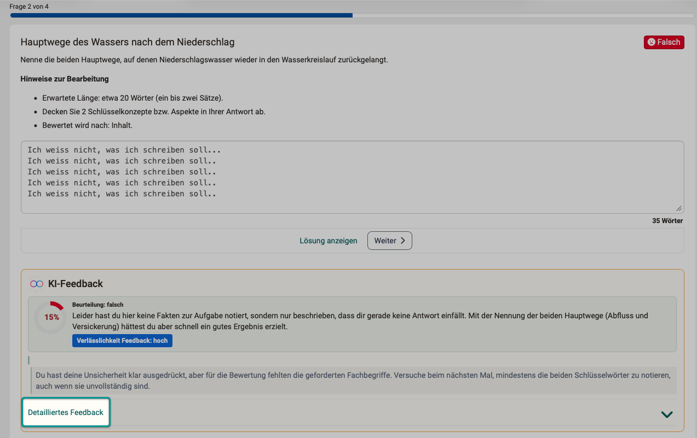{ class="shadow lightbox" title="Block KI-Feedback, zugeklappt" }

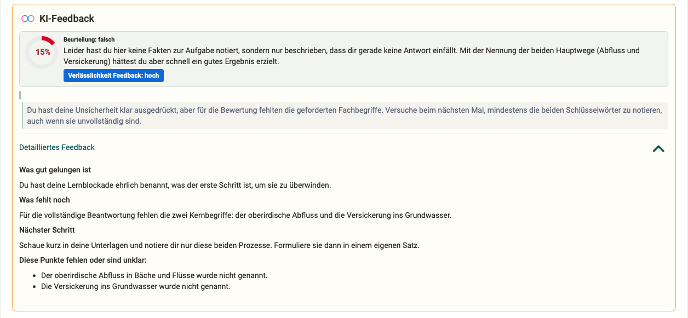{ class="shadow lightbox" title="Block KI-Feedback, aufgeklappt" }

[Zum Seitenanfang ^](#ai_essay)

---

## Fragen per Import erzeugen {: #import}

Statt die Frage von Hand zu schreiben, lassen Sie sie aus einem Lerntext erzeugen, etwa aus dem Skript zu Ihrem Kurs.

1. Klicken Sie im Bearbeitungsmodus der Seite auf **"Importieren"**, unter dem Inhalt neben "Neues Layout einfügen".
2. Wählen Sie eine Markdown-, Text- oder Word-Datei mit dem Lerntext, oder wählen Sie "Text einfügen" und fügen Sie den Lerntext in das Eingabefeld ein.
3. Der Schalter "KI-generiertes Quiz hinzufügen" ist beim Öffnen des Dialogs eingeschaltet. Lassen Sie ihn eingeschaltet. Der Schalter "Bild-Metadaten mit KI generieren" betrifft nur die Bilder der importierten Datei: OpenOlat erzeugt dafür Titel, Beschreibung, Alternativtext und Tags.
4. Legen Sie im Feld "Essay-Frage mit KI-Korrektur" fest, wie viele Freitextfragen entstehen. Erlaubt sind bis zu fünf. Das Feld "MC-Fragen" steuert die Anzahl der Multiple-Choice-Fragen und kann auf 0 bleiben.
5. Wählen Sie die "Bloom-Stufen" und die "Zielschwierigkeit", und erfassen Sie bei Bedarf "Lernziele", ein Ziel pro Zeile.  
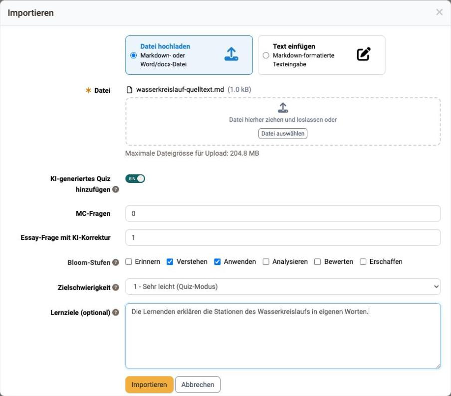{ class="shadow lightbox" title="Dialog Importieren im Content Editor" }

6. Starten Sie den Import. Die Generierung läuft im Hintergrund und kann eine Minute dauern. OpenOlat übernimmt den Lerntext als Inhalt auf die Seite und fügt die Fragen direkt danach als Quiz-Element an.

Die KI füllt das Bewertungskit der erzeugten Fragen vor. Prüfen Sie jede Frage inhaltlich und schärfen Sie das Bewertungskit im Tab "KI-Feedback" nach.

Denselben Weg gibt es im [Fragenpool](../../manual_user/area_modules/Question_Bank_Create_Questions.de.md#create_with_AI) über den Button "KI Fragen". Die Anzahl der Freitextfragen legen Sie dort im Feld "Essay-Fragen mit KI-Korrektur" fest. Im Fragenpool erzeugte Fragen erhalten den Status "Review". In ein Quiz übernehmen Sie sie im Bearbeitungsmodus der Seite über das Menü des Quiz-Elements: `Weitere Aktionen > Fragen aus Pool importieren`. Das Bewertungskit kommt mit.

[Zum Seitenanfang ^](#ai_essay)

---

## Checkliste {: #checklist}

- [x] Ist im KI-Modul die Funktion "Essay Bewertung" aktiv und mit einem Modell verbunden?
- [x] Erscheint im Quiz unter "Hinzufügen" der Eintrag "Freitext"?
- [x] Sind Lernziel, Quelltext-Auszug, Musterantwort, Bloom-Stufe und Sprache erfasst?
- [x] Ergeben die Gewichte ausgefüllter Schlüsselpunkte und Bewertungskriterien je 1.0?
- [x] Wurde das Feedback mit einer Beispielantwort getestet?
- [x] Passt das erwartete Antwortmass zur Grenze für Eingabewörter im KI-Modul?
- [x] Ist den Lernenden klar, dass das KI-Feedback keine Punkte vergibt?

---

## Weiterführende Informationen {: #further_information}

**Auf dieser Seite erwähnt** 
["Wie erstelle ich meinen ersten OpenOlat-Kurs?" >](../my_first_course/my_first_course.de.md) 
[Kursbaustein "Seite" >](../../manual_user/learningresources/Course_Element_Page.de.md) 
[Content Editor >](../../manual_user/basic_concepts/Content_Editor.de.md) 
[Persönliche Werkzeuge: Das Media Center >](../../manual_user/personal_menu/Media_Center.de.md) 
[Kursbaustein "Test" >](../../manual_user/learningresources/Course_Element_Test/index.de.md) 
[Externe Werkzeuge: KI-Modul >](../../manual_admin/administration/External_Tools_AI.de.md) 
[Persönliche Konfiguration: Einstellungen >](../../manual_user/personal_menu/Settings.de.md) 
[Fragenpool: Fragen erstellen >](../../manual_user/area_modules/Question_Bank_Create_Questions.de.md)

**Weiterführend** 
[Test Fragetypen >](../../manual_user/learningresources/Test_question_types.de.md) 
[KI-Funktionen: Anwendungsmap >](../../manual_user/area_modules/AI_Features_Map.de.md) 
[Fragenpool: Beurteilungsprozess >](../../manual_user/area_modules/Question_Bank_Review_Process.de.md)

[Zum Seitenanfang ^](#ai_essay)
