# How do I give learners AI feedback on free-text answers in a quiz? {: #ai_essay}

??? abstract "Aim and content of these instructions"

    Do you want to ask learners an open-ended question and give them immediate feedback without reading every answer yourself? 
    The following instructions show how to create an essay question, fill in the grading kit for the AI and check the result before you put it to use.

??? abstract "Target group"

    [x] Authors [ ] Coaches  [ ] Participants

    [ ] Beginners [x] Advanced users  [ ] Experts

??? abstract "Expected previous knowledge"

    * ["How do I create my first OpenOlat course?"](../my_first_course/my_first_course.md)
    * [Course Element Page](../../manual_user/learningresources/Course_Element_Page.md)
    * [Content Editor](../../manual_user/basic_concepts/Content_Editor.md)

---

## What AI feedback does {: #concept}

With AI feedback, learners receive **formative feedback** on their answer to an essay question. The AI compares the answer with the information you store as an author and describes what worked and what is missing.

OpenOlat names the feature for each role with the word that fits its task. As an author, you set up in the "AI feedback" tab what learners receive later. Learners allow the AI to check their answer in the "AI correction" dialog and then read their AI feedback. The table shows for each goal who acts, where, and under which word of the interface, in the order of these instructions.

| Goal | Who | Where | Word in the interface |
|---|---|---|---|
| Fill in the [grading kit](#grading_kit): the information the AI measures an answer against | Author | Tab of the essay question | "AI feedback" |
| Allow or decline the check of the answer by the AI | Learners | Dialog at the start of the Quiz | "AI correction" |
| Receive the AI's feedback on the answer | Learners | Note during the check Block below the answer | "Waiting for AI correction" "AI feedback" |
| Set how many essay questions the AI generates, each with a pre-filled grading kit | Author | "Import" dialog in the Content Editor "AI questions" dialog in the question bank | "Essay question with AI correction" "Essay questions with AI correction" |

!!! info "frentix customers"

    For frentix customers, the "Essay Grading" feature requires an agreement with frentix. After that, their customer advisor at frentix enables the feature.

Three points govern its use:

* The feedback **does not award any points**. It serves self-assessment and does not replace an assessment by the course coaches.
* You create the question in the **"Quiz" content element** of the Content Editor, that is, on a page in the "Page" course element or in the [Media Center](../../manual_user/personal_menu/Media_Center.md). The "Test" and "Self-test" course elements have no AI feedback.
* Learners request the feedback themselves. With "New attempt" they answer the Quiz again from the start and so write a revised answer.

For a graded assessment, continue to use the [Test course element](../../manual_user/learningresources/Course_Element_Test/index.md) with manual correction.

[To the top of the page ^](#ai_essay)

---

## Checking the requirements {: #requirements}

!!! info "frentix customers"

    For frentix customers, their customer advisor at frentix takes care of the settings in the tabs "AI providers", "AI features" and "AI processing pools".

The essay question in the Quiz only appears once the AI feature "Essay Grading" is enabled in the system administration. A person with the system administrator role carries out the check. For the activation, contact your organisation.

1. As a system administrator, open the system administration: `Administration > External tools > AI module`.
2. Select the "AI features" tab.
3. Check the "Essay Grading" feature: the "Enable feature" switch is set to "ON", and an AI provider and a language model are selected. You set up the provider beforehand in the [AI providers](../../manual_admin/administration/External_Tools_AI.md#ai_provider) tab.
4. For [generated questions](#import), also check the "Essay Question Generator" feature. The "AI questions" button in the question bank also only appears with the "MC Question Generator" feature.

Two limits of the "Essay Grading" feature directly affect learners and authors:

| Field | Default value | Effect |
|---|---|---|
| "Maximum input words" | 400 | For longer answers, learners receive a message with the configured value instead of the AI feedback. The answer remains saved. |
| "Timeout (seconds)" | 600 | If grading takes longer, OpenOlat aborts it and reports this. The value also applies to the "Test feedback" preview. |

For details on these fields, see [External tools: AI module](../../manual_admin/administration/External_Tools_AI.md#ai_function_limits).

[To the top of the page ^](#ai_essay)

---

## Step 1: Create a Quiz and essay question {: #create_question}

1. In the course editor, add a **"Page" course element** and open the **"Page content"** tab.
2. Click **"Edit page"**.
3. Select **"Add content"** and, in the "Knowledge" area, the **"Quiz"** element.
4. In the Quiz, click **"Add"** at the top right and select **"Essay"**.  
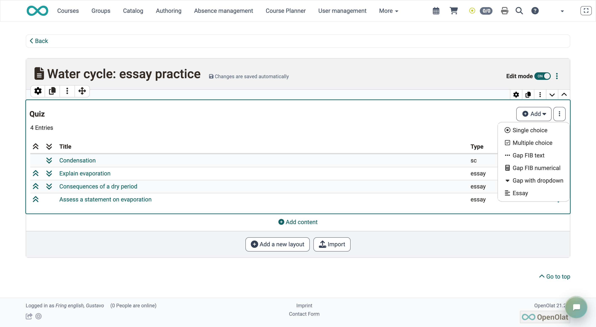{ class="shadow lightbox" title="Quiz element in the Content Editor of a page · 2026.11.04" }

5. In the "Essay" tab, enter the **Title** and the **Question**.
6. If needed, set **"Min. words"** and **"Max. words"**. The counter below the input field shows learners their progress and the maximum. Set the maximum no higher than the "Maximum input words" value in the AI module, so that every permitted answer receives AI feedback.
7. Save the question.

!!! info "Important"

    The "Essay" entry only appears in the "Add" menu if the "Essay Grading" AI feature is enabled and connected to an AI provider and a language model. If the entry is missing, check the requirements in the AI module.

[To the top of the page ^](#ai_essay)

---

## Step 2: Fill in the grading kit {: #grading_kit}

The grading kit in the **"AI feedback"** tab defines what the AI measures the answers against. Only with a saved grading kit do learners receive AI feedback on this question. For it, the AI uses the reference excerpt, the model answer, the key points, the rubric criteria, the grading hints, the difficulty and the language.

Five entries are mandatory and marked with an asterisk:

| Field | What goes in it |
|---|---|
| "Learning objective" | What learners should demonstrate with their answer, in one sentence. |
| "Reference excerpt" | The passage from the source text the question is based on. The source text is the text your learners work through, for example a script. The AI uses the passage as a reference. |
| "Model answer" | The expected answer in the length and language you expect from learners. |
| "Bloom level" | The cognitive level of the question according to Bloom's taxonomy, from the simplest to the most demanding thinking step: "Remember", "Understand", "Apply", "Analyse", "Evaluate" or "Create". |
| "Language (BCP-47)" | The language in which learners are to answer, as a language tag such as `de`, `en` or `fr`. Enter the language tag without region, for example `en`. OpenOlat prefills the empty field with the language of your user interface. If learners answer in a different language, the AI feedback points this out. |

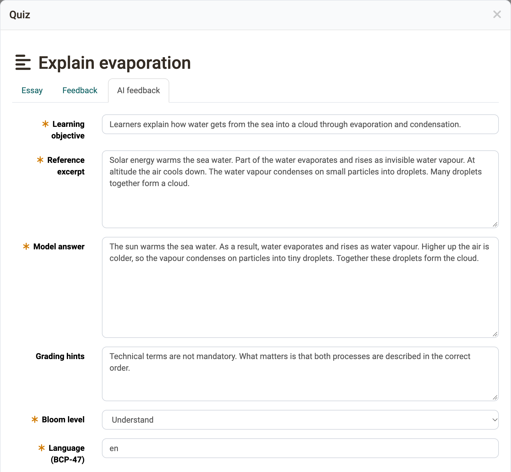{ class="shadow lightbox" title="AI feedback tab of an essay question in the Quiz · 2026.11.04" }

The AI writes the feedback to learners in the language the learner has selected in their [personal settings](../../manual_user/personal_menu/Settings.md#language). The "Test feedback" preview in step 3 writes it in the language from the "Language (BCP-47)" field.

The remaining fields are optional:

* **"Grading hints"**: rules for the assessment, for example that technical terms are not mandatory.
* **"Difficulty (1–5)"**: the standard the AI applies when assessing. 1 is very easy, a short answer is enough; 5 is very hard.
* **"Key points"**: the core aspects a good answer covers. Each point gets a description, a weight from 0.0 to 1.0 and the "required" marker. Weight and marker show the AI how much a point counts. If rows are filled in, the weights must sum to 1.0 (tolerance 0.01).
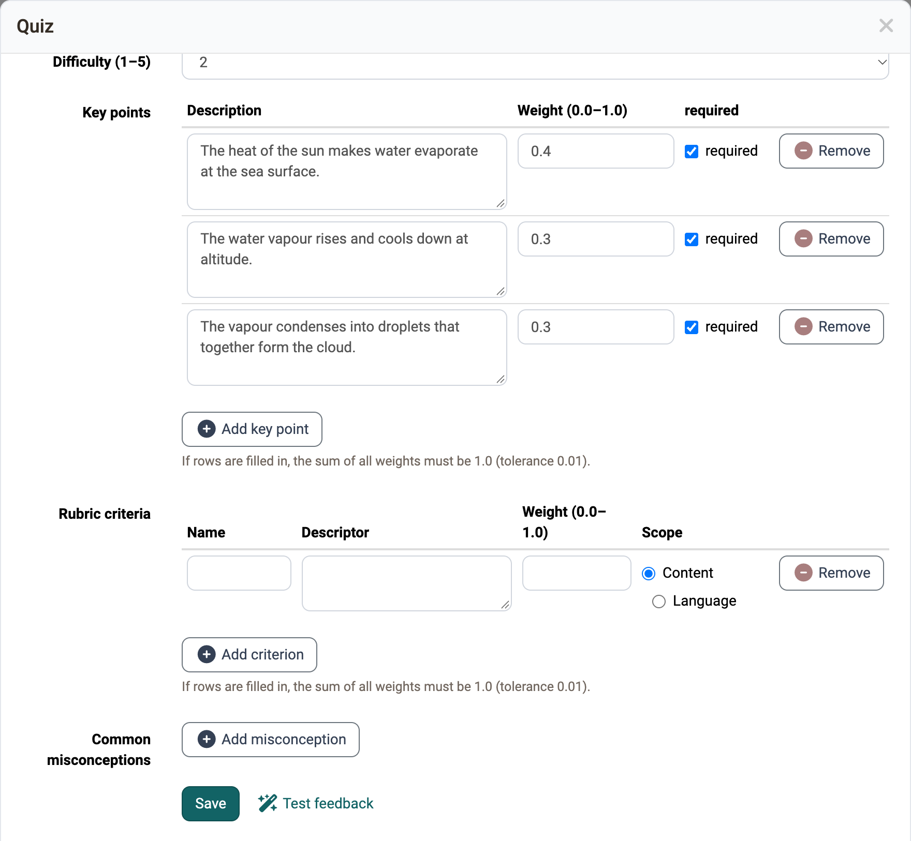{ class="shadow lightbox" title="Key points section in the AI feedback tab · 2026.11.04" }

* **"Rubric criteria"**: named criteria with a descriptor, weight and the scope "Content" or "Language". The scope shows the AI whether the criterion concerns the content or the language of the answer. If rows are filled in, the weights must sum to 1.0 here too.
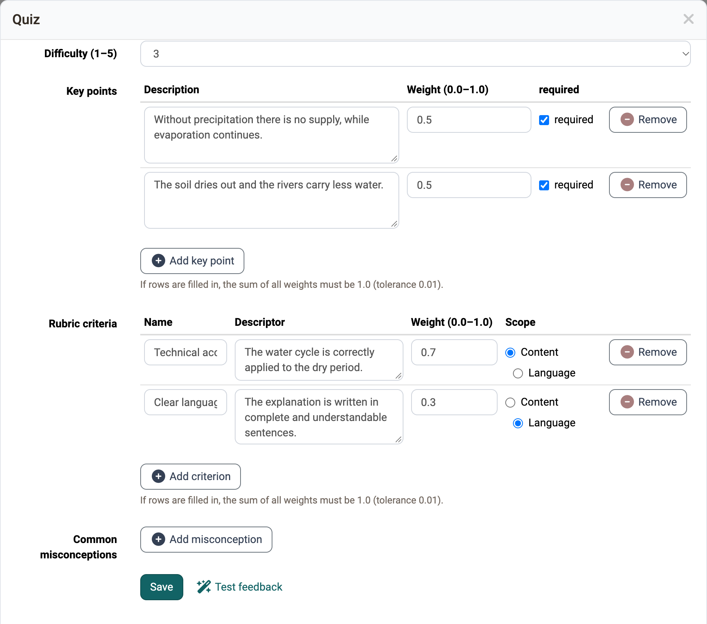{ class="shadow lightbox" title="Rubric criteria section in the AI feedback tab · 2026.11.04" }

* **"Common misconceptions"**: typical false assumptions about the question, as a reference list in the grading kit. When questions are generated, the AI pre-fills them. If the AI feedback should address a false assumption, also name it in the grading hints.
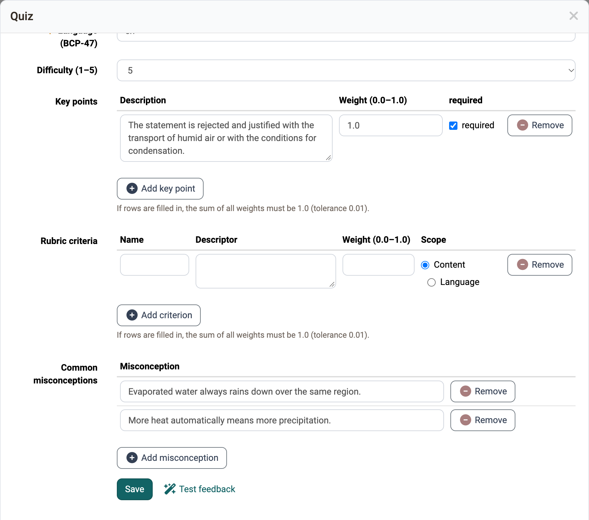{ class="shadow lightbox" title="Common misconceptions section in the AI feedback tab · 2026.11.04" }

You add another row with "Add key point", "Add criterion" or "Add misconception"; "Remove" deletes a row.

If you duplicate a question in the Quiz, the copy has no grading kit. Fill it in again for the copy.

If the grading kit cannot be saved, OpenOlat shows the error directly at the field or at the row of the table. If the weights do not add up to 1.0, the message "Weights must sum to 1.0 (±0.01)." appears at the weight of the first row.

[To the top of the page ^](#ai_essay)

---

## Step 3: Test the feedback {: #test_feedback}

Check the grading kit before you publish the course and learners see the question.

1. In the "AI feedback" tab, click **"Test feedback"**.
2. Enter a sample answer, ideally a deliberately incomplete one.
3. Click **"Generate feedback"**. Depending on the language model, grading takes a few seconds up to two minutes. At the latest after the "Timeout (seconds)" value in the AI module, OpenOlat aborts.

Under "Grading signals", the preview shows how the AI reads the answer.

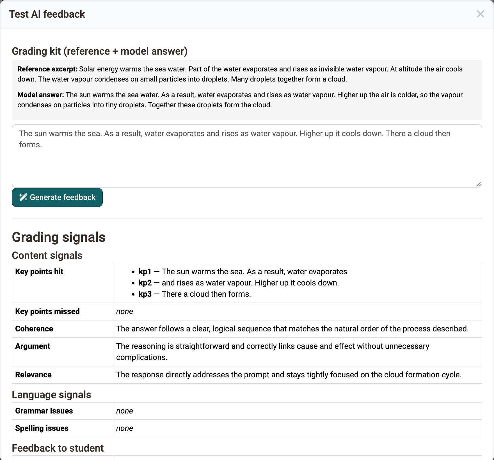{ class="shadow lightbox" title="Test AI feedback dialog · 2026.11.04" }

* **"Content signals"**: key points hit and missing, plus "Coherence", "Argument" and "Relevance".
* **"Language signals"**: "Grammar issues" and "Spelling issues".
* **"Feedback to student"**: the text learners see later.
* **"Overall"**: "Overall assessment", "Estimated score", "Off-topic flag", "Confidence" and "Feedback to coach".

You see the "Feedback to coach" in this preview. The learners' answers and their AI feedback stay with the learners.

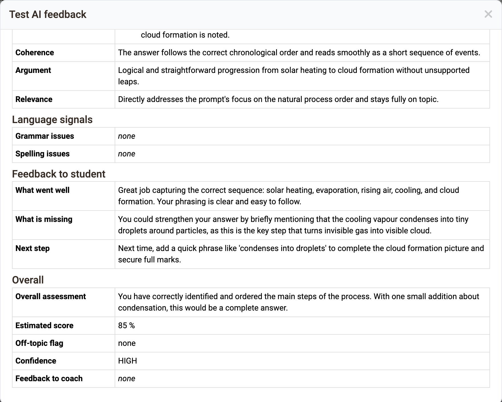{ class="shadow lightbox" title="Lower part of the Test AI feedback dialog · 2026.11.04" }

If the feedback differs from your expectation, refine the model answer, the key points or the grading hints and test again.

[To the top of the page ^](#ai_essay)

---

## Three examples of questions and grading kits {: #examples}

The entries in the grading kit depend on the demands of the question. Three patterns:

| Question | Bloom level | Difficulty | Focus in the grading kit |
|---|---|---|---|
| "Explain in your own words how water gets from the sea into a cloud." | Understand | 2 | Three key points with the weights 0.4, 0.3 and 0.3, model answer that contains exactly these three points |
| "No rain falls in a region for three weeks. Explain what consequences are to be expected for the soil and rivers." | Apply | 3 | Two rubric criteria: "Technical accuracy" in the Content scope with 0.7, "Clear language" in the Language scope with 0.3 |
| "Assess the statement: More evaporation always leads to more rain in the same region." | Evaluate | 5 | One key point with weight 1.0, plus grading hints on two typical false assumptions and "Max. words" 150 in the question |

The more open the question, the more important grading hints and rubric criteria become. For a knowledge question, a model answer and key points are enough.

[To the top of the page ^](#ai_essay)

---

## The learner's view {: #learner_view}

At the start of the quiz, OpenOlat asks learners in the "AI correction" dialog whether the AI may correct their free-text answers: "Allow once", "Always allow" or "Not now". The AI feedback is a response for the learners; points and passed status remain unaffected. Without permission learners answer the question as usual, only no AI feedback appears. "Always allow" stores the choice in the "AI settings" tab of the personal settings, after which the dialog no longer appears. After "Allow once" or "Not now", OpenOlat asks again at the next run through the Quiz, for example after "New attempt". In the "AI settings" tab, learners change their choice at any time: "Off" switches the AI feedback off, "Default (on)" or "Default (off)" lets OpenOlat ask again at the start. Details are described in [Consent to the AI correction](../../manual_user/basic_concepts/Content_Editor.md#ai_consent).

1. Learners start the Quiz on the page and answer the essay question in the input field. If the AI generated the question, via the import or via "AI questions" in the question bank, the question text ends with "Notes for your answer": the expected length, the number of key concepts and the scopes the answer is graded by. A question you create by hand has no such block. The block is part of the question text, so you can change or remove it in the "Question" field. The counter shows the number of words and, if a maximum is set, the permitted maximum.
2. With **"Check"** they submit the answer. While the AI is working, the message "Waiting for AI correction" appears. If it takes longer, OpenOlat asks you to keep the page open: the feedback appears on the open page. After that, "Continue" leads to the next question.

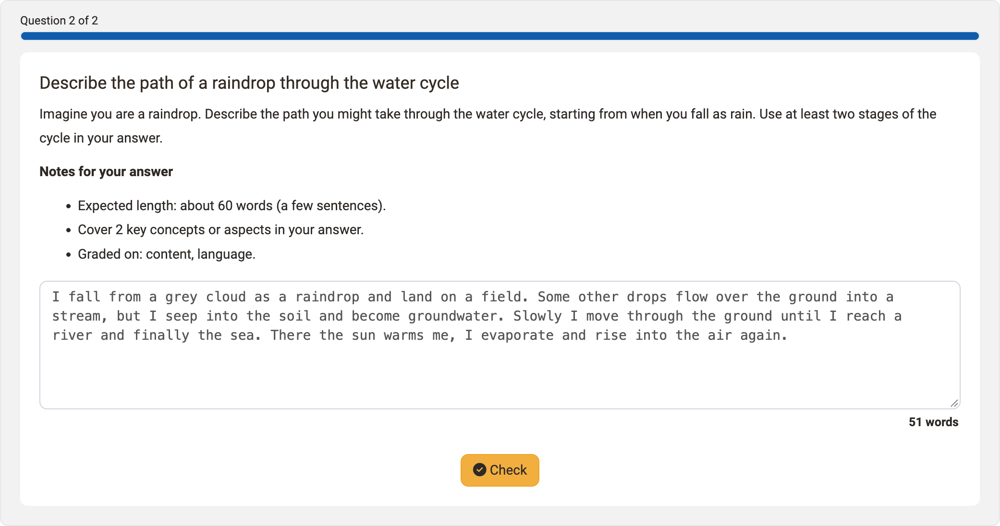{ class="shadow lightbox" title="Learner view of the Quiz on a course page · 2026.11.04" }

3. The result appears in the **"AI feedback"** block.

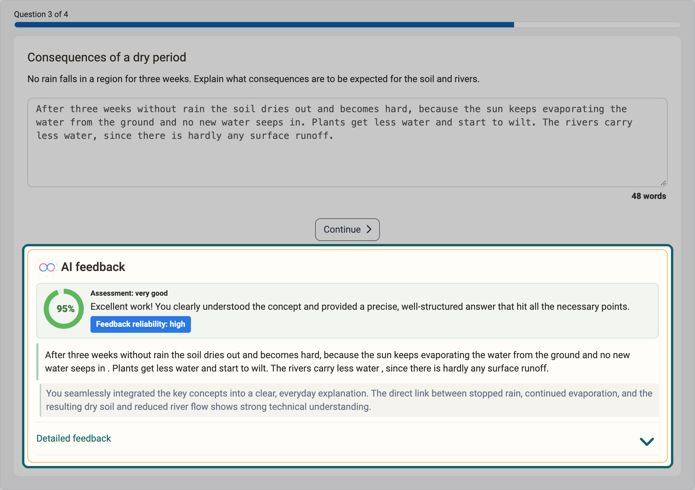{ class="shadow lightbox" title="AI feedback block in the Quiz after checking · 2026.11.04" }

The block begins with the **"Assessment"** in five levels: "very good", "good", "mediocre", "insufficient" and "wrong". Next to it is the **"Feedback reliability"** with "high", "medium" or "low". It shows how confident the AI is in its own assessment.

The assessment is an estimate by the AI for the learners. On the results page of the Quiz, an essay answer counts as correct from 50 percent.

OpenOlat detects the language of the answer and compares it with the "Language (BCP-47)" field in the grading kit. If it differs, the "AI feedback" block shows the note "The language of your answer does not appear to match the expected language." The AI grades the answer nevertheless.

Under **"Detailed feedback"** further sections can be expanded: "What went well", "What is missing" and "Next step", plus the covered and missing points as well as feedback on grammar and spelling.

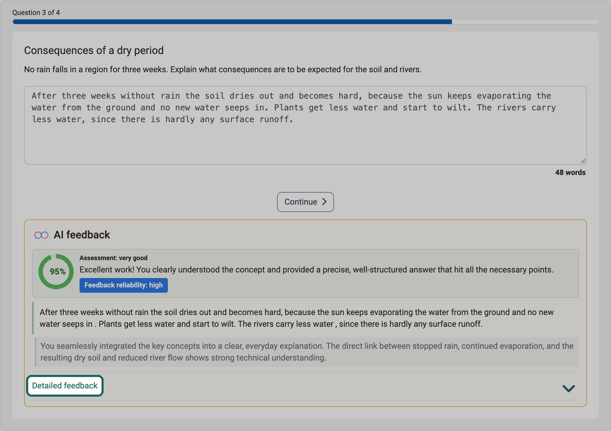{ class="shadow lightbox" title="AI feedback block, collapsed · 2026.11.04" }

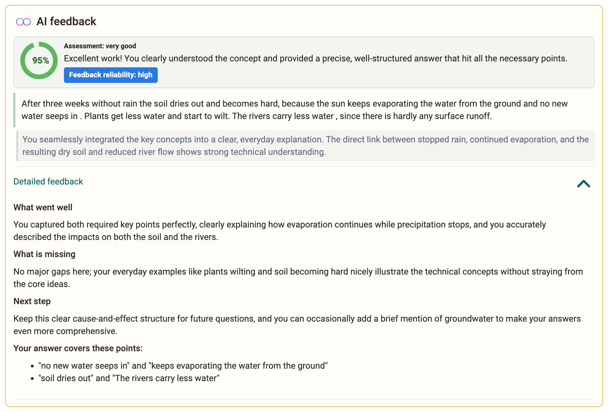{ class="shadow lightbox" title="AI feedback block, expanded · 2026.11.04" }

[To the top of the page ^](#ai_essay)

---

## Creating questions via import {: #import}

Instead of writing the question by hand, you can have it generated from a source text, for example from the script for your course.

1. In the edit mode of the page, click **"Import"**, below the content next to "Add a new layout".
2. Select a Markdown, text or Word file with the source text, or select "Paste text" and paste the source text into the input field.
3. The "Add AI generated Quiz" switch is on when the dialog opens. Leave it on. The "Generate image metadata with AI" switch only concerns the images in the imported file: OpenOlat generates a title, description, alternative text and tags for them.
4. In the "Essay question with AI correction" field, set how many essay questions are created. Up to five are allowed. The "MC question" field sets the number of multiple-choice questions and can stay at 0.
5. Select the "Bloom levels" and the "Target difficulty", and enter "Learning objectives" if needed, one objective per line.  
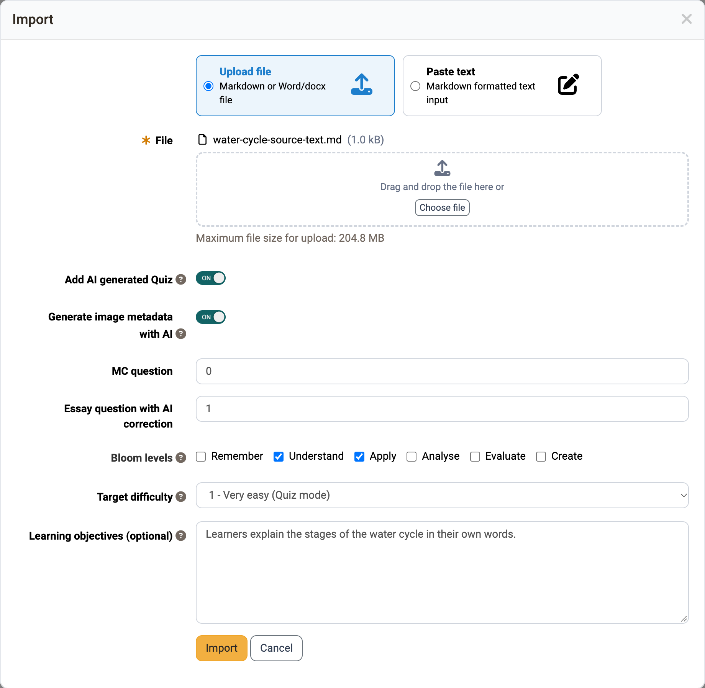{ class="shadow lightbox" title="Import dialog in the Content Editor · 2026.11.04" }

6. Start the import. Generation runs in the background and may take a minute. OpenOlat takes the source text onto the page as content and adds the questions directly after it as a Quiz element.

The AI pre-fills the grading kit of the generated questions. Check each question for content and refine the grading kit in the "AI feedback" tab.

The same path exists in the [Question bank](../../manual_user/area_modules/Question_Bank_Create_Questions.md#create_with_AI) via the "AI questions" button. There you set the number of essay questions in the "Essay questions with AI correction" field. Questions created in the question bank receive the status "Review". You take them into a Quiz in the edit mode of the page via the menu of the Quiz element: `More actions > Import questions from pool`. The grading kit comes along.

[To the top of the page ^](#ai_essay)

---

## Checklist {: #checklist}

- [x] Is the "Essay Grading" feature active in the AI module and connected to a model?
- [x] Does the "Essay" entry appear under "Add" in the Quiz?
- [x] Are the learning objective, reference excerpt, model answer, Bloom level and language filled in?
- [x] Do the weights of filled-in key points and rubric criteria each sum to 1.0?
- [x] Has the feedback been tested with a sample answer?
- [x] Does the expected answer length match the input-word limit in the AI module?
- [x] Is it clear to learners that the AI feedback does not award any points?

---

## Further information {: #further_information}

**Mentioned on this page** 
["How do I create my first OpenOlat course?" >](../my_first_course/my_first_course.md) 
[Course Element "Page" >](../../manual_user/learningresources/Course_Element_Page.md) 
[Content Editor >](../../manual_user/basic_concepts/Content_Editor.md) 
[User tools: Media Center >](../../manual_user/personal_menu/Media_Center.md) 
[Course Element "Test" >](../../manual_user/learningresources/Course_Element_Test/index.md) 
[External tools: AI module >](../../manual_admin/administration/External_Tools_AI.md) 
[Personal Configuration: Settings >](../../manual_user/personal_menu/Settings.md) 
[Question bank: Create Questions >](../../manual_user/area_modules/Question_Bank_Create_Questions.md)

**Further reading** 
[Test question types >](../../manual_user/learningresources/Test_question_types.md) 
[AI features: Application map >](../../manual_user/area_modules/AI_Features_Map.md) 
[Question Bank Review Process >](../../manual_user/area_modules/Question_Bank_Review_Process.md)

[To the top of the page ^](#ai_essay)
