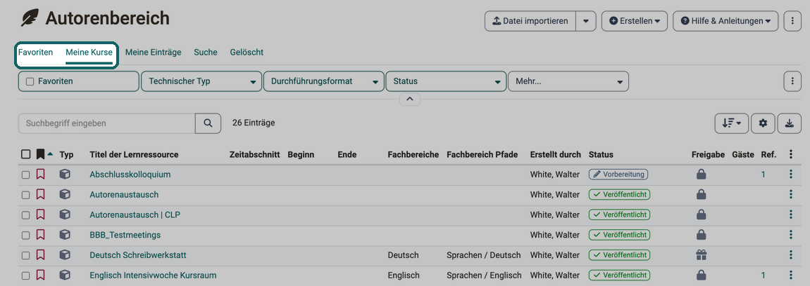
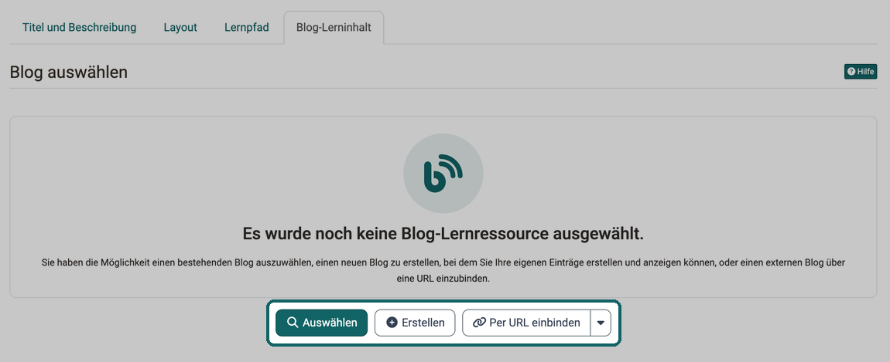
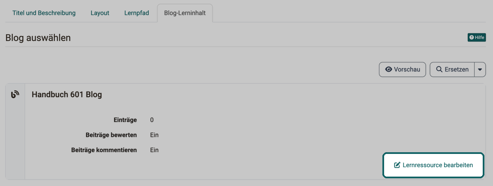
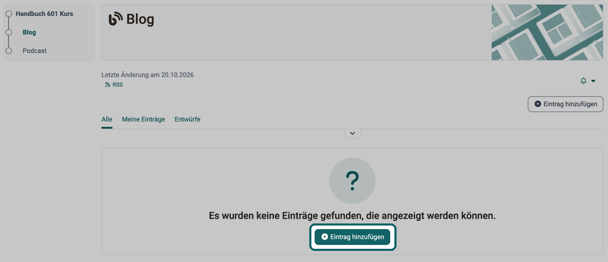
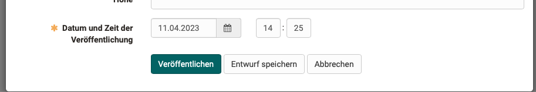

# Wie erstelle ich einen Blog? {: #how_do_i_create_a_blog}

Mit dieser Anleitung fügen Sie Ihrem Kurs in kurzer Zeit einen Blog hinzu, legen fest, wer darin schreiben darf, und erstellen den ersten Eintrag.

## Welche Art Blog soll es sein?

Überlegen Sie vor dem Anlegen, wozu der Blog dient. Davon hängt ab, ob Sie einen OpenOlat-Blog erstellen oder einen externen Blog einbinden und wer Einträge schreibt.

* Info-Blog
    - als Informationskanal an alle Teilnehmer:innen des Kurses
    - Teilnehmer:innen können nur lesen
* Fach-Blog
    - meist in mehreren Kursen eingesetzt
    - via URL von extern eingebunden (z.B. Mastodon Feed)
* User-Generated Content Blog
    - z.B. Flipped Classroom Szenarien
    - Teilnehmer:innen schreiben Einträge und kommentieren
* Lerntagebuch
    - typischerweise ein Blog pro Teilnehmer:in
    - nicht sichtbar für die anderen Teilnehmer:innen

## Voraussetzung

Sie binden den Blog in einen OpenOlat-Kurs ein. Haben Sie noch keinen Kurs, legen Sie ihn zuerst an, wie unter [Wie erstelle ich meinen ersten OpenOlat-Kurs?](../my_first_course/my_first_course.de.md) beschrieben.

---

## Schritt 1: Kurseditor öffnen und Kursbaustein "Blog" einfügen

a) Öffnen Sie im Autorenbereich den Kurs, in den der Blog kommt, zum Beispiel über den Tab "Meine Kurse" oder "Favoriten".

{ class="shadow lightbox" title="Tab Meine Kurse im Autorenbereich · 2026.10.20" }

b) Öffnen Sie im Kurs den Kurseditor: 
`Kurs > Administration > Kurseditor`

c) Wählen Sie im Kursmenü den Kursbaustein, unter dem der Blog stehen soll. OpenOlat fügt neue Kursbausteine immer unterhalb des ausgewählten Kursbausteins ein.

d) Klicken Sie in der Kopfzeile des Kurseditors auf "Kursbausteine einfügen" oder nutzen Sie die Quick-Add-Funktion und wählen Sie in der Auswahlliste den Kursbaustein "Blog".

Damit ist der Kursbaustein dem Kurs hinzugefügt.

e) Vergeben Sie im Tab "Titel und Beschreibung" einen passenden Titel und speichern Sie den Kursbaustein.

!!! info "Wichtig"

    Wenn Sie den Kurseditor bereits jetzt schliessen, zeigt das Kursmenü noch keinen Blog, denn der Kursbaustein ist unvollständig: Es fehlt noch die Lernressource.

[zum Seitenanfang ^](#how_do_i_create_a_blog)

---

## Schritt 2: Blog (Lernressource) erstellen

a) Wechseln Sie in den Tab "Blog-Lerninhalt". Solange kein Blog gewählt ist, bietet der Tab drei Wege an:

{ class="shadow lightbox" title="Tab Blog-Lerninhalt im Kurseditor · 2026.10.20" }

* **Auswählen**: Sie verbinden den Kursbaustein mit einem Blog, der bereits als Lernressource besteht.
* **Erstellen**: Sie legen einen neuen OpenOlat-Blog an, in dem Sie und die berechtigten Personen Einträge schreiben.
* **Per URL einbinden**: Sie binden einen externen Blog über seinen RSS-Feed ein, siehe [Externen Blog einbinden](#external_blog).

Einen Blog, der Ihnen als Datei vorliegt, zum Beispiel aus einem Export, laden Sie über den Pfeil neben "Per URL einbinden" mit "Import" hoch. Ob ein Blog ein OpenOlat-Blog oder ein externer Blog ist, steht beim Anlegen fest und lässt sich später nicht mehr ändern.

Im Folgenden erstellen Sie einen neuen OpenOlat-Blog.

b) Klicken Sie auf "Erstellen".

c) Geben Sie im Dialog "Blog erstellen" einen Titel für Ihre Blog-Lernressource ein und bestätigen Sie mit "Erstellen".

Damit ist eine neue Blog-Lernressource angelegt und mit dem Kursbaustein verbunden. Der Tab zeigt den Blog nun mit der Zahl seiner Einträge und den Einstellungen "Beiträge bewerten" und "Beiträge kommentieren". Mit "Vorschau" sehen Sie sich den Blog an, mit "Ersetzen" verbinden Sie den Kursbaustein mit einem anderen Blog.

!!! tip "Tipp"

    Alternativ erstellen Sie einen OpenOlat-Blog wie jede andere Lernressource im Autorenbereich mit "Erstellen" und verbinden ihn danach im Kurseditor im Tab "Blog-Lerninhalt" über "Auswählen" mit dem Kurs.

    So wird sichtbar, dass Lernressourcen kursübergreifend sind: Derselbe Blog lässt sich in mehreren OpenOlat-Kursen einbinden und auch ohne Kurs verwenden.

[zum Seitenanfang ^](#how_do_i_create_a_blog)

---

## Schritt 3: Berechtigungen festlegen

a) Im Tab "Blog-Lerninhalt" legen Sie unter "Berechtigungen" fest, wer Einträge schreiben und wer den Blog moderieren darf. Für "Moderator" und "Beiträge erstellen" wählen Sie je die Rollen, zum Beispiel Betreuer:innen oder Teilnehmer:innen. Mit "Erweiterte Konfiguration anzeigen" vergeben Sie ein Recht zusätzlich an einzelne Benutzer:innen oder Gruppen, auch mit Beginn und Ende.

{ class="shadow lightbox" title="Abschnitt Berechtigungen im Tab Blog-Lerninhalt · 2026.10.20" }

Die Berechtigung "Beiträge erstellen" erscheint nur bei einem OpenOlat-Blog, denn in einen externen Blog schreibt niemand in OpenOlat. Darüber legen Sie unter "Metadaten-Konfiguration" fest, ob der Kursbaustein Titel, Beschreibung und Bild des Blogs anzeigt.

b) Personen mit der Berechtigung "Moderator" schreiben ebenfalls Einträge. Zusätzlich bearbeiten und löschen sie Einträge anderer Personen, und sie löschen jeden Kommentar.

c) Publizieren Sie abschliessend den Kurs und schliessen Sie den Kurseditor, damit die Änderungen sichtbar werden.

[zum Seitenanfang ^](#how_do_i_create_a_blog)

---

## Schritt 4: Einträge hinzufügen

Einträge schreiben Sie direkt in der Lernressource oder im Kurs.

a) In der Lernressource: Öffnen Sie den Kurseditor erneut und klicken Sie im Tab "Blog-Lerninhalt" auf "Lernressource bearbeiten".

{ class="shadow lightbox" title="Tab Blog-Lerninhalt mit gewähltem Blog · 2026.10.20" }

b) Im Kurs: Öffnen Sie bei geschlossenem Kurseditor den Kursbaustein Blog. Solange der Blog keine Einträge hat, zeigt er hier wie in der Lernressource die Meldung "Es wurden keine Einträge gefunden, die angezeigt werden können."

{ class="shadow lightbox" title="Kursbaustein Blog im Kurs · 2026.10.20" }

Klicken Sie auf "Eintrag hinzufügen". Sie finden den Button in der leeren Liste und oben rechts.

c) Füllen Sie im Dialog "Bearbeiten" die Felder aus:

* Vergeben Sie einen Titel.
* Bei Bedarf wählen Sie unter "Tags" passende Tags.
* Den eigentlichen Eintrag schreiben Sie im Feld "Inhalt". Unter "Zusammenfassung" ergänzen Sie bei Bedarf eine kurze Zusammenfassung.
* Unter "Audio- oder Videodatei" laden Sie ergänzend eine Datei hoch.
* Unter "Datum und Zeit der Veröffentlichung" bestimmen Sie, ab wann der Eintrag erscheint.

d) Klicken Sie am unteren Rand des Dialogs auf "Veröffentlichen". Mit "Entwurf speichern" sichern Sie den Eintrag, ohne ihn zu veröffentlichen.

{ class="shadow lightbox" title="Unterer Rand des Dialogs Bearbeiten" }

Weitere Einträge fügen Sie jederzeit mit "Eintrag hinzufügen" hinzu. Personen mit der Berechtigung "Beiträge erstellen" schreiben ihre Einträge auf dieselbe Weise im Kurs, sobald der Kurs publiziert ist.

!!! info "Voraussetzung"

    Einträge erstellen können Besitzer:innen, Betreuer:innen und Teilnehmende nur in einem OpenOlat-Blog. Einen externen Blog können sie je nach den Einstellungen "Beiträge bewerten" und "Beiträge kommentieren" bewerten und kommentieren.

!!! info "Wichtig"

    Teilnehmende und Betreuer:innen erstellen ihre Einträge im Kurs bei geschlossenem Kurseditor. Besitzer:innen des Blogs fügen Einträge zusätzlich direkt in der Lernressource hinzu.

[zum Seitenanfang ^](#how_do_i_create_a_blog)

---

## Schritt 5: Kurs publizieren und Kursstatus auf "Veröffentlicht" ändern

Gehen Sie dazu vor, wie unter [Wie erstelle ich meinen ersten OpenOlat-Kurs?](../my_first_course/my_first_course.de.md) beschrieben.

Der Blog ist nun eingebunden und Teilnehmende können die Einträge lesen.

[zum Seitenanfang ^](#how_do_i_create_a_blog)

---

## Externen Blog einbinden {: #external_blog}

Einen Blog, der ausserhalb von OpenOlat im Internet erscheint, zeigen Sie über seinen RSS-Feed direkt im Kurs an. Sie brauchen dafür die Adresse des RSS-Feeds.

Klicken Sie im Tab "Blog-Lerninhalt" statt auf "Erstellen" auf "Per URL einbinden". Tragen Sie im Dialog im Feld "URL" die Adresse des RSS-Feeds ein. Erkennt OpenOlat den Blog, sind danach die Felder "Typ" und "Titel der Lernressource" ausgefüllt. Klicken Sie auf "Einbinden".

Der Feed muss über das öffentliche Internet erreichbar sein, denn OpenOlat ruft ihn vom Server aus ab. Ist in der System-Administration unter `Administration > Login > Sicherheit` der Schutz "SSRF Mitigation" eingeschaltet, ruft OpenOlat keinen Feed aus dem lokalen Netz ab, etwa von einem Server im Netz Ihrer Organisation, siehe [Sicherheit](../../manual_admin/administration/Login_Security.de.md#ssrf).

Anschliessend zeigt der Kurs die Einträge des externen Blogs. Je nach Einstellung lassen sie sich mit Sternen bewerten und kommentieren. Die Kommentare sind nur im Kurs sichtbar, nicht im externen Blog.

[zum Seitenanfang ^](#how_do_i_create_a_blog)

---

## Weiterführende Informationen {: #further_information}

**Auf dieser Seite erwähnt** 
[Wie erstelle ich meinen ersten OpenOlat-Kurs? >](../my_first_course/my_first_course.de.md) 
[Sicherheit >](../../manual_admin/administration/Login_Security.de.md)

**Weiterführend** 
[Kursbaustein "Blog" >](../../manual_user/learningresources/Course_Element_Blog.de.md) 
[Blog konfigurieren >](../../manual_user/learningresources/Blog_Configuration.de.md) 
[Bloggen >](../../manual_user/learningresources/Blog_Blogging.de.md)

[zum Seitenanfang ^](#how_do_i_create_a_blog)

