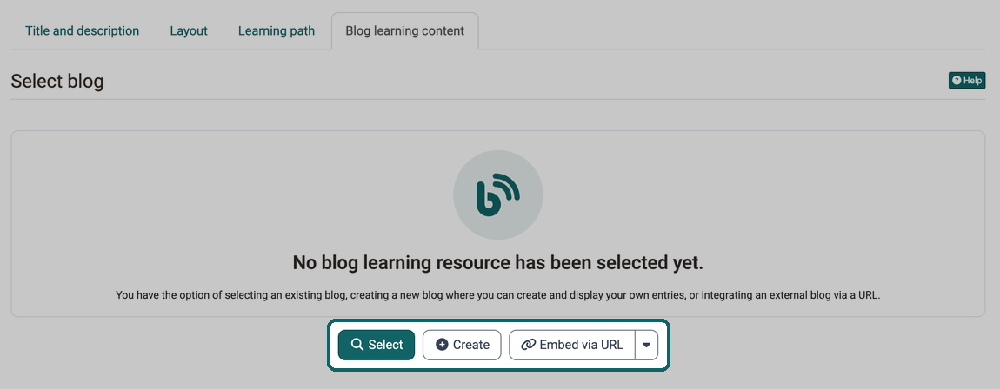
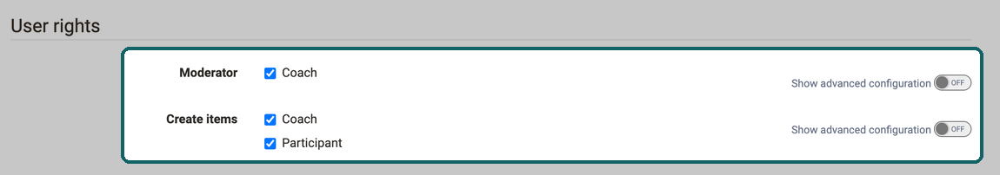
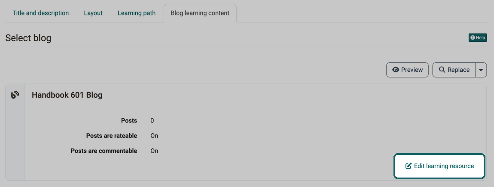
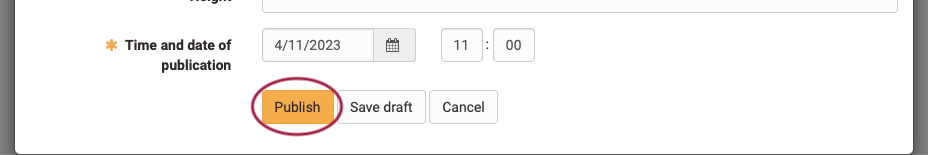

# How do I create a blog? {: #how_do_i_create_a_blog}

With this guide, you add a blog to your course in a short time, define who may write in it, and create the first entry.

## What kind of blog should it be?

Before you create the blog, consider what it is for. This determines whether you create an OpenOlat blog or embed an external blog, and who writes entries.

* info blog
    - as information channel to all participants of the course
    - participants can only read
* specialists blog
    - normally used in several courses
    - integrated via URL from an external source (e.g. Mastodon feed)
* user generated content blog
    - e.g. flipped classroom scenarios
    - participants write and comment entries
* learning journal
    - typically one blog per participant
    - not visible for other participants

## Requirement

You embed the blog in an OpenOlat course. If you do not have a course yet, create it first as described in [How do I create my first OpenOlat course?](../my_first_course/my_first_course.md).

---

## Step 1: Open course editor and insert "Blog" course element

a) In Authoring, open the course in which the blog goes, for example via the tab "My courses" or "Favourites".

{ class="shadow lightbox" title="Tab My courses in Authoring · 2026.10.20" }

b) In the course, open the course editor: 
`Course > Administration > Course editor`

c) In the course menu, select the course element below which the blog should appear. OpenOlat always inserts new course elements below the selected course element.

d) Click "Insert course elements" in the header of the course editor or use the Quick-Add function and select the course element "Blog" in the selection list.

The course element has now been added to the course.

e) Assign a suitable title in the tab "Title and description" and save the course element.

!!! info "Important"

    If you close the course editor already now, the course menu shows no blog yet, because the course element is incomplete: the learning resource is still missing.

[to the top of the page ^](#how_do_i_create_a_blog)

---

## Step 2: Create the blog (learning resource)

a) Switch to the tab "Blog learning content". As long as no blog is selected, the tab offers three options:

{ class="shadow lightbox" title="Tab Blog learning content in the course editor · 2026.10.20" }

* **Select**: You connect the course element with a blog that already exists as a learning resource.
* **Create**: You create a new OpenOlat blog in which you and the authorised people write entries.
* **Embed via URL**: You embed an external blog via its RSS feed, see [Embed an external blog](#external_blog).

A blog that you have as a file, for example from an export, you upload with "Import" via the arrow next to "Embed via URL". Whether a blog is an OpenOlat blog or an external blog is fixed when it is created and cannot be changed later.

In the following, you create a new OpenOlat blog.

b) Click "Create".

c) In the "Create blog" dialog, enter a title for your blog learning resource and confirm with "Create".

A new blog learning resource is now created and connected with the course element. The tab now shows the blog with the number of its posts and the settings "Posts are rateable" and "Posts are commentable". With "Preview" you look at the blog, with "Replace" you connect the course element with another blog.

!!! tip "Tip"

    Alternatively, you create an OpenOlat blog like any other learning resource in Authoring with "Create" and then connect it with the course in the course editor in the tab "Blog learning content" via "Select".

    This shows that learning resources are cross-course: the same blog can be embedded in several OpenOlat courses and can also be used without a course.

[to the top of the page ^](#how_do_i_create_a_blog)

---

## Step 3: Define user rights

a) In the tab "Blog learning content", you define under "User rights" who may write entries and who may moderate the blog. For "Moderator" and "Create items" you select the roles, for example coaches or participants. With "Show advanced configuration" you additionally grant a right to individual users or groups, also with a start and an end.

{ class="shadow lightbox" title="Section User rights in the tab Blog learning content · 2026.10.20" }

The "Create items" right only appears for an OpenOlat blog, because nobody writes in OpenOlat into an external blog. Above, under "Metadata config", you define whether the course element shows the title, description and image of the blog.

b) People with the "Moderator" right also write entries. In addition, they edit and delete entries of other people, and they delete any comment.

c) Finally, publish the course and close the course editor so that the changes become visible.

[to the top of the page ^](#how_do_i_create_a_blog)

---

## Step 4: Add entries

You write entries directly in the learning resource or in the course.

a) In the learning resource: Open the course editor again and click "Edit learning resource" in the tab "Blog learning content".

{ class="shadow lightbox" title="Tab Blog learning content with a selected blog · 2026.10.20" }

b) In the course: With the course editor closed, open the Blog course element. As long as the blog has no entries, it shows the message "No entries were found that can be displayed." here, as in the learning resource.

{ class="shadow lightbox" title="Blog course element in the course · 2026.10.20" }

Click "Add entry". You find the button in the empty list and at the top right.

c) Fill in the fields in the "Edit" dialog:

* Give the entry a title.
* If required, select suitable tags under "Tags".
* Write the actual entry in the "Content" field. Under "Summary" you add a short summary if required.
* Under "Audio or video file" you additionally upload a file.
* Under "Time and date of publication" you determine from when the entry appears.

d) Click "Publish" at the bottom of the dialog. With "Save draft" you keep the entry without publishing it.

{ class="shadow lightbox" title="Bottom of the Edit dialog" }

You add further entries at any time with "Add entry". People with the "Create items" right write their entries the same way in the course, as soon as the course is published.

!!! info "Precondition"

    Owners, coaches and participants can create entries only in an OpenOlat blog. Depending on the settings "Posts are rateable" and "Posts are commentable", they can rate and comment on an external blog.

!!! info "Important"

    Participants and coaches create their entries in the course with the course editor closed. Owners of the blog can additionally add entries directly in the learning resource.

[to the top of the page ^](#how_do_i_create_a_blog)

---

## Step 5: Publish course and change course status to "Published"

To do this, proceed as described in [How do I create my first OpenOlat course?](../my_first_course/my_first_course.md).

The blog is now integrated and participants can read the entries.

[to the top of the page ^](#how_do_i_create_a_blog)

---

## Embed an external blog {: #external_blog}

You show a blog that appears outside OpenOlat on the internet directly in the course via its RSS feed. For this you need the address of the RSS feed.

In the tab "Blog learning content", click "Embed via URL" instead of "Create". In the dialog, enter the address of the RSS feed in the "URL" field. If OpenOlat recognises the blog, the fields "Type" and "Title of learning resource" are filled in afterwards. Click "Embed".

The feed must be reachable via the public internet, because OpenOlat retrieves it from the server. If the "SSRF mitigation" protection is switched on in the system administration under `Administration > Login > Security`, OpenOlat does not retrieve a feed from the local network, for example from a server in the network of your organisation, see [Security](../../manual_admin/administration/Login_Security.md#ssrf).

The course then shows the entries of the external blog. Depending on the settings, they can be rated with stars and commented on. The comments are only visible in the course, not in the external blog.

[to the top of the page ^](#how_do_i_create_a_blog)

---

## Further information {: #further_information}

**Mentioned on this page** 
[How do I create my first OpenOlat course? >](../my_first_course/my_first_course.md) 
[Security >](../../manual_admin/administration/Login_Security.md)

**Further reading** 
[Course Element "Blog" >](../../manual_user/learningresources/Course_Element_Blog.md) 
[Blog Configuration >](../../manual_user/learningresources/Blog_Configuration.md) 
[Blogging >](../../manual_user/learningresources/Blog_Blogging.md)

[to the top of the page ^](#how_do_i_create_a_blog)