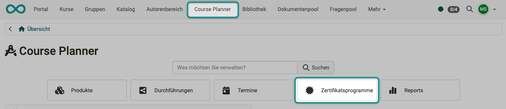
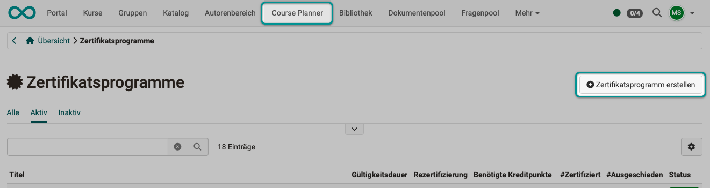
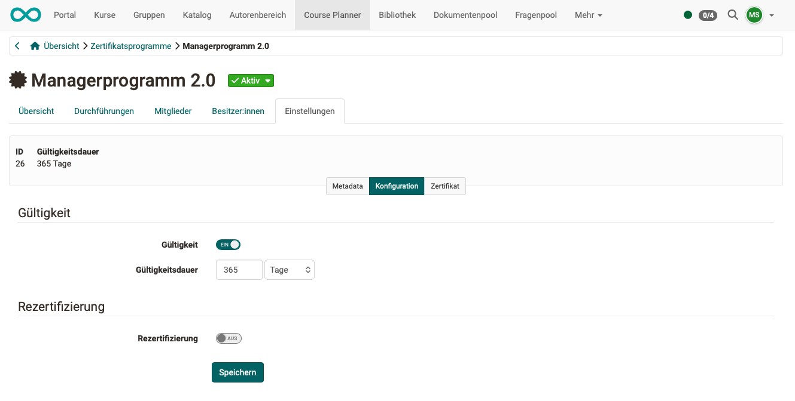
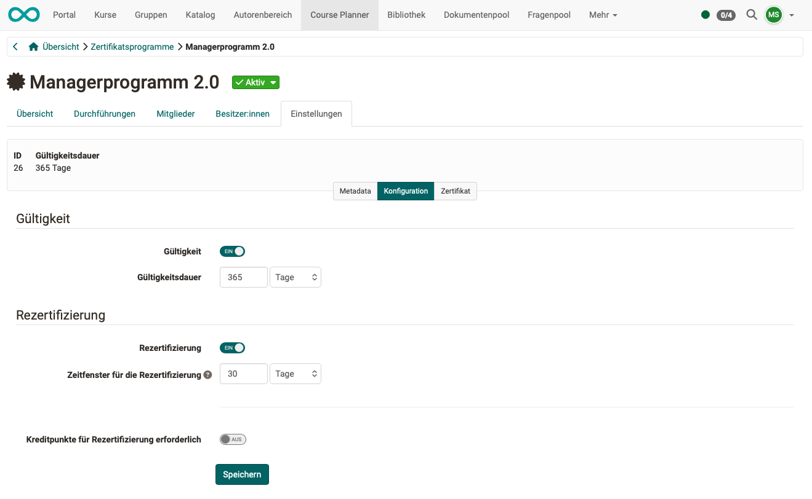
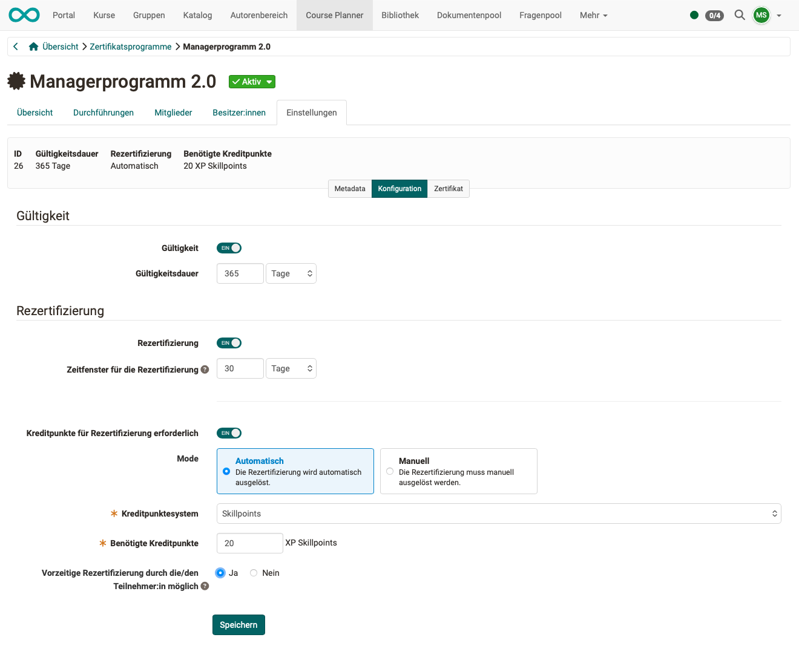
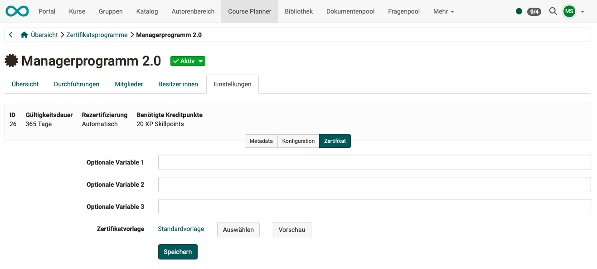
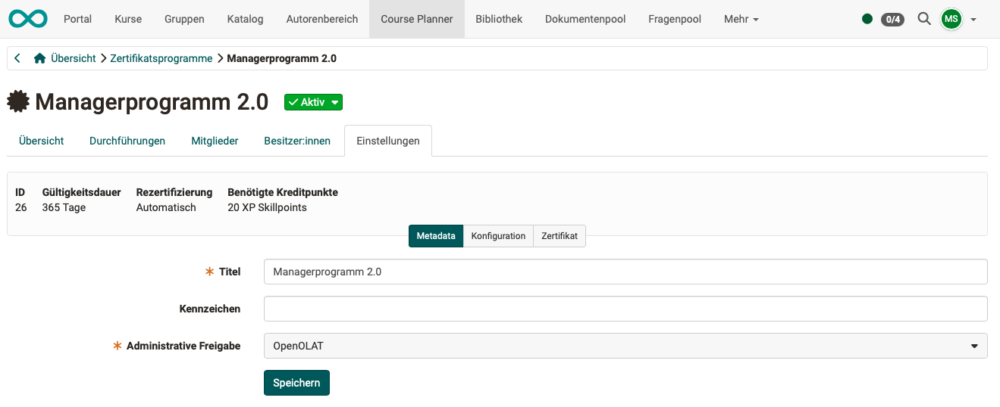
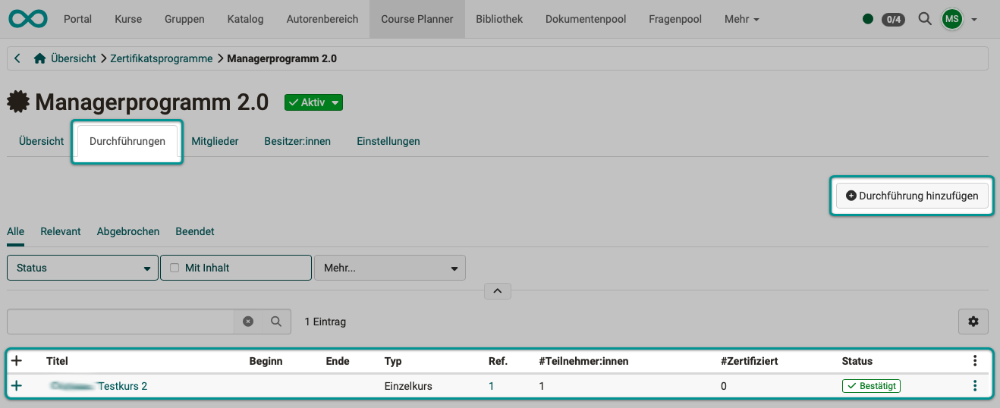
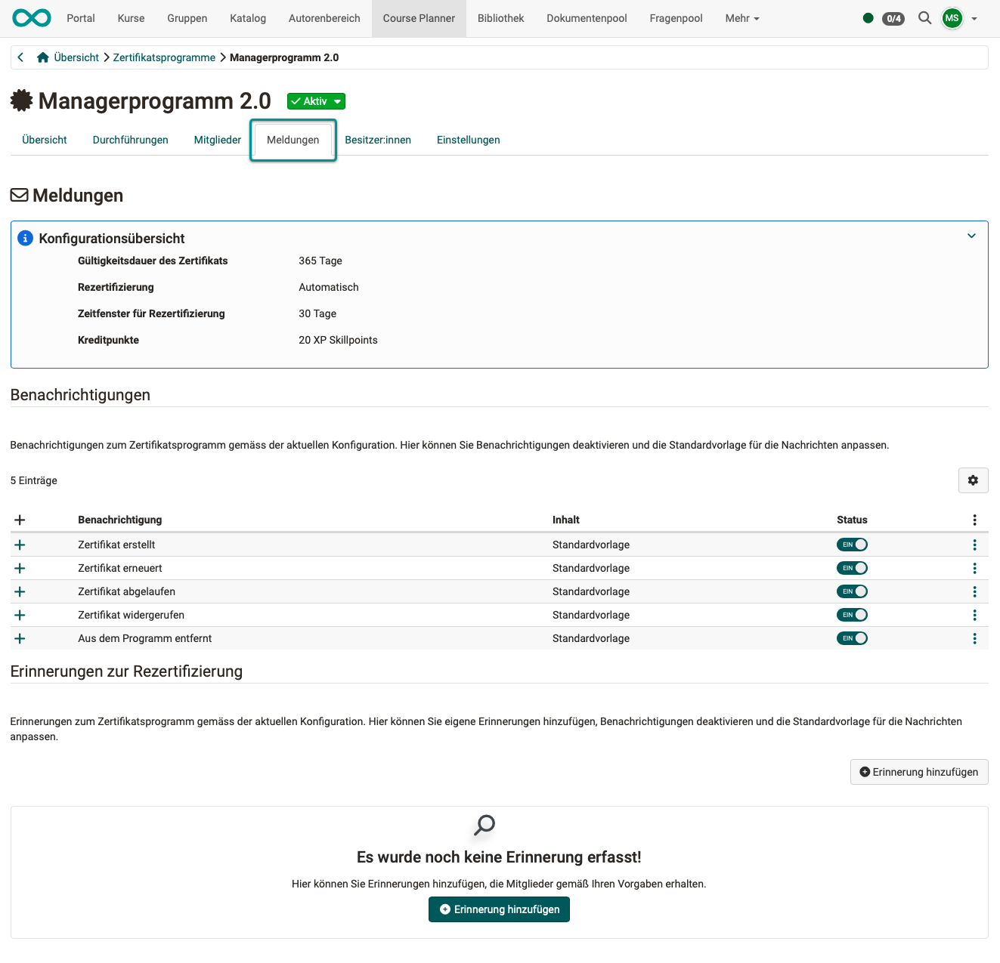

# Wie kann ich mit dem Course Planner Zertifikatsprogramme erstellen? {: #create_certification_programs}

??? abstract "Ziel und Inhalt dieser Anleitung"

    Die folgende Anleitung zeigt, wie Sie OpenOlat-Zertifikatsprogramme für verschiedene Zwecke erstellen.

??? abstract "Zielgruppe"

    [x] Autor:innen [x] Betreuer:innen  [ ] Teilnehmer:innen

    [ ] Anfänger:innen [x] Fortgeschrittene  [x] Expert:innen

??? abstract "Erwartete Vorkenntnisse"

    * Sie haben bereits Erfahrung als Autor:in.
    * Sie kennen sich mit dem Course Planner aus.

## Ein Beispiel zum Verständnis {: #example}

* Sie erwägen (in Präsenz oder online) die Teilnahme an einem **Kurs** "Spanisch Niveau A1".
* Der gleiche Kurs wird mehrfach **durchgeführt**, z.B. an verschiedenen Orten oder zu verschiedenen Zeiten.
* An den verschiedenen **Durchführungen** nehmen unterschiedliche Personen teil.
* Das gleiche **Zertifikat** "Niveau A1" kann an jedem dieser Orte und zu verschiedenen Zeiten erworben werden.

 

**Fall 1** 
In OpenOlat gibt es Kurse die nur **einmalig** durchgeführt werden: 
Verwendungszweck "Eigenständig" unter `Kurs > Administration > Einstellungen > Freigabe`

* Soll es doch eine zweite Durchführung geben, kann ein solcher Kurs im Autorenbereich kopiert werden. Dann müssen in der Kurskopie andere Mitglieder hinzugefügt werden.
* Die Mitglieder werden direkt dem Kurs hinzugefügt: `Kurs > Administration > Mitgliederverwaltung`
* Für das Bestehen dieses Kurses stellt OpenOlat ein Zertifikat aus. Eingerichtet wird es unter: `Kurs > Administration > Einstellungen > Bewertung`

 

**Fall 2** 
In OpenOlat können Kurse auch für die **mehrfache Verwendung** vorgesehen werden. 

* Der **Course Planner** ist das Tool um OpenOlat-Kurse mehrfach durchzuführen.
* Im Course Planner organisieren Sie mehrere **Durchführungen** eines Kurses (oder auch mehrerer Kurse im Course Bundle).
* Damit ein Kurs für mehrere Durchführungen verwendet werden kann, muss er dafür vorgesehen werden: Verwendungszweck "Verwendung im Course Planner" unter `Kurs > Administration > Einstellungen > Freigabe`
* Wichtig: In diesem Fall können die Mitglieder nicht mehr dem Kurs hinzugefügt werden, sondern müssen den Durchführungen zugeordnet werden. (Denn jede Durchführung hat andere Teilnehmende.)
* Auch in OpenOlat kann das gleiche Zertifikat ausgestellt werden, aber Ort und Zeit des Erwerbs können variieren. Besitzer:innen eines Zertifikatsprogramms können bestimmen, in welchen Durchführungen das Zertifikat erworben werden kann:  `Course Planner > Zertifikatsprogramme > "Programmtitel" > Tab "Durchführungen"`

[Zum Seitenanfang ^](#create_certification_programs)

---

##  Vorgehen {: #procedure}

### Schritt 1: Course Planner öffnen {: #step1}

Öffnen Sie in der Hauptnavigation den Course Planner und klicken Sie darin den Button "Zertifikatsprogramme".

{ class="shadow lightbox" title="Übersicht des Course Planner" }

[Zum Seitenanfang ^](#create_certification_programs)

---

### Schritt 2: Neues Zertifikatsprogramm erstellen {: #step2}

Erstellen Sie mit dem Button "Zertifikatsprogramm erstellen" rechts oben ein neues Zertifikatsprogramm.

{ class="shadow lightbox" title="Seite Zertifikatsprogramme im Course Planner" }

Beginnen Sie anschliessend mit der Einrichtung am besten hier: 
`Course Planner > Zertifikatsprogramme > "Programmtitel" > Tab "Einstellungen" > Konfiguration`

[Zum Seitenanfang ^](#create_certification_programs)

---

### Schritt 3: Gültigkeitsdauer {: #step3}

Wünschen Sie, dass das vergebene Zertifikat eine begrenzte Gültigkeitsdauer hat?

* Wenn nicht, kann der Toggle-Button "Gültigkeit" ausgeschaltet bleiben. 
(Das Zertifikat hat dann eine unbegrenzte Gültigkeit.)
* Soll die Gültigkeit begrenzt werden, aktivieren Sie den Toggle-Button. Geben Sie in diesem Fall dann die Gültigkeitsdauer in Tagen an.

{ class="shadow lightbox" title="Konfiguration im Tab Einstellungen eines Zertifikatsprogramms" }

[Zum Seitenanfang ^](#create_certification_programs)

---

### Schritt 4: Rezertifizierung? {: #step4}
Erst durch die Angabe einer Gültigkeitsdauer wird die Option zur Rezertifizierung auswählbar.

Wird die Rezertifizierung gewünscht, geben Sie ein Zeitfenster für die Rezertifizierung an. So wird festgelegt, wie lange die Teilnehmer:innen Zeit haben, ihr Zertifikat zu erneuern nachdem es abgelaufen ist.

{ class="shadow lightbox" title="Abschnitt Rezertifizierung in der Konfiguration eines Zertifikatsprogramms" }

[Zum Seitenanfang ^](#create_certification_programs)

---

### Schritt 5: Kreditpunkte für die Rezertifizierung? {: #step5}

Wenn die Rezertifizierung aktiviert wurde, kann mit einem weiteren Toggle-Button entschieden werden, ob Kreditpunkte für die Rezertifizierung erforderlich sind. Wird dies gewünscht, machen Sie anschliessend Angaben dazu,

* ob die Rezertifizierung automatisch oder manuell ausgelöst werden soll.
* welches Kreditpunktesystem verwendet werden soll.
* wieviele Kreditpunkte benötigt werden, um ein Zertifikat zu erlangen.
* ob eine vorzeitige Rezertifizierung durch die Teilnehmenden möglich ist. (Teilnehmer:innen können dann ihr Zertifikat vorzeitig erneuern, auch wenn das Zertifikat noch gültig ist.)

{ class="shadow lightbox" title="Kreditpunkte in der Konfiguration eines Zertifikatsprogramms" }

[Zum Seitenanfang ^](#create_certification_programs)

---

### Schritt 6: Zertifikat auswählen {: #step6}

Bestimmen Sie nun unter "Zertifikat", welches PDF-Zertifikat verschickt wird.
Wählen Sie die passende Vorlage: eine systemweite Vorlage ("System") oder eine eigene Datei ("Eigenes"). Mit "Vorschau" prüfen Sie das Zertifikat mit Beispieldaten, bevor Sie das erste ausstellen. In den Feldern "Optionale Variable 1" bis "Optionale Variable 3" hinterlegen Sie bei Bedarf Angaben, die auf jedem Zertifikat dieses Zertifikatsprogramms gleich sind.

{ class="shadow lightbox" title="Bereich Zertifikat im Tab Einstellungen eines Zertifikatsprogramms" }

[Zum Seitenanfang ^](#create_certification_programs)

---

### Schritt 7: Metadaten {: #step7}

In den Metadaten können Sie Titel und Kennzeichen des Programms angeben und mit "Administrative Freigabe" den administrativen Zugriff auf eine bestimmte Organisationseinheit eingrenzen.

{ class="shadow lightbox" title="Bereich Metadaten im Tab Einstellungen eines Zertifikatsprogramms" }

[Zum Seitenanfang ^](#create_certification_programs)

---

### Schritt 8: Durchführung hinzufügen {: #step8}

Bedingung für die Erlangung eines Zertifikates ist das erfolgreiche Absolvieren einer der hier aufgelisteten Durchführungen (ODER-Verknüpfung, es genügt eine der hier aufgelisteten Durchführungen).
Fügen Sie also im Tab "Durchführungen" mit dem Button "Durchführung hinzufügen" rechts oben mindestens eine Durchführung hinzu.

Falls Sie mehrere Durchführungen angeben möchten, beachten Sie: 
Ob es sich um mehrere Durchführungen des genau gleichen Produkts oder Kurses handelt, spielt keine Rolle. Deshalb ist die Auswahl mit Bedacht zu treffen um eine Gleichwertigkeit zu gewährleisten.

{ class="shadow lightbox" title="Tab Durchführungen eines Zertifikatsprogramms" }

[Zum Seitenanfang ^](#create_certification_programs)

---

### Schritt 9: Mitglieder und Besitzer:innen hinzufügen {: #step9}

Sobald alle Bedingungen und Eigenschaften des Zertifikats geklärt sind, können Sie im Tab "Mitglieder" die Personen bestimmen, die es erwerben sollen.

Soll eine weitere Person dieses Zertifikatsprogramm bearbeiten können, ergänzen Sie diese Person im Tab "Besitzer:innen".

[Zum Seitenanfang ^](#create_certification_programs)

---

### Schritt 10: Meldungen ergänzen {: #step10}

Ist geklärt, wie das Zertifikatsprogramm aufgebaut ist, können nach Bedarf automatische Benachrichtigungen eingerichtet werden. (Der Bedarf zeigt sich meist erst, wenn der Ablauf des Zertifikatsprogramms klar ist.)  
Für das Erstellen der Meldungen steht der Tab "Meldungen" zur Verfügung. 
Einige typische Meldungen sind vorbereitet und Sie können den Versand einfach aktivieren oder deaktivieren. Im unteren Teil können Sie mit "Erinnerung hinzufügen" eigene Erinnerungen einrichten.

{ class="shadow lightbox" title="Tab Meldungen eines Zertifikatsprogramms" }

[Zum Seitenanfang ^](#create_certification_programs)

---

## Anwendungsfall 1: Datenschutz-Zertifikate mit Kreditpunkten  {: #use_case_1}

* Im Unternehmen müssen Zertifikate regelmässig aktualisiert werden.
* Mit OpenOlat sammeln Mitarbeitende automatisch Kreditpunkte, wenn sie Schulungen absolvieren. 
* Wird eine bestimmte Punktzahl erreicht, verlängert sich das Zertifikat von selbst. 
* Es braucht kein manuelles Nachfassen durch die Betreuer:innen.

[Zum Seitenanfang ^](#create_certification_programs)

---

## Anwendungsfall 2: Ausbildungsprogramme mit automatischer Rezertifizierung  {: #use_case_2}

* In Ausbildungsinstitutionen sammeln Lernende über mehrere Module hinweg Punkte, die zu einem Abschlusszertifikat führen.
* Nach Ablauf dieses Zertifikats kann es automatisch oder manuell verlängert werden, sobald neue Punkte hinzukommen.
* Mit diesem System soll kontinuierliches Lernen angestossen werden.

[Zum Seitenanfang ^](#create_certification_programs)

---

## Anwendungsfall 3: Führungskräfteentwicklung mit flexiblen Lernpfaden  {: #use_case_3}

* Führungskräfte absolvieren verschiedene Lernmodule und sammeln dabei Skillpoints.
* Erreichen sie den Schwellenwert, verlängert sich ihr Zertifikat automatisch.
* Wenn gewünscht, kann die Verlängerung auch durch eine manuelle Freigabe erfolgen, damit die Kontrolle jederzeit bei der Institution bleibt.

[Zum Seitenanfang ^](#create_certification_programs)

---

## Weiterführende Informationen {: #further_information}

[Course Planner: Zertifikatsprogramme >](../../manual_user/area_modules/Course_Planner_Certification_Programs.de.md) 
[Course Planner: Durchführungen >](../../manual_user/area_modules/Course_Planner_Implementations.de.md) 
[Kurseinstellungen - Tab Bewertung: Zertifikate und Rezertifizierung >](../../manual_user/learningresources/Course_Settings_Assessment_Certificate.de.md) 
[Persönliche Erfolge/Leistungen: Zertifikate >](../../manual_user/personal_menu/Certificates.de.md) 
[Persönliche Erfolge/Leistungen: Kreditpunkte >](../../manual_user/personal_menu/Credit_Points.de.md) 
[e-Assessment Administration: Kreditpunkte >](../../manual_admin/administration/e-Assessment_Credit_Points.de.md)

[Zum Seitenanfang ^](#create_certification_programs)