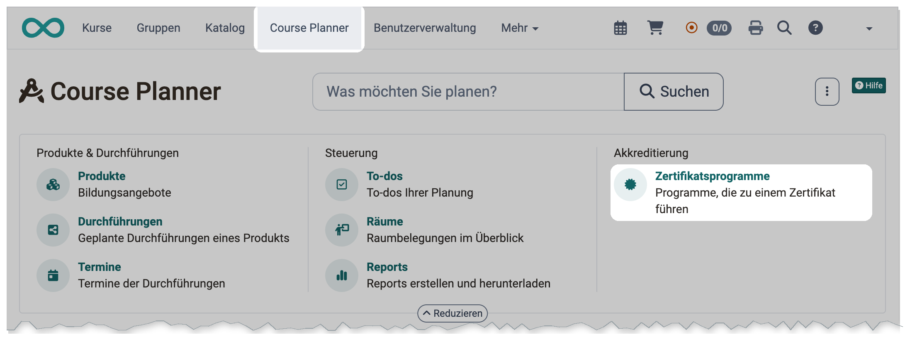
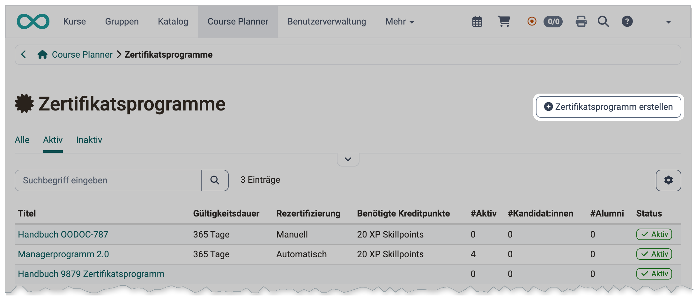
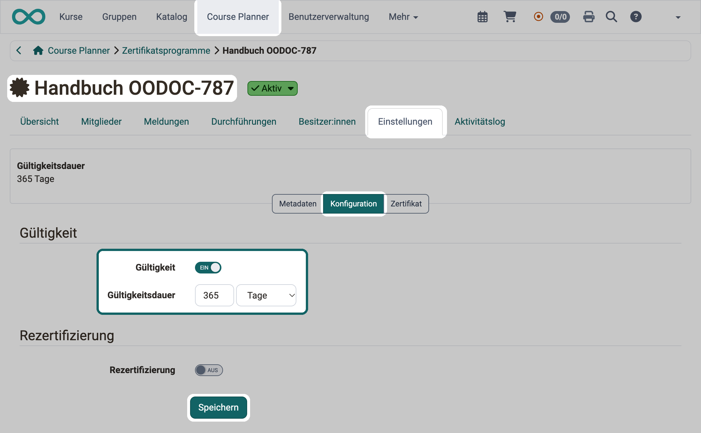
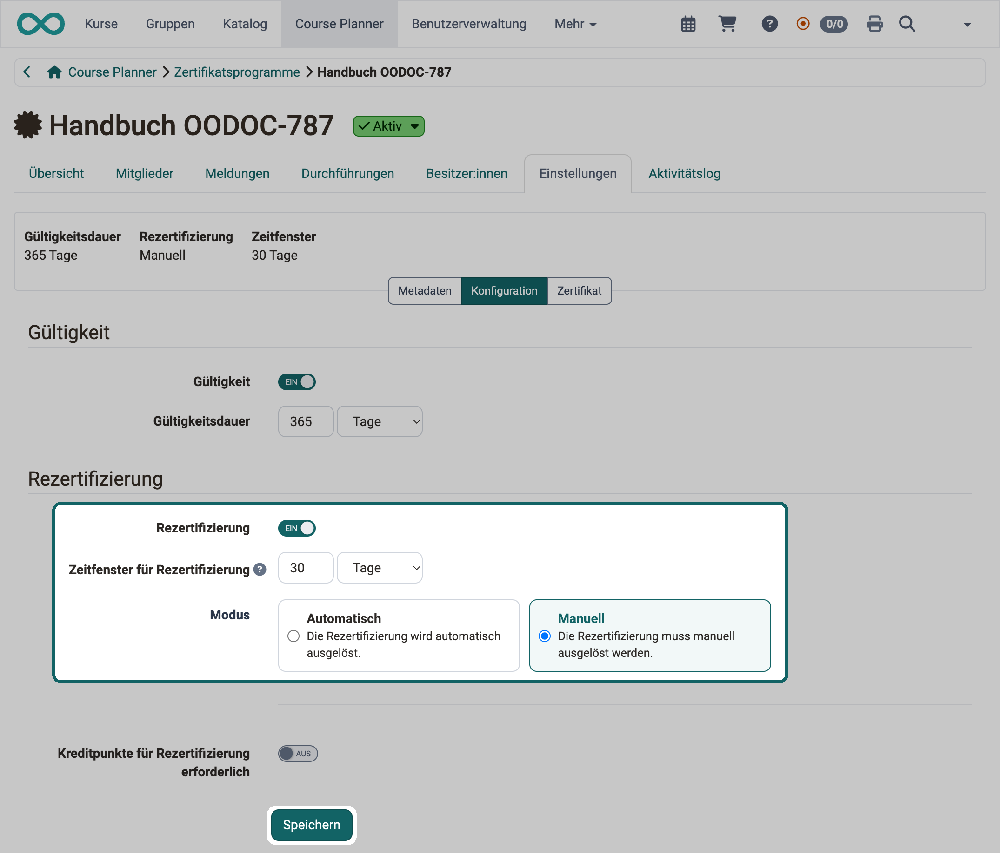
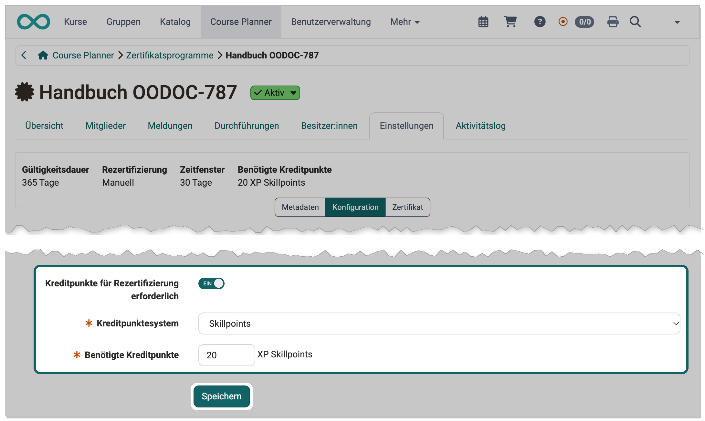
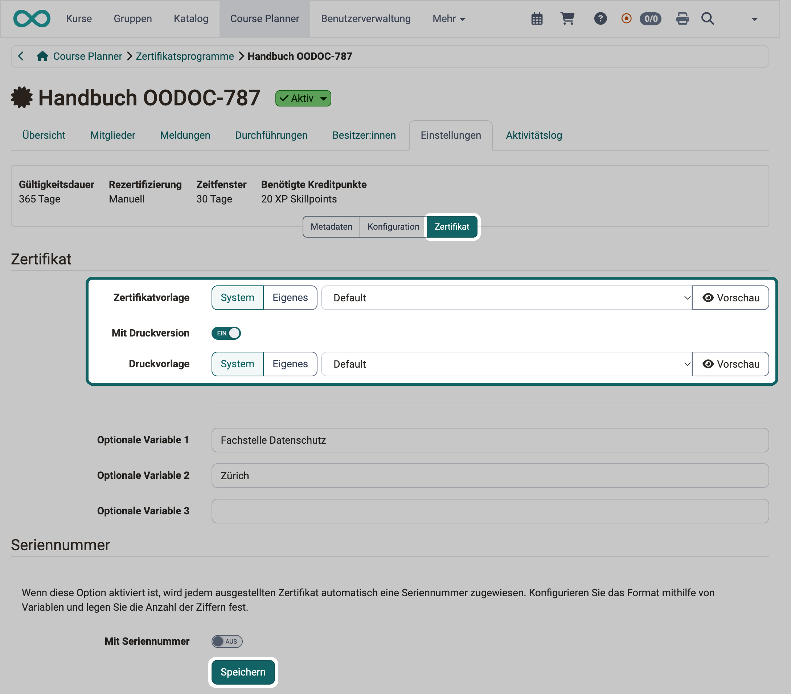
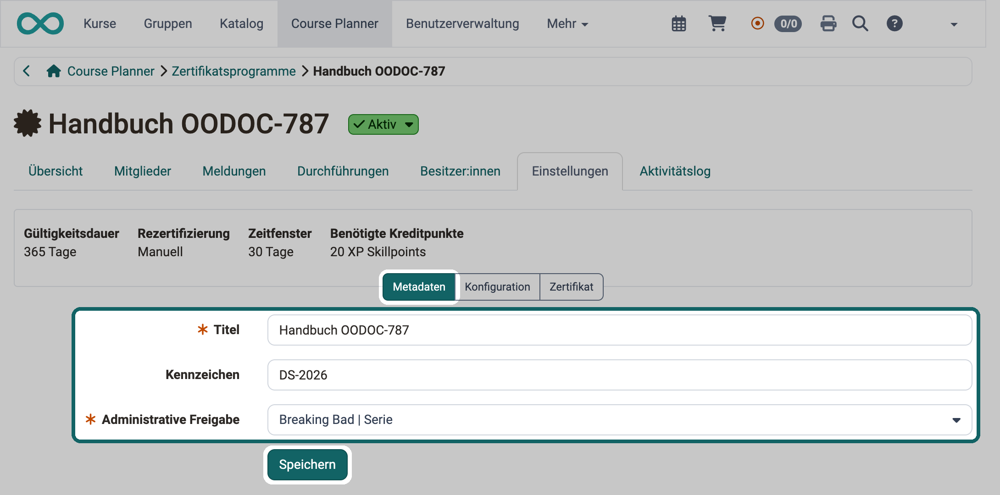
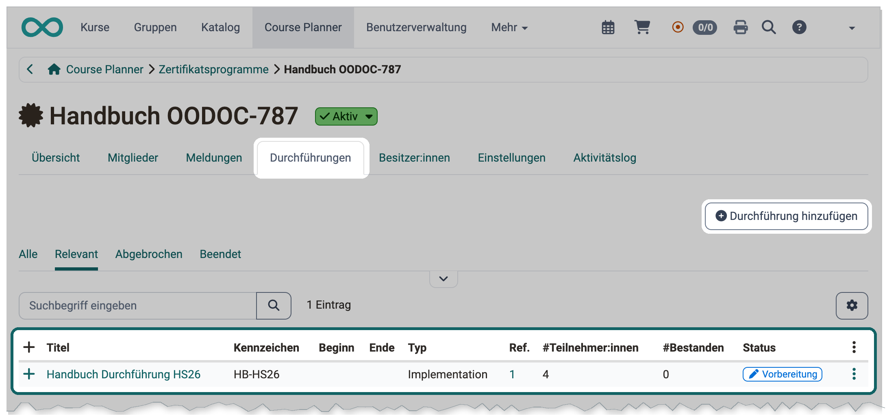
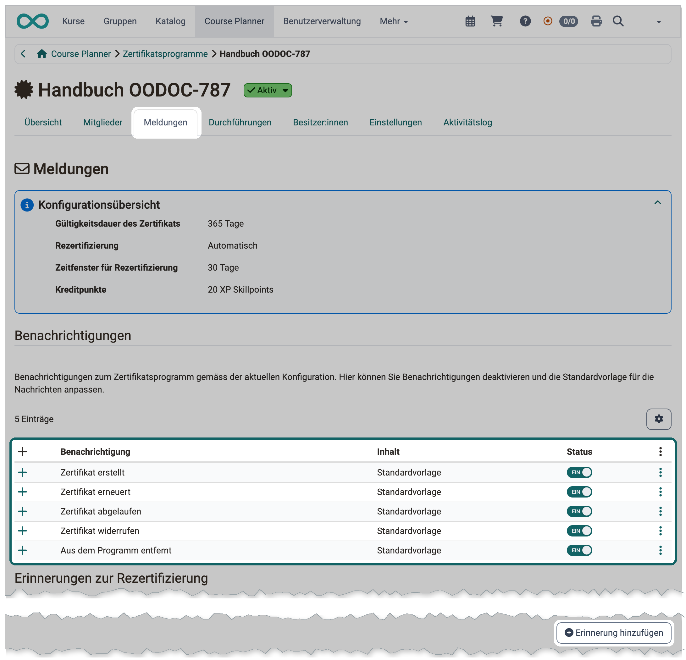

# Wie kann ich mit dem Course Planner Zertifikatsprogramme erstellen? {: #create_certification_programs}

??? abstract "Ziel und Inhalt dieser Anleitung"

    Die folgende Anleitung zeigt, wie Sie OpenOlat-Zertifikatsprogramme für verschiedene Zwecke erstellen.

??? abstract "Zielgruppe"

    [x] Autor:innen [x] Betreuer:innen  [ ] Teilnehmer:innen

    [ ] Anfänger:innen [x] Fortgeschrittene  [x] Expert:innen

??? abstract "Erwartete Vorkenntnisse"

    * Sie haben bereits Erfahrung als Autor:in.
    * Sie kennen sich mit dem Course Planner aus.

## Ein Beispiel zum Verständnis {: #example}

* Sie erwägen (in Präsenz oder online) die Teilnahme an einem **Kurs** "Spanisch Niveau A1".
* Der gleiche Kurs wird mehrfach **durchgeführt**, z.B. an verschiedenen Orten oder zu verschiedenen Zeiten.
* An den verschiedenen **Durchführungen** nehmen unterschiedliche Personen teil.
* Das gleiche **Zertifikat** "Niveau A1" kann an jedem dieser Orte und zu verschiedenen Zeiten erworben werden.

 

**Fall 1** 
In OpenOlat gibt es Kurse, die nur einmalig durchgeführt werden: 
Verwendungszweck "Eigenständig" unter `Kurs > Administration > Einstellungen > Freigabe`

* Soll es doch eine zweite Durchführung geben, kann ein solcher Kurs im Autorenbereich kopiert werden. Dann müssen in der Kurskopie andere Mitglieder hinzugefügt werden.
* Die Mitglieder werden direkt dem Kurs hinzugefügt: `Kurs > Administration > Mitgliederverwaltung`
* Für das Bestehen dieses Kurses stellt OpenOlat ein Zertifikat aus. Eingerichtet wird es unter: `Kurs > Administration > Einstellungen > Bewertung`

 

**Fall 2** 
In OpenOlat können Kurse auch für die **mehrfache Verwendung** vorgesehen werden. 

* Der Course Planner ist das Tool, um OpenOlat-Kurse mehrfach durchzuführen.
* Im Course Planner organisieren Sie mehrere **Durchführungen** eines Kurses (oder auch mehrerer Kurse im Course Bundle).
* Damit ein Kurs für mehrere Durchführungen verwendet werden kann, muss er dafür vorgesehen werden: Verwendungszweck "Verwendung im Course Planner" unter `Kurs > Administration > Einstellungen > Freigabe`
* Wichtig: In diesem Fall können die Mitglieder nicht mehr dem Kurs hinzugefügt werden, sondern müssen den Durchführungen zugeordnet werden. (Denn jede Durchführung hat andere Teilnehmende.)
* Auch in OpenOlat kann das gleiche Zertifikat ausgestellt werden, aber Ort und Zeit des Erwerbs können variieren. Besitzer:innen eines Zertifikatsprogramms können bestimmen, in welchen Durchführungen das Zertifikat erworben werden kann:  `Course Planner > Zertifikatsprogramme > "Programmtitel" > Tab "Durchführungen"`

[Zum Seitenanfang ^](#create_certification_programs)

---

## Vorgehen {: #procedure}

### Schritt 1: Course Planner öffnen {: #step1}

Öffnen Sie in der Hauptnavigation den Course Planner und klicken Sie in der Übersicht unter "Akkreditierung" auf "Zertifikatsprogramme".

{ class="shadow lightbox" title="Übersicht des Course Planner · 2026.11.18" }

[Zum Seitenanfang ^](#create_certification_programs)

---

### Schritt 2: Neues Zertifikatsprogramm erstellen {: #step2}

Erstellen Sie mit dem Button "Zertifikatsprogramm erstellen" rechts oben ein neues Zertifikatsprogramm. Den Button sehen Personen mit der Rolle Kursplaner:in, welche die Verwaltung des Course Planner übernimmt, und Administrator:innen. Besitzer:innen eines Zertifikatsprogramms finden ihr Programm in derselben Liste und bearbeiten es dort.

{ class="shadow lightbox" title="Seite Zertifikatsprogramme im Course Planner · 2026.11.18" }

Beginnen Sie anschliessend mit der Einrichtung am besten hier: 
`Course Planner > Zertifikatsprogramme > "Programmtitel" > Tab "Einstellungen" > Konfiguration`

[Zum Seitenanfang ^](#create_certification_programs)

---

### Schritt 3: Gültigkeitsdauer {: #step3}

Wünschen Sie, dass das vergebene Zertifikat eine begrenzte Gültigkeitsdauer hat?

* Wenn nicht, lassen Sie den Schalter "Gültigkeit" ausgeschaltet. Das Zertifikat gilt dann unbegrenzt.
* Soll die Gültigkeit begrenzt sein, schalten Sie "Gültigkeit" ein. Geben Sie unter "Gültigkeitsdauer" an, wie viele Tage, Wochen, Monate oder Jahre das Zertifikat gilt.

{ class="shadow lightbox" title="Konfiguration im Tab Einstellungen eines Zertifikatsprogramms · 2026.11.18" }

[Zum Seitenanfang ^](#create_certification_programs)

---

### Schritt 4: Rezertifizierung? {: #step4}

Soll ein abgelaufenes Zertifikat erneuert werden können, richten Sie im selben Bereich die Rezertifizierung ein: 
`Course Planner > Zertifikatsprogramme > "Programmtitel" > Tab "Einstellungen" > Konfiguration`

Den Schalter "Rezertifizierung" schalten Sie erst ein, wenn "Gültigkeit" eingeschaltet ist. Geben Sie danach unter "Zeitfenster für Rezertifizierung" an, wie lange die Teilnehmer:innen Zeit haben, ihr Zertifikat zu erneuern, nachdem es abgelaufen ist.

Wählen Sie unter "Modus", ob die Rezertifizierung automatisch ausgelöst wird ("Automatisch") oder manuell ausgelöst werden muss ("Manuell"). Voreingestellt ist "Manuell".

* **Automatisch**: OpenOlat erneuert das Zertifikat selbst, sobald es abgelaufen ist.
* **Manuell**: Besitzer:innen erneuern das Zertifikat im Tab "Mitglieder", oder die Person schliesst eine verknüpfte Durchführung erneut erfolgreich ab.

Weitere Einzelheiten zu beiden Modi beschreibt die Seite [Course Planner: Zertifikatsprogramme](../../manual_user/area_modules/Course_Planner_Certification_Programs.de.md#config_tab_settings).

{ class="shadow lightbox" title="Abschnitt Rezertifizierung in der Konfiguration eines Zertifikatsprogramms · 2026.11.18" }

[Zum Seitenanfang ^](#create_certification_programs)

---

### Schritt 5: Kreditpunkte für die Rezertifizierung? {: #step5}

Ist die Rezertifizierung eingeschaltet, legen Sie mit dem Schalter "Kreditpunkte für Rezertifizierung erforderlich" fest, ob eine Rezertifizierung Kreditpunkte kostet. Im Modus "Automatisch" ist dieser Schalter immer eingeschaltet, denn die automatische Rezertifizierung braucht Kreditpunkte. Ist der Schalter eingeschaltet, geben Sie an,

* in welchem "Kreditpunktesystem" die Kreditpunkte gezählt werden.
* wie viele Kreditpunkte eine Rezertifizierung kostet ("Benötigte Kreditpunkte").

Bei jeder Rezertifizierung zieht OpenOlat diese Kreditpunkte vom Kreditpunkteguthaben der Person ab, also von den Kreditpunkten, die sie in diesem Kreditpunktesystem gesammelt hat. Das Kreditpunktesystem selbst legt die System-Administration an, siehe [e-Assessment Administration: Kreditpunkte](../../manual_admin/administration/e-Assessment_Credit_Points.de.md).

{ class="shadow lightbox" title="Kreditpunkte in der Konfiguration eines Zertifikatsprogramms · 2026.11.18" }

[Zum Seitenanfang ^](#create_certification_programs)

---

### Schritt 6: Zertifikat auswählen {: #step6}

Bestimmen Sie nun, welches PDF-Zertifikat OpenOlat ausstellt: 
`Course Planner > Zertifikatsprogramme > "Programmtitel" > Tab "Einstellungen" > Zertifikat`

Wählen Sie unter "Zertifikatvorlage" die passende Vorlage: eine systemweite Vorlage ("System") oder eine eigene Datei ("Eigenes"), die Sie hochladen. Mit "Vorschau" prüfen Sie das Zertifikat mit Beispieldaten, bevor Sie das erste ausstellen. Eine eigene Vorlage ist eine HTML-Vorlage als ZIP-Datei mit der Datei "index.html" oder ein PDF-Formular; Aufbau und Variablen beschreibt die Seite [Kurseinstellungen - Tab Bewertung: Zertifikate und Rezertifizierung](../../manual_user/learningresources/Course_Settings_Assessment_Certificate.de.md#certificate_template).

Druckt Ihre Organisation Zertifikate auf vorgedrucktes Papier, schalten Sie "Mit Druckversion" ein. Unter "Druckvorlage" wählen Sie dann eine zweite Vorlage ohne die vorgedruckten Elemente, ebenfalls als "System" oder "Eigenes". Im Tab "Mitglieder" steht danach "Druckzertifikat exportieren" bereit. Die Teilnehmenden erhalten weiterhin nur das Zertifikat aus der Zertifikatvorlage.

In den Feldern "Optionale Variable 1" bis "Optionale Variable 3" hinterlegen Sie bei Bedarf Angaben, die auf jedem Zertifikat dieses Zertifikatsprogramms gleich sind. Mit "Mit Seriennummer" erhält jedes ausgestellte Zertifikat automatisch eine Seriennummer.

{ class="shadow lightbox" title="Bereich Zertifikat im Tab Einstellungen eines Zertifikatsprogramms · 2026.11.18" }

[Zum Seitenanfang ^](#create_certification_programs)

---

### Schritt 7: Metadaten {: #step7}

In den Metadaten geben Sie den Titel des Programms an und unter "Kennzeichen" eine eigene Kennung, nach der Sie in der Liste der Zertifikatsprogramme suchen können und die in den vorbereiteten Meldungen erscheint. Mit "Administrative Freigabe" bestimmen Sie die Organisationen, deren Administrator:innen und Kursplaner:innen das Programm verwalten dürfen.

{ class="shadow lightbox" title="Bereich Metadaten im Tab Einstellungen eines Zertifikatsprogramms · 2026.11.18" }

[Zum Seitenanfang ^](#create_certification_programs)

---

### Schritt 8: Durchführung hinzufügen {: #step8}

Bedingung für die Erlangung eines Zertifikates ist das erfolgreiche Absolvieren einer der hier aufgelisteten Durchführungen (ODER-Verknüpfung, es genügt eine der hier aufgelisteten Durchführungen). OpenOlat misst den Erfolg am Kurs: Hat eine Person einen Kurs dieser Durchführung bestanden, gilt die Durchführung als erfolgreich absolviert.
Fügen Sie also im Tab "Durchführungen" mit dem Button "Durchführung hinzufügen" rechts oben mindestens eine Durchführung hinzu.

Falls Sie mehrere Durchführungen angeben möchten, beachten Sie: 
Ob es sich um mehrere Durchführungen des genau gleichen Produkts oder Kurses handelt, spielt für OpenOlat keine Rolle: Jede aufgelistete Durchführung führt zum selben Zertifikat. Wählen Sie die Durchführungen deshalb mit Bedacht, damit sie gleichwertig sind.

{ class="shadow lightbox" title="Tab Durchführungen eines Zertifikatsprogramms · 2026.11.18" }

[Zum Seitenanfang ^](#create_certification_programs)

---

### Schritt 9: Mitglieder und Besitzer:innen hinzufügen {: #step9}

Sobald alle Bedingungen und Eigenschaften des Zertifikats geklärt sind, können Sie im Tab "Mitglieder" die Personen bestimmen, die es erwerben sollen. Teilnehmende einer verknüpften Durchführung erscheinen dort unter "Kandidat:innen", bis sie ihr erstes Zertifikat erhalten. Weitere Personen nehmen Sie mit "Neue Person zertifizieren" auf.

Soll eine weitere Person dieses Zertifikatsprogramm bearbeiten können, ergänzen Sie diese Person im Tab "Besitzer:innen".

Wer im Zertifikatsprogramm wann etwas geändert hat, zeigt später der Tab "Aktivitätslog", beschrieben auf der Seite [Course Planner: Zertifikatsprogramme](../../manual_user/area_modules/Course_Planner_Certification_Programs.de.md#config_tab_activitylog).

[Zum Seitenanfang ^](#create_certification_programs)

---

### Schritt 10: Meldungen ergänzen {: #step10}

Ist geklärt, wie das Zertifikatsprogramm aufgebaut ist, richten Sie nach Bedarf automatische Benachrichtigungen ein. Der Bedarf zeigt sich meist erst, wenn der Ablauf des Zertifikatsprogramms klar ist. Dafür steht der Tab "Meldungen" zur Verfügung.

Oben fasst die "Konfigurationsübersicht" zusammen, was Sie in den Schritten 3 bis 5 eingestellt haben. Danach richten sich die vorbereiteten Meldungen unter "Benachrichtigungen": "Zertifikat erstellt", "Zertifikat widerrufen" und "Aus dem Programm entfernt" stehen immer bereit, "Zertifikat abgelaufen" mit einer Gültigkeit und "Zertifikat erneuert" mit einer Rezertifizierung. Den Versand jeder Meldung schalten Sie ein oder aus. Unter "Erinnerungen zur Rezertifizierung" richten Sie mit "Erinnerung hinzufügen" eigene Erinnerungen ein.

{ class="shadow lightbox" title="Tab Meldungen eines Zertifikatsprogramms · 2026.11.18" }

[Zum Seitenanfang ^](#create_certification_programs)

---

## Anwendungsfall 1: Datenschutz-Zertifikate mit Kreditpunkten  {: #use_case_1}

* Im Unternehmen müssen Zertifikate regelmässig aktualisiert werden.
* Mit OpenOlat sammeln Mitarbeitende automatisch Kreditpunkte, wenn sie Schulungen absolvieren. 
* Wird eine bestimmte Punktzahl erreicht, verlängert sich das Zertifikat von selbst. 
* Es braucht kein manuelles Nachfassen durch die Betreuer:innen.

[Zum Seitenanfang ^](#create_certification_programs)

---

## Anwendungsfall 2: Ausbildungsprogramme mit automatischer Rezertifizierung  {: #use_case_2}

* In Ausbildungsprogrammen sammeln Lernende über mehrere Module hinweg Punkte, die zu einem Abschlusszertifikat führen.
* Nach Ablauf dieses Zertifikats kann es automatisch oder manuell verlängert werden, sobald neue Punkte hinzukommen.
* Mit diesem System soll kontinuierliches Lernen angestossen werden.

[Zum Seitenanfang ^](#create_certification_programs)

---

## Anwendungsfall 3: Führungskräfteentwicklung mit flexiblen Lernpfaden  {: #use_case_3}

* Führungskräfte absolvieren verschiedene Lernmodule und sammeln dabei Skillpoints.
* Erreichen sie den Schwellenwert, verlängert sich ihr Zertifikat automatisch.
* Wenn gewünscht, verlängern Besitzer:innen des Zertifikatsprogramms das Zertifikat stattdessen von Hand (Modus "Manuell"), damit die Kontrolle jederzeit bei der Organisation bleibt.

[Zum Seitenanfang ^](#create_certification_programs)

---

## Weiterführende Informationen {: #further_information}

[Course Planner: Zertifikatsprogramme >](../../manual_user/area_modules/Course_Planner_Certification_Programs.de.md) 
[Course Planner: Durchführungen >](../../manual_user/area_modules/Course_Planner_Implementations.de.md) 
[Kurseinstellungen - Tab Bewertung: Zertifikate und Rezertifizierung >](../../manual_user/learningresources/Course_Settings_Assessment_Certificate.de.md) 
[Persönliche Erfolge/Leistungen: Zertifikate >](../../manual_user/personal_menu/Certificates.de.md) 
[Persönliche Erfolge/Leistungen: Kreditpunkte >](../../manual_user/personal_menu/Credit_Points.de.md) 
[e-Assessment Administration: Kreditpunkte >](../../manual_admin/administration/e-Assessment_Credit_Points.de.md)

[Zum Seitenanfang ^](#create_certification_programs)