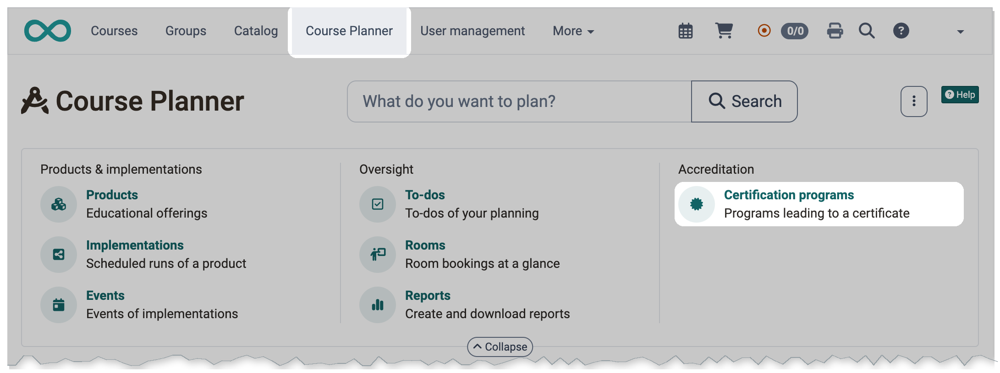
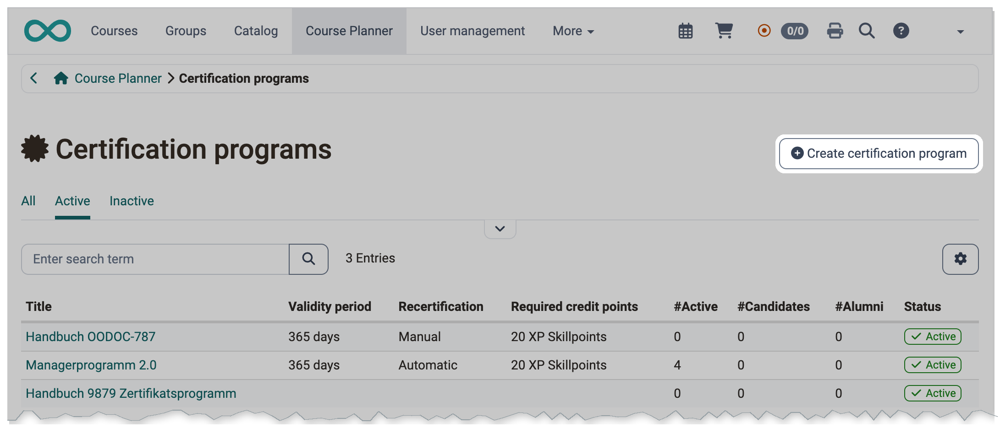
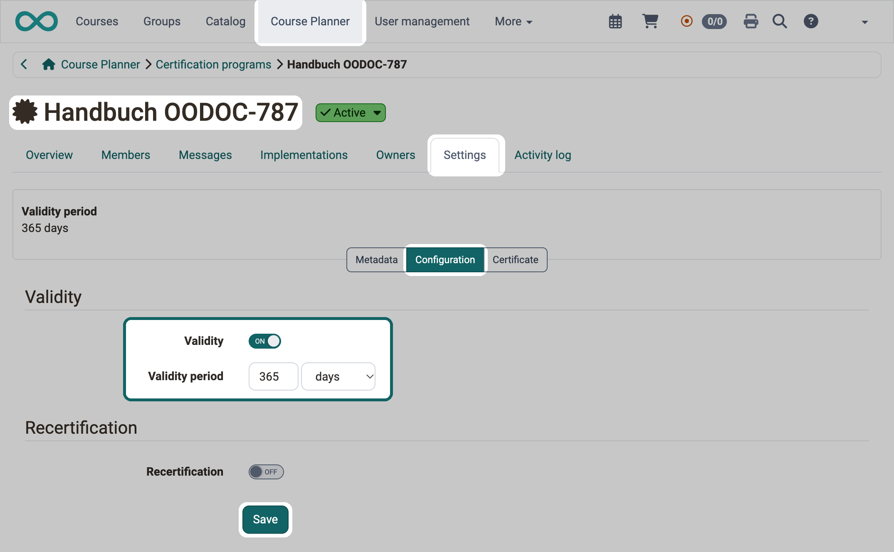
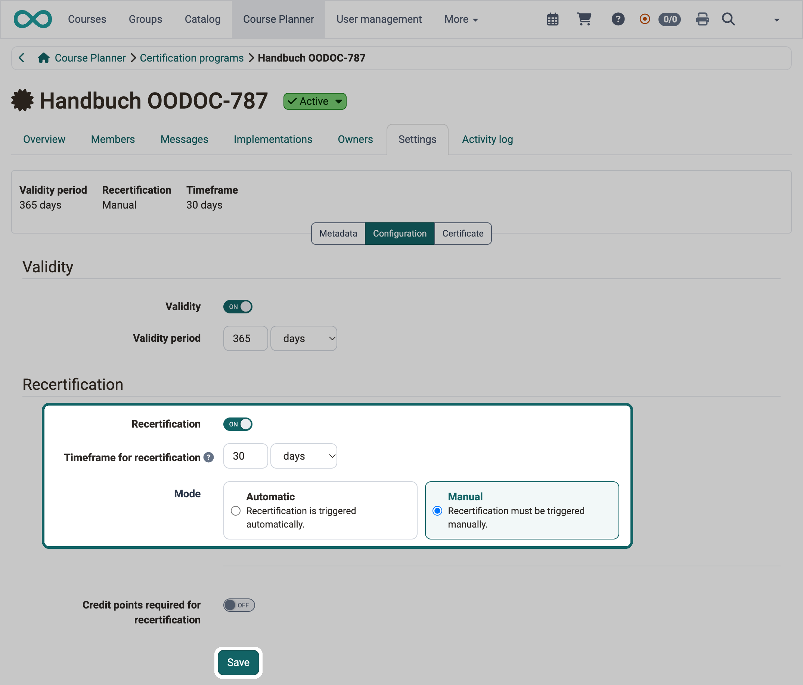
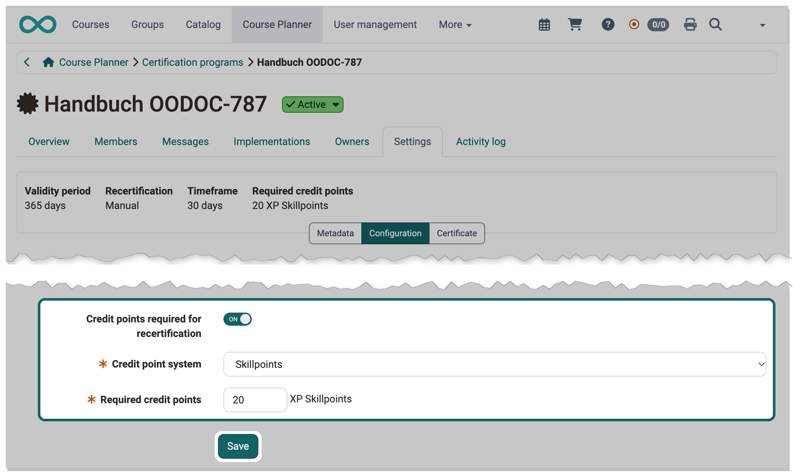
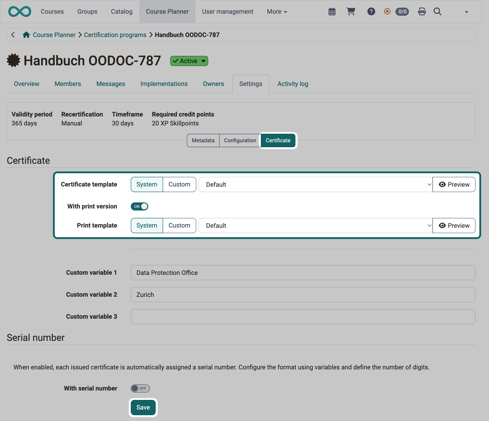
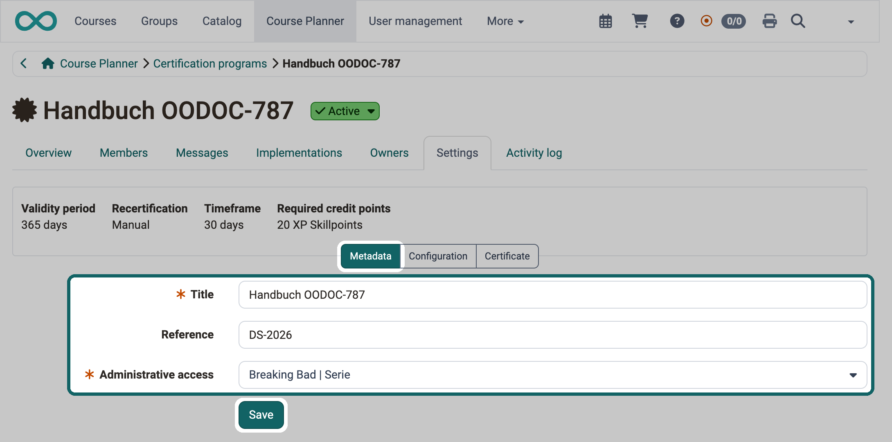
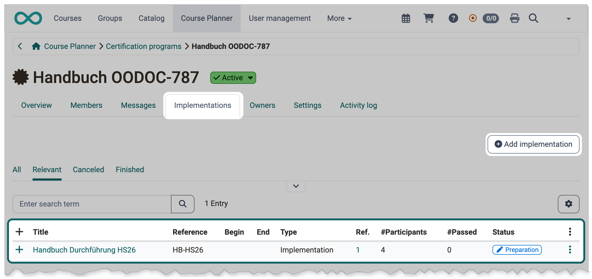
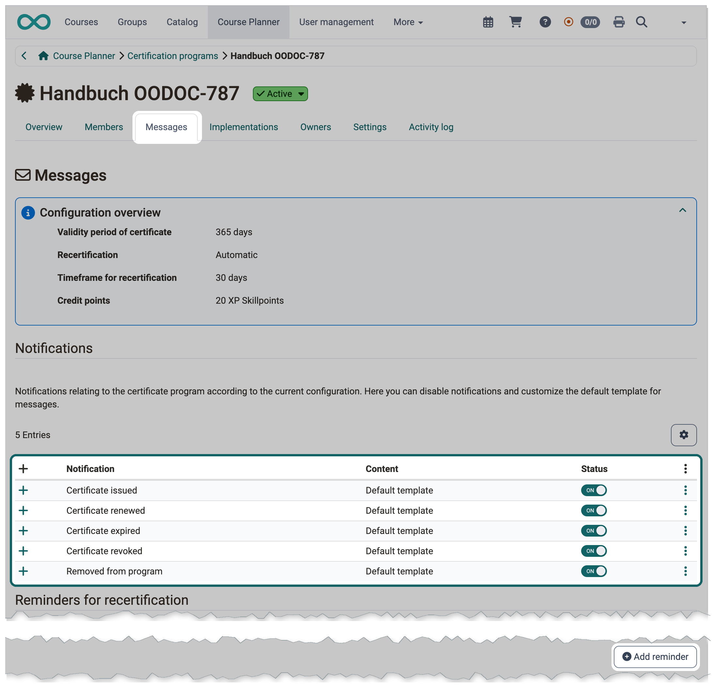

# How can I create certification programs with the Course Planner? {: #create_certification_programs}

??? abstract "Objectives and content of this instruction"

    The following instruction shows how to create OpenOlat certification programs for different purposes.

??? abstract "Target group"

    [ ] Authors [ ] Coaches  [ ] Participants  [x] Course planners

    [ ] Beginners [x] Advanced users  [x] Experts

??? abstract "Expected previous knowledge"

    * You already have experience as an author.
    * You are familiar with the Course Planner.

## An example for better understanding {: #example}

* You are considering taking part (in person or online) in a course "Spanish level A1".
* The same course is implemented several times, e.g. at different locations or at different times.
* Different people take part in the different implementations.
* The same certificate "Level A1" can be acquired at each of these locations and at different times.

 

**Case 1** 
In OpenOlat, there are courses that are implemented only once: 
Usage "Standalone" under `Course > Administration > Settings > Share`

* If a second implementation is needed after all, copy such a course in Authoring and add the new members to the course copy.
* You add the members directly to the course: `Course > Administration > Members management`
* For passing this course, OpenOlat can issue a certificate, without any certification program. You set it up in the course under: `Course > Administration > Settings > Assessment`

 

**Case 2** 
In OpenOlat, courses can also be intended for multiple use.

* The Course Planner is the tool for implementing OpenOlat courses several times.
* In the Course Planner, you organize several implementations of a course (or of several courses in a course bundle, an implementation with several courses).
* For a course to be used for several implementations, it must be intended for this: Usage "Use in Course Planner" under `Course > Administration > Settings > Share`
* Important: In this case, you no longer add participants and coaches to the course, but assign them to the implementations, because each implementation has different participants. Directly in the course, you only add owners.
* In OpenOlat, too, the same certificate can be issued, but the place and time of acquisition can vary. Owners of a certification program can determine in which implementations the certificate can be acquired:  `Course Planner > Certification programs > "Program title" > Tab "Implementations"`

[To the top of the page ^](#create_certification_programs)

---

## Procedure {: #procedure}

### Step 1: Open the Course Planner {: #step1}

Open the Course Planner in the main navigation and then click on "Certification programs" under "Accreditation" in the overview.

{ class="shadow lightbox" title="Course Planner overview · 2026.11.18" }

[To the top of the page ^](#create_certification_programs)

---

### Step 2: Create a new certification program {: #step2}

Create a new certification program with the "Create certification program" button at the top right. In the dialog, enter the "Title", if needed a "Reference" and, if your instance works with organizations, the "Administrative access" (step 7 explains both). Then click "Create". Whoever creates the program is then an owner of the program. Persons with the role Course planner, which manages the Course Planner, and administrators see this button. Owners of a certification program find their program in the same list and edit it there.

{ class="shadow lightbox" title="Certification programs page in the Course Planner · 2026.11.18" }

Then start with the setup, preferably here: 
`Course Planner > Certification programs > "Program title" > Tab "Settings" > Configuration`

The three sections "Metadata", "Configuration" and "Certificate" each have their own "Save" button, with which you apply the information of that section.

[To the top of the page ^](#create_certification_programs)

---

### Step 3: Period of validity {: #step3}

Would you like the issued certificate to have a limited period of validity?

* If not, leave the "Validity" switch off. The certificate is then valid indefinitely.
* If the validity is to be limited, switch on "Validity". Under "Validity period", specify how many days, weeks, months or years the certificate is valid.

{ class="shadow lightbox" title="Configuration in the Settings tab of a certification program · 2026.11.18" }

[To the top of the page ^](#create_certification_programs)

---

### Step 4: Recertification? {: #step4}

If an expired certificate is to be renewable, set up the recertification in the same area: 
`Course Planner > Certification programs > "Program title" > Tab "Settings" > Configuration`

You can only switch on the "Recertification" switch once "Validity" is switched on. Then specify under "Timeframe for recertification" how long participants have to renew their certificate after it has expired.

Under "Mode", select whether the recertification is triggered automatically ("Automatic") or must be triggered manually ("Manual"). The default is "Manual".

* **Automatic**: OpenOlat renews the certificate itself as soon as it has expired and the person's credit point balance is sufficient (step 5).
* **Manual**: Owners renew the certificate in the "Members" tab in the person's row with "Renew certificate".

In both modes, owners can also renew a certificate by hand, and whoever successfully completes a linked implementation again receives a new certificate.

Further details on both modes are described on the page [Course Planner: Certification programs](../../manual_user/area_modules/Course_Planner_Certification_Programs.md#config_tab_settings).

{ class="shadow lightbox" title="Recertification section in the configuration of a certification program · 2026.11.18" }

[To the top of the page ^](#create_certification_programs)

---

### Step 5: Credit points for recertification? {: #step5}

If recertification is switched on, use the switch "Credit points required for recertification" to determine whether a recertification costs credit points. In the "Automatic" mode, this switch is always on, because the automatic recertification needs credit points. If the switch is on, specify

* in which "Credit point system" the credit points are counted.
* how many credit points a recertification costs ("Required credit points").

If OpenOlat renews a certificate in the "Automatic" mode or owners renew it with "Renew certificate", OpenOlat deducts these credit points from the person's credit point balance, that is, from the credit points the person has collected in this credit point system. If the balance is not sufficient, OpenOlat does not renew the certificate. The first certificate costs no credit points, and whoever successfully completes a linked implementation again also receives the new certificate without a deduction. The credit point system itself is created in the system administration, see [e-Assessment Administration: Credit points](../../manual_admin/administration/e-Assessment_Credit_Points.md).

{ class="shadow lightbox" title="Credit points in the configuration of a certification program · 2026.11.18" }

[To the top of the page ^](#create_certification_programs)

---

### Step 6: Select certificate {: #step6}

Now specify which PDF certificate OpenOlat issues: 
`Course Planner > Certification programs > "Program title" > Tab "Settings" > Certificate`

Under "Certificate template", select the appropriate template: a system-wide template ("System") or your own file ("Custom") that you upload. With "Preview" you check the certificate with sample data before you issue the first one. Your own template is an HTML template as a ZIP file with the file "index.html" or a PDF form; the page [Course Settings - Tab Assessment: Certificates and recertification](../../manual_user/learningresources/Course_Settings_Assessment_Certificate.md#certificate_template) describes its structure and variables.

If your organization prints certificates on pre-printed paper, switch on "With print version". Under "Print template", you then select a second template without the pre-printed elements, also as "System" or "Custom". In the "Members" tab, "Export print certificate" is then available. Participants still receive only the certificate from the certificate template.

In the fields "Custom variable 1" to "Custom variable 3" you enter, if needed, information that is the same on every certificate of this certification program. On the certificate, it appears where the template contains the variables `$custom1` to `$custom3`. With "With serial number", each issued certificate automatically receives a serial number.

{ class="shadow lightbox" title="Certificate section in the Settings tab of a certification program · 2026.11.18" }

[To the top of the page ^](#create_certification_programs)

---

### Step 7: Metadata {: #step7}

In the metadata, you enter the title of the program and, under "Reference", your own identifier, which you can search for in the list of certification programs and which appears in the prepared messages (step 10). With "Administrative access" you determine the organizations whose administrators and course planners may manage the program. Owners edit the program regardless of this access.

{ class="shadow lightbox" title="Metadata section in the Settings tab of a certification program · 2026.11.18" }

[To the top of the page ^](#create_certification_programs)

---

### Step 8: Add implementation {: #step8}

The condition for obtaining a certificate is the successful completion of one of the implementations listed in the "Implementations" tab (OR link, one of them is sufficient). OpenOlat measures success by the course: once a person has passed a course of this implementation, the implementation counts as successfully completed. If several courses are assigned directly to the implementation (course bundle), one of them is sufficient.

So add at least one implementation in the "Implementations" tab with the "Add implementation" button at the top right. The implementation must already exist in the Course Planner, and its course must assess passing. You set this in the course under: `Course > Administration > Settings > Assessment`

If you wish to specify multiple implementations, please note: 
For OpenOlat, it does not matter whether there are several implementations of exactly the same product or course: each listed implementation leads to the same certificate. Therefore, select the implementations carefully so that they are equivalent.

{ class="shadow lightbox" title="Implementations tab of a certification program · 2026.11.18" }

[To the top of the page ^](#create_certification_programs)

---

### Step 9: Add members and owners {: #step9}

Once all the conditions and properties of the certificate have been clarified, you see in the "Members" tab who acquires the certificate. Participants of a linked implementation appear there under "Candidates" until they receive their first certificate. With "Certify new users", you issue a certificate directly to a further person without them completing an implementation.

If you want another person to be able to edit this certification program, add that person in the "Owners" tab.

Who changed what in the certification program and when is shown later in the "Activity log" tab, described on the page [Course Planner: Certification programs](../../manual_user/area_modules/Course_Planner_Certification_Programs.md#config_tab_activitylog).

[To the top of the page ^](#create_certification_programs)

---

### Step 10: Add messages {: #step10}

Once the structure of the certification program is clear, set up automatic notifications as needed. The need usually only becomes apparent once the process of the certification program is clear. The "Messages" tab is available for this.

At the top, the "Configuration overview" summarizes what you set in steps 3 to 5. The prepared messages under "Notifications" depend on these settings: "Certificate issued", "Certificate revoked" and "Removed from program" are always available, "Certificate expired" with a validity and "Certificate renewed" with a recertification. You switch the sending of each message on or off. Under "Reminders for recertification", you set up your own reminders with "Add reminder". They are sent to the members, either before the certificate expires ("Upcoming") or before the recertification period expires ("Overdue").

{ class="shadow lightbox" title="Messages tab of a certification program · 2026.11.18" }

[To the top of the page ^](#create_certification_programs)

---

## Use case 1: Data protection certificates with credit points  {: #use_case_1}

* Certificates must be updated regularly within the company.
* With OpenOlat, associates automatically earn credit points when they complete training courses.
* If they have collected enough credit points when the certificate expires, the certificate is renewed automatically ("Automatic" mode).
* No manual follow-up by the owners of the certification program is required.

[To the top of the page ^](#create_certification_programs)

---

## Use case 2: Training programs with automatic recertification {: #use_case_2}

* In training programs, learners receive a certificate of completion as soon as they pass an implementation.
* After that, they collect credit points in further courses. When the certificate expires, OpenOlat renews it in the "Automatic" mode as soon as enough credit points are available, as long as the timeframe for recertification is running.
* This system is designed to encourage continuous learning.

[To the top of the page ^](#create_certification_programs)

---

## Use case 3: Leadership development with various courses  {: #use_case_3}

* Managers complete various courses and collect credit points in the process, for example in a credit point system "Skillpoints".
* If they have collected enough credit points when the certificate expires, their certificate is renewed automatically.
* If desired, owners of the certification program renew the certificate by hand instead ("Manual" mode), so that the organization retains control at all times.

[To the top of the page ^](#create_certification_programs)

---

## Further information {: #further_information}

[Course Planner: Certification programs >](../../manual_user/area_modules/Course_Planner_Certification_Programs.md) 
[e-Assessment Administration: Credit points >](../../manual_admin/administration/e-Assessment_Credit_Points.md) 
[Course Settings - Tab Assessment: Certificates and recertification >](../../manual_user/learningresources/Course_Settings_Assessment_Certificate.md) 
[Course Planner: Implementations >](../../manual_user/area_modules/Course_Planner_Implementations.md) 
[Personal achievements/successes: Certificates >](../../manual_user/personal_menu/Certificates.md) 
[Personal achievements/successes: Credit points >](../../manual_user/personal_menu/Credit_Points.md)

[To the top of the page ^](#create_certification_programs)
