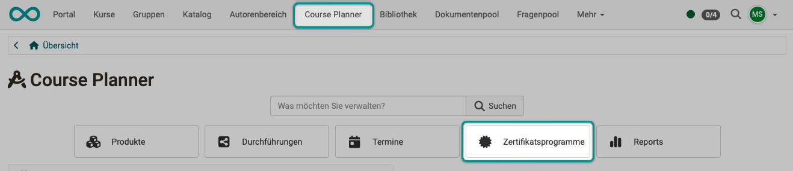
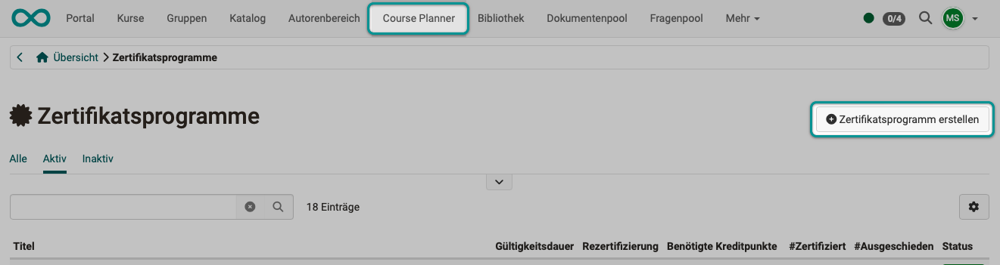
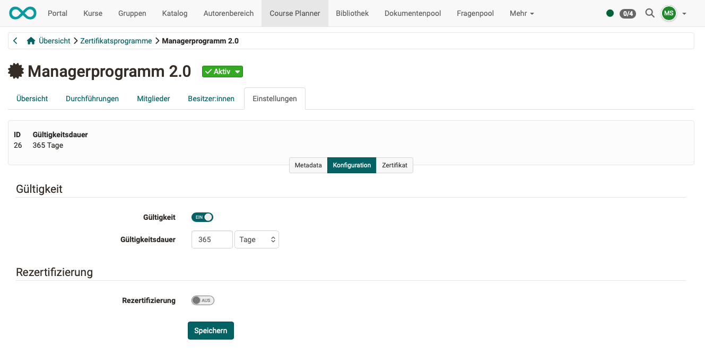
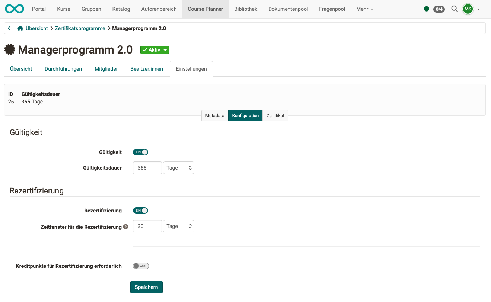
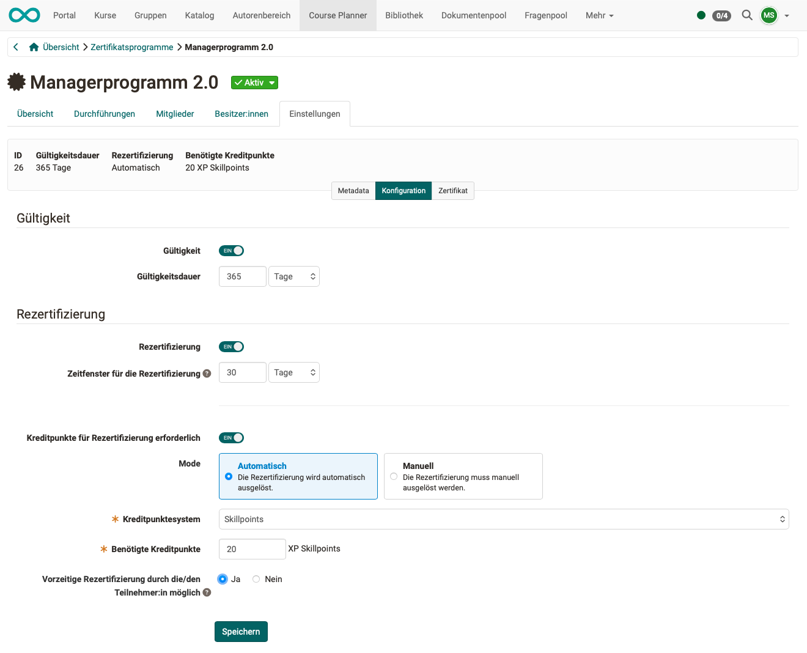
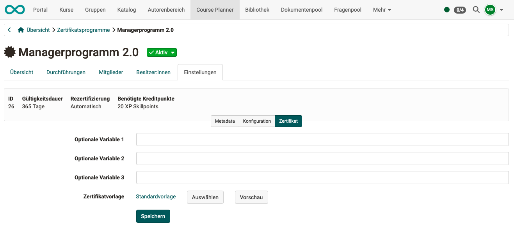
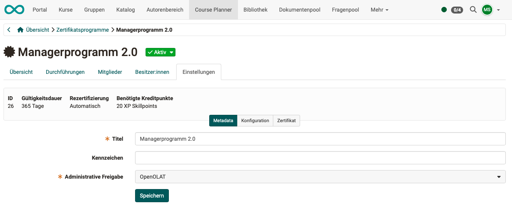
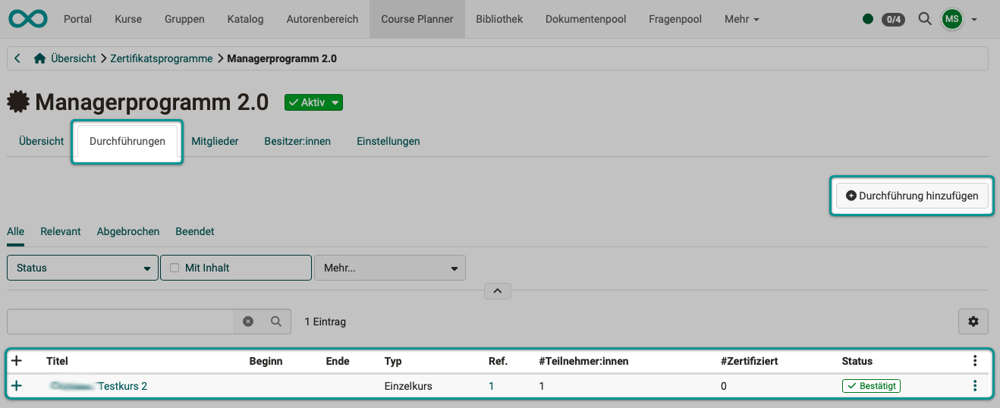
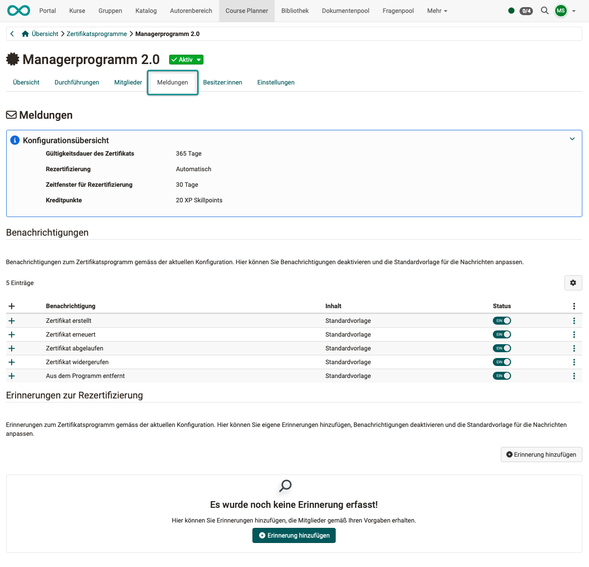

# How can I create certification programs with the Course Planner? {: #create_certification_programs}

??? abstract "Objectives and content of this instruction"

    The following instruction shows how to create OpenOlat certification programs for different purposes.

??? abstract "Target group"

    [x] Authors [x] Coaches  [ ] Participants

    [ ] Beginners [x] Advanced users  [x] Experts

??? abstract "Expected previous knowledge"

    * You already have experience as an author.
    * You are familiar with the Course Planner.

## An example for better understanding {: #example}

* You are considering taking part (in person or online) in a **course** "Spanish level A1".
* The same course is **implemented** several times, e.g. at different locations or at different times.
* Different people take part in the different **implementations**.
* The same **certificate** "Level A1" can be acquired at each of these locations and at different times.

 

**Case 1** 
In OpenOlat, there are courses that are implemented only **once**: 
Usage "Standalone" under `Course > Administration > Settings > Share`

* If a second implementation is needed after all, such a course can be copied in Authoring. Other members must then be added to the course copy.
* The members are added directly to the course: `Course > Administration > Members management`
* For passing this course, OpenOlat issues a certificate. It is set up under: `Course > Administration > Settings > Assessment`

 

**Case 2** 
In OpenOlat, courses can also be intended for **multiple use**.

* The **Course Planner** is the tool for implementing OpenOlat courses several times.
* In the Course Planner, you organize several **implementations** of a course (or of several courses in a course bundle).
* For a course to be used for several implementations, it must be intended for this: Usage "Use in Course Planner" under `Course > Administration > Settings > Share`
* Important: In this case, members can no longer be added to the course. They must be assigned to the implementations instead. (Because each implementation has different participants.)
* In OpenOlat, too, the same certificate can be issued, but the place and time of acquisition can vary. Owners of a certification program can determine in which implementations the certificate can be acquired:  `Course Planner > Certification programs > "Program title" > Tab "Implementations"`

[To the top of the page ^](#create_certification_programs)

---

##  Procedure {: #procedure}

### Step 1: Open the Course Planner {: #step1}

Open the Course Planner in the main navigation and then click on the "Certification programs" button.

{ class="shadow lightbox" title="Course Planner overview" }

[To the top of the page ^](#create_certification_programs)

---

### Step 2: Create a new certification program {: #step2}

Create a new certification program with the "Create certification program" button at the top right.

{ class="shadow lightbox" title="Certification programs page in the Course Planner" }

Then start with the setup, preferably here: 
`Course Planner > Certification programs > "Program title" > Tab "Settings" > Configuration`

[To the top of the page ^](#create_certification_programs)

---

### Step 3: Period of validity {: #step3}

Would you like the issued certificate to have a limited period of validity?

* If not, the "Validity" toggle button can remain off. 
(The certificate will then be valid indefinitely.)
* If you want to limit the validity, activate the toggle button. In this case, specify the validity period in days.

{ class="shadow lightbox" title="Configuration in the Settings tab of a certification program" }

[To the top of the page ^](#create_certification_programs)

---

### Step 4: Recertification? {: #step4}
The recertification option can only be selected once a validity period has been specified.

If recertification is desired, specify a time window for recertification. This determines how long participants have to renew their certificate after it has expired.

{ class="shadow lightbox" title="Recertification section in the configuration of a certification program" }

[To the top of the page ^](#create_certification_programs)

---

### Step 5: Credit points for recertification? {: #step5}

If recertification has been activated, another toggle button can be used to decide whether credit points are required for recertification. If desired, please provide the following information:

* Should the recertification be triggered automatically or manually?
* Which credit point system should be used?
* How many credit points are required to acquire a certificate?
* Is an early recertification by the participant possible? (Participants can then renew their certificate early, even if the certificate is still valid.)

{ class="shadow lightbox" title="Credit points in the configuration of a certification program" }

[To the top of the page ^](#create_certification_programs)

---

### Step 6: Select certificate {: #step6}

Now specify under "Certificate" which PDF certificate will be sent.
Select the appropriate template: a system-wide template ("System") or your own file ("Custom"). With "Preview" you check the certificate with sample data before you issue the first one. In the fields "Custom variable 1" to "Custom variable 3" you enter, if needed, information that is the same on every certificate of this certification program.

{ class="shadow lightbox" title="Certificate section in the Settings tab of a certification program" }

[To the top of the page ^](#create_certification_programs)

---

### Step 7: Metadata {: #step7}

In the metadata, you can specify the title and reference of the program and use "Administrative access" to restrict administrative access to a specific organizational unit.

{ class="shadow lightbox" title="Metadata section in the Settings tab of a certification program" }

[To the top of the page ^](#create_certification_programs)

---

### Step 8: Add implementation {: #step8}

The condition for obtaining a certificate is the successful completion of one of the implementations listed here (OR link, one of the implementations listed here is sufficient).
So add at least one implementation in the "Implementations" tab with the "Add implementation" button at the top right.

If you wish to specify multiple implementations, please note: 
It does not matter whether there are several implementations of exactly the same product or course. Therefore, the selection must be made carefully to ensure equivalence.

{ class="shadow lightbox" title="Implementations tab of a certification program" }

[To the top of the page ^](#create_certification_programs)

---

### Step 9: Add members and owners {: #step9}

Once all the conditions and properties of the certificate have been clarified, you can specify the people who are to receive it in the "Members" tab.

If you want another person to be able to edit this certification program, add that person in the "Owners" tab.

[To the top of the page ^](#create_certification_programs)

---

### Step 10: Add messages {: #step10}

Once the structure of the certification program is clear, you can set up automatic notifications as needed. (The need usually only becomes apparent once the process of the certification program is clear.) 
The "Messages" tab is available for creating the messages.
Some typical messages are prepared, and you can simply activate or deactivate their sending. In the lower part, you can set up your own reminders with "Add reminder".

{ class="shadow lightbox" title="Messages tab of a certification program" }

[To the top of the page ^](#create_certification_programs)

---

## Use case 1: Data protection certificates with credit points  {: #use_case_1}

* Certificates must be updated regularly within the company.
* With OpenOlat, associates automatically earn credit points when they complete training courses.
* Once a certain number of points has been reached, the certificate is automatically renewed.
* No manual follow-up by coaches is required.

[To the top of the page ^](#create_certification_programs)

---

## Use case 2: Training programs with automatic recertification {: #use_case_2}

* In educational institutions, learners accumulate points across several modules, which lead to a certificate of completion.
* Once this certificate expires, it can be renewed automatically or manually as soon as new points are added.
* This system is designed to encourage continuous learning.

[To the top of the page ^](#create_certification_programs)

---

## Use case 3: Leadership development with flexible learning paths  {: #use_case_3}

* Managers complete various learning modules and collect skill points in the process.
* Once they reach the threshold, their certificate is automatically renewed.
* If desired, renewal can also require a manual approval, so that the institution retains control at all times.

[To the top of the page ^](#create_certification_programs)

---

## Further information {: #further_information}

[Course Planner: Certification programs >](../../manual_user/area_modules/Course_Planner_Certification_Programs.md) 
[Course Planner: Implementations >](../../manual_user/area_modules/Course_Planner_Implementations.md) 
[Course Settings - Tab Assessment: Certificates and recertification >](../../manual_user/learningresources/Course_Settings_Assessment_Certificate.md) 
[Personal achievements/successes: Certificates >](../../manual_user/personal_menu/Certificates.md) 
[Personal achievements/successes: Credit points >](../../manual_user/personal_menu/Credit_Points.md) 
[e-Assessment Administration: Credit points >](../../manual_admin/administration/e-Assessment_Credit_Points.md)

[To the top of the page ^](#create_certification_programs)
