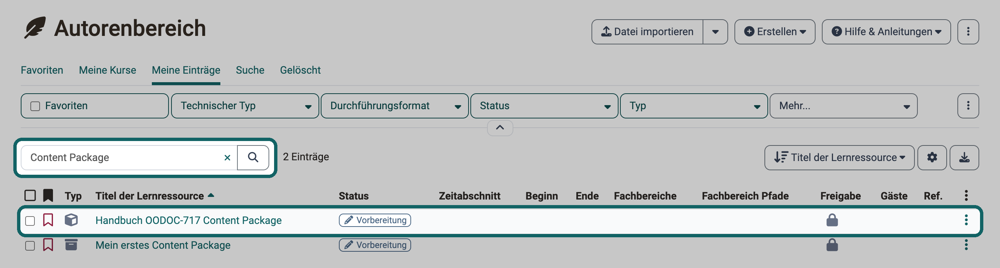
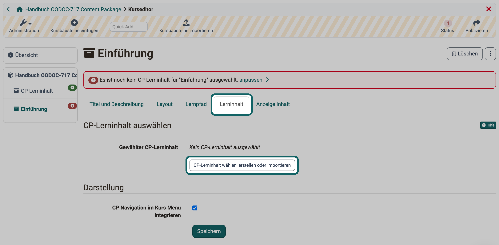
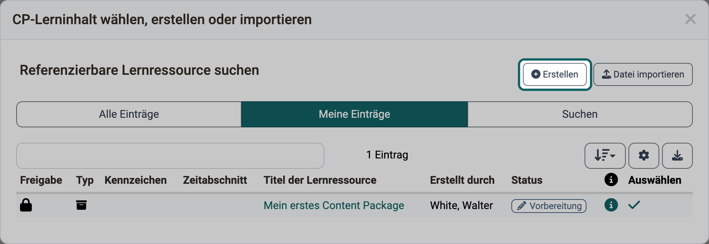
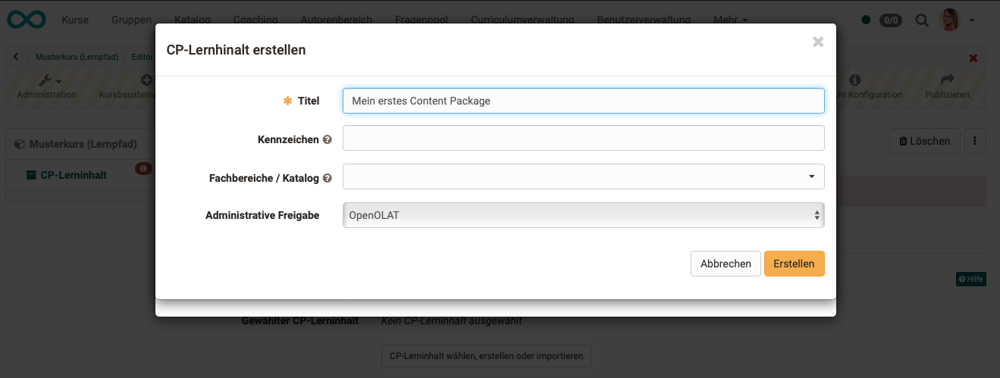
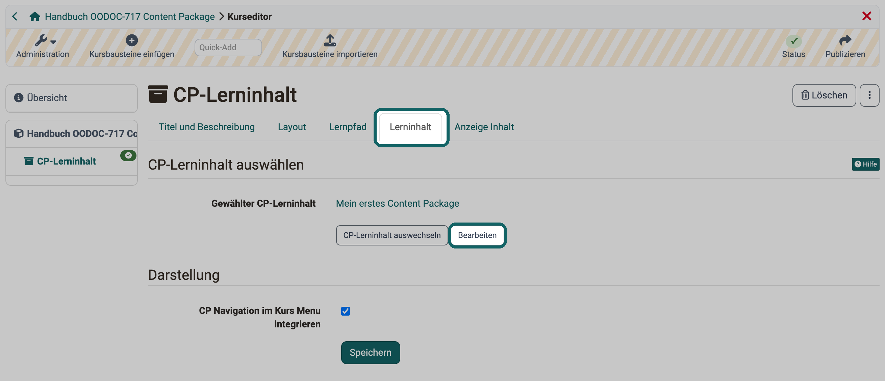
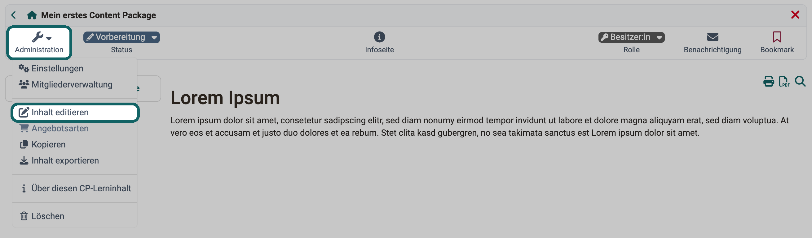
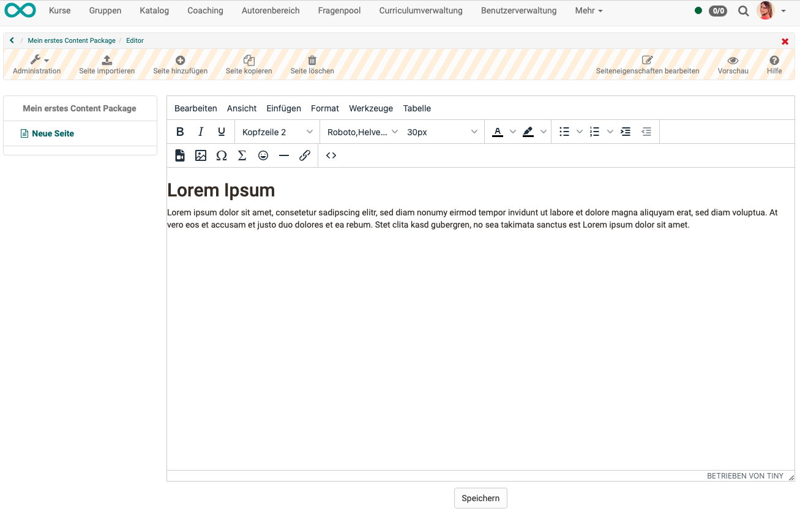
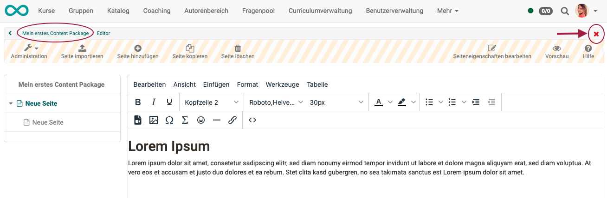
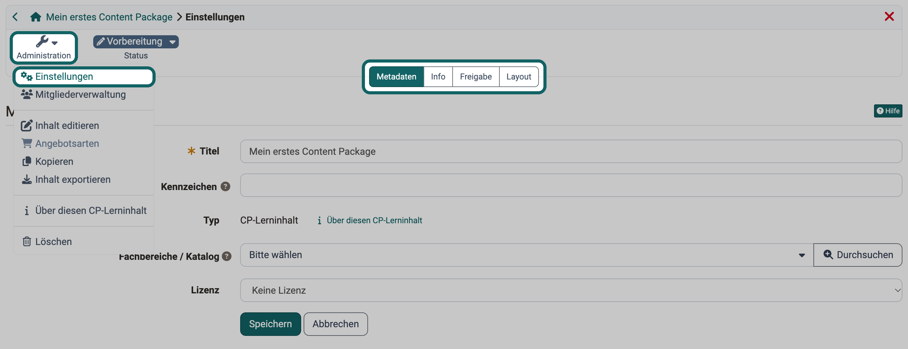
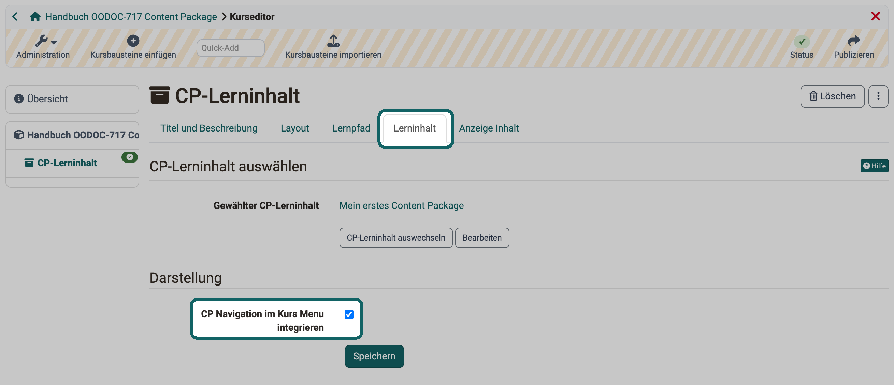

# Wie erstelle ich ein Content Package? {: #content_package}

Die folgende Anleitung zeigt Ihnen, wie Sie ein Content Package in OpenOlat erstellen oder importieren und in Ihren OpenOlat-Kurs einbinden.

---

## Was ist ein Content Package (CP)?

Ein Content Package (CP) wird im E-Learning genutzt, um Lerninhalte oder Tests als in sich geschlossene Pakete zu erstellen.

Es ist ein standardisiertes Format. Dadurch können auch CPs von anderen Lernplattformen in OpenOlat importiert werden. Umgekehrt können Sie in OpenOlat erstellte CPs auch in anderen Lernplattformen verwenden, die das CP-Format unterstützen.

Das am weitesten verbreitete Format wurde von IMS Global definiert. Es wird eine XML-Manifestdatei namens imsmanifest.xml verwendet, die den Aufbau des Content Packages beschreibt. Diese Datei zur Strukturbeschreibung ist zusammen mit den Lerninhalten (HTML-Dateien, Bild-Dateien) in eine ZIP-Datei gepackt.

---

## Wo werden Content Packages verwendet?

Content Packages können sowohl in einen OpenOlat-Kursbaustein als auch separat verwendet werden. In der Regel werden CPs in einen Kurs eingebunden. Dabei kann ein und dasselbe CP in mehreren Kursen verwendet werden.

**Beispiel:** 
Erstellen Sie eine Einführung in Ihr Thema als Content Package. Sie können die Einführung dann sowohl in einem Kurs für Anfänger als auch zur Wiederholung in weiterführenden Kursen einbinden. Oder Sie verwenden das Content Package als eigenständige Lernressource.

 

Im Folgenden zeigen wir, wie ein Content Package innerhalb eines OpenOlat-Kurses eingebunden wird. Wenn Sie noch keinen Kurs erstellt haben, steht im Kapitel ["Wie erstelle ich meinen ersten OpenOlat-Kurs"](../my_first_course/my_first_course.de.md), wie Sie vorgehen müssen, bevor Sie mit Hilfe der folgenden Anleitung Ihr Content Package erstellen und einbinden.

---

## Wie kommt ein Content Package (CP) in OpenOlat?

Es gibt grundsätzlich zwei Möglichkeiten:

* Import eines CP oder
* Erstellung in OpenOlat

---

## Schritt 1: Kurseditor öffnen und Kursbaustein "CP-Lerninhalt" einfügen  

a) Gehen Sie in den Autorenbereich und suchen Sie dort den Kurs, in den der CP-Lerninhalt eingefügt werden soll.

{ class="shadow lightbox" title="Tab Meine Einträge im Autorenbereich · 2026.11.06" }

b) Öffnen Sie den gewünschten Kurs im Kurseditor: `Kurs > Administration > Kurseditor`.

c) Wählen Sie die Stelle im Kursmenü, an der der Baustein hinzugefügt werden soll. Kursbausteine werden immer unterhalb des aktuell ausgewählten Kursbausteins eingefügt. 

d) Klicken Sie in der Kopfzeile des Editors auf "Kursbausteine einfügen" und wählen Sie in der Auswahlliste "CP-Lerninhalt". Alternativ tippen Sie den Namen des Kursbausteins in das Feld "Quick-Add".

Damit ist der Kursbaustein dem Kurs hinzugefügt.

e) Vergeben Sie nun im Tab "Titel und Beschreibung" einen passenden Titel und speichern Sie den Kursbaustein.

!!! info "Wichtig"

    Wenn Sie den Kurseditor bereits jetzt schliessen, wird im Menü kein Kursbaustein mit Content Package angezeigt, denn der Kursbaustein ist noch unvollständig. Es fehlt noch die Lernressource, das CP.

---

## Schritt 2: Content Package (Lernressource) erstellen  

a) Wechseln Sie in den Tab "Lerninhalt" und klicken Sie auf "CP-Lerninhalt wählen, erstellen oder importieren".

{ class="shadow lightbox" title="Kursbaustein CP-Lerninhalt im Kurseditor · 2026.11.06" }

b) Im Dialog, der sich öffnet, können Sie

* ein neues Content Package erstellen,
* ein Content Package wählen, das als Lernressource in OpenOlat bereits vorhanden ist,
* oder ein Content Package importieren, das Ihnen als ZIP-Datei vorliegt (z.B. durch einen Export aus einem anderen System).

Wir gehen im Folgenden davon aus, dass Sie ein neues Content Package erstellen möchten.

c) Klicken Sie auf den Button "Erstellen".

{ class="shadow lightbox" title="Dialog CP-Lerninhalt wählen, erstellen oder importieren · 2026.11.06" }

d) Geben Sie einen Titel für Ihre CP-Lernressource ein und bestätigen Sie mit "Erstellen".

{ class="shadow lightbox" title="Dialog CP-Lerninhalt erstellen" }

Fertig. Damit ist eine neue Lernressource angelegt. Sie können nun weitere Einstellungen festlegen und den Inhalt gestalten.

!!! tip "Tipp"

    Alternativ kann ein CP-Lerninhalt (so wie alle anderen Lernressourcen) auch im Autorenbereich erstellt und anschliessend im Kurseditor im Tab "Lerninhalt" in den gewünschten Kurs eingebunden werden. 

    Bei diesem Vorgehen wird deutlich, dass Lernressourcen kursübergreifende Elemente sind und die Einbindung im gewählten Kurs nur eine der Verwendungsmöglichkeiten darstellt. 

    Das gleiche Content Package kann in mehreren OpenOlat-Kursen eingebunden und auch kursunabhängig verwendet werden.

---

## Schritt 3: Content Package bearbeiten

!!! note "Hinweis"

    In OpenOlat ist ein eigener Editor für Content Packages im IMS-Standard vorhanden. 
    Weitere Informationen zu IMS CP finden Sie unter der folgenden Adresse: http://www.imsglobal.org/content/packaging/

    Sie können zur Erstellung aber auch einen anderen Editor verwenden und dann die dort erstellte zip-Datei importieren.

<h3> a) Lernressource bearbeiten (Vorschau öffnen)</h3>

Öffnen Sie den Kurseditor und klicken Sie im Tab "Lerninhalt" auf "Bearbeiten". Der Button "CP-Lerninhalt auswechseln" daneben bindet stattdessen ein anderes Content Package in den Kursbaustein ein.

{ class="shadow lightbox" title="Kursbaustein CP-Lerninhalt im Kurseditor · 2026.11.06" }

Mit "Bearbeiten" gelangen Sie auf die Vorschau Ihres Content Packages. Ein neu erstelltes Content Package enthält eine erste Seite mit Platzhaltertext.

<h3> b) CP-Editor öffnen</h3>

Über `CP-Lerninhalt > Administration > Inhalt editieren` gelangen Sie in den Bearbeitungsmodus des CP-Editors. Die schraffierte Kopfzeile zeigt ihn an. (Sie bearbeiten hier jedoch nicht einen Kurs, sondern eine Lernressource.)

{ class="shadow lightbox" title="Vorschau des CP-Lerninhalts · 2026.11.06" }

Sie finden hier alle Werkzeuge zum Ergänzen von Inhalt in der CP-Lernressource:

* erstellen Sie neue Seiten innerhalb des Content Packages,
* ergänzen Sie Bilder,
* ergänzen Sie Links,
* ergänzen Sie Videos,
* ...

{ class="shadow lightbox" title="CP-Editor" }

!!! tip "Tipp"

    Vergessen Sie nicht, am unteren Rand des Editors auf "Speichern" zu klicken!

<h3> c) Editieren der Lernressource abschliessen</h3>

Haben Sie alle Inhalte in das Content Package eingefügt, verlassen Sie den Bearbeitungsmodus (schraffierte Kopfzeile), damit die Änderungen sichtbar werden. Klicken Sie dazu

* entweder auf das kleine rote Kreuz rechts oben
* oder auf den Titel der Lernressource in der Breadcrumb.

Sie gelangen dann wieder zur Ansicht der Lernressource.

{ class="shadow lightbox" title="CP-Editor" }

<h3> d) Weitere Einstellungen der CP-Lernressource </h3>

Sie befinden sich immer noch in der Lernressource. Zum Kurs und zum Kursbaustein CP-Lerninhalt ist es nochmals eine Stufe weiter zurück.

Bevor Sie auf diese Ebene zurückgehen, empfiehlt es sich, in der Lernressource zuerst weitere Einstellungen festzulegen: `CP-Lerninhalt > Administration > Einstellungen`. Sie können die Einstellungen zur Lernressource auch später jederzeit wieder aufrufen. Wer in der Organisation der Lernressource die Rolle Systemadministrator:in, Administrator:in, Rollenverwalter:in, Benutzerverwalter:in oder Lernressourcenverwalter:in hat, sieht zusätzlich den Tab "Quota".

{ class="shadow lightbox" title="Einstellungen des CP-Lerninhalts · 2026.11.06" }

<h3> e) Navigation ins Kursmenü übernehmen</h3>

Innerhalb eines Content Packages existieren normalerweise verschiedene Seiten und auch Unterordner. Das bedeutet, innerhalb des Content Packages braucht und hat es eine Navigation.

Diese Navigation innerhalb des Content Packages kann in das Menü des OpenOlat-Kurses übernommen werden. So wird die Navigation für die Lernenden vereinfacht.

Bei einem neuen Kursbaustein ist die Option "CP Navigation im Kurs Menu integrieren" bereits aktiviert. Sie finden die Option im Kurseditor im Tab "Lerninhalt" des Kursbausteins. Möchten Sie die Navigation nicht im Kursmenü zeigen, deaktivieren Sie die Option und speichern Sie.

{ class="shadow lightbox" title="Kursbaustein CP-Lerninhalt im Kurseditor · 2026.11.06" }

---

## Schritt 4: Kurs publizieren und Status auf "Veröffentlicht" ändern  

Gehen Sie dazu vor, wie in ["Wie erstelle ich meinen ersten OpenOlat-Kurs"](../my_first_course/my_first_course.de.md) beschrieben.

Das Content Package ist nun eingebunden und Teilnehmende können den Inhalt lesen.

---

## Weiterführende Informationen {: #further_information}

[Wie erstelle ich meinen ersten OpenOlat-Kurs? >](../my_first_course/my_first_course.de.md) 
[Kursbaustein "CP-Lerninhalt" >](../../manual_user/learningresources/Course_Element_CP_Learning_Content.de.md) 
[CP-Lerninhalt erstellen >](../../manual_user/learningresources/CP_Editor.de.md)

[Zum Seitenanfang ^](#content_package)
