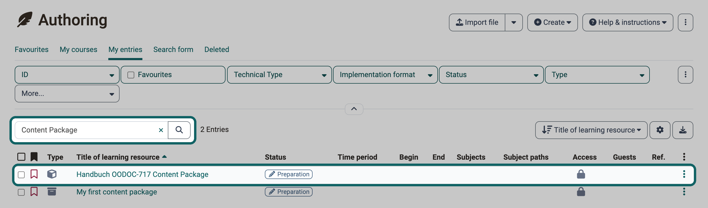
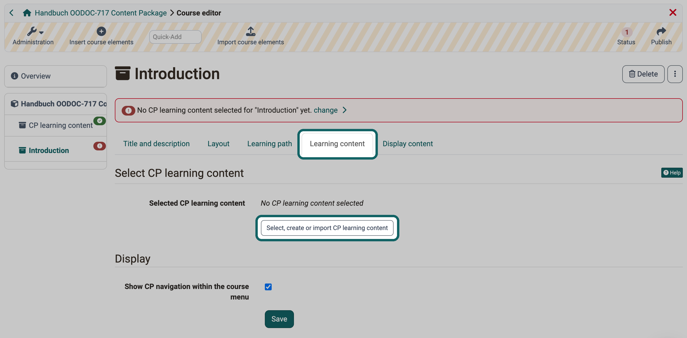
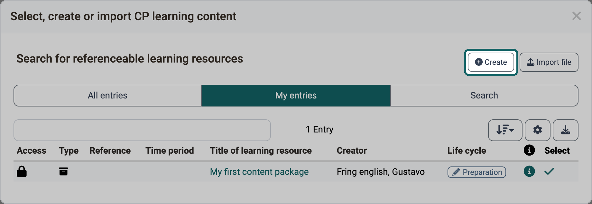
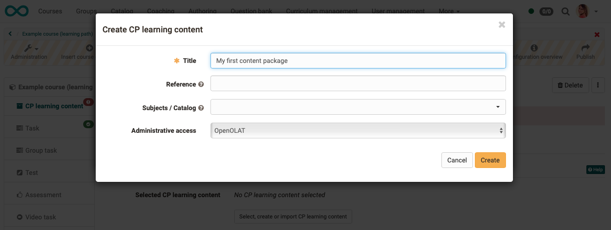
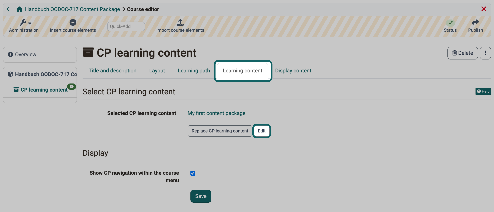
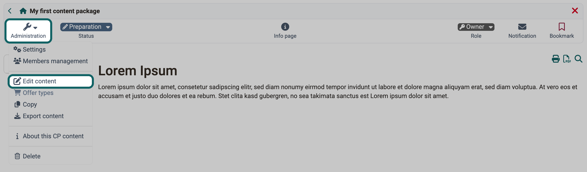
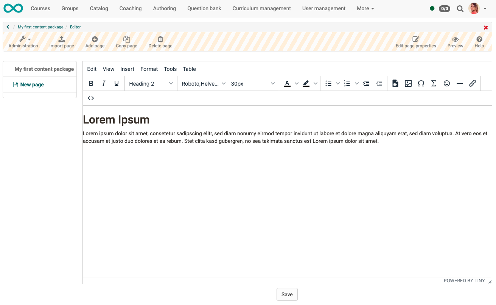
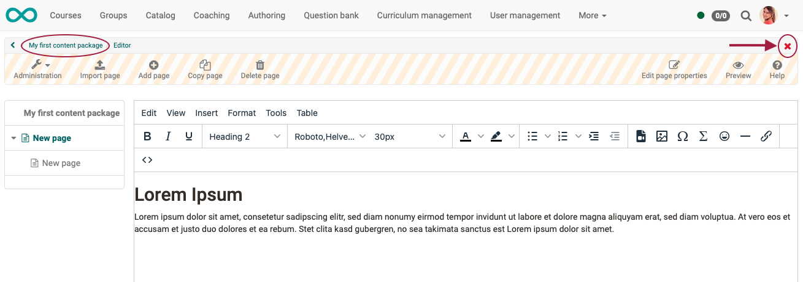
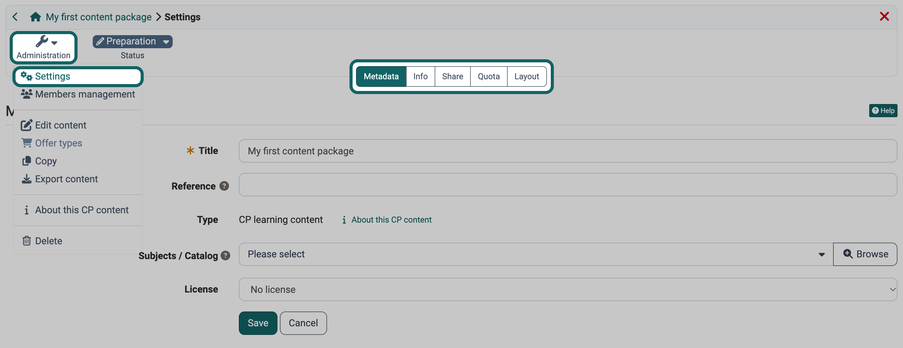
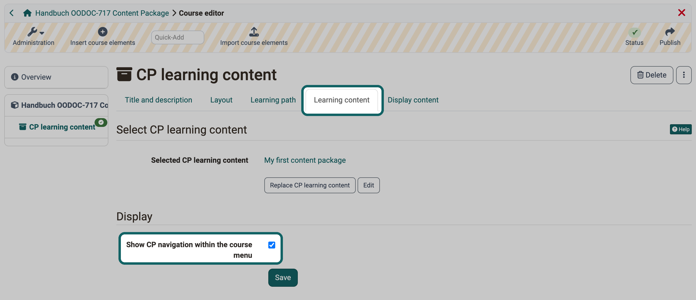

# How do I create a content package? {: #content_package}

The following instructions show you how to create or import a content package in OpenOlat and include it in your OpenOlat course.

---

## What is a Content Package (CP)?

A Content Package (CP) is used in e-learning to create learning content or tests as self-contained packages.

It is a standardized format. This means that CPs from other learning platforms can also be imported into OpenOlat. Vice versa, you can use CPs created in OpenOlat in other learning platforms that support the CP format.

The most widely used format was defined by IMS Global. It uses an XML manifest file called imsmanifest.xml that describes the structure of the content package. This structure description file is packed together with the learning content (HTML files, image files) in a ZIP file.

---

## Where are Content Packages used?

Content Packages can be included in an OpenOlat course element or used separately. As a rule, CPs are integrated into a course. One and the same CP can be used in several courses.

**Example:** 
Create an introduction to your topic as a content package. You can then include the introduction both in a course for beginners and for repetition in more advanced courses. Or, use the content package as a stand-alone learning resource.

 

In the following we show how to include a content package within an OpenOlat course. If you have not yet created a course, the chapter ["How do I create my first OpenOlat course"](../my_first_course/my_first_course.md) tells you how to proceed before creating and embedding your content package using the following instructions.

---

## How does a Content Package (CP) get into OpenOlat?

There are basically two possibilities:

* import of a CP or
* creation in OpenOlat

---

## Step 1: Open course editor and insert course element "CP learning content"

a) Go to Authoring and search there for the course in which the CP learning content is to be inserted.

{ class="shadow lightbox" title="My entries tab in Authoring · 2026.11.06" }

b) Open the desired course in the course editor: `Course > Administration > Course editor`.

c) Select the position in the course menu where the course element is to be added. Course elements are always inserted below the currently selected course element.

d) Click "Insert course elements" in the editor header and select "CP learning content" in the selection list. Alternatively, type the name of the course element into the "Quick-Add" field.

This adds the course element to the course.

e) Now enter a suitable title in the tab "Title and description" and save the course element.

!!! info "Important"

    If you close the course editor already now, no course element with content package will be displayed in the menu because the course element is still incomplete. The learning resource, the CP, is still missing.

---

## Step 2: Create Content Package (Learning Resource) 

a) Switch to the "Learning content" tab and click on "Select, create or import CP learning content".

{ class="shadow lightbox" title="Course element CP learning content in the course editor · 2026.11.06" }

b) In the dialog that opens, you can

* create a new content package,
* select a content package that is already available as a learning resource in OpenOlat,
* or import a content package that you have as a ZIP file (e.g. by exporting it from another system).

In the following, we assume that you want to create a new content package.

c) Click the "Create" button.

{ class="shadow lightbox" title="Dialog Select, create or import CP learning content · 2026.11.06" }

d) Enter a title for your CP learning resource and confirm with "Create".

{ class="shadow lightbox" title="Dialog Create CP learning content" }

Done. Now a new learning resource is created. You can now define further settings and design the content.

!!! tip "Tip"

    Alternatively, a CP learning content (like all other learning resources) can also be created in the authoring area and then integrated in the desired course in the course editor in the tab "Learning content". 

    This procedure makes it clear that learning resources are cross-course elements and their integration in the selected course is only one of the possible uses. 

    The same content package can be integrated in several OpenOlat courses and can also be used independently of the course.

---

## Step 3: Editing the Content Package

!!! note "Note"

    In OpenOlat there is a separate editor for content packages in the IMS standard. 
    More information about IMS CP can be found at the following address: http://www.imsglobal.org/content/packaging/

    However, you can also use another editor to create it and then import the zip file created there.

<h3> a) Edit learning resource (open preview)</h3>

Open the course editor and click "Edit" in the "Learning content" tab. The "Replace CP learning content" button next to it adds a different content package to the course element instead.

{ class="shadow lightbox" title="Course element CP learning content in the course editor · 2026.11.06" }

"Edit" takes you to the preview of your content package. A newly created content package contains a first page with placeholder text.

<h3> b) Open the CP editor</h3>

Use `CP learning content > Administration > Edit content` to reach the edit mode of the CP editor. The hatched header indicates it. (However, you are not editing a course here, but a learning resource).

{ class="shadow lightbox" title="Preview of the CP learning content · 2026.11.06" }

You will find here all tools for adding content to the CP learning resource:

* create new pages within the content package,
* add images,
* add links,
* add videos,
* ...

{ class="shadow lightbox" title="CP editor" }

!!! tip "Tip"

    Don't forget to click "Save" at the bottom of the editor!

<h3> c) Complete editing of the learning resource</h3>

Once you have inserted all the content into the content package, exit the editing mode (hatched header) so that the changes become visible. To do this, click

* either on the small red cross in the upper right corner
* or on the title of the learning resource in the breadcrumb.

You will then return to the learning resource view.

{ class="shadow lightbox" title="CP editor" }

<h3> d) Further settings of the CP learning resource </h3>

You are still in the learning resource. To the course and the course element CP learning content it is again one step further back.

Before you go back to this level, it is recommended to define further settings in the learning resource first: `CP learning content > Administration > Settings`. You can always return to the learning resource settings later. Anyone with the role system administrator, administrator, roles manager, user manager or learning resource manager in the organisation of the learning resource also sees the "Quota" tab.

{ class="shadow lightbox" title="Settings of the CP learning content · 2026.11.06" }

<h3> e) Transfer navigation into the course menu</h3>

Within a content package there are usually different pages and also subfolders. That means, within the content package it needs and has a navigation.

This navigation within the content package can be transferred to the menu of the OpenOlat course. This simplifies the navigation for the learners.

In a new course element, the option "Show CP navigation within the course menu" is already activated. You find the option in the course editor in the "Learning content" tab of the course element. If you do not want to show the navigation in the course menu, deactivate the option and save.

{ class="shadow lightbox" title="Course element CP learning content in the course editor · 2026.11.06" }

---

## Step 4: Publish course and change status to "Published"

To do this, proceed as described in ["How do I create my first OpenOlat course"](../my_first_course/my_first_course.md).

The content package is now included and participants can read the content.

---

## Further information {: #further_information}

[How do I create my first OpenOlat course? >](../my_first_course/my_first_course.md) 
[Course Element "CP learning content" >](../../manual_user/learningresources/Course_Element_CP_Learning_Content.md) 
[Create CP learning content >](../../manual_user/learningresources/CP_Editor.md)

[To the top of the page ^](#content_package)

