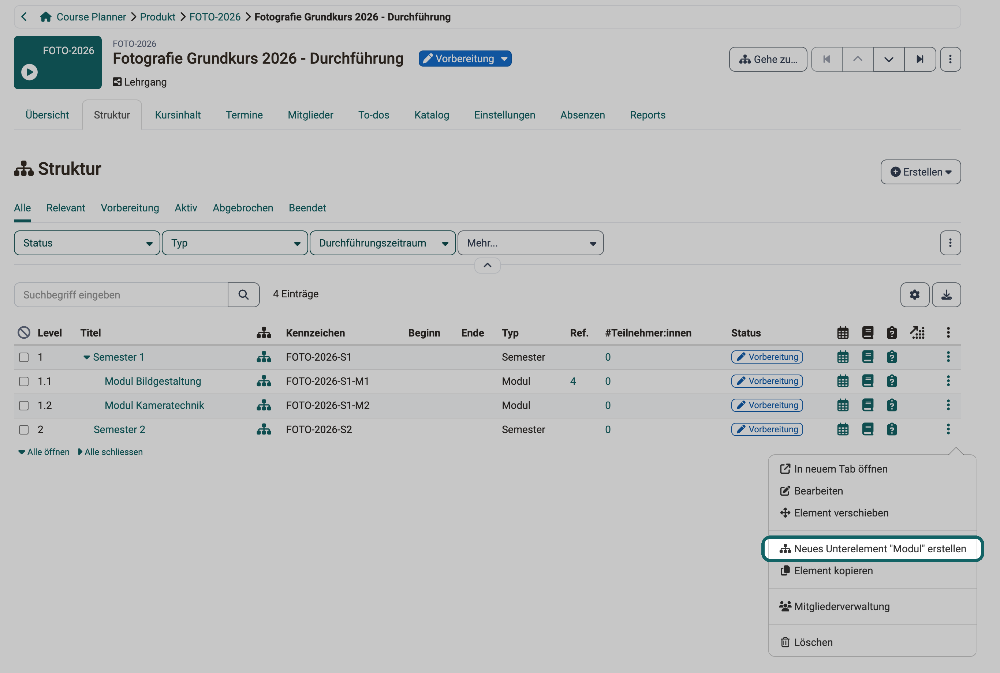

# Wie kann ich mit dem Course Planner ein Produkt aus mehreren Kursen planen und durchführen? {: #plan_and_run_curriculum_with_course_planner}

??? abstract "Ziel und Inhalt dieser Anleitung"

    Diese Anleitung führt Sie vom Elementtyp bis zur zweiten Durchführung eines Produkts, das aus mehreren Kursen besteht, zum Beispiel eines Lehrgangs mit Semestern und Modulen.

??? abstract "Zielgruppe"

    [ ] Autor:innen [ ] Betreuer:innen  [ ] Teilnehmer:innen  [x] Kursplaner:innen

    [ ] Anfänger:innen [x] Fortgeschrittene  [x] Expert:innen

??? abstract "Erwartete Vorkenntnisse"

    * ["Wie kann ich mit dem Course Planner einen Kurs in mehreren Durchführungen planen und durchführen?"](../course_planner_courses/course_planner_courses.de.md) 
    * [Course Planner: Übersicht >](../../manual_user/area_modules/Course_Planner.de.md) 

Lehrgang, Bildungsgang, Studiengang oder Ausbildung: Im Course Planner heisst das Angebot Produkt, der einzelne Durchgang Durchführung. Sie planen zum Beispiel einen Lehrgang mit zwei Semestern und je drei Modulen, und jedes Modul ist ein Kurs. Der Lehrgang startet jeden Herbst neu, mit neuen Teilnehmer:innen.

Diese Anleitung zeigt, in welcher Reihenfolge Sie das im Course Planner aufbauen. Die Reihenfolge zählt, denn der Elementtyp entscheidet, was Sie später bauen können: Ohne Unterelemente zeigt die Durchführung kein Tab "Struktur", und ohne den Inhalt "Einzelkurs" nimmt ein Element kein Kurstemplate an. Die Struktur bauen Sie einmal und kopieren sie danach für jeden neuen Jahrgang.

---

## Welche Planung passt? {: #which_planning}

Bevor Sie beginnen, prüfen Sie, ob Sie auf der richtigen Seite sind. Wählen Sie die einfachste Planung, die zu Ihrem Fall passt:

| Fall | Elementtyp der Durchführung | Anleitung |
|---|---|---|
| Ein Kurs, mehrfach durchgeführt | "Inhalt" = "Einzelkurs" | [Einen Kurs in mehreren Durchführungen planen](../course_planner_courses/course_planner_courses.de.md) |
| Mehrere Kurse ohne Gliederung | "Unterelemente" = "Nein", "Inhalt" = "Kurs-Bundle" | diese Anleitung, ohne Schritt 4 |
| Mehrere Kurse in einer Baumstruktur | "Unterelemente" = "Ja", Kurse an den Unterelementen | diese Anleitung, alle Schritte |

Die drei Planungen mit Grafiken erklärt das Benutzerhandbuch: 
[Planung für Einzelkurse >](../../manual_user/area_modules/Course_Planner.de.md#planning_single_courses) 
[Planung für Course Bundles >](../../manual_user/area_modules/Course_Planner.de.md#planning_course_bundles) 
[Planung für strukturierte Bildungsgänge >](../../manual_user/area_modules/Course_Planner.de.md#planning_structured_product)

[zum Seitenanfang ^](#plan_and_run_curriculum_with_course_planner)

---

## Was muss eingerichtet sein? {: #requirements}

Damit Sie die Schritte ausführen können, müssen vier Dinge erfüllt sein:

- **Course Planner eingeschaltet**: Administrator:innen schalten den Course Planner in der System-Administration ein, mit dem Schalter Modul "Course Planner" unter `Administration > Module > Course Planner > Tab "Einstellungen"`. Hosting-Kund:innen von frentix wenden sich für die Aktivierung an frentix: [contact@frentix.com](mailto:contact@frentix.com)
- **Rolle**: Sie haben die Rolle Kursplaner:in oder sind Produktbesitzer:in des Produkts. Autor:innen haben keinen Zugang zum Course Planner, siehe [Wer kann den Course Planner nutzen? >](../../manual_user/area_modules/Course_Planner.de.md#users)
- **Elementtypen**: Es gibt passende Elementtypen für die Durchführung und ihre Elemente (Schritt 1).
- **Kurse**: Die Kurse tragen den Verwendungszweck "Verwendung im Course Planner", Kurstemplates den Verwendungszweck "Template" (Schritt 5).

[zum Seitenanfang ^](#plan_and_run_curriculum_with_course_planner)

---

## Schritt 1: Elementtypen klären {: #element_types}

Die Elementtypen legen fest, was Sie in einer Durchführung bauen können: ob sie Semester und Module enthält, welches Element einen Kurs trägt und wo ein Kurstemplate möglich ist. Elementtypen legen Administrator:innen in der System-Administration an. Klären Sie deshalb vor dem ersten Klick mit Ihrer Administrator:in, welche Typen es gibt und welche Sie brauchen. Die Typen stehen unter: 
`Administration > Module > Course Planner > Tab "Elementtypen"`

Für einen Lehrgang mit Semestern und Modulen genügen drei Typen, zum Beispiel:

| Elementtyp | Verwendung als | Unterelemente | Inhalt | Kindelemente |
|---|---|---|---|---|
| Lehrgang | Durchführung | Ja | Kein Inhalt | Semester |
| Semester | Element | Ja | Kein Inhalt | Modul |
| Modul | Element | Nein | Einzelkurs | (Feld erscheint nicht) |

Jede Einstellung wirkt später in der Durchführung:

- **Verwendung als**: Ein Typ für die Durchführung selbst braucht "Durchführung", ein Typ für Semester und Module "Element". Der Wert ergibt sich aus dem Button, mit dem die Administrator:in den Typ anlegt: "Typ für Durchführung erstellen" oder "Typ für Element erstellen". Ändern lässt er sich danach nicht.
- **Unterelemente**: Nur mit "Ja" zeigt eine Durchführung oder ein Element das Tab "Struktur" und nimmt Unterelemente auf.
- **Inhalt**: "Kein Inhalt": Das Element trägt keinen Kurs und dient nur der Gliederung, sein Tab "Kursinhalt" erscheint nicht. Diesen Wert gibt es nur bei "Unterelemente" = "Ja". "Einzelkurs" trägt genau einen Kurs, und nur hier gibt es den Button "Kurstemplate hinzufügen". "Kurs-Bundle" trägt mehrere Kurse, aber kein Kurstemplate.
- **Elternelemente und Kindelemente**: Hier legt die Administrator:in fest, welche Typen unter welchem Typ stehen dürfen. Das Feld "Kindelemente" erscheint nur bei "Unterelemente" = "Ja", das Feld "Elternelemente" nur bei Typen mit "Verwendung als" = "Element". Nur die erlaubten Typen bietet die Durchführung später zum Erstellen an (Schritt 4).

Alle Felder eines Elementtyps erklärt das Administrationshandbuch: 
[Elementtyp erstellen und bearbeiten >](../../manual_admin/administration/Modules_Course_Planner.de.md#create_element_types)

[zum Seitenanfang ^](#plan_and_run_curriculum_with_course_planner)

---

## Schritt 2: Produkt erstellen und Besitzer:innen bestimmen {: #create_product}

Das Produkt ist der Rahmen für alle Jahrgänge des Lehrgangs. Wie Sie ein Produkt erstellen und Produktbesitzer:innen bestimmen, zeigen die Schritte 1 und 2 der Anleitung [Einen Kurs in mehreren Durchführungen planen](../course_planner_courses/course_planner_courses.de.md#create_product).

Im Produkt nehmen Sie nur Besitzer:innen auf, im Tab "Besitzer:innen" mit dem Button "Produktbesitzer:in hinzufügen". Teilnehmer:innen werden nie Mitglieder des Produkts, sondern Mitglieder einer Durchführung (Schritt 9). Eine Produktbesitzer:in sieht das Produkt auch dann, wenn es zu einer anderen Organisation gehört als ihre Rolle Kursplaner:in.

Das Produkt selbst hat kein Tab "Struktur". Seine Tabs sind "Übersicht", "Durchführungen", "Termine", "To-dos", "Besitzer:innen", "Metadaten" und "Reports". Die Struktur bauen Sie in der Durchführung.

[zum Seitenanfang ^](#plan_and_run_curriculum_with_course_planner)

---

## Schritt 3: Erste Durchführung erstellen {: #create_implementation}

Struktur, Kurse und Mitglieder gehören zur Durchführung, nicht zum Produkt. Legen Sie deshalb zuerst die Durchführung an: 
`Course Planner > Produkte > "Titel des Produkts" > Tab "Durchführungen" > Erstellen`

Das Menü "Erstellen" bietet je Elementtyp für Durchführungen einen Eintrag an, zum Beispiel Neues "Lehrgang" erstellen. Im Dialog "Neues Element erstellen" geben Sie "Titel" und "Kennzeichen" ein, der "Typ" ist vorbelegt. Dasselbe Menü finden Sie unter `Course Planner > Durchführungen > Erstellen`.

Der Dialog fragt kein Datum ab. Den Durchführungszeitraum legen Sie danach in der Durchführung fest: 
`Course Planner > Durchführungen > "Titel der Durchführung" > Tab "Einstellungen" > Durchführung` 
Zeitgesteuerte Regeln der Automatisierung richten sich nach seinem Beginn oder Ende (Schritt 7).

[zum Seitenanfang ^](#plan_and_run_curriculum_with_course_planner)

---

## Schritt 4: Struktur aufbauen {: #build_structure}

Mit der Struktur bilden Sie Semester und Module so ab, wie die Teilnehmer:innen den Lehrgang erleben. Bei einem Kurs-Bundle ohne Unterelemente entfällt dieser Schritt. Öffnen Sie die Durchführung und wählen Sie das Tab "Struktur". Elemente legen Sie auf zwei Wegen an:

- **Erstellen**: Der Button oben rechts legt ein Element direkt unter der Durchführung an. Das Menü zeigt nur die Typen, die der Elementtyp der Durchführung unter "Kindelemente" zulässt, dazu "Neues Element erstellen".
- **Menü der 3 Punkte**: Am Ende einer Zeile legen Sie ein Element unter diesem Element an. Der Eintrag nennt den erlaubten Typ, zum Beispiel Neues Unterelement "Modul" erstellen in der Zeile eines Semesters.

{ class="shadow lightbox" title="Tab Struktur einer Durchführung · 2026.10.27" }

Fehlt ein Typ in diesen Menüs, ist er unter diesem Element nicht erlaubt. Ändern lässt sich das nur im Elementtyp, unter "Kindelemente" oder "Elternelemente" (Schritt 1). Ein Element mit "Unterelemente" = "Ja", im Beispiel ein Semester, hat selbst ebenfalls ein Tab "Struktur".

Steht ein Element an der falschen Stelle, wählen Sie im Menü der 3 Punkte "Element verschieben". Im Dialog wählen Sie die Zielposition und dort "Oben", "Unten" oder "Unterelement", dann klicken Sie auf "Element verschieben".

Mehr zum Tab "Struktur" finden Sie im Benutzerhandbuch unter: 
[Tab Struktur >](../../manual_user/area_modules/Course_Planner_Implementations.de.md#tab_structure)

[zum Seitenanfang ^](#plan_and_run_curriculum_with_course_planner)

---

## Schritt 5: Kurse zuordnen {: #assign_courses}

Die Kurse hängen an den Elementen, die sie inhaltlich tragen, im Beispiel an den Modulen. Öffnen Sie das Element über seinen Titel im Tab "Struktur" und wählen Sie das Tab "Kursinhalt": 
`Course Planner > Durchführungen > "Titel der Durchführung" > Tab "Struktur" > "Titel des Elements" > Tab "Kursinhalt"`

Hier wählen Sie zwischen einem festen Kurs und einem Kurstemplate:

- **Kurs hinzufügen**: Sie binden einen bestehenden Kurs ein. Der Dialog zeigt nur Kurse mit dem Verwendungszweck "Verwendung im Course Planner". Welche Kurse er sonst noch ausblendet, erklärt [Welche Kurse der Dialog "Kurs hinzufügen" zeigt >](../course_planner_courses/course_planner_courses.de.md#add_course_dialog)
- **Kurstemplate hinzufügen**: Sie binden einen Kurs mit dem Verwendungszweck "Template" ein. Aus ihm erstellt der Course Planner für dieses Element einen eigenen Kurs, von Hand oder durch die Automatisierung (Schritt 7). Den Button gibt es nur bei Elementtypen mit "Inhalt" = "Einzelkurs".

Ein Element mit "Kurs-Bundle" trägt mehrere Kurse, aber kein Kurstemplate. Ein Element mit "Kein Inhalt" zeigt das Tab "Kursinhalt" nicht, solange es keinen Kurs hat.

[zum Seitenanfang ^](#plan_and_run_curriculum_with_course_planner)

---

## Schritt 6: Termine planen {: #plan_events}

Präsenztage und Prüfungen planen Sie am Element, zu dem sie gehören, damit sie im richtigen Modul erscheinen. Jede Durchführung und jedes Element hat ein Tab "Termine", sofern in der System-Administration das Modul "Termine / Absenzen" eingeschaltet ist. Mit dem Button "Termin hinzufügen" legen Sie einen Termin an. Hat das Element einen Kurs, wählen Sie im Dialog unter "Durchführen in" den Kurs, in dem der Termin stattfindet.

Mit "Alle Ebenen" zeigt die Durchführung auch die Termine ihrer Elemente, mit "Diese Ebene" nur ihre eigenen. Der Filter "Relevant" ist vorgewählt und blendet vergangene Termine aus. Wirkt die Tabelle leer, wählen Sie den Filter "Alle".

Wie Sie einen Termin einrichten, zeigt Schritt 4 der Anleitung [Einen Kurs in mehreren Durchführungen planen](../course_planner_courses/course_planner_courses.de.md#events). Mehr zum Tab "Termine" finden Sie im Benutzerhandbuch unter: 
[Tab Termine >](../../manual_user/area_modules/Course_Planner_Implementations.de.md#tab_events)

[zum Seitenanfang ^](#plan_and_run_curriculum_with_course_planner)

---

## Schritt 7: Automatisierung festlegen {: #automation}

Bei vielen Modulen sollen die Kurse zum geplanten Zeitpunkt entstehen, ohne dass Sie jedes Kurstemplate einzeln instanziieren. Das übernimmt die Automatisierung. Sie finden sie unter: 
`Course Planner > Durchführungen > "Titel der Durchführung" > Tab "Einstellungen" > Automatisierung`

Unter "Konfiguration" wählen Sie, ob die Durchführung die Regeln ihres Elementtyps übernimmt oder ob Sie mit "Überschreiben" eigene Regeln festlegen. Die erste Option zeigt in Klammern, ob der Elementtyp Regeln hat. Aktivierte Automatisierungen laufen einmal täglich, die Uhrzeit nennt der Hinweis über der Auswahl.

!!! warning "Achtung"

    Die Wahl "Überschreiben" wird sofort gespeichert, ohne Button "Speichern". Hat der Elementtyp keine Regeln, erhält die Durchführung die sechs vorgegebenen Regeln, und alle sind eingeschaltet. Wer nur nachsehen will, schaltet damit die Automatisierung ein. Einzelne Regeln schalten Sie in der Spalte "Aktiv" aus.

Die vorgegebenen Regeln einer Durchführung:

| Kontext | Automatisierung | Zielstatus | Bedingung |
|---|---|---|---|
| Durchführung | Statusänderung | Bestätigt | 7 Tage vor dem Beginn des Durchführungszeitraums |
| Durchführung | Statusänderung | Beendet | Ende des Durchführungszeitraums |
| Inhalt | Instanziierung | | Wenn der Status auf "Bestätigt" gesetzt ist |
| Inhalt | Statusänderung | Freigabe Betreuer:innen | Wenn der Status auf "Bestätigt" gesetzt ist |
| Inhalt | Statusänderung | Veröffentlicht | Beginn des Durchführungszeitraums |
| Inhalt | Statusänderung | Beendet | Wenn der Status auf "Abgebrochen" oder "Beendet" gesetzt ist |

Die Instanziierung hängt also am Status "Bestätigt", nicht an einem Datum. Weil die erste Regel diesen Status 7 Tage vor dem Beginn setzt, entstehen die Kurse mit den vorgegebenen Regeln eine Woche vor dem Beginn. Soll die Instanziierung selbst an ein Datum gebunden sein, öffnen Sie nach "Überschreiben" im Menü der 3 Punkte der Regel "Automationsregel bearbeiten". Dort stellen Sie den "Auslöser" auf "Zeitgesteuert" und wählen den Abstand zum Beginn des Durchführungszeitraums.

Jede Regel wirkt auf das Element, in dem sie steht. Die Instanziierung der Durchführung erstellt nur Kurse aus den Kurstemplates der Durchführung selbst. Hängt das Kurstemplate an einem Modul, gelten die Regeln des Moduls, im Modul unter `Tab "Einstellungen" > Automatisierung`. Ein Element instanziiert mit den vorgegebenen Regeln, sobald es den Status "Aktiv" hat.

Mehr zur Automatisierung finden Sie im Benutzerhandbuch unter: 
[Automatisierung konfigurieren >](../../manual_user/area_modules/Course_Planner_Implementations.de.md#tab_settings_automation)

[zum Seitenanfang ^](#plan_and_run_curriculum_with_course_planner)

---

## Schritt 8: Angebot im Katalog {: #offer}

Interessierte sollen den ganzen Lehrgang in einem Schritt buchen, nicht jeden Kurs einzeln. Angebote gibt es deshalb nur für die ganze Durchführung: Semester und Module haben kein Tab "Katalog". Ein Angebot legen Sie an unter: 
`Course Planner > Durchführungen > "Titel der Durchführung" > Tab "Katalog" > Angebote > Angebot hinzufügen`

Mit der Angebotsart "Rechnung" gilt die Abrechnung für die ganze Durchführung. Unter "Einstellungen" legen Sie mit "Buchung" fest, ob Sie Teilnehmer:innen auch ohne Buchungsauftrag aufnehmen können. Die Einzelheiten zeigt Schritt 5 der Anleitung [Einen Kurs in mehreren Durchführungen planen](../course_planner_courses/course_planner_courses.de.md#offer).

[zum Seitenanfang ^](#plan_and_run_curriculum_with_course_planner)

---

## Schritt 9: Mitglieder aufnehmen {: #add_members}

Nehmen Sie eine Teilnehmer:in einmal in die Durchführung auf, sieht sie alle Kurse des Lehrgangs. Wer nur ein Modul belegt, erhält nur diesen Teil. Beides geschieht im selben Assistenten: 
`Course Planner > Durchführungen > "Titel der Durchführung" > Tab "Mitglieder" > Teilnehmer:innen hinzufügen`

Im Menü neben dem Button fügen Sie Betreuer:innen, Klassenlehrer:innen, Kursbesitzer:innen und Elementbesitzer:innen hinzu. Im Assistenten wählen Sie zuerst die Personen. Im Schritt "Mitgliedschaft" legen Sie fest:

- **Standard oder Mit Bestätigung**: "Standard" macht die Mitgliedschaft sofort aktiv, "Mit Bestätigung" legt sie als ausstehend an.
- **Anwenden auf**: Die Option mit dem Titel der Durchführung und dem Zusatz "und enthaltene Elemente" nimmt die Person in die ganze Durchführung auf. Mit "einzelne Elemente" wählen Sie einen Teilbereich, zum Beispiel ein Modul.

Im letzten Schritt "Benachrichtigung" ist der Schalter "E-Mail Benachrichtigung" eingeschaltet. Soll die Person keine E-Mail erhalten, schalten Sie ihn dort aus.

Für ein einzelnes Element gibt es einen zweiten Weg: Im Tab "Struktur" öffnet der Eintrag "Mitgliederverwaltung" im Menü der 3 Punkte das Element mit seinem Tab "Mitglieder". Dort steht derselbe Assistent zur Verfügung.

Mehr zum Tab "Mitglieder" finden Sie im Benutzerhandbuch unter: 
[Tab Mitglieder >](../../manual_user/area_modules/Course_Planner_Implementations.de.md#tab_members)

[zum Seitenanfang ^](#plan_and_run_curriculum_with_course_planner)

---

## Schritt 10: Nächste Durchführung als Kopie {: #copy}

Den Lehrgang im nächsten Herbst bauen Sie nicht neu, Sie kopieren die bestehende Durchführung. Die Aktion "Element kopieren" finden Sie im Menü der 3 Punkte in der Liste der Durchführungen: 
`Course Planner > Produkte > "Titel des Produkts" > Tab "Durchführungen" > 3 Punkte > Element kopieren` 
Dasselbe Menü gibt es unter `Course Planner > Durchführungen`. Im Menü oben rechts in der geöffneten Durchführung fehlt der Eintrag.

Der Assistent "Element kopieren" übernimmt die ganze Struktur. Im Schritt "Allgemeine Einstellungen" geben Sie Titel und Kennzeichen der neuen Durchführung ein und wählen, was mitkommt:

| Feld | Auswahl |
|---|---|
| Kursinhalt | "Kopieren", "Wiederverwenden" oder "Nicht kopieren" |
| Eigenständige Termine | "Kopieren" oder "Nicht kopieren" |
| To-dos | "Standard", "Nur To-dos" oder "Nicht kopieren" |
| Raumplanung | "Kopieren" oder "Nicht kopieren" |
| Betreuer:innen | "Standard", "Nur Mitgliedschaft" oder "Nicht kopieren" |
| Klassenlehrer:innen / Kursbesitzer:innen / Elementbesitzer:innen | "Inklusive Mitgliedschaft" oder "Nicht kopieren" |

Teilnehmer:innen übernimmt die Kopie nie, die neue Durchführung startet ohne sie. Bei "Kursinhalt" verwendet "Kopieren" ein Kurstemplate wieder oder kopiert einen Kurs ohne Template. "Wiederverwenden" teilt den Kurs mit der bisherigen Durchführung. Termine der neuen Durchführung liegen dann im selben Kurs wie die der bisherigen.

Im Schritt "Übersicht Elemente" verschieben Sie mit dem Button "Alle Daten schieben" alle Datumsangaben gemeinsam, zum Beispiel um ein Jahr. Im Dialog wählen Sie unter "Verschiebung nach" ein neues "Datum" oder eine Anzahl "Tage". Hat die Vorlage keinen Durchführungszeitraum, zeigt "Bezugsdatum (frühestes)" keinen Wert, und Sie verschieben mit "Tage". Hat die Durchführung Angebote, folgt ein Schritt "Angebote".

Planen Sie viele Durchführungen auf einmal, legen Sie sie alternativ mit dem Excel-Import an. Organisationen, Elementtypen und Fachbereiche müssen dafür bereits bestehen. Wie das geht, zeigt das Benutzerhandbuch unter: 
[Course Planner: Import / Export >](../../manual_user/area_modules/Course_Planner_Import_Export.de.md)

[zum Seitenanfang ^](#plan_and_run_curriculum_with_course_planner)

---

## Weiterführende Informationen {: #further_information}

**Auf dieser Seite erwähnt** 
[Wie kann ich mit dem Course Planner einen Kurs in mehreren Durchführungen planen und durchführen? >](../course_planner_courses/course_planner_courses.de.md) 
[Course Planner: Übersicht >](../../manual_user/area_modules/Course_Planner.de.md) 
[Modul Course Planner >](../../manual_admin/administration/Modules_Course_Planner.de.md) 
[Course Planner: Durchführungen >](../../manual_user/area_modules/Course_Planner_Implementations.de.md) 
[Course Planner: Import / Export >](../../manual_user/area_modules/Course_Planner_Import_Export.de.md)

**Weiterführend** 
[Course Planner: Produkte >](../../manual_user/area_modules/Course_Planner_Products.de.md) 
[Course Planner: Termine >](../../manual_user/area_modules/Course_Planner_Events.de.md) 
[Course Planner: Reports >](../../manual_user/area_modules/Course_Planner_Reports.de.md)

[zum Seitenanfang ^](#plan_and_run_curriculum_with_course_planner)
