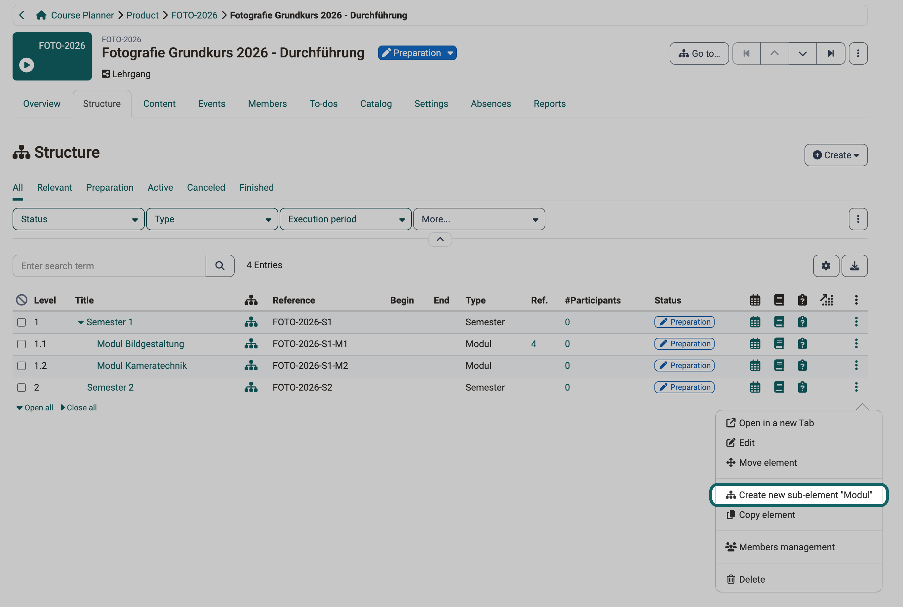

# How do I plan and run a product with several courses with the Course Planner? {: #plan_and_run_curriculum_with_course_planner}

??? abstract "Purpose and content of this guide"

    This guide takes you from the element type to the second implementation of a product that consists of several courses, for example a program with semesters and modules.

??? abstract "Target group"

    [ ] Authors [ ] Coaches  [ ] Participants  [x] Course planners

    [ ] Beginners [x] Advanced users  [x] Experts

??? abstract "Expected previous knowledge"

    * ["How do I plan and run a course in several implementations with the Course Planner?"](../course_planner_courses/course_planner_courses.md) 
    * [Course Planner: Overview >](../../manual_user/area_modules/Course_Planner.md) 

Program, study program, degree course or training: in the Course Planner, the offering is called a product, and each run of it is an implementation. For example, you plan a program with two semesters of three modules each, and each module is a course. The program starts again every autumn, with new participants.

This guide shows the order in which you build this in the Course Planner. The order matters, because the element type decides what you can build later: without sub-elements the implementation shows no "Structure" tab, and without the content "Single course" an element does not accept a course template. You build the structure once and then copy it for every new intake.

---

## Which planning fits? {: #which_planning}

Before you start, check whether you are on the right page. Choose the simplest planning that fits your case:

| Case | Element type of the implementation | Guide |
|---|---|---|
| One course, run several times | "Content" = "Single course" | [Plan a course in several implementations](../course_planner_courses/course_planner_courses.md) |
| Several courses without structure | "Subelements" = "No", "Content" = "Course bundle" | this guide, without step 4 |
| Several courses in a tree structure | "Subelements" = "Yes", courses on the sub-elements | this guide, all steps |

The user manual explains the three types of planning with diagrams: 
[Planning single courses >](../../manual_user/area_modules/Course_Planner.md#planning_single_courses) 
[Planning for course bundles >](../../manual_user/area_modules/Course_Planner.md#planning_course_bundles) 
[Planning for structured educational programs >](../../manual_user/area_modules/Course_Planner.md#planning_structured_product)

[To the top of the page ^](#plan_and_run_curriculum_with_course_planner)

---

## What must be set up? {: #requirements}

!!! info "frentix customers"

    The Course Planner is an additional module. For frentix customers, their customer advisor at frentix takes care of the activation.

To carry out the steps, four conditions must be met:

- **Course Planner switched on**: System administrators switch on the Course Planner in the system administration, with the switch Module "Course Planner" under `Administration > Modules > Course Planner > Tab "Settings"`.
- **Role**: You have the role Course planner or you are a product owner of the product. Authors have no access to the Course Planner, see [Who can use the Course Planner? >](../../manual_user/area_modules/Course_Planner.md#users)
- **Element types**: Suitable element types exist for the implementation and its elements (step 1).
- **Courses**: The courses have the usage "Use in Course Planner", course templates the usage "Template" (step 5).

[To the top of the page ^](#plan_and_run_curriculum_with_course_planner)

---

## Step 1: Clarify the element types {: #element_types}

The element types determine what you can build in an implementation: whether it contains semesters and modules, which element carries a course and where a course template is possible. System administrators create element types in the system administration. So before the first click, clarify with your system administrator which types exist and which ones you need. The types are under: 
`Administration > Modules > Course Planner > Tab "Element types"`

For a program with semesters and modules, three types are enough, for example:

| Element type | For use as | Subelements | Content | Child elements |
|---|---|---|---|---|
| Lehrgang | Implementation | Yes | No content | Semester |
| Semester | Element | Yes | No content | Modul |
| Modul | Element | No | Single course | (field does not appear) |

Each setting takes effect later in the implementation:

- **For use as**: A type for the implementation itself needs "Implementation", a type for semesters and modules "Element". The value results from the button the system administrator uses to create the type: "Create type for implementation" or "Create type for element". It cannot be changed afterwards.
- **Subelements**: Only with "Yes" does an implementation or an element show the "Structure" tab and accept sub-elements.
- **Content**: With "No content", the element carries no course and only serves to structure, its "Content" tab does not appear. This value only exists with "Subelements" = "Yes". An element with "Single course" carries exactly one course, and only there is the "Add course template" button available. An element with "Course bundle" carries several courses, but no course template.
- **Parent elements and child elements**: Here the system administrator determines which types may stand below which type. The field "Child elements" only appears with "Subelements" = "Yes", the field "Parent elements" only for types with "For use as" = "Element". The implementation later offers only the permitted types for creation (step 4).

The administration manual explains all fields of an element type: 
[Create and edit element types >](../../manual_admin/administration/Modules_Course_Planner.md#create_element_types)

[To the top of the page ^](#plan_and_run_curriculum_with_course_planner)

---

## Step 2: Create the product and determine the owners {: #create_product}

The product is the frame for all intakes of the program. How you create a product and determine product owners is shown in steps 1 and 2 of the guide [Plan a course in several implementations](../course_planner_courses/course_planner_courses.md#create_product).

In the product, you only add owners, in the "Owners" tab with the "Add product owner" button. Participants never become members of the product, but members of an implementation (step 9). A product owner sees the product even if it belongs to an organisation other than that of their role as course planner.

The product itself has no "Structure" tab. Its tabs are "Overview", "Implementations", "Events", "To-dos", "Owners", "Metadata" and "Reports". You build the structure in the implementation.

[To the top of the page ^](#plan_and_run_curriculum_with_course_planner)

---

## Step 3: Create the first implementation {: #create_implementation}

Structure, courses and members belong to the implementation, not to the product. So first create the implementation: 
`Course Planner > Products > "Title of the product" > Tab "Implementations" > Create`

The "Create" menu offers one entry per element type for implementations, for example Create new "Lehrgang". In the "Create new element" dialog, you enter "Title" and "Reference", the "Type" is preselected. You find the same menu under `Course Planner > Implementations > Create`.

The dialog does not ask for a date. You then set the execution period in the implementation: 
`Course Planner > Implementations > "Title of the implementation" > Tab "Settings" > Execution` 
Time-controlled automation rules depend on its begin or end (step 7).

[To the top of the page ^](#plan_and_run_curriculum_with_course_planner)

---

## Step 4: Build the structure {: #build_structure}

With the structure, you map semesters and modules the way the participants experience the program. For a course bundle without sub-elements, this step does not apply. Open the implementation and select the "Structure" tab. You create elements in two ways:

- **Create**: The button at the top right creates an element directly below the implementation. The menu only shows the types that the element type of the implementation permits under "Child elements", plus "Create new element".
- **Menu of the 3 dots**: At the end of a row, you create an element below this element. The entry names the permitted type, for example Create new sub-element "Modul" in the row of a semester.

{ class="shadow lightbox" title="Structure tab of an implementation · 2026.10.27" }

If a type is missing from these menus, it is not permitted below this element. This can only be changed in the element type, under "Child elements" or "Parent elements" (step 1). An element with "Subelements" = "Yes", in the example a semester, also has its own "Structure" tab.

If an element is in the wrong place, choose "Move element" in the menu of the 3 dots. In the dialog, you choose the target position and there "Above", "Below" or "Sub-element", then click "Move element".

You can find more about the "Structure" tab in the user manual under: 
[Tab Structure >](../../manual_user/area_modules/Course_Planner_Implementations.md#tab_structure)

[To the top of the page ^](#plan_and_run_curriculum_with_course_planner)

---

## Step 5: Assign courses {: #assign_courses}

The courses are attached to the elements that carry them in terms of content, in the example to the modules. Open the element via its title in the "Structure" tab and select the "Content" tab: 
`Course Planner > Implementations > "Title of the implementation" > Tab "Structure" > "Title of the element" > Tab "Content"`

Here you choose between a fixed course and a course template:

- **Add course**: You add an existing course. The dialog only shows courses with the usage "Use in Course Planner". Which other courses it hides is explained in [Which courses the "Add course" dialog shows >](../course_planner_courses/course_planner_courses.md#add_course_dialog)
- **Add course template**: You add a course with the usage "Template". From it, the Course Planner creates a separate course for this element, manually or through the automation (step 7). The button only exists for element types with "Content" = "Single course".

An element with "Course bundle" carries several courses, but no course template. An element with "No content" does not show the "Content" tab as long as it has no course.

[To the top of the page ^](#plan_and_run_curriculum_with_course_planner)

---

## Step 6: Plan events {: #plan_events}

You plan in-person days and exams on the element they belong to, so that they appear in the right module. Every implementation and every element has an "Events" tab, provided that the module "Events / Absences" is switched on in the system administration. You create an event with the "Add event" button. If the element has a course, you choose in the dialog under "Carried out in" the course in which the event takes place.

With "All levels", the implementation also shows the events of its elements, with "This level" only its own. The "Relevant" filter is preselected and hides past events. If the table appears empty, select the "All" filter.

How you set up an event is shown in step 4 of the guide [Plan a course in several implementations](../course_planner_courses/course_planner_courses.md#events). You can find more about the "Events" tab in the user manual under: 
[Tab Events >](../../manual_user/area_modules/Course_Planner_Implementations.md#tab_events)

[To the top of the page ^](#plan_and_run_curriculum_with_course_planner)

---

## Step 7: Define the automation {: #automation}

With many modules, the courses should be created at the planned time without you instantiating each course template individually. The automation takes care of this. You can find it under: 
`Course Planner > Implementations > "Title of the implementation" > Tab "Settings" > Automation`

Under "Configuration", you choose whether the implementation adopts the rules of its element type or whether you define your own rules with "Override". The first option shows in brackets whether the element type has rules. Enabled automations run once a day, the note above the selection gives the time.

!!! warning "Attention"

    The choice "Override" is saved immediately, without a "Save" button. If the element type has no rules, the implementation receives the six predefined rules, and all of them are switched on. Anyone who only wants to take a look switches on the automation this way. You switch off individual rules in the "Active" column.

The predefined rules of an implementation:

| Context | Automation | Target status | Condition |
|---|---|---|---|
| Implementation | Status change | Confirmed | 7 days before the begin of the execution period |
| Implementation | Status change | Finished | End of the execution period |
| Content | Instantiation | | When status is set to "Confirmed" |
| Content | Status change | Access for coach | When status is set to "Confirmed" |
| Content | Status change | Published | Begin of the execution period |
| Content | Status change | Finished | When status is set to "Canceled" or "Finished" |

The instantiation therefore depends on the status "Confirmed", not on a date. Because the first rule sets this status 7 days before the begin, the courses are created one week before the begin with the predefined rules. If the instantiation itself is to depend on a date, open "Edit automation rule" in the menu of the 3 dots of the rule after "Override". There you set the "Trigger" to "Time-controlled" and choose the interval to the begin of the execution period.

Each rule acts on the element in which it is defined. The instantiation of the implementation only creates courses from the course templates of the implementation itself. If the course template is attached to a module, the rules of the module apply, in the module under `Tab "Settings" > Automation`. With the predefined rules, an element instantiates as soon as it has the status "Active".

You can find more about the automation in the user manual under: 
[Configure automation >](../../manual_user/area_modules/Course_Planner_Implementations.md#tab_settings_automation)

[To the top of the page ^](#plan_and_run_curriculum_with_course_planner)

---

## Step 8: Offer in the catalog {: #offer}

Interested parties should book the whole program in one step, not each course individually. That is why offers only exist for the whole implementation: semesters and modules have no "Catalog" tab. You create an offer under: 
`Course Planner > Implementations > "Title of the implementation" > Tab "Catalog" > Offers > Add offer`

With the offer type "Invoice", the billing applies to the whole implementation. Under "Settings", you use "Booking" to determine whether you can also add participants without a booking order. The details are shown in step 5 of the guide [Plan a course in several implementations](../course_planner_courses/course_planner_courses.md#offer).

[To the top of the page ^](#plan_and_run_curriculum_with_course_planner)

---

## Step 9: Add members {: #add_members}

If you add a participant to the implementation once, they see all courses of the program. Someone who only takes one module receives only this part. Both happen in the same wizard: 
`Course Planner > Implementations > "Title of the implementation" > Tab "Members" > Add participants`

In the menu next to the button, you add coaches, master coaches, course owners and element owners. In the wizard, you first choose the persons. In the "Membership" step, you determine:

- **Standard or With confirmation**: "Standard" makes the membership active immediately, "With confirmation" creates it as pending.
- **Apply to**: The option with the title of the implementation and the addition "and contained elements" adds the person to the whole implementation. With "individual elements", you choose a part, for example a module.

In the last step "Notification", the "E-mail notification" switch is switched on. If the person should not receive an e-mail, switch it off there.

For a single element, there is a second way: in the "Structure" tab, the entry "Members management" in the menu of the 3 dots opens the element with its "Members" tab. The same wizard is available there.

You can find more about the "Members" tab in the user manual under: 
[Tab Members >](../../manual_user/area_modules/Course_Planner_Implementations.md#tab_members)

[To the top of the page ^](#plan_and_run_curriculum_with_course_planner)

---

## Step 10: Next implementation as a copy {: #copy}

You do not rebuild the program for next autumn, you copy the existing implementation. You find the action "Copy element" in the menu of the 3 dots in the list of implementations: 
`Course Planner > Products > "Title of the product" > Tab "Implementations" > 3 dots > Copy element` 
The same menu exists under `Course Planner > Implementations`. The menu at the top right of the opened implementation does not contain the entry.

The "Copy element" wizard takes over the whole structure. In the "General settings" step, you enter the title and reference of the new implementation and choose what comes along:

| Field | Choice |
|---|---|
| Content | "Copy", "Reuse" or "Don't copy" |
| Standalone events | "Copy" or "Don't copy" |
| To-dos | "Standard", "To-dos only" or "Don't copy" |
| Room scheduling | "Copy" or "Don't copy" |
| Coaches | "Standard", "Membership only" or "Don't copy" |
| Master coaches / Course owners / Element owners | "Including membership" or "Don't copy" |

The copy never takes over participants, the new implementation starts without them. For "Content", "Copy" reuses a course template or copies a course without a template. "Reuse" shares the course with the previous implementation. Events of the new implementation are then in the same course as those of the previous one.

In the "Overview elements" step, you shift all dates together with the "Shift all dates" button, for example by one year. In the dialog, you choose under "Shift by" a new "Date" or a number of "Days". If the template has no execution period, "Reference date (earliest)" shows no value, and you shift with "Days". If the implementation has offers, an "Offers" step follows.

If you plan many implementations at once, you can create them with the Excel import instead. Organisations, element types and subjects must already exist for this. How this works is shown in the user manual under: 
[Course Planner: Import / Export >](../../manual_user/area_modules/Course_Planner_Import_Export.md)

[To the top of the page ^](#plan_and_run_curriculum_with_course_planner)

---

## Further information {: #further_information}

**Mentioned on this page** 
[How do I plan and run a course in several implementations with the Course Planner? >](../course_planner_courses/course_planner_courses.md) 
[Course Planner: Overview >](../../manual_user/area_modules/Course_Planner.md) 
[Module Course Planner >](../../manual_admin/administration/Modules_Course_Planner.md) 
[Course Planner: Implementations >](../../manual_user/area_modules/Course_Planner_Implementations.md) 
[Course Planner: Import / Export >](../../manual_user/area_modules/Course_Planner_Import_Export.md)

**Further reading** 
[Course Planner: Products >](../../manual_user/area_modules/Course_Planner_Products.md) 
[Course Planner: Events >](../../manual_user/area_modules/Course_Planner_Events.md) 
[Course Planner: Reports >](../../manual_user/area_modules/Course_Planner_Reports.md)

[To the top of the page ^](#plan_and_run_curriculum_with_course_planner)
