# How do I create a form learning resource? {: #create_form}

## 1. What is a form in OpenOlat? {: #step1}

An OpenOlat form is a page that can be filled out interactively by users. Typically, questions are to be answered by ticking something or entering an answer as text.

The information can be stored anonymously or on a personal basis.

Authorized persons have access to the information provided and can call up evaluations.

Form learning resources are created in the authoring area by persons with the author role.

---

## 2. Course element and learning resource {: #step2}

An OpenOlat course is composed of course elements. Most course elements are containers into which a learning resource is inserted.

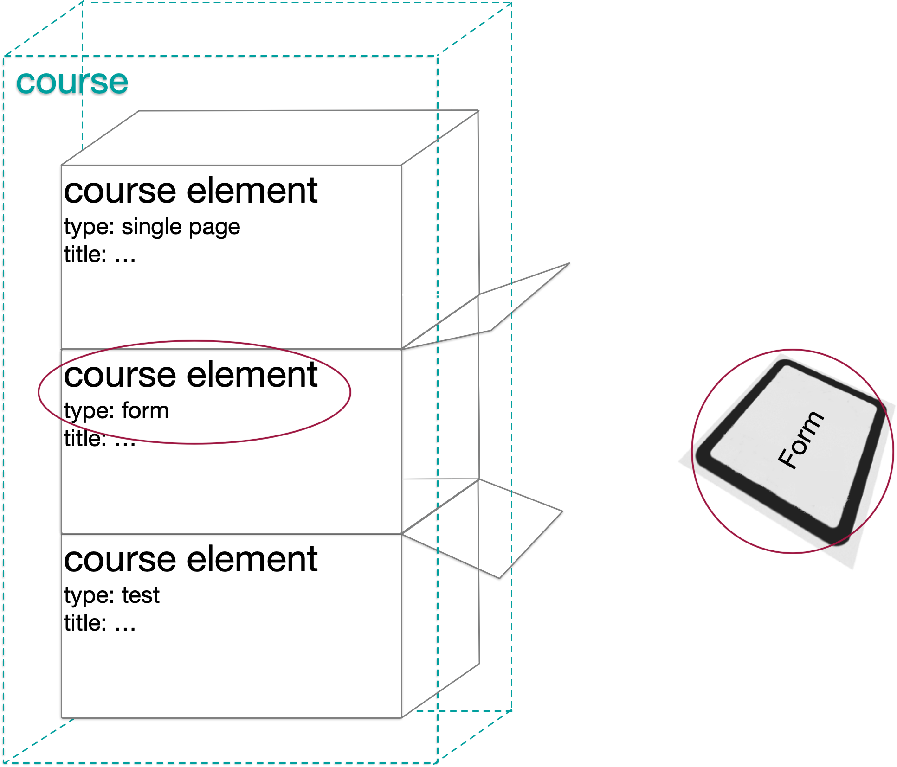{ width=300px class="lightbox" title="Course element and learning resource" }

**Attention!** 
There is a learning resource "Form" and a course element "Form". The learning resource contains the form itself, the course element includes it in a course. A form learning resource can be used in different places in OpenOlat (see next section).

This tutorial describes how to create the form **learning resource**.
There are further instructions for using the learning resource in different course elements.

!!! note "Note"

    In previous OpenOlat versions, form learning resources were called **questionnaires**. They were based on the QTI 1.2 standard, which is now no longer supported.

[To the top of the page ^](#create_form)

---

## 3. Where are form learning resources used?  {: #step3}

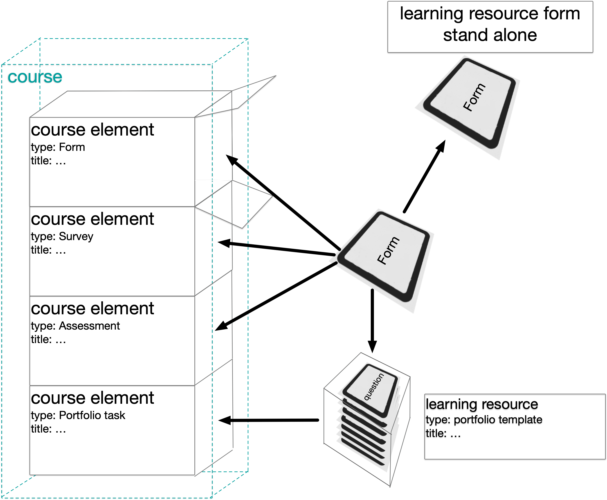{ width=400px class="lightbox" title="Places where a form learning resource is used" }

a) Form learning resource in the **course element Form**

b) Form learning resource in the **course element Survey**

c) Form learning resource in the **course element Assessment**

d) Form learning resource **in a portfolio**

e) Form learning resource **stand-alone**

[To the top of the page ^](#create_form)

---

## 4. What is a form capable of?  {: #step4}

<h3> a) What does a form look like?</h3>

Various question types are available in forms:

* Rubric 
* Single choice
* Multiple choice
* Text block
* Date / Time
* Upload file

A rubric is a grid of rows and columns: the rows carry the criteria or statements, the columns the levels of a common rating scale. A text block is an input field in which the participants write their answer.

Depending on the objective, forms can be designed quite differently with it. Here is an example in the participant view:

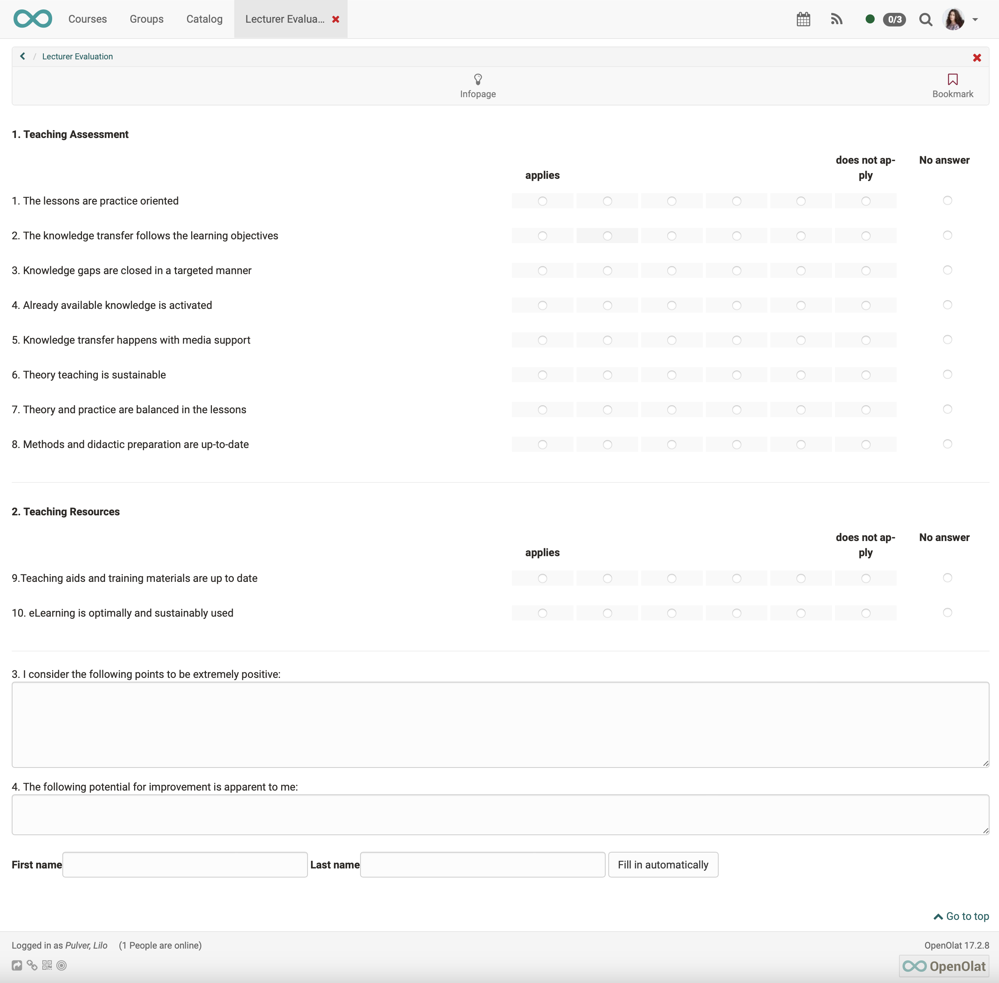{ class="shadow lightbox" title="Form in the participant view" }

 

<h3> b) What does a form consist of?</h3>

Each form consists of a page with one or more questions or other elements (e.g. title). The individual elements can be selected in the editor and then be edited. In some cases, a pop-up (inspector window) with setting options is displayed.

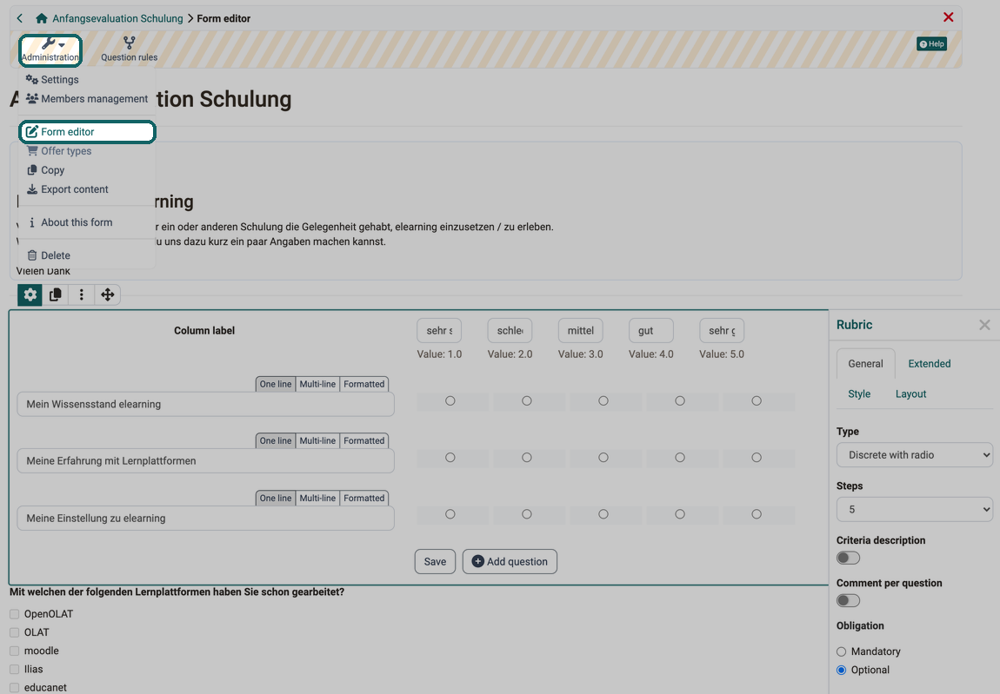{ class="shadow lightbox" title="Rubric element in the form editor · 2026.09.28" }

 

<h3> c) How does a form work? </h3>

If participants have entered a response in the form, the entries are saved per participant. 
Exception: An anonymous survey was created.

The answers can be viewed by authorized persons. 
Who is authorized can be configured, see [8. Configure forms](#step8).

If coaches click on the course element "Form" in the course, they do not see the form like the participants, but the list of participants with status and submission date. The status shows how far someone has got: "Not started", "In progress" or "Done". By default, only persons with a system role such as author or administrator see the column "Username", coaches without such a role do not see it. The administration of OpenOlat sets which roles see the username. From the list coaches open the individual forms, with "Export data" they download the entries. 

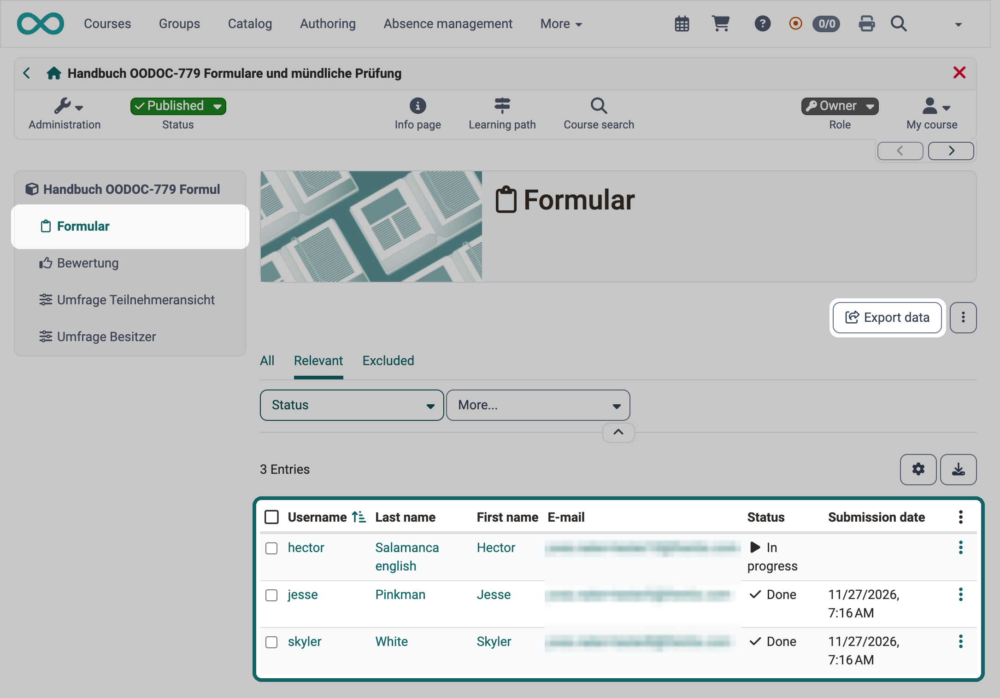{ class="shadow lightbox" title="Course element Form as seen by coaches · 2026.11.27" }

!!! info "Question rules"

    A **branch** is also possible via **question rules**: "If question xy is answered this way, then ..."

    You can find the icon for creating the rules in the header of the form editor.

    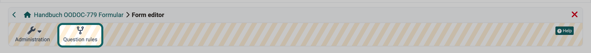{ class="shadow lightbox" title="Header of the form editor · 2026.11.10" }

[To the top of the page ^](#create_form)

---

## 5. Create/edit forms  {: #step5}

You design a form learning resource in the form editor. You open it from different places:

<h3>a) Authoring > create new form</h3>

You can create a form learning resource directly in the authoring area and add its elements in the form editor, without any course. Subsequently, you can access this prepared form learning resource when editing a course and include it in a course element.

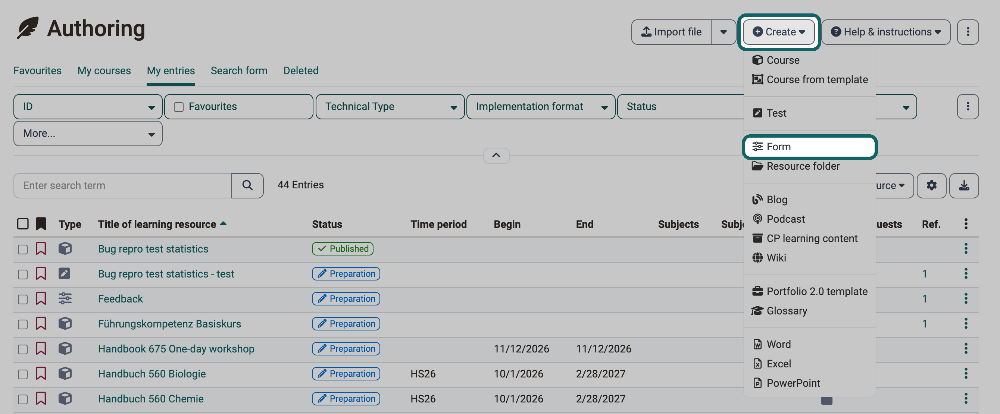{ class="shadow lightbox" title="Authoring area · 2026.11.10" } 

 

<h3>b) Authoring > tab "My entries" > select available form > Form editor</h3>

Does the form learning resource already exist but is still empty? Since we then edit a form **learning resource**, it can be found in the authoring area under the tab "My entries". (Only courses are listed under "My courses".) Use the filters to search in large databases.

To edit, click on the title and then open `Form > Administration > Form editor`. Alternatively, select the entry "Form editor" in the menu with the 3 dots at the end of the line.

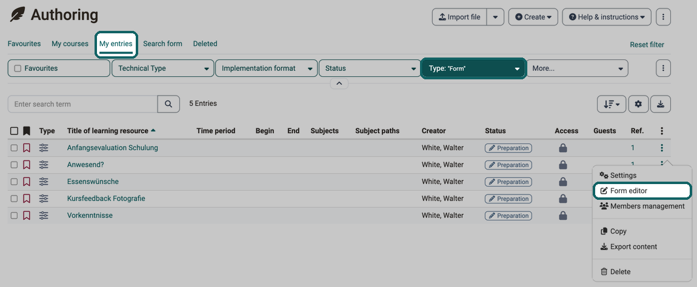{ class="shadow lightbox" title="Tab My entries in the authoring area · 2026.09.28" } 

 

<h3>c) Course editor > course element > tab for learning content (e.g. tab "Survey") > buttons "Select", "Create" and "Import" </h3>

If you have inserted a course element in the course editor (e.g. the course element "Survey"), then a learning resource must be inserted there under the tab "Survey". With "Select" you choose an existing form learning resource, with "Import" you import one. If no form learning resource is prepared, you create a new one directly here with "Create".

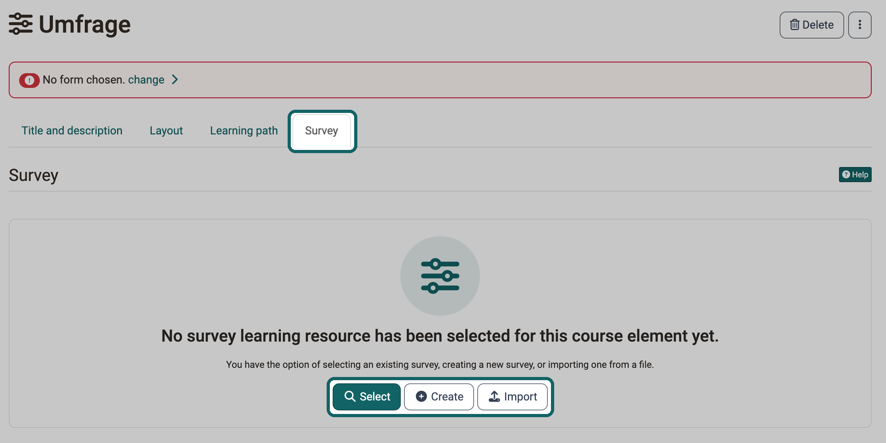{ class="shadow lightbox" title="Course element Survey without form · 2026.11.10" } 

 

<h3>d) Course editor > course element > tab for learning content > button "Edit learning resource"</h3>

If a form learning resource is already included in the course element, you open it in the course editor with the button "Edit learning resource". In the opened learning resource, select `Form > Administration > Form editor`. If the form has no content yet, the button "Form editor" on the empty page also takes you there.

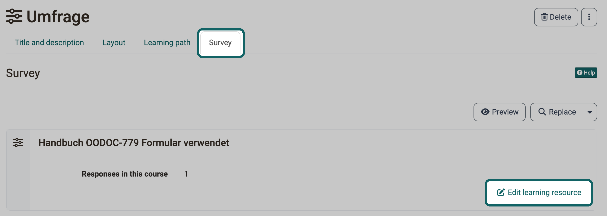{ class="shadow lightbox" title="Course element Survey with form · 2026.11.10" } 

!!! tip "Tip"

    Since the learning resource form can be used in many different ways, it makes sense to consider the later use already in the title, for example with a suitable abbreviation at the beginning. This makes it easier to find and assign the learning resource later.

!!! tip "Tip"

    When you create a brand new form learning resource in the authoring area, OpenOlat takes you to the settings of the learning resource, tab "Metadata", after you enter the title.
    Here you can set settings right away, for example store a license. However, you can also access it again at any time later. For more information, see [8. Configure forms](#step8).

!!! info "Important"

    If a form has already been used (opened or filled in by participants), there are restrictions on editing. (See below: [9. Modify forms](#step9))

[To the top of the page ^](#create_form)

---

## 6. Designing forms in the editor  {: #step6}

Once you have opened the form editor via `Form > Administration > Form editor`, you see the default **layout** with one column. You insert further layouts with the button "Add a new layout".  
A layout here means a **grid**. You can insert several such layouts one after the other.

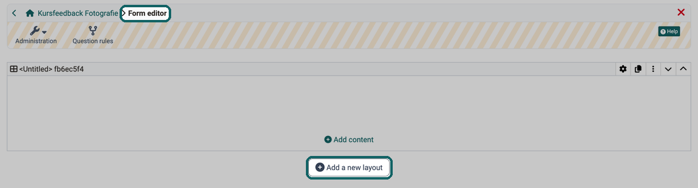{ class="shadow lightbox" title="New form learning resource in the form editor · 2026.09.28" } 
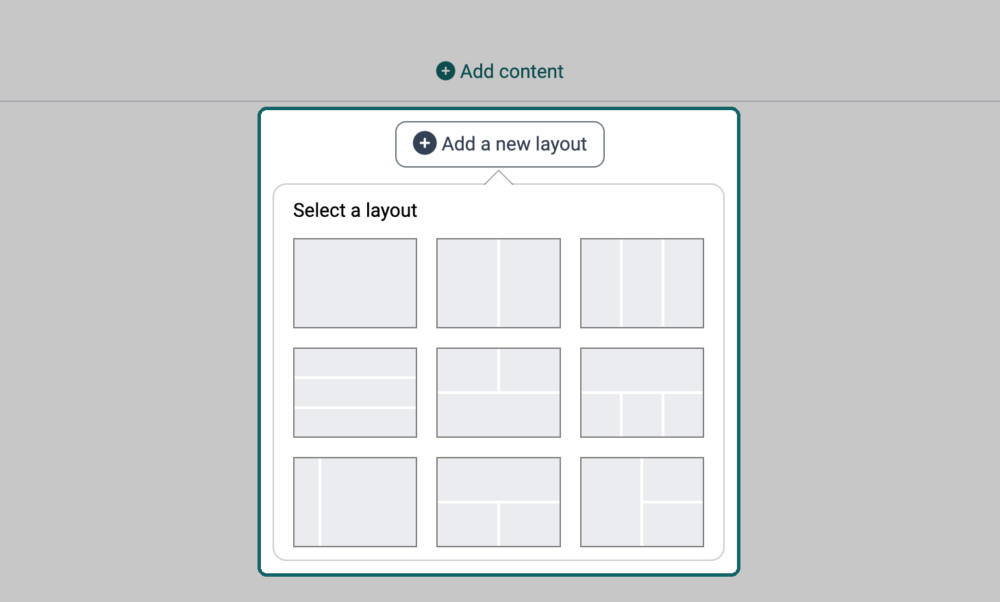{ class="shadow lightbox" title="Layout selection in the form editor · 2026.11.10" } 

 

Now insert the content into the fields of the layout, for example titles, texts and single choices.

If you want to change the layout afterwards, click on the small gear of the layout. In the inspector, select another template in the tab "Layout".

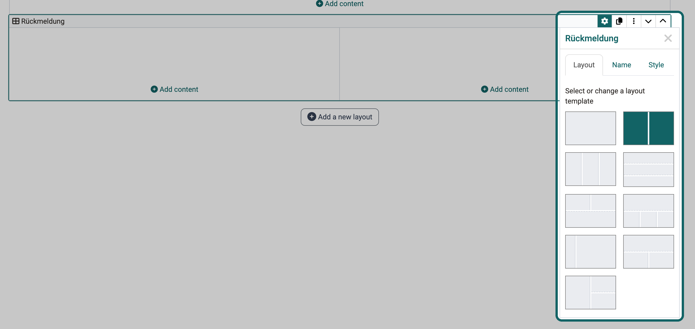{ class="shadow lightbox" title="Tab Layout in the form editor · 2026.11.10" } 

 

Now add titles, texts and the different questions. It is best to start with a title and a short introductory text in the element "Text" that informs the participants. Unlike the question type "Text block", the element "Text" only displays text, without an input field.

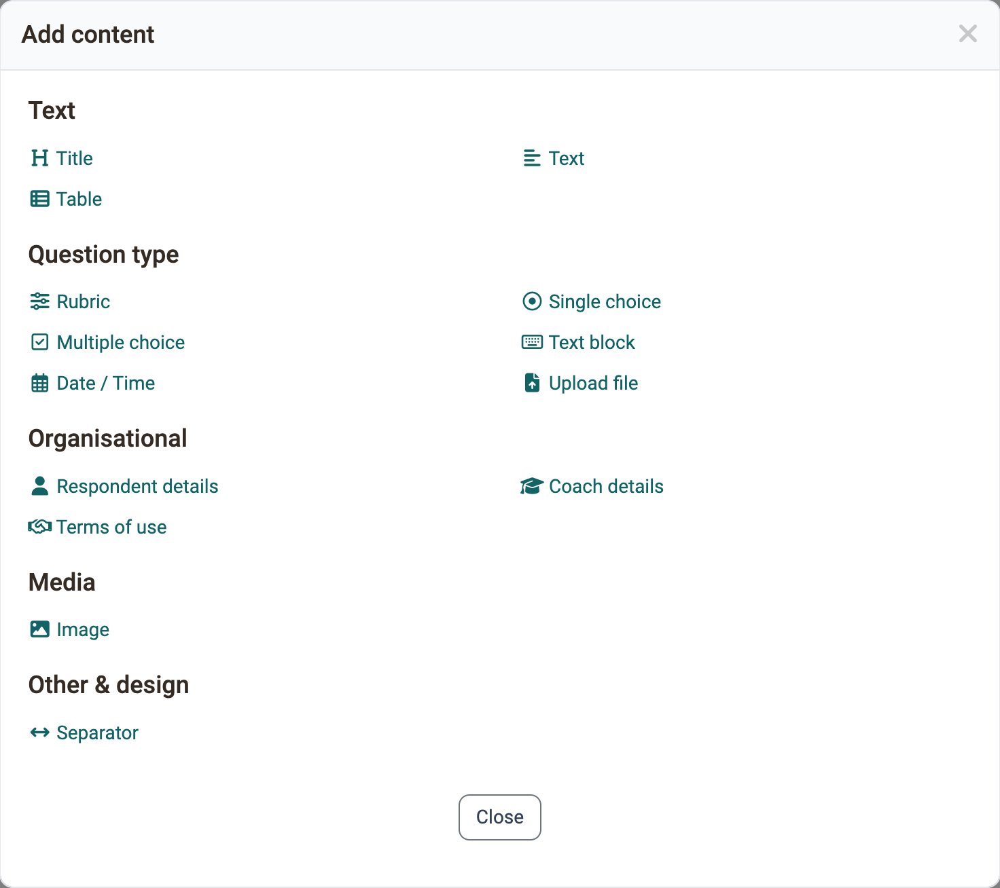{ class="shadow lightbox" title="Window Add content in the form editor · 2026.11.09" } 

 

In each case, click "Add content" in the field of the layout and then use the options provided. 
For example, for a "Title" element.

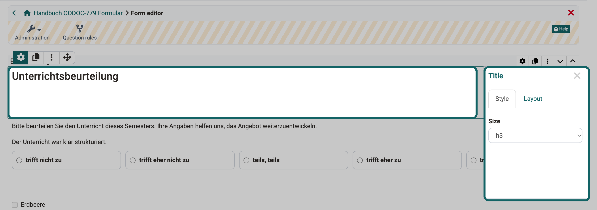{ class="shadow lightbox" title="Title element in the form editor · 2026.11.10" } 

For a "Rubric" element, the options are much more diverse. However, the same principle of procedure always applies:

* Select an element.
* The displayed options apply to the currently selected element.

For a rubric element, the inspector shows the tabs "General", "Extended", "Style" and "Layout". In the tab "General" you set, among other things, "Type", "Steps" and "Obligation", in the tab "Extended" the name of the rubric, the "Scale type" and the value ranges. All options are described on the page [The form element rubric](../../manual_user/learningresources/Form_Element_Rubric.md).

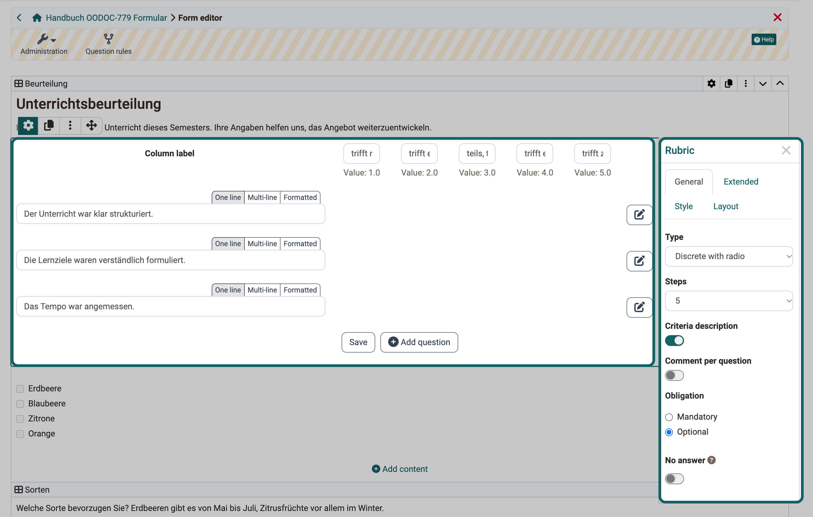{ class="shadow lightbox" title="Options of a rubric element · 2026.11.10" } 

 

<h3>Finish editing </h3>

* Repeat the process until the form is completed.
* As an alternative to the "Add content" button, you can also click on the icon with the 3 dots for content that has already been added and then select "Add before" or "Add after". You will see the selection of all elements again.
* If you want to use recurring elements, you can also duplicate them.
* If you want to change the order of the elements, you can simply drag and drop them.

When you are done **close the editor by clicking on the title of the form in the breadcrumb navigation**. The form is now saved and you will see the form from the participants' perspective.

[To the top of the page ^](#create_form)

---

## 7. Testing forms  {: #step7}

To test a form as an author, select "Participant view" in the menu "Role" under "Switch to":

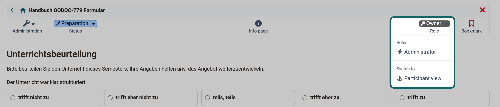{ class="shadow lightbox" title="Role switch in the form learning resource · 2026.11.10" } 

 

!!! warning "Limited editing possibility after data entry"

    When others (non-owners) test, their entered data is saved and a form can only be changed to a limited extent afterwards. This prevents subsequent manipulation.

    This also applies to you as an owner: if you open a course element "Survey" in the course under `Role > Switch to > Participant view`, the form can only be changed to a limited extent afterwards, even if you do not enter anything. The form editor then shows the message "The resource is already used. Editing is limited." Limited means: you can no longer add, duplicate, delete or move elements. If you open the course element without a role switch in your role "Owner" instead, by default you see the results of the survey, and the form remains freely editable.

    If editing is already limited because others or you yourself have opened the form as a participant, create a copy of the learning resource via `Form > Administration > Copy`, change the copy and include it in a new course element.

 

!!! tip "Tip when a 'Not accessible' appears"

    If you as an author have published a course and then call it up, it can happen that the course element with the form learning resource is not accessible.

    Often it is because authors are not allowed to fill in the form themselves according to the preset configuration, because they are owners but not participants. In the course element "Survey", for example, only the role "Participant" is preset under "Participation by" in the tab "Survey". Owners see the results there if they are selected under "Results visible for", as in the preset. Otherwise the course element is not accessible for them.

    You can get around this by switching to the "Participant view" in the menu "Role" of the course. Note the warning above: afterwards, the form can only be changed to a limited extent.

[To the top of the page ^](#create_form)

---

## 8. Configure forms  {: #step8}

<h3>Where are configurations done?</h3>

Already when creating a new form learning resource you get to the settings after specifying a title. There you can configure the learning resource.
Often you skip these input fields at first. The settings can be called up again at any time and edited.

You have also made settings when creating the questions. You have configured individual questions. The configurations can therefore be made at different levels:

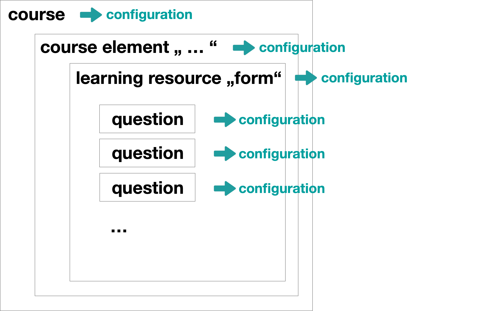{ width=450px class="lightbox" title="Levels of configuration" }

**Configuration of the course:** 
`Course > Administration > Settings`

**Configuration of the course element:** 
`Course > Administration > Course editor > "Course element" > tabs of the course element`

**Configuration of the learning resource:** 
`Form > Administration > Settings`

**Configuration of a question:** 
Open the form in the form editor: `Form > Administration > Form editor`. Clicking an element switches to the edit mode, and the related options appear.

 

<h3>What can be configured?</h3>

A complete enumeration of all configuration options across all levels would be too extensive at this point. The main options concern

* the appearance of the form and the questions
* who may fill out the form
* in which period the form can be filled in
* whether the information is collected anonymously or personalized 
* who may see the entries and evaluations
* ...

!!! info "Anonymous or personalized?"

    You can have forms filled out anonymously or with the name.
    By default, a form records no personalized information. With the element "[Respondent details](../../manual_user/learningresources/Form_Elements/index.md#form_element_info)", the form is no longer anonymous, and you evaluate the answers per person.
    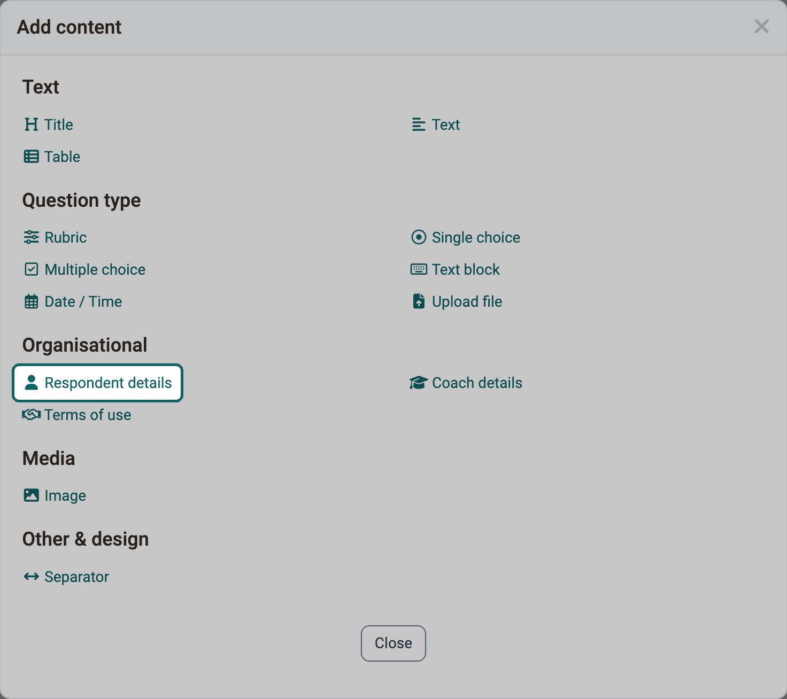{ class="shadow lightbox" title="Element Respondent details in the form editor · 2026.11.09" } 

!!! tip "Note on Share"

    If you want to use the form in course elements, you do **not** need to set up the tab "Share" of the learning resource Form any further. Setting up the tab "Share" is primarily relevant if you want to use the learning resource stand-alone.

!!! tip "To note when the learning path is used"

    Are you using the learning path? If yes, make sure that the configuration of preceding course elements or the top course node does not undesirably restrict processing. E.g. by sequential learning steps or if the preceding course element must be completed compulsorily before one arrives at the form.

[To the top of the page ^](#create_form)

---

## 9. Modify forms  {: #step9}

As soon as a form learning resource has been included in a course element and a participant has filled in the form, data exists.
However, this also means that the form must not be changed after the first use. This would otherwise allow any subsequent manipulations.

**Once a form has been included and called up in the course, the form can therefore only be changed to a limited extent.**

**No longer possible** is, for example, the addition of further questions or question rules.

**Possible** is e.g. still the change of the name of a rubric:

* In the form editor, click the relevant rubric to edit it.
* Select the "Extended" tab in the inspector popup.
* Change the name of the rubric in the field "Name". "Show name", "Positive rating" and the value ranges "Insufficient", "Neutral" and "Good" also remain editable. The field "Scale type" is locked.

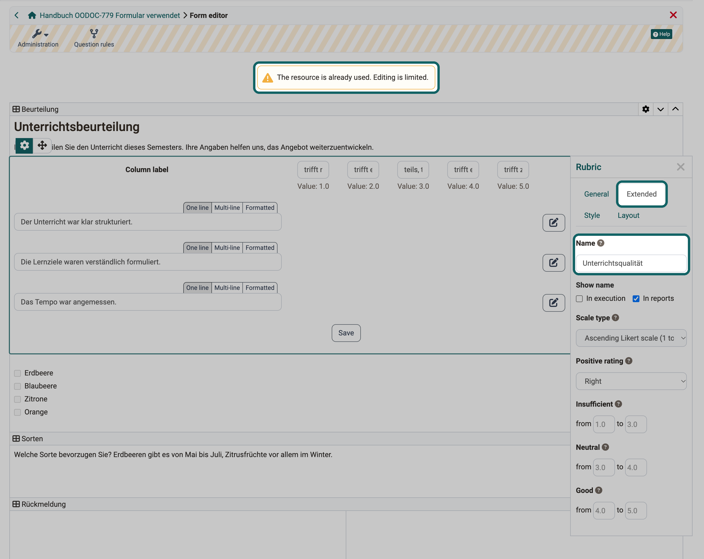{ class="shadow lightbox" title="Form editor for a form already in use · 2026.11.10" }

[To the top of the page ^](#create_form)

---

## Examples

### Example 1: Teaching quality survey {: #example1}

Characteristics:

* often single choice, in order to force a clear statement
* anonymous
* the example below uses rubrics of the type "Discrete with slider"

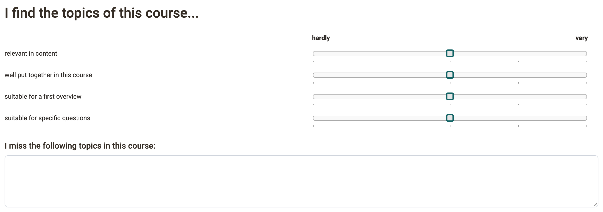{ class="shadow lightbox" title="Example teaching quality survey · 2026.11.10" }

[OpenOlat learning resource to download](assets/form_example1_teaching_survey_en.zip)

---

### Example 2: Employee survey {: #example2}

Characteristics:

* personalized
* often text input, e.g. personal goals of the employees
* fewer questions with answer type correct / wrong

---

### Example 3: Customer satisfaction survey {: #example3}

Characteristics:

* often traffic light system, as it simplifies the response and means little effort for customers

---

### Example 4: Assessment of the oral presentation in English {: #example4}

Characteristics:

* personalized
* assessment criteria independent of topic
* form options must be quickly comprehensible for the evaluating examiners

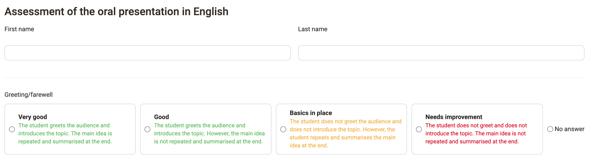{ class="shadow lightbox" title="Example assessment of a presentation · 2026.11.10" }

[OpenOlat learning resource to download](assets/form_example4_presentation_rubric_en.zip)

---

### Example 5: Rubric in the peer review {: #example5}

Characteristics:

* form usually contains only 1 rubric element (except title etc.)

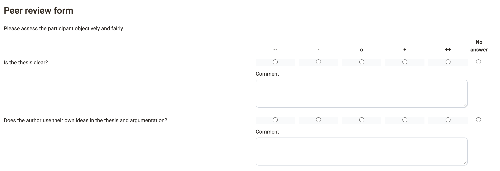{ class="shadow lightbox" title="Example form for a peer review · 2026.11.10" }

[OpenOlat learning resource to download](assets/form_example5_peer_review_en.zip)

[To the top of the page ^](#create_form)

---

## Further information {: #further_information}

**Mentioned on this page** 
[The form element rubric >](../../manual_user/learningresources/Form_Element_Rubric.md) 
[Form elements >](../../manual_user/learningresources/Form_Elements/index.md)

**Further reading** 
[Forms - Overview >](../../manual_user/learningresources/Form/index.md) 
[The form editor >](../../manual_user/learningresources/Form_Editor/index.md) 
[Question rules in forms >](../../manual_user/learningresources/Form_Question_Rules.md) 
[Forms in courses >](../../manual_user/learningresources/Forms_in_Courses.md) 
[Course Element "Form" >](../../manual_user/learningresources/Course_Element_Form.md) 
[Course Element "Survey" >](../../manual_user/learningresources/Course_Element_Survey.md) 
[Forms in Rubric Scoring >](../../manual_user/learningresources/Forms_in_Rubric_Scoring.md) 
[Course Element "Task" >](../../manual_user/learningresources/Course_Element_Task/index.md) 
[Form in the Portfolio 2.0 template >](../../manual_user/learningresources/Forms_in_the_ePortfolio_template.md) 
[How do I perform a peer review? >](../peer_review/peer_review.md)

[To the top of the page ^](#create_form)
