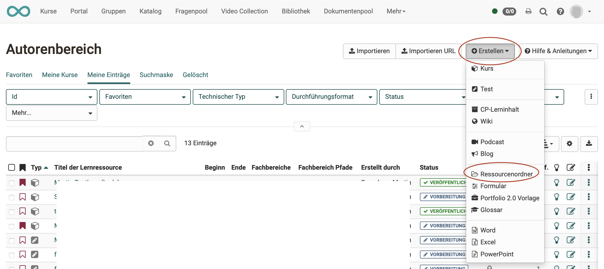
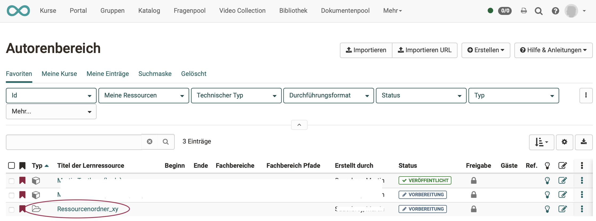
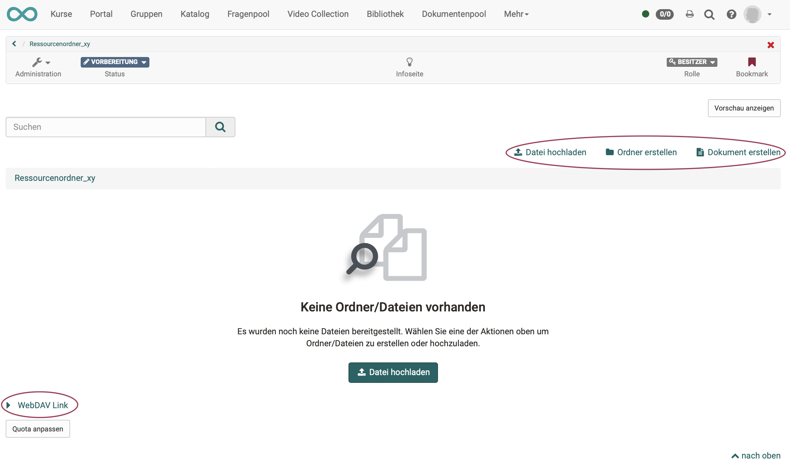
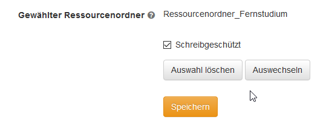

# Wie kann ich dieselben Dateien in mehreren Kursen einsetzen? {: #multiple_use}

Wenn Sie ein Lehrszenario mit mehreren Kursen umsetzen, zum Beispiel einen Studiengang, und viele Dateien in allen Kursen brauchen, legen Sie diese Dateien zentral in einem Ressourcenordner ab und binden ihn in alle gewünschten Kurse ein. Sie ändern eine Datei dann nur einmal, und die Änderung ist automatisch in allen verknüpften Kursen sichtbar.

Typische Beispiele für derartige Dateien sind:

* grundsätzliche Rahmenbedingungen,
* AGBs,
* organisatorische Infos,
* Infos zur generellen Betreuung bzw. Ansprechpartnern,
* kursübergreifende Lehrmaterialien
* usw.

## Was Sie benötigen

* die Rolle Autor:in
* die Rolle Besitzer:in in den Kursen, in die Sie den Ressourcenordner einbinden
* einen [Ressourcenordner](../../manual_user/learningresources/Resource_Folder.de.md)
* mehrere Kurse
* Dateien, die Sie mehrfach verwenden wollen

## Vorgehensweise {: #procedure}

Sie gehen in drei Schritten vor: Sie erstellen den Ressourcenordner, binden ihn in die Kurse ein und verwenden seine Dateien im Kurs.

### 1. Ressourcenordner erstellen

1.1 Öffnen Sie den [Autorenbereich](../../manual_user/area_modules/Authoring/index.de.md) und wählen Sie: 
`Autorenbereich > Erstellen > Ressourcenordner`

{ class="shadow lightbox" title="Menü Erstellen im Autorenbereich" }
 

1.2 Geben Sie dem Ressourcenordner einen passenden Titel. Die übrigen Felder sind optional: Da Sie den Ressourcenordner vor allem für Ihre eigene Organisation nutzen, genügt meist der Titel.

{ class="shadow lightbox" title="Dialog Ressourcenordner erstellen" }

!!! info "Hinweis"

    Ressourcenordner werden wie andere Lernressourcen im Autorenbereich aufgelistet. Technisch gesehen, ist ein kompletter Ressourcenordner eine einzelne Lernressource.
 

1.3 Öffnen Sie den neuen Ressourcenordner in der Liste des Autorenbereichs.

{ class="shadow lightbox" title="Liste im Autorenbereich" }
 

1.4 Hier laden Sie nun Dateien hoch und erstellen bei Bedarf Unterordner.

Wenn Sie viele Dateien hochladen wollen, nutzen Sie [WebDAV](../webdav/webdav.de.md). Den WebDAV-Link öffnen Sie im Ressourcenordner über das 3-Punkte-Menü mit "WebDAV-Link". Den Eintrag zeigt der Ordner, wenn die System-Administration die WebDAV-Links eingeschaltet hat.

Die üblichen Einstellungen einer Lernressource finden Sie unter: 
`Ressourcenordner > Administration > Einstellungen`

{ class="shadow lightbox" title="Leerer Ressourcenordner" }

1.5 Alternativ erstellen Sie Dateien direkt im Ressourcenordner, zum Beispiel ein Word-Dokument.

{ class="shadow lightbox" title="Dialog Dokument erstellen" }

### 2. Ressourcenordner in Kurse einbinden

2.1 Öffnen Sie den gewünschten Kurs und wählen Sie in den [Kurseinstellungen](../../manual_user/learningresources/Course_Settings_Options.de.md) den Tab "Optionen": 
`Kurs > Administration > Einstellungen > Tab "Optionen"`

{ class="shadow lightbox" title="Reiter Optionen in den Kurseinstellungen" }

  

2.2 Klicken Sie unter "Gewählter Ressourcenordner" auf "Auswechseln".

{ class="shadow lightbox" title="Bereich Gewählter Ressourcenordner" }

  

2.3 Wählen Sie den zuvor erstellten Ressourcenordner aus, um ihn mit dem Kurs zu verknüpfen. Danach steht sein Titel unter "Gewählter Ressourcenordner", daneben der Button "Auswahl löschen", mit dem Sie die Verknüpfung wieder aufheben. Mit "Speichern" übernehmen Sie die Wahl.

 

2.4 Standardmässig sind die Dateien des Ressourcenordners im Kurs schreibgeschützt. So ändern Sie die Dateien zentral im Ressourcenordner, und alle Kurse zeigen denselben Stand. Sollen Dateien auch aus dem Kurs heraus bearbeitet werden können, entfernen Sie im Tab "Optionen" das Häkchen "Schreibgeschützt" und speichern. Das Häkchen lässt sich nur ändern, wenn Sie auch den Ressourcenordner verwalten dürfen. Änderungen aus dem Kurs gelten direkt im Ressourcenordner und damit in allen verknüpften Kursen.

{ class="shadow lightbox" title="Gewählter Ressourcenordner mit Schreibschutz" }

Wiederholen Sie das Vorgehen für alle relevanten Kurse.

### 3. Zugriff auf die Dateien organisieren

3.1 Die Dateien des Ressourcenordners finden Sie im Kurs unter: 
`Kurs > Administration > Dateien` 
Dort erscheint neben dem "Ablageordner" der automatisch angelegte Ordner "_sharedfolder" mit allen Dateien des Ressourcenordners.

{ class="shadow lightbox" title="Menü Administration im Kurs" }

{ class="shadow lightbox" title="Ablageordner des Kurses" }

3.2 Die Dateien dieses Ordners binden Sie wie alle anderen Dateien des Kurses im Kurseditor über den Kursbaustein "[HTML-Seite](../../manual_user/learningresources/Course_Element_HTML_Page.de.md)" ein.

!!! warning "Zu beachten"

    Sie können nur einen Ressourcenordner pro Kurs einbinden. Überlegen Sie deshalb im Vorfeld genau, welche Dateien Sie über einen kursübergreifenden Ressourcenordner statt über den kursbezogenen Ablageordner organisieren möchten.

## Weiterführende Informationen {: #further_information}

[Ressourcenordner >](../../manual_user/learningresources/Resource_Folder.de.md) 
[Autorenbereich - Übersicht >](../../manual_user/area_modules/Authoring/index.de.md) 
[Wie kann ich mittels WebDAV Dateien übertragen? >](../webdav/webdav.de.md) 
[Kurseinstellungen - Tab Optionen >](../../manual_user/learningresources/Course_Settings_Options.de.md) 
[Kursbaustein "HTML-Seite" >](../../manual_user/learningresources/Course_Element_HTML_Page.de.md) 
[Ablageordner >](../../manual_user/learningresources/Storage_folder.de.md) 
[Einsatz von WebDAV >](../../manual_user/basic_concepts/Using_WebDAV.de.md)

[Zum Seitenanfang ^](#multiple_use)
