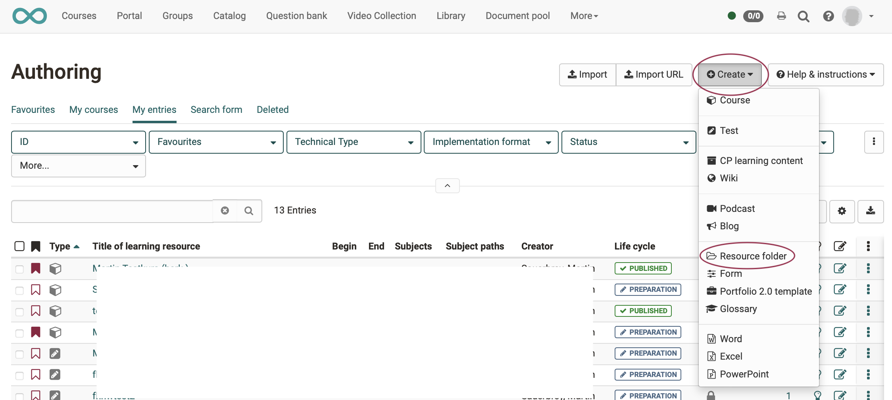
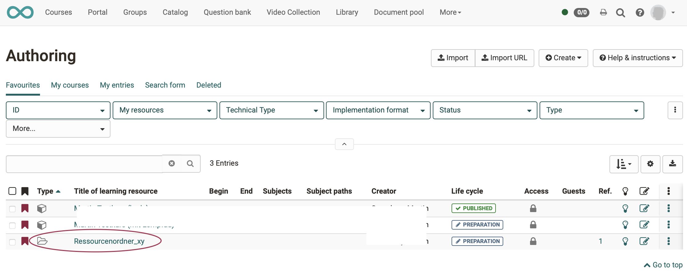
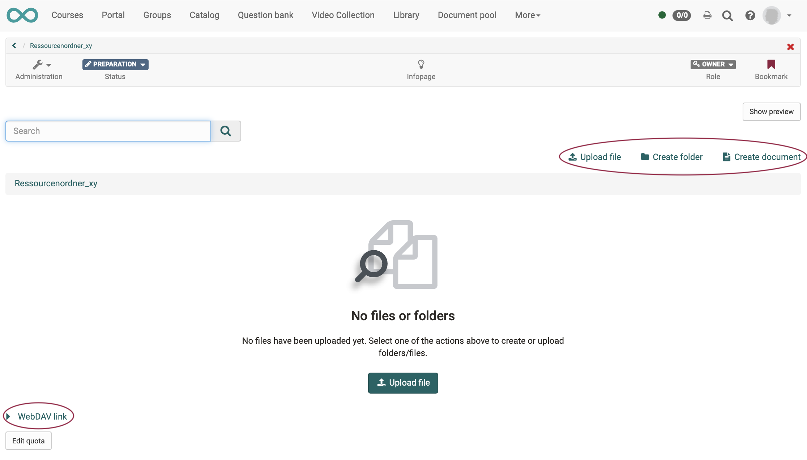
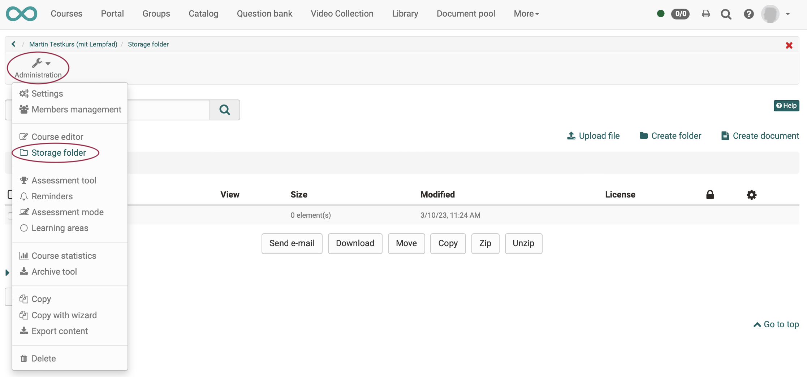
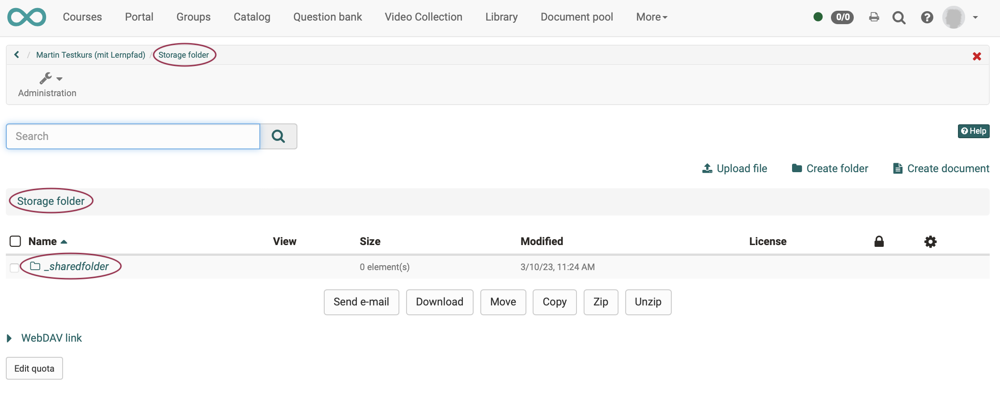

# How can I use the same files in several courses? {: #multiple_use}

If you implement a teaching scenario with several courses, for example a course of studies, and need many files in all courses, store these files centrally in a resource folder and include it in all desired courses. You then change a file only once, and the change is automatically visible in all linked courses.

Typical examples for such files are:

* basic framework conditions,
* general terms and conditions,
* organizational information,
* information on general support and contact persons,
* cross-course teaching materials
* etc.

## What you need

* the role author
* the role owner in the courses in which you include the resource folder
* a [resource folder](../../manual_user/learningresources/Resource_Folder.md)
* multiple courses
* files you want to use several times

## Procedure {: #procedure}

You proceed in three steps: you create the resource folder, include it in the courses and use its files in the course.

### 1. Create a resource folder

1.1 Open the [Authoring](../../manual_user/area_modules/Authoring/index.md) area and select: 
`Authoring > Create > Resource folder`

{ class="shadow lightbox" title="Create menu in Authoring" }
 

1.2 Give the resource folder a suitable title. The other fields are optional: since you mainly use the resource folder for your own organization, the title is usually sufficient.

{ class="shadow lightbox" title="Create resource folder dialog" }

!!! info "Note"

    Resource folders are listed like other learning resources in the authoring area. Technically, a complete resource folder is a single learning resource.
 

1.3 Open the new resource folder in the Authoring list.

{ class="shadow lightbox" title="List in Authoring" }
 

1.4 Here you now upload files and create subfolders if necessary.

If you want to upload many files, use [WebDAV](../webdav/webdav.md). You open the WebDAV link in the resource folder via the 3-dot menu with "WebDAV link". The folder shows the entry if the system administration has switched on the WebDAV links.

You find the usual settings of a learning resource under: 
`Resource folder > Administration > Settings`

{ class="shadow lightbox" title="Empty resource folder" }

1.5 Alternatively, you create files directly in the resource folder, for example a Word document.

{ class="shadow lightbox" title="Create document dialog" }

### 2. Include the resource folder in courses

2.1 Open the desired course and select the "Options" tab in the [course settings](../../manual_user/learningresources/Course_Settings_Options.md): 
`Course > Administration > Settings > Tab "Options"`

{ class="shadow lightbox" title="Options tab in the course settings" }

 

2.2 Choose "Replace" under "Selected resource folder".

{ class="shadow lightbox" title="Selected resource folder section" }

 

2.3 Select the resource folder you created before to link it to the course. Its title then appears under "Selected resource folder", next to it the button "Deselect", with which you remove the link again. With "Save" you apply the selection.

 

2.4 By default, the files of the resource folder are write-protected in the course. This way you change the files centrally in the resource folder, and all courses show the same version. If files are also to be edited from within the course, remove the checkmark "Read only" in the "Options" tab and save. You can only change the checkmark if you are also allowed to manage the resource folder. Changes made from the course apply directly in the resource folder and therefore in all linked courses.

{ class="shadow lightbox" title="Selected resource folder with write protection" }

Repeat the procedure for all relevant courses.

### 3. Organize access to the files

3.1 You find the files of the resource folder in the course under: 
`Course > Administration > Files` 
There, next to the "Storage folder", the automatically created folder "_sharedfolder" appears with all files of the resource folder.

{ class="shadow lightbox" title="Administration menu in the course" }

{ class="shadow lightbox" title="Storage folder of the course" }

3.2 Like all other files of the course, you include the files of this folder in the course editor via the course element "[HTML page](../../manual_user/learningresources/Course_Element_HTML_Page.md)".

!!! warning "Please note"

    You can only include one resource folder per course. You should therefore carefully consider in advance which files you want to organize using a cross-course resource folder instead of the course-specific storage folder.

## Further information {: #further_information}

[Resource folder >](../../manual_user/learningresources/Resource_Folder.md) 
[Authoring - Overview >](../../manual_user/area_modules/Authoring/index.md) 
[How can I transfer files using WebDAV? >](../webdav/webdav.md) 
[Course Settings - Tab Options >](../../manual_user/learningresources/Course_Settings_Options.md) 
[Course Element "HTML page" >](../../manual_user/learningresources/Course_Element_HTML_Page.md) 
[Storage folder >](../../manual_user/learningresources/Storage_folder.md) 
[Using WebDAV >](../../manual_user/basic_concepts/Using_WebDAV.md)

[To the top of the page ^](#multiple_use)

