# How do I create my first OpenOlat course? {: #my_first_course} 

## 1. Get author rights {: #get_author_rights} 

To be able to create OpenOlat courses, you need author rights. Please contact your <b>administration</b> to give you the author role. Once you are an author, the site <b>"Authoring"</b> appears in the main navigation.

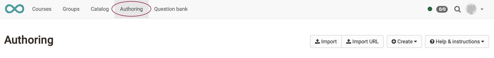{ class="shadow lightbox" title="Main navigation of OpenOlat" }

!!! tip "Tip"

    It may be necessary to log out and log in again so that the menu item is visible to you after the author role has been activated.

[To the top of the page ^](#my_first_course)

---

## 2. Enter authoring area {: #enter_authoring_area} 

After opening the authoring area, you will see an empty list, because you have not created your own courses yet.

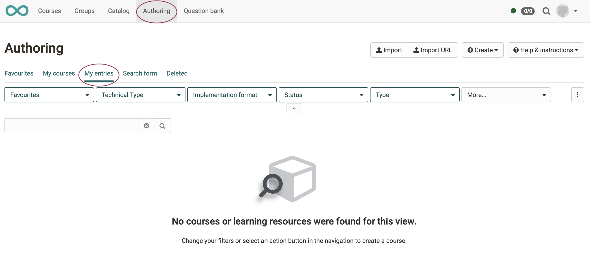{ class="shadow lightbox" title="Tab My entries in Authoring" }

If you use the search mask, you will also find courses and learning resources from other authors. However, only those,

* which have already been published by fellow authors 
* and access by other authors has been allowed.

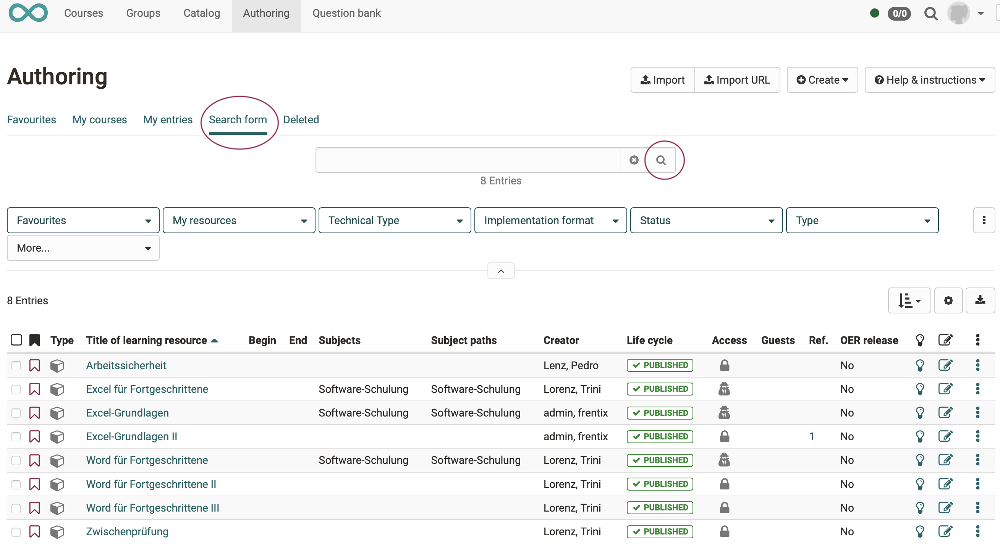{ class="shadow lightbox" title="Tab Search form in Authoring" }

!!! note "Note"

    You can click on the magnifying glass icon without entering a search term. This will show you <b>all</b> available courses and learning resources.
    You can then filter the search results using the filter options.

[To the top of the page ^](#my_first_course)

---

## 3. Create a new course {: #create_course} 

The button for creating new courses and other learning resources is located in the authoring area in the upper right corner. Create a new course here.

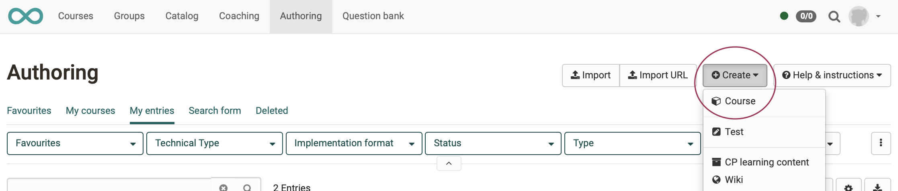{ class="shadow lightbox" title="Button Create in Authoring" }

You will be asked right at the beginning whether you want to create a <b>learning path course</b> or a <b>conventional course</b>.

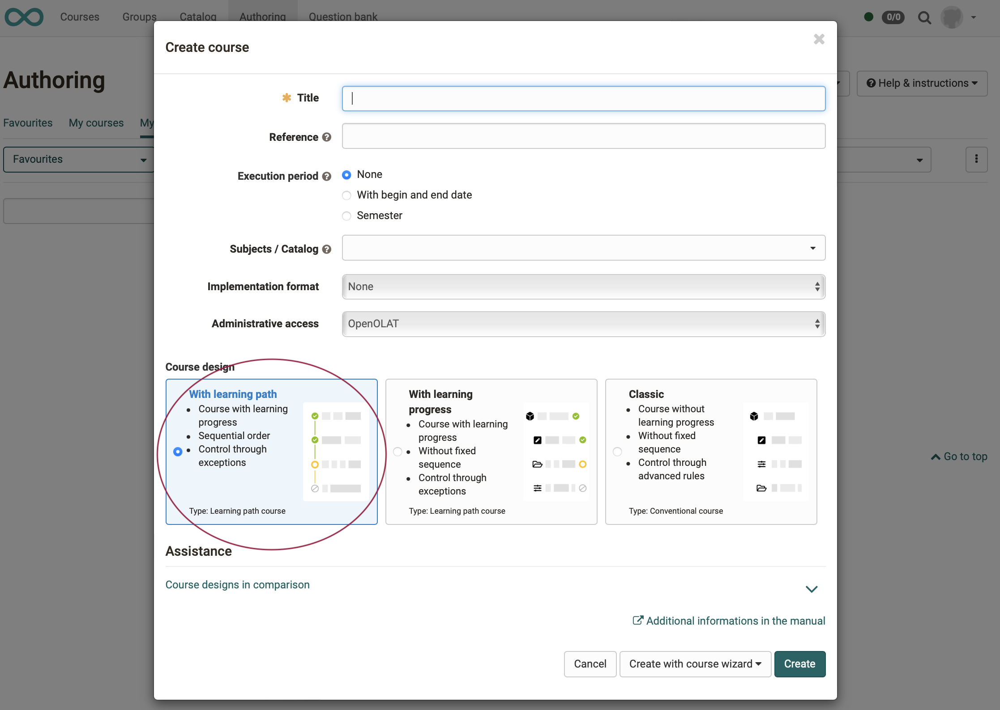{ class="shadow lightbox" title="Dialog Create course" }

In order for the course to be saved, it is mandatory to have a title. The other information you can also add and edit at a later time.

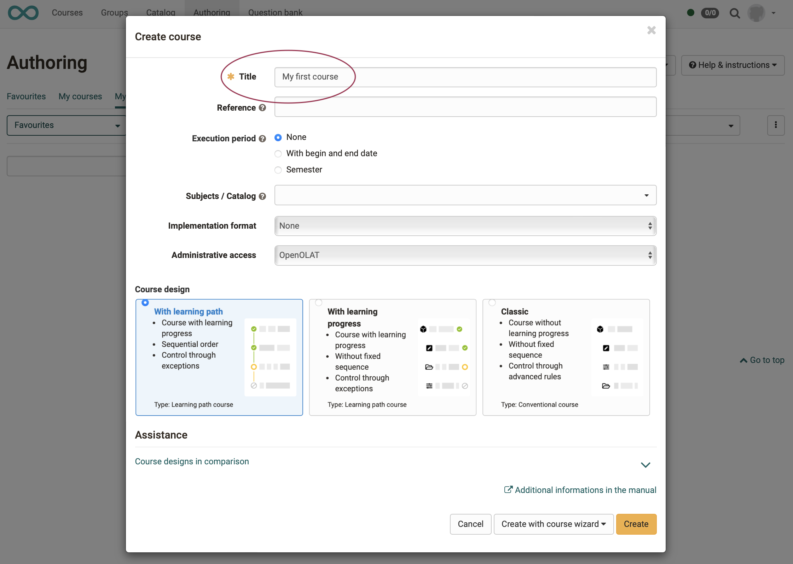{ class="shadow lightbox" title="Dialog Create course" }

By clicking on the help "Course designs in comparison" you can learn about the differences of the course designs.

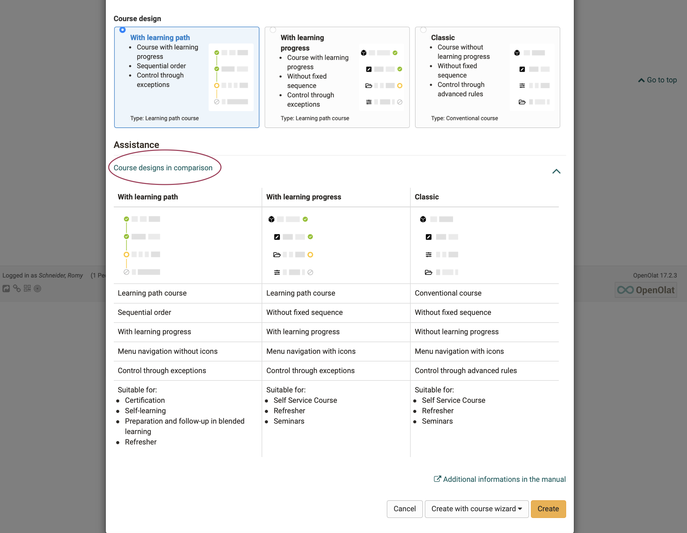{ class="shadow lightbox" title="Assistance in the dialog Create course" }

!!! note "Note"

    It is possible to be guided through the creation of the course by a course wizard. In this manual, however, the procedure is presented in individual steps for better understanding.

(Call the wizard in the lower right corner.)

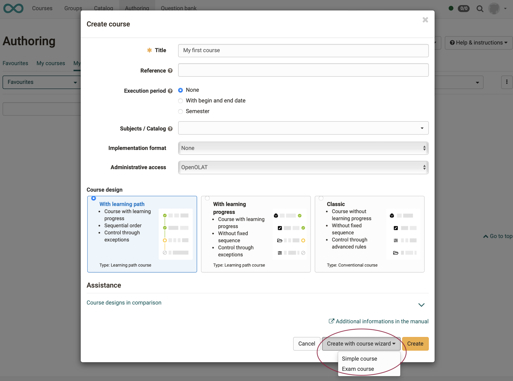{ class="shadow lightbox" title="Dialog Create course" }

To complete this step, click on "<b>Create</b>".

[To the top of the page ^](#my_first_course)

---

## 4. Make course settings {: #config_course} 

Immediately after the new course is created, you will get to the settings. In each of the tabs there you can make detailed specifications. For the beginning we will use the default settings. 
Later on you can recall and edit these course settings at any time under `Course > Administration > Settings`. 
The individual steps are explained in detail in the user manual: [Course Settings >](../../manual_user/learningresources/Course_Settings/index.md). 
(This process is often referred to as course configuration. Unlike [configuration of course elements](#configure_course_elements).)

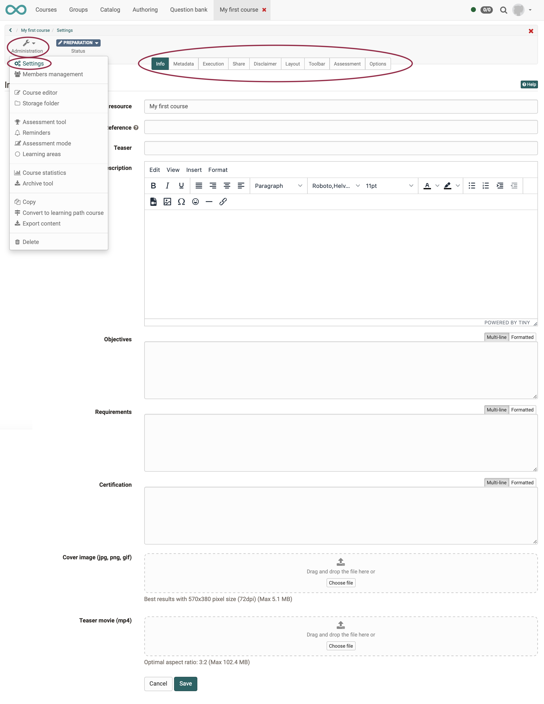{ class="shadow lightbox" title="Course settings, tab Info" }

The settings made here <b>apply to the course as a whole</b>. If you have then inserted course elements in the next step, you can also make settings there. There, the settings apply only to the currently selected course element.
 
!!! note "Note"

    Don't forget to save!

[To the top of the page ^](#my_first_course)

---

## 5. Add course elements {: #add_course_elements} 

An OpenOlat course consists of course elements. The order of the selected course elements is reflected in the <b>course menu</b>.

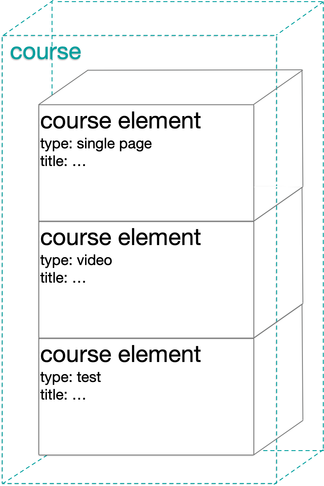{ width=240px class="lightbox" title="Course built from course elements" }

To edit and add new course elements, open the <b>course editor</b>. You can recognize that you are in the editor by the <b>shaded header</b>.

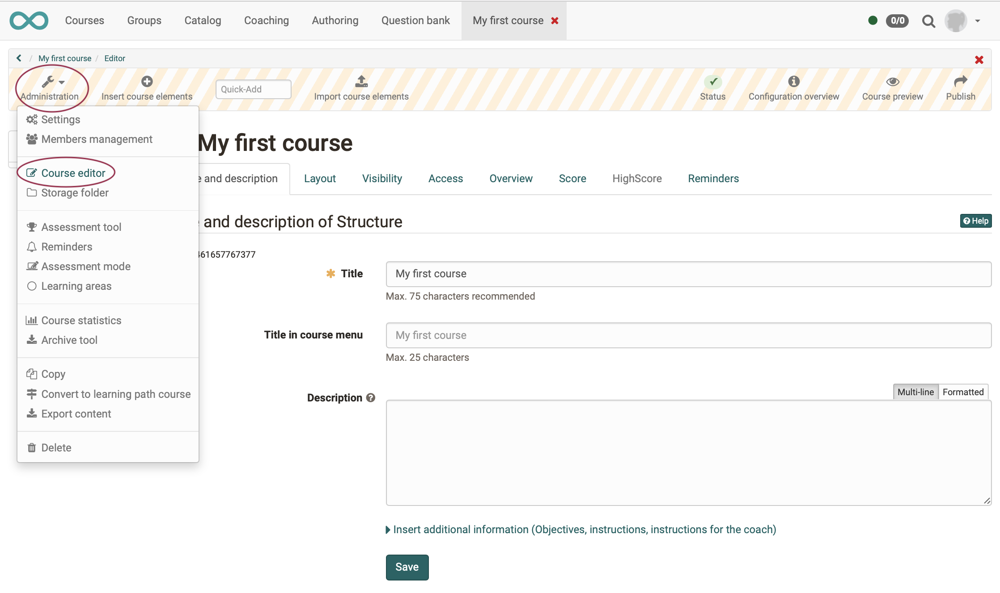{ class="shadow lightbox" title="Course editor with menu Administration" }

By clicking on the icon <b>"Insert course elements"</b> you open a selection of available course elements.

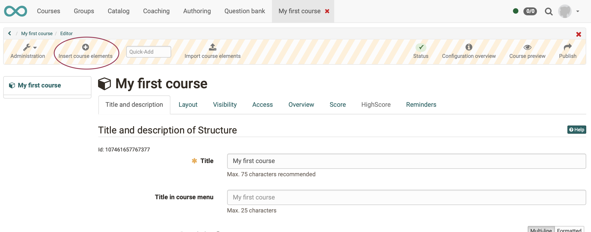{ class="shadow lightbox" title="Toolbar of the course editor" }

Clicking on one of the listed elements will insert a course element of this type in the course.

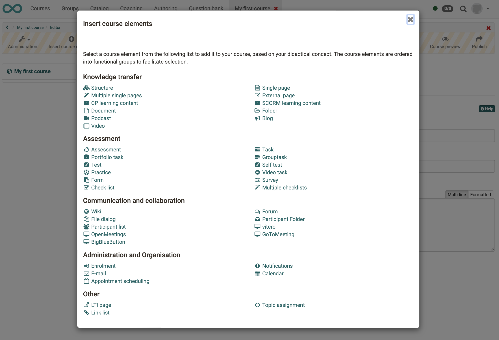{ class="shadow lightbox" title="Dialog Insert course elements" }

After insertion, the course elements can be <b>moved</b> in the course menu with the <b>mouse button pressed</b>. If you drag a course element onto a structure element, it will be placed there as a subordinate element. (Structure elements can be collapsed so that their content is hidden and the menu becomes clearer).

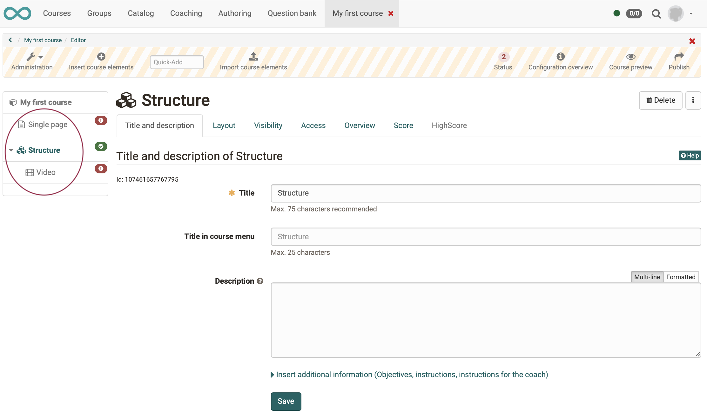{ class="shadow lightbox" title="Course menu in the course editor" }

[To the top of the page ^](#my_first_course)

---

## 6. Configure course elements and add learning resource  {: #configure_course_elements} 

!!! note "Note"

    To configure a course element, you remain in the course editor. (In contrast to configuring the course as a whole, see point 4).

To edit a course element, select the course element on the left in the <b>course menu</b>. Then the options for configuring this course element are displayed in several tabs on the right.

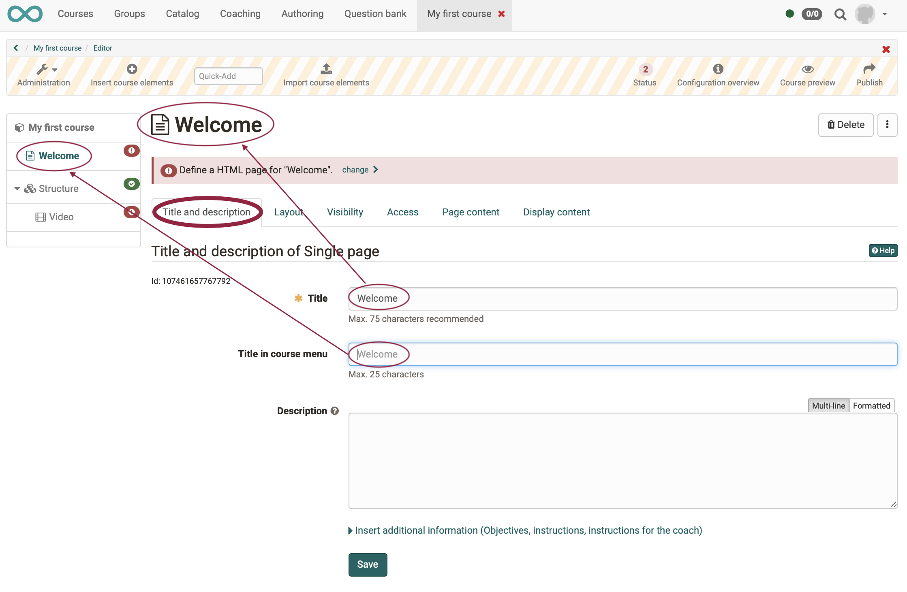{ class="shadow lightbox" title="Tab Title and description in the course editor" }

Many course elements require a learning resource. Think of the course elements as containers into which a learning resource must be inserted.

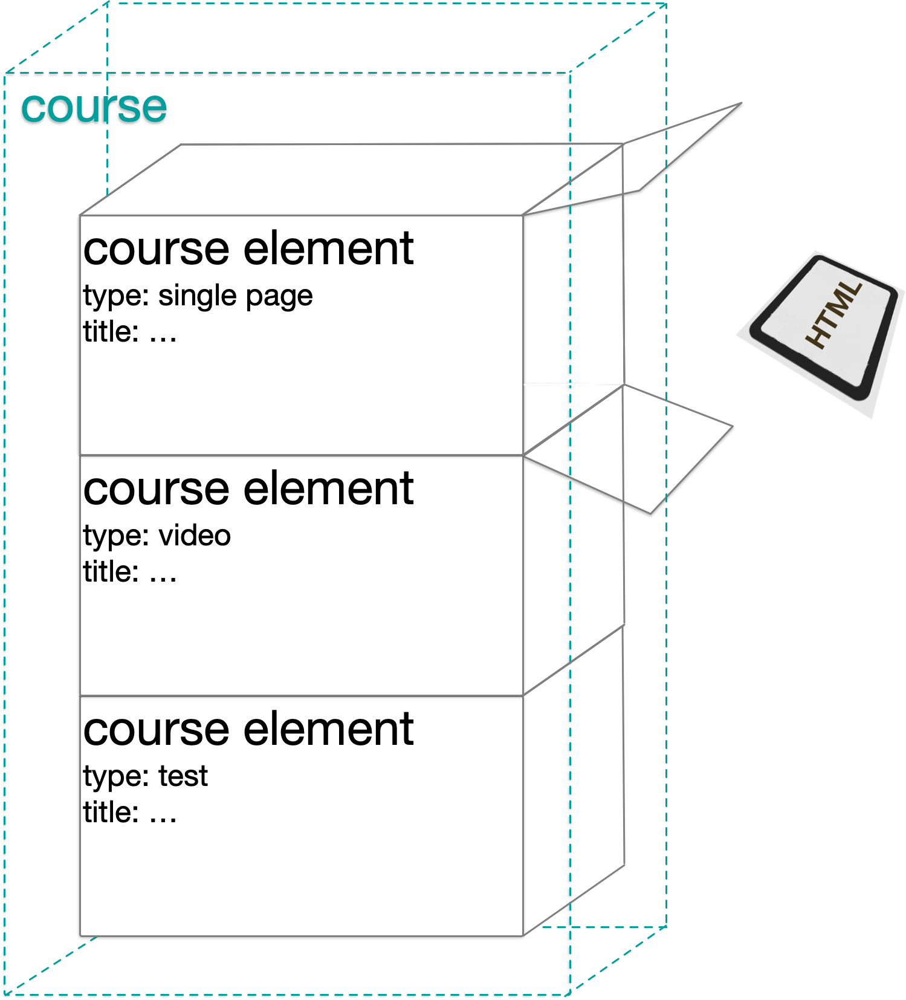{ width=300px class="lightbox" title="Course element and learning resource" }

<h3>Example 1</h3> 
The course element of the type <b>"Single page"</b> requires an <b>HTML file</b> as learning resource. In the tab <b>"Page content"</b> you can create a new HTML file, include an already existing one in OpenOlat or import an HTML file created elsewhere into OpenOlat.

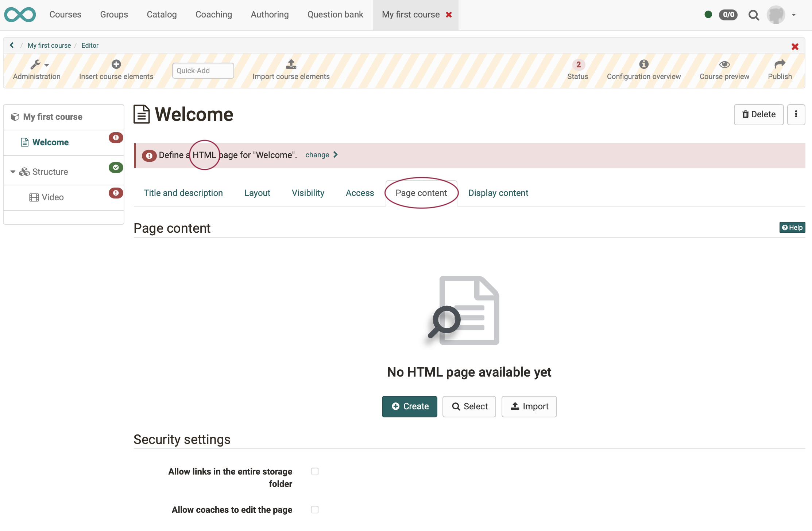{ class="shadow lightbox" title="Course element Single page in the course editor" }

<h3>Example 2</h3> 
The course element of the type <b>"Video"</b> requires an <b>mp4 file</b> as learning resource.

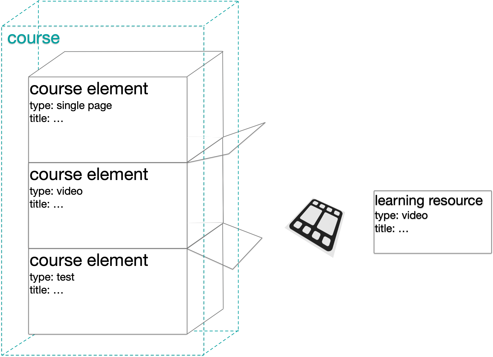{width=470px class="lightbox" title="Course element Video and learning resource" }

For example, if it is desired that the video is considered "viewed" when 95% has actually been viewed, then this <b>configuration is done on the course element</b>. The configuration is added on the container and not on the learning resource.

This concept has the advantage that the mp4 file (learning resource) can be exchanged without the course element disappearing from the course menu and having to be configured completely from scratch.
  

There are also <b>configuration options of the learning resource</b>, such as annotations (notes).

If the video learning resource is used in different courses and course elements, these annotations will be present in all course elements in which this learning resource is included.

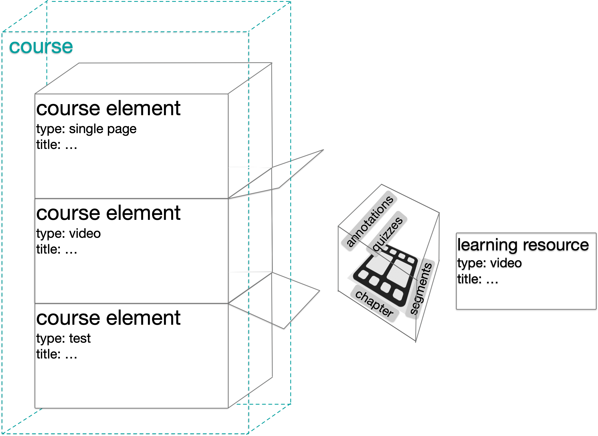{ width=470px class="lightbox" title="Configuration of the learning resource video" }

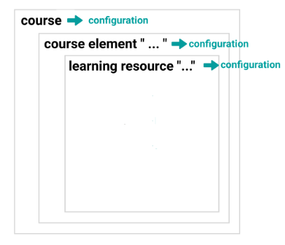{ class="lightbox" title="Three levels of configuration" }

[To the top of the page ^](#my_first_course)

---

## 7. Check your work result {: #check_result} 

In the course menu (as long as you are in the course editor) you will see small symbols on the course elements. They indicate if the configuration of a course element is still incomplete or incorrect.

In the header of the course editor, a click on the small red number (if there are errors) opens a popup that lists all incomplete course elements. There you can jump directly to the affected course elements.

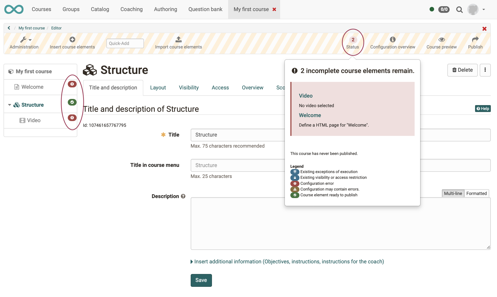{ class="shadow lightbox" title="Status in the course editor" }

When you work as an author in the course editor, you do it in the role of the <b>owner</b> of this course. After leaving the course editor (step 8), you can also switch to the <b>participant view</b> to check the work result.

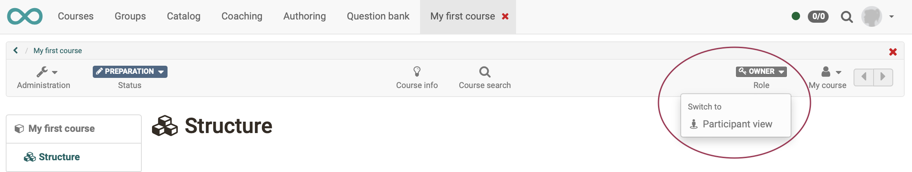{ class="shadow lightbox" title="Toolbar of the course" }

[To the top of the page ^](#my_first_course)

---

## 8. Publish course {: #publish_course} 

Are all desired course elements inserted and configured?
To <b>exit the course editor</b> click on

* the <b>"Publish" icon</b> (step-by-step procedure)  or
* the <b>red cross</b> in the upper right corner (abbreviated procedure)  or
* the <b>breadcrumb</b> (abbreviated procedure)

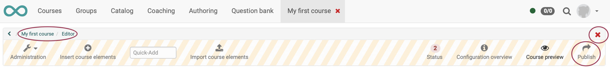{ class="shadow lightbox" title="Header of the course editor" }

When publishing (leaving the course editor) OpenOlat checks if the course is technically executable.

!!! note "Note"

    If a course element is not included in the menu after publishing, OpenOlat has discovered that this course element was incomplete and deactivated it for the executable course. When you go back to the course editor, this course element is still present there. It has a red icon because, for example, a learning resource is still missing. (See step 7)

!!! note "Note"

    Do not confuse <b>"Publish"</b> with <b>"Change status to published"</b> (step 10).
    After publishing, your course is not yet available to others. This happens only when you change the status to "published".

[To the top of the page ^](#my_first_course)

---

## 9. Add members {: #add_members} 

Your course is now ready to run, but has not yet the status "published". If you already know by name which people should have access to this course, you can add these people to the course as course members. To do this, go to the member administration of your course.

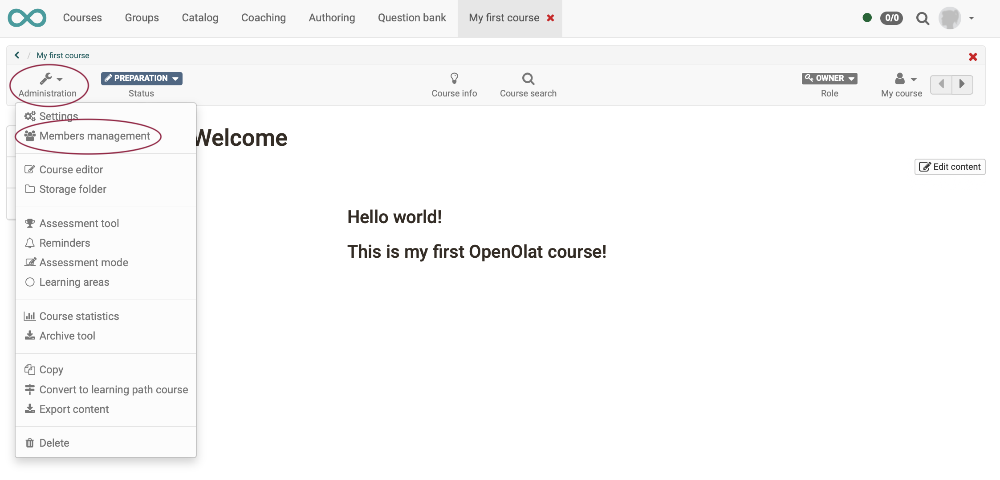{ class="shadow lightbox" title="Menu Administration in the course" }

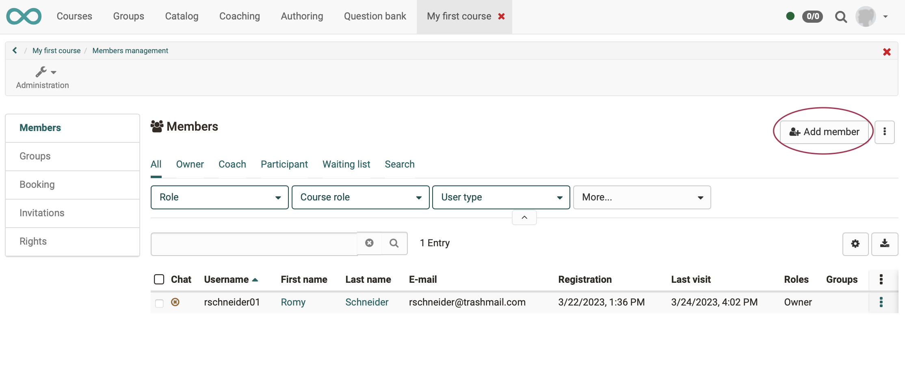{ class="shadow lightbox" title="Members management, section Members" }

!!! note "Note"

    There are various ways in which a course can obtain members. E.g. also by people registering themselves. More about this can be found elsewhere in the manual.

[To the top of the page ^](#my_first_course)

---

## 10. Change status {: #change_status} 

If a new course is created, it initially always has the <b>status "Preparation"</b>. This means that only you as the author can see the course. It is located in the workshop (authoring area) on your personal workbench, so to speak.

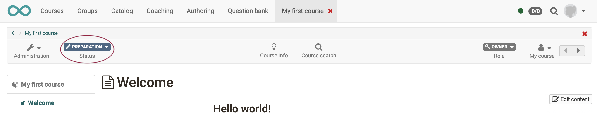{ class="shadow lightbox" title="Toolbar of the course" }

By clicking on "Preparation" you can select another status. The following states are possible:

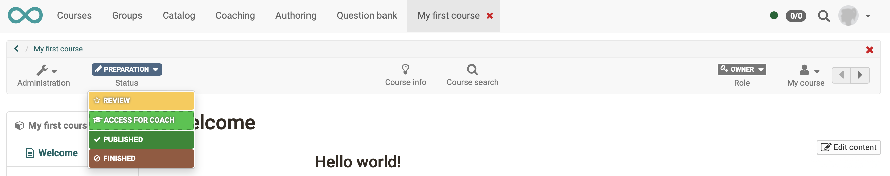{ class="shadow lightbox" title="Toolbar of the course" }

Status| Access|
---|---|
<b>Preparation</b> | Only owners of this course have access to it.|
<b>Review</b> | Only owners of this learning resource have access. All preparations for this learning resource have been completed and the content has been released for further review.
<b>Access for coach</b> | The course can be opened by coaches of this course in addition to the author (course owner).
<b>Published</b> | The course can now also be found in the "Courses" area. It can be opened and visited by all authorized persons (participants, coaches, possibly guests).
<b>Finished</b> | The course can still be opened and viewed by course members, but no more edits are possible (tests, forms, etc.)

To make your first own course visible to other OpenOlat users now, change the status to <b>"Published"</b>. The course has then been brought from your workbench to the sales floor, so to speak.

[To the top of the page ^](#my_first_course)

---

### Display in catalog {: #display_in_catalog}

If you wish, you can also include your course in the <b>OpenOlat catalog</b>, figuratively putting it in the shop window.

To do this, you release it in the course settings. 

Furthermore, an offer must be created for the catalog and the course must be made bookable. (Until now, we have only granted access to your course to manually selected members (= release "Private")).

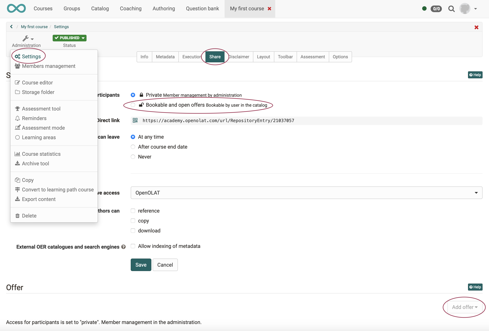{ class="shadow lightbox" title="Tab Share of the course settings" }

!!! tip "Tip"

    A prerequisite for publishing in the catalog is, of course, that the administration has set up a catalog. You can recognize it by whether the site "Catalog" is displayed in the main navigation.

[To the top of the page ^](#my_first_course)

---

## Further information {: #further_information}

[Overview authoring area >](../../manual_user/area_modules/Authoring/index.md) 
[General information on courses >](../../manual_user/learningresources/General_Information/index.md) 
[Creating courses >](../../manual_user/learningresources/Creating_Course.md) 
[Create courses and learning resources >](../../manual_user/area_modules/authoring_new_course.md) 
[Learning path courses >](../../manual_user/learningresources/Learning_path_course/index.md) 
[Creating learning path courses >](../../manual_user/learningresources/Creating_learning_path_courses.md) 
[Course elements >](../../manual_user/learningresources/Course_Elements/index.md) 
[Course elements in the Course editor >](../../manual_user/learningresources/General_Configuration_of_Course_Elements.md) 
[Course settings >](../../manual_user/learningresources/Course_Settings/index.md) 
[Deleting, Moving and Copying Course Elements >](../../manual_user/learningresources/Deleting_Moving_and_Copying_Course_Elements.md) 
[Design possibilities of courses and course elements >](../../manual_user/learningresources/Design_possibilities_of_courses_and_course_elements.md) 
[Members management >](../../manual_user/learningresources/Members_management.md) 
[How do I present my courses in the OpenOlat catalog? >](../../manual_how-to/catalog/catalog.md) 

[To the top of the page ^](#my_first_course)